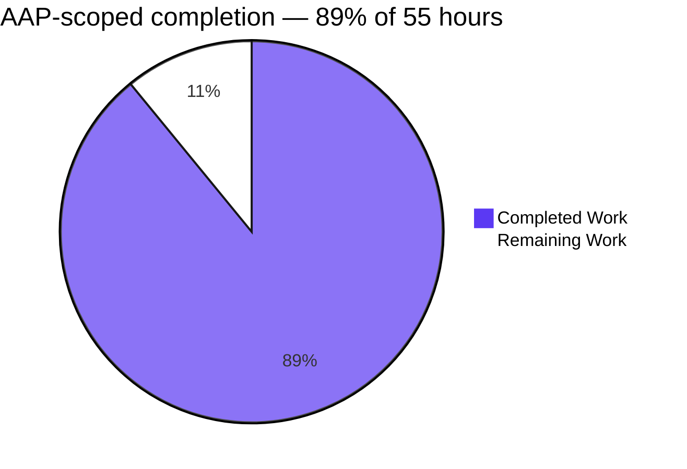
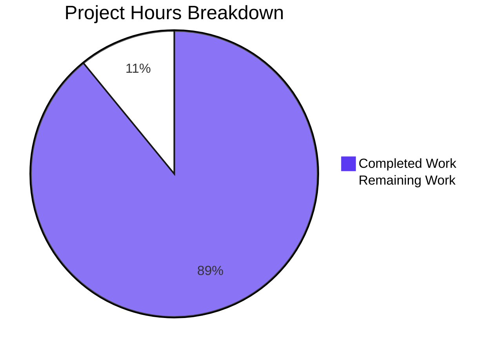
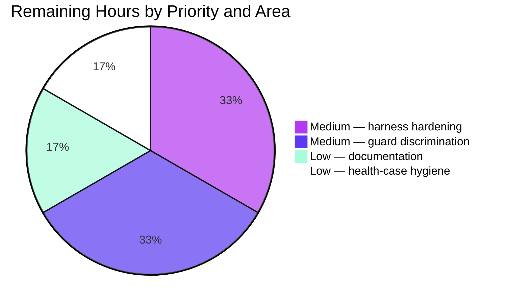

# 1. Executive Summary

## 1.1 Project Overview

The warehouse-catalogue-api is a small Express service holding a product catalogue and its shipments in memory behind six JSON routes: liveness, inventory intake and listing, shipment creation and lookup, and dispatch. This release raises integration-level coverage of that business behaviour from 0 of 12 counted behaviours to 12 of 12 — every documented status, body, default and refusal now asserted over a real socket against the real parser, router and registers. It is written for the team maintaining the service and any gate built on its suite. Four files are added and none is changed.

## 1.2 Completion Status

Completion is measured on the AAP's basis — the 12 counted behaviours plus the path-to-production work those deliverables need — and from hours, not case counts: 49 ÷ 55 = 89.1%, reported as **89%**.



| Metric | Hours |
|---|---|
| Total Hours | 55 |
| Completed Hours (Baseline: Human with agentic-assist) | 49 |
| Remaining Hours | 6 |

## 1.3 Key Accomplishments

- Twelve integration cases in three route-group files plus a shared harness drive every counted behaviour over a real listening socket.
- Intake: defaulted, explicit and zero `reorderLevel`, accepted zero quantity, duplicate refusal, four malformed payloads storing nothing.
- Shipments: `SHP-<n>` minting, exact decrement, over-ship refusal with the would-be id absent, three quantity refusals, unknown SKU, lookup `404`.
- Dispatch: bodyless default carrier, explicit override, a repeat refusal that discriminates a mutate-before-guard handler, `404` for an absent id.
- Gate green and deterministic: 13 pass, 0 fail, 0 skipped, 0 todo, ~133 ms, `src/server.js` at 100% line, branch and function.
- Production code, manifest and the pre-existing health case byte-identical; no dependency, script, threshold or pipeline added.

## 1.4 Critical Unresolved Issues

**0 of the 12 counted behaviours is open.** Four items remain open around them; none blocks release.

| Issue | Impact | Owner | ETA |
|---|---|---|---|
| Two rejection branches of the shared harness have no case, and its requests carry no timeout (test-support/harness.js:41-48, :103-108) | A regression in those guards, or a request that is never answered, would show as a stalled run rather than a failing case | Suite maintainer | 2h |
| Guard discrimination gaps: the stock guard is never exercised at equality and guard precedence between the SKU look-up and the quantity check is unasserted (src/server.js:25-30) | A `<`→`<=` inversion of the stock guard, or a reorder of the two guards, would pass the suite | Suite maintainer | 2h |
| The repository's gap list and run instructions still describe the pre-change state (README.md:7, :12-13) | A new reader is told only the health route is tested, and that `npm start` runs the service when it binds nothing | Repository owner | 1h |
| The pre-existing health case keeps a host-less bind and a header that says full workflow coverage is absent (test/routes.test.js:5-6, :8) | Its listener is reachable on every interface for the case's lifetime, and the comment misdescribes the suite | Repository owner | 1h |

## 1.5 Access Issues

No access issues identified. Neither the suite nor the service needs a credential, secret, environment variable, database or network access: every case binds an OS-assigned loopback port, the only dependency is the pinned `express` package, and nothing in the checkout authenticates.

## 1.6 Recommended Next Steps

1. **[High]** Decide the service's production hardening — authentication, durable state, header stripping, an `express` upgrade — as separate work (Section 6).
2. **[Medium]** Close the two guard-discrimination gaps and give every loop variant its own case (2h).
3. **[Medium]** Cover the harness's two rejection branches and bound its requests with a timeout (2h).
4. **[Low]** Refresh the gap list and run instructions, and align the pre-existing health case (2h).

# 2. Project Hours Breakdown

## 2.1 Completed Work Detail

| Component | Hours | Description |
|---|---|---|
| Shared integration-test harness | 10 | `test-support/harness.js`: `startApp` reloads `src/server.js` per case for empty registers and `SHP-1` ids, binds `app.listen(0, '127.0.0.1')` and rejects a failed boot without leaking a listener; `request` resolves its target against the base url and refuses any off-origin pathname, reporting method, path, status, content-type and url on failure; `postJson`, `getJson` and `seedItem` complete the five exports the plan requires. Traces to the harness deliverable of §0.4.3. |
| Inventory intake and listing cases | 8 | `test/inventory.test.js`: 4 cases covering the defaulted `reorderLevel` of 5, the explicit override, the explicit `0` and accepted zero quantity, the empty and populated listing, the duplicate refusal with the stored record unchanged in every field, and four malformed-payload refusals. Traces to §0.1.2 requirements 1, 6, 7, 9. |
| Shipment creation and lookup cases | 9 | `test/shipments.test.js`: 5 cases covering `SHP-<n>` minting with the exact stock decrement, the over-ship refusal with stock intact and the would-be id absent, three invalid-quantity refusals, the unknown-SKU refusal, and lookup with its `404`. Traces to §0.1.2 requirements 3, 4, 5, 8, 10. |
| Dispatch cases | 6 | `test/dispatch.test.js`: 3 cases covering the bodyless default carrier `standard`, the explicit `dhl` override, both re-read through the lookup route, the repeat-dispatch refusal that would expose a mutate-before-guard handler, and the `404` for an absent id. Traces to §0.1.2 requirements 2, 11, 12. |
| Assertion strength and refusal discrimination | 5 | Exact-body `deepEqual` on every response, second-request proof of every state change, post-refusal proof of what stayed unchanged, labelled assertions inside the two parameterised loops, and comments that state why each refusal proves the guard rather than a mutation. Traces to §0.7.5 and §0.1.5. |
| Case isolation and determinism | 4 | Fresh module instance and its own ephemeral listener per case, API-only seeding, ids read from responses, teardown in `finally`; verified by running a single case by name and by repeating the whole suite. Traces to §0.3.3 and §0.11.1. |
| Behaviour-basis coverage accounting and traceability | 2 | All 12 high- and medium-priority behaviours mapped to the case that carries each, at 12 of 12 against the closed counted basis, with the two excluded framework behaviours left untested by design. Traces to §0.7.1 and §0.7.3. |
| Verification runs | 3 | Baseline of the pre-existing case, per-file runs (1/4/5/3), whole-package runs (13/13, repeated), the coverage diagnostic, and `node --check` over every tracked `.js` file. Traces to §0.9.4. |
| Convention fidelity and case naming | 2 | Sentence-style case names matching the pre-existing register and the twelve names fixed by the plan, the repository's import, boot, `fetch`, `deepEqual` and close-in-`finally` shape in all three files, and JSDoc on the harness's exported helpers. Traces to §0.7.5 and §0.5.2. |
| **Total Completed** | **49** | Sum of the rows above; equals Completed Hours in Section 1.2. |

## 2.2 Remaining Work Detail

| Category | Hours | Priority |
|---|---|---|
| Harness rejection branches and a request bound: cases for the off-origin and null-address rejections, and a timeout so a never-answered request fails instead of stalling the run (traces to the harness deliverable and the assertion-density requirement) | 2 | Medium |
| Guard-discrimination assertions: shipping exactly the stock on hand is accepted, the SKU look-up answers before the quantity guard, and each loop variant gets its own case so every iteration is evaluated in one run (traces to requirements 3 and 5 and the assertion-density requirement) | 2 | Medium |
| Repository gap list and run instructions: describe the delivered suite per route group and name the entrypoint that listens rather than `npm start` (traces to the documentation boundary the plan fixed) | 1 | Low |
| Pre-existing health case alignment: refresh the header comment and pass the loopback host, as the shared harness does (traces to the untouched-file boundary the plan fixed) | 1 | Low |
| **Total Remaining** | **6** | Sum of the rows above; equals Remaining Hours in Section 1.2 and the "Remaining Work" value in Section 7. Completed 49 + remaining 6 = 55 total project hours. |

# 3. Test Results

Every figure below was produced by a run against this checkout on Node.js v22.23.5 with `express` 4.21.2 installed.

| Area / Category | Framework | Tests | Passed | Failed | Coverage | What This Proves |
|---|---|---|---|---|---|---|
| Inventory intake and listing (`test/inventory.test.js`) | `node:test` | 4 | 4 | 0 | `src/server.js` 100% line / branch / function (whole-suite diagnostic) | A valid item is stored with the code's own `reorderLevel` of 5, an explicit override and an explicit `0` are honoured, the listing is empty before any write and complete afterwards, and the duplicate and four malformed payloads store nothing |
| Shipment creation and lookup (`test/shipments.test.js`) | `node:test` | 5 | 5 | 0 | same diagnostic | Stock decrements by exactly the shipped amount, `SHP-<n>` ids are minted, an over-ship leaves stock and shipments untouched with the would-be id absent, and every invalid quantity, absent SKU and unknown id is refused with its documented body |
| Dispatch (`test/dispatch.test.js`) | `node:test` | 3 | 3 | 0 | same diagnostic | The route supplies its own carrier when none is sent and records an explicit one, a second dispatch is refused without altering the stored record, and an absent id answers `404` from the look-up guard |
| Service liveness (pre-existing case, `test/routes.test.js`) | `node:test` | 1 | 1 | 0 | same diagnostic | The health contract still answers `200 {"status":"ok"}` unchanged after the additions |
| Whole-package gate (`node --test`, identical to `npm test`) | `node:test` | 13 | 13 | 0 | 100% line / branch / function on `src/server.js`; ~133 ms; two repeat runs identical | The twelve behaviours and the pre-existing case hold together on a clean boot, deterministically, with zero failed, skipped, todo or cancelled cases |
| Coverage diagnostic (`--experimental-test-coverage --test-coverage-include='src/**'`) | `node:test` | 13 | 13 | 0 | `src/server.js` 100.00 line / 100.00 branch / 100.00 function, no uncovered lines | Every handler, guard and default in the only module that implements behaviour is entered by the suite |

Per file, run alone: `test/routes.test.js` 1/1, `test/inventory.test.js` 4/4, `test/shipments.test.js` 5/5, `test/dispatch.test.js` 3/3. A single case by name also passes. The coverage figure covers `src/server.js` only; `src/index.js` is not loaded by any test.

**Not Covered** — delivered behaviour that no test exercises, and what a human should check before relying on it:

- **The harness's own rejection branches.** `request()`'s off-origin refusal (test-support/harness.js:103-108) and `startApp()`'s null-address rejection (:41-48) are never reached by the suite; they were verified only by driving the helper directly. A dedicated case per branch would keep them from drifting.
- **The stock guard at equality.** Shipping exactly the stock on hand is not asserted anywhere, so a `<`→`<=` inversion of src/server.js:30 would keep the suite green. Verified correct in the running build (a shipment of 7 against 7 stock answers `201`).
- **Guard precedence.** No case sends an unknown SKU carrying an invalid quantity, so a reorder of src/server.js:26-29 would go unnoticed. The running build answers `404 sku not found`.
- **Later variants of the two parameterised loops.** `test/shipments.test.js:72` and `test/inventory.test.js:157` stop at the first failing iteration, so a regression in the last variant surfaces only after the earlier ones are corrected.
- **The framework's own request handling.** A malformed JSON body (`400`), an oversized body (`413`), an unmatched route (HTML `404`) and the `PORT` default in `src/index.js` have no case and no contract; they are outside the counted basis by design.
- **The service bootstrap.** `src/index.js` is loaded by no test, so nothing proves it binds, and `npm start` binds nothing at all (package.json:5 runs `node src/server.js`, which only exports the app).
- **Id sequences beyond two shipments, deletion and large registers.** Every case mints at most two shipments, so an id-minting defect that needs a deletion or a large register would not be caught.
- **Field shapes the contracts do not name.** `destination` omitted (the key vanishes from the response), a non-string `carrier`, an unvalidated `reorderLevel`, and non-ASCII or quote-bearing names are all unexercised.
- **Concurrency, load and multi-process behaviour.** Nothing asserts what two simultaneous shipments of the same stock do, and all state is per process.

# 4. Runtime Validation & UI Verification

Every line below was driven against the service as it stands at HEAD, on `PORT=34771 node src/index.js`, with `curl` over loopback.

- ✅ **Service startup and liveness** — `warehouse API listening on 34771` on an empty stderr; `GET /health` answered `200 {"status":"ok"}` on the first request.
- ✅ **Inventory intake and listing** — `201` with `reorderLevel: 5` when omitted, `12` when overridden, `0` when explicitly sent, and `quantity: 0` accepted, all visible in the listing; `409 {"error":"duplicate sku"}` with the stored record unchanged; `400 {"error":"invalid inventory payload"}` for a missing `sku`, a missing `name`, a fractional and a negative quantity; `200 []` before any write.
- ✅ **Shipment creation, decrement and lookup** — `201 {"id":"SHP-1",…,"status":"created"}`, listing quantity `10 → 7`, then `200` on `GET /shipments/SHP-1` and `404 {"error":"shipment not found"}` for `SHP-99`.
- ✅ **Over-ship and invalid-quantity refusals** — `409 {"error":"insufficient inventory"}` with stock intact and `SHP-2` absent; `400 {"error":"quantity must be positive"}` for `0`, `-2` and `1.5`.
- ✅ **Dispatch** — bodyless `200` with `status: "dispatched"` and `carrier: "standard"`, explicit `200` with `carrier: "dhl"`, both persisted on a later `GET`.
- ✅ **Dispatch refusals** — `409 {"error":"shipment cannot be dispatched"}` for a repeat (with and without a carrier) leaving status and carrier unchanged; `404 {"error":"shipment not found"}` for an absent id.
- ✅ **Boundary behaviour outside the contracts** — a shipment of exactly the remaining stock answered `201` and left stock at 0; an unknown SKU carrying an invalid quantity answered `404` before `400`.
- ✅ **Shared harness behaviour** — the listener answers on loopback and refuses an off-host connection, off-origin pathnames are refused before any request is sent, and two successive `close()` calls both resolve.
- ⚠ **Service entrypoint and envelope** — `npm start` exits 0 in under a second with nothing bound; only `PORT=<port> node src/index.js` listens, a duplicate bind fails with `EADDRINUSE`, every response carries `X-Powered-By: Express`, and the production bootstrap binds every host interface while the test harness binds loopback only.

❌ **No user interface to verify.** The deliverable is a JSON HTTP API with no HTML, script, stylesheet or asset route, so there is no browser surface: no screen, navigation or visual state was driven.

**Never exercised at runtime:** the framework's own rejections (malformed JSON `400`, oversized body `413`, unmatched-route HTML `404`), the `PORT` default in `src/index.js`, concurrent or out-of-order requests against the same stock, multi-process or replica behaviour, and any field shape the twelve contracts do not name (omitted `destination`, non-string `carrier`, unvalidated `reorderLevel`, non-ASCII names).

# 5. Compliance & Quality Review

## 5.1 Compliance Matrix

| Deliverable | Verified state at HEAD | Status |
|---|---|---|
| Behaviour 1 — intake stores a valid item with the default `reorderLevel` of 5, an override stored instead, and the record readable | Asserted on the response and re-read through the listing (test/inventory.test.js:14-86); reproduced live | ✅ Pass — 100% |
| Behaviour 2 — dispatch flips a `created` shipment to `dispatched`, defaults the carrier to `standard`, records an explicit one, both visible on a later read | Asserted twice and re-read twice (test/dispatch.test.js:7-63); reproduced live | ✅ Pass — 100% |
| Behaviour 3 — over-ship refused with `409`, stock unchanged, the would-be id not retrievable | Three independent observations in one case (test/shipments.test.js:38-64); reproduced live | ✅ Pass — 100% |
| Behaviour 4 — creation returns `SHP-<n>` with `status: created` and decrements stock by exactly the shipped amount | Exact five-field body plus id pattern plus listing re-read (test/shipments.test.js:7-36); reproduced live | ✅ Pass — 100% |
| Behaviour 5 — zero, negative and fractional quantities refused with `400` and no stock movement | All three variants asserted with labels, stock and ids re-checked (test/shipments.test.js:66-99); reproduced live | ✅ Pass — 100% |
| Behaviours 6-9 — listing empty then complete, duplicate refusal with the record intact, unknown SKU `404`, malformed intake storing nothing | One case each with post-refusal state proof (test/inventory.test.js:92-180, test/shipments.test.js:101-122); reproduced live | ✅ Pass — 100% |
| Behaviours 10-12 — lookup `200`/`404`, repeat-dispatch refusal, unknown-id `404` with the guard ahead of the mutation | One case each, the repeat refusal discriminating a mutate-first handler (test/shipments.test.js:124-159, test/dispatch.test.js:65-126); reproduced live | ✅ Pass — 100% |
| Integration level, shared harness and per-case isolation | Real socket, real parser, real router and registers; five exports; fresh module and ephemeral loopback listener per case (test-support/harness.js) | ✅ Pass — 100% |
| Assertion density and refusal discrimination | Exact bodies, second-request state proof and labelled variants throughout; the equal-stock boundary and guard precedence are unasserted and the loops stop at the first failing variant | ⚠ Partial — 80% |
| Coverage target on the counted behaviour basis (≥90%) | 12 of 12 high- and medium-priority behaviours carry a passing integration case — 100%, above the 11-of-12 = 91.7% minimum | ✅ Pass — 100% |
| Production immutability, dependency fence and tooling restraint | `src/`, `package.json`, `README.md` and `test/routes.test.js` byte-identical to the branch point; `express` still `4.21.2`; `devDependencies` still `{}`; no threshold, lint, reporter or pipeline added | ✅ Pass — 100% |
| Conventions, naming and hygiene | Sentence-style names matching the pre-existing register and the twelve planned names; no `.only`, `.skip`, `todo` mark, placeholder or commented-out case anywhere | ✅ Pass — 100% |

## 5.2 AAP & Rule Divergences and Gaps

| What the AAP/Rule Required | What Was Delivered Instead | Why It Diverged | Impact | Remediation |
|---|---|---|---|---|
| §0.4.4's requirement-1 row illustrates two intake records (`SKU-INV-01` defaulted, `SKU-INV-02` with `reorderLevel: 12`) and a listing of "both records" | The same case drives four records, adding a zero-quantity intake and an explicit `reorderLevel: 0`, and asserts the listing holds all four (test/inventory.test.js:41-86) | The row's own contract — `201`, exact body, re-read by sku — is unchanged, and the accepted-zero boundary can only be driven inside that case; **sanctioned** by the row's contract clause | None; the two original records and their proof are intact | None required. Optionally extend the row to name the zero-boundary records |
| §0.4.4's requirement-7 row illustrates the refused duplicate payload as `{name:'Bolt', quantity:99}` | The refused payload is `{name:'Nut', quantity:99, reorderLevel:99}` (test/inventory.test.js:127-134) | The same row requires proof that the rejected payload never landed; with two of three fields equal to the stored record that proof is one field deep. **Sanctioned** by the row's state-proof clause | None; the `409` body and the unchanged stored record are asserted as specified | None required. Optionally align the illustrative payload with the discriminating one |
| §0.4.4's requirement-11 row says the refused repeat dispatch is sent "with no body" | The refused attempt carries `{"carrier":"dhl"}`, with a comment stating why (test/dispatch.test.js:89-94) | §0.1.5 and the plan's refusal standard require a case to expose "a guard inverted to mutate first"; a bodyless refusal makes the mutant's writes identical to the correct handler's. **Sanctioned** by §0.1.5, which outranks a request-shape detail | None; the `409`, the exact body and the unchanged status and carrier are asserted, and the bodyless form is still exercised on the dispatches that prove the carrier default (:27, :78, :116) | None required |
| The plan's §0.8.2 excludes documentation edits, so the repository's gap list stays as written | README.md:12-13 still says only the health route is tested, and README.md:7 presents `npm start` as the run command although package.json:5 runs a module that never listens | **Sanctioned** by the plan's own documentation boundary; delivering the suite did not license a side-effect documentation change | A new reader underestimates what the suite covers and will try an entrypoint that exits with nothing bound | Refresh the gap list per route group and name `PORT=<port> node src/index.js` as the entrypoint (1h) |
| §0.5.3 and §0.8.2 require `test/routes.test.js` to stay byte-for-byte as it is | That file keeps its host-less `app.listen(0)` (test/routes.test.js:8) and its header saying full workflow coverage is absent (:5-6) | **Sanctioned** by the plan's additive-only boundary; the shared harness binds loopback while this pre-existing case does not | Its listener is reachable on every interface for the case's ~100 ms lifetime, and the header now misdescribes the suite | Pass the loopback host and refresh the header in a documentation-and-hygiene change (1h) |
| The request's example of an expected-failure marker is pytest's `xfail(reason=...)` | The repository's runner is `node:test`, whose equivalent is `test(name, { todo: '<reason>' }, fn)`; no case needed it (# todo 0) | **Sanctioned** by the plan's conflict resolution: the repository has no pytest, and the mapping is recorded rather than substituted silently | None today. On Node 22 the marker is advisory — a marked case keeps the run green even if the behaviour later passes | If a mark is ever added, re-check it by hand and carry it to the pull-request summary (no hours today) |

Three of these need a human decision rather than a fix.

**Repository documentation.** The suite now asserts twelve business behaviours, but README.md:12-13 still tells a reader that only the health route is tested, and README.md:7 gives `npm start` as the way to run the service even though package.json:5 runs `node src/server.js`, which builds and exports the app and never calls `listen` — verified: it exits 0 with nothing bound, while `PORT=<port> node src/index.js` listens. The staleness was deliberate: the plan scoped this release to the test suite and forbade documentation side effects. Whoever owns the repository should decide whether the gap list is refreshed per route group and the run section corrected, or whether the README is regenerated wholesale in a separate documentation change.

**Pre-existing health case.** test/routes.test.js:8 still calls `app.listen(0)` with no host, so that case's listener accepts connections on every interface for its lifetime, and test/routes.test.js:5-6 still states that full workflow coverage is intentionally absent — which the three new files have made false. The file was required to stay byte-for-byte, and the shared harness already binds `127.0.0.1` explicitly (test-support/harness.js:26). Refreshing the header and passing the loopback host is a one-line hygiene change with no behavioural risk; the decision is whose change it belongs to.

**Expected-failure semantics.** Because this runtime has no pytest, the equivalent of `xfail(reason=...)` is `node:test`'s `todo` option, which on Node 22 still runs the case, reports it as `not ok … # TODO <reason>`, and leaves the process exit code at 0. No case needed a mark, so nothing is owed today. The decision for the suite's owner is whether any future expected failure is acceptable at all in a gate whose exit code cannot see it, or whether a failing case should always fail the run.

# 6. Risk Assessment

| Risk | Category | Severity | Probability | Mitigation | Status |
|---|---|---|---|---|---|
| The stock guard is never exercised at equality (src/server.js:30), so a `<` → `<=` inversion would ship while the suite stayed green | Technical | Medium | Medium | Assert that shipping exactly the stock on hand is accepted, and that an unknown SKU carrying an invalid quantity answers `404` before `400` (Section 2.2, 2h) | Open |
| A request that is accepted but never answered stalls a run: `request()` sets no timeout and `node:test` applies no per-test timeout | Operational | Medium | Low | Add an `AbortSignal.timeout` to the shared request helper; `node --test --test-force-exit` is the recovery until then | Open |
| `express` 4.21.2 pins `qs` 6.13.0 (GHSA-6rw7-vpxm-498p, arrayLimit bypass to memory-exhaustion DoS) | Security | Low | Low | Reachable only through a query parser this service never exercises; move to a later `express` in a change that is allowed to touch the manifest | Accepted, carried |
| The service authenticates nothing, emits `X-Powered-By: Express`, and the production bootstrap binds every host interface (src/index.js:3) | Security | High | High if deployed as-is | Deploy behind an authenticating gateway that strips the header; both are production changes this test-only release cannot make | Open, outside this release |
| All state lives in two module-level `Map`s (src/server.js:5-6), so a restart discards the catalogue and shipments and two replicas never share state | Operational | High | Medium | A persistence layer is a separate feature; until then treat the service as single-process and ephemeral | Open, outside this release |
| The literal `SHP-1`/`SHP-2` assertions hold only because `startApp()` reloads the module per case | Technical | Medium | Low | Keep the reload; it is documented at test-support/harness.js:5-7 and :15-17, and any change to it will fail several cases loudly rather than silently | Mitigated, watch |
| Request fields the contracts do not name are unvalidated: `destination` optional and dropped from the response, `reorderLevel` stored verbatim, `carrier` accepted as any type, intake accepting `quantity: 0` while shipment creation refuses it | Integration | Medium | Medium | A contract decision on the request shapes, made in a change allowed to touch `src/server.js` | Open, outside this release |
| The repository's gap list and the pre-existing health case's header describe the pre-change state, so a maintainer or a future gate misjudges what the suite covers | Operational | Low | High | Refresh both in the documentation-and-hygiene change (Section 2.2, 2h) | Open |

# 7. Visual Project Status



Colours throughout: Completed Work `#5B39F3` (dark blue), Remaining Work `#FFFFFF` (white), accents `#B23AF2`, highlight `#A8FDD9`.

| Measure | Value |
|---|---|
| Total project hours | 55 |
| Completed hours | 49 |
| Remaining hours | 6 |
| AAP-scoped completion | 89% (49 ÷ 55) |
| Counted behaviours covered | 12 of 12 (100% of the counted basis) |
| Suite state | 13 tests, 13 pass, 0 fail, 0 skipped, 0 todo, ~133 ms |

Remaining work by priority, the same six hours Section 2.2 carries:



# 8. Summary & Recommendations

The warehouse-catalogue-api now has an integration suite where it previously had a liveness case and nothing else. Four files and 634 lines were added: one shared harness that boots a fresh copy of the application on an ephemeral loopback port for every case, and three route-group files carrying twelve cases that assert the exact status, the exact response body and the state that must hold afterwards for inventory intake and listing, shipment creation and lookup, and dispatch. Nothing else changed — `src/server.js`, `src/index.js`, `package.json`, `README.md` and the pre-existing health case are byte-identical to the branch point, no dependency was added, and no threshold, linter or pipeline was introduced.

What the suite proves is narrow and deliberate: 12 of 12 high- and medium-priority behaviours are covered against a closed counted basis, which clears the 90% target with one behaviour to spare, and the whole-package gate runs 13 tests to 13 passes in about 133 ms with zero failed, skipped or todo cases, repeating identically. The coverage diagnostic reports `src/server.js` at 100% of lines, branches and functions, and every requirement row was also driven by hand against a running service, from the defaulted `reorderLevel` and the accepted zero quantity through the over-ship refusal, the carrier default and the guard that answers `404` before it mutates anything.

Six hours of work remain, which is why the AAP-scoped figure is 89% (49 of 55 hours) although no counted behaviour is open. Two medium-priority items close real holes in the suite's discrimination: the stock guard is never exercised at equality, so a `<` → `<=` inversion would pass, and the order between the SKU look-up and the quantity guard is unasserted; the harness's own off-origin and null-address rejections are also untested and its requests carry no timeout, so a request that is never answered would stall a run rather than fail it. Two low-priority items are documentation and hygiene: the repository's gap list and run instructions still describe the pre-change state, and the pre-existing health case keeps a host-less bind and a header that now misdescribes the suite.

The critical path to production is not test work. Deploying this service as it stands would expose an unauthenticated, state-mutating API on every host interface, with all state lost on restart and `express` 4.21.2 pinned to a `qs` version carrying a denial-of-service advisory. Those are production changes this test-only release was forbidden to make, and each needs its own decision: authentication at the edge, a persistence layer, a manifest upgrade. The suite is ready to serve as the gate for that work today — `node --test` needs no configuration and completes in well under a second — and the four remaining items above are what stand between it and being a fully discriminating gate.

# 9. Development Guide

### System prerequisites

- **Node.js 20 or later.** The suite needs stable `node:test`, global `fetch` and the built-in coverage flags. Verified on **Node.js v22.23.5** with **npm 11.21.3** (`node --version`, `npm --version`).
- **Nothing else.** No database, broker, cache, container, virtualenv, secret or environment variable is required; `PORT` has a default. The repository declares no `engines` field, no `.nvmrc` and no CI configuration, so the installed runtime is the version of record.

### Environment setup and dependency installation

Run everything from the repository root.

```bash
# 1. Install the single pinned dependency
CI=true npm install --no-audit --no-fund

# 2. Confirm which version resolved (expect express@4.21.2)
npm ls express --depth=0
```

`node_modules/` and `package-lock.json` are install artefacts and are not tracked; leave them untracked.

**There is no build step.** The project is plain CommonJS with no transpiler, bundler or compiler, so the build-equivalent check is a syntax gate:

```bash
node --check src/server.js && node --check src/index.js
```

Expected: exit 0, no output. The same check over every tracked file is clean:

```bash
for f in src/*.js test/*.js test-support/*.js; do node --check "$f"; done
```

### Running the tests

```bash
# Whole-package gate — the command a pipeline should run
npm test              # identical to: node --test
# expected: # tests 13 / # pass 13 / # fail 0 / # skipped 0 / # todo 0  (~133 ms)

# One file
node --test test/dispatch.test.js          # 3 tests, 3 pass

# One case by name
node --test --test-name-pattern="POST /inventory rejects a duplicate SKU"

# Coverage diagnostic (diagnostic only; the repository binds no threshold)
node --test --experimental-test-coverage --test-coverage-include='src/**'
# expected: src/server.js 100.00 line / 100.00 branch / 100.00 funcs

# Recovery when a listener outlived a failed assertion and the run hangs
node --test --test-force-exit
```

A filtered run (`--test-name-pattern`) reports each test file as a top-level test, so its `# tests` total differs from 13 and must not be compared with the suite size.

### Starting the service

`src/index.js` is the only entrypoint that listens. Pick a free port; do not rely on the default 3000, which is shared on a busy host.

```bash
PORT=3000 node src/index.js
# expected: warehouse API listening on 3000
```

**Do not use `npm start`.** Its script is `node src/server.js`, a module that only builds and exports the Express app, so it exits in under a second with nothing bound.

Verification and shutdown:

```bash
curl -s http://127.0.0.1:3000/health      # {"status":"ok"} with HTTP 200
# stop the process with Ctrl-C, or: kill $(ps -eo pid,args | grep 'node src/index.js' | grep -v grep | awk '{print $1}')
```

### Example usage

With the service running on `PORT=<port>`:

```bash
B=http://127.0.0.1:<port>

# liveness
curl -s $B/health

# empty catalogue
curl -s $B/inventory                                  # []

# intake: reorderLevel defaults to 5
curl -s -X POST -H 'content-type: application/json' \
  -d '{"sku":"SKU-INV-01","name":"Bolt","quantity":10}' $B/inventory
# {"sku":"SKU-INV-01","name":"Bolt","quantity":10,"reorderLevel":5}

# create a shipment of 3: stock drops to 7
curl -s -X POST -H 'content-type: application/json' \
  -d '{"sku":"SKU-INV-01","quantity":3,"destination":"Leeds"}' $B/shipments
# {"id":"SHP-1","sku":"SKU-INV-01","quantity":3,"destination":"Leeds","status":"created"}
curl -s $B/inventory

# look it up
curl -s $B/shipments/SHP-1

# dispatch with no carrier: the route supplies "standard"
curl -s -X POST $B/shipments/SHP-1/dispatch
# {"id":"SHP-1",...,"status":"dispatched","carrier":"standard"}

# a second dispatch is refused; an unknown id is not found
curl -s -X POST -H 'content-type: application/json' -d '{"carrier":"dhl"}' $B/shipments/SHP-1/dispatch
# {"error":"shipment cannot be dispatched"}
curl -s -X POST $B/shipments/SHP-99/dispatch
# {"error":"shipment not found"}
```

Every state change is read back through a second request rather than inferred from the response, which is the pattern the test suite follows.

### Troubleshooting

| Symptom | Cause | Resolution |
|---|---|---|
| `Error: listen EADDRINUSE: address already in use :::<port>` and exit 1 | Another process holds the port; `src/index.js` has no `'error'` handler, so the bind failure is fatal | Choose another `PORT` |
| `npm start` returns immediately with nothing listening | Its script is `node src/server.js`, which never calls `listen` | Use `PORT=<port> node src/index.js` |
| `npm ls` reports a missing `express` | Dependencies are not installed in this checkout | `CI=true npm install --no-audit --no-fund` |
| A test run never exits after a failure | A listener outlived the failed assertion | `node --test --test-force-exit` |
| A case fails with a message naming a method, path, status, content-type and url | The shared harness reporting what the app actually answered | Read that message first; it names the request that produced the unexpected response |
| `could not be sent to <url>` | The listener was not reachable (closed port, wrong host) | Check the case booted through `startApp()` and closed in `finally` |
| A filtered run reports `# tests 4` | `node:test` counts each test file as a top-level test under a name filter | Compare pass/fail, not the total, in filtered runs |

# 10. Appendices

## Appendix A — Command Reference

| Purpose | Command | Observed result |
|---|---|---|
| Install dependencies | `CI=true npm install --no-audit --no-fund` | Resolves the manifest; verify with `npm ls express --depth=0` → `express@4.21.2` |
| Syntax gate (build equivalent) | `node --check src/server.js && node --check src/index.js` | Exit 0, no output |
| Whole-package test gate | `npm test` (identical to `node --test`) | 13 tests, 13 pass, 0 fail, 0 skipped, 0 todo, ~133 ms |
| One test file | `node --test test/<file>.test.js` | Per file: routes 1/1, inventory 4/4, shipments 5/5, dispatch 3/3 |
| One case by name | `node --test --test-name-pattern="<case name>"` | Matching case passes; file counts appear as top-level tests |
| Coverage diagnostic | `node --test --experimental-test-coverage --test-coverage-include='src/**'` | `src/server.js` 100.00 line / branch / function |
| Hang recovery | `node --test --test-force-exit` | 13/13, exit 0 |
| Run the service | `PORT=<port> node src/index.js` | `warehouse API listening on <port>` |
| Readiness check | `curl -s http://127.0.0.1:<port>/health` | `{"status":"ok"}`, HTTP 200 |

## Appendix B — Port Reference

| Port | Owner | Notes |
|---|---|---|
| `0` | Every test case | OS-assigned ephemeral port read back from `server.address().port`; the only bind in the suite is `app.listen(0, '127.0.0.1')` (test-support/harness.js:26) |
| `3000` | `src/index.js` default | Used only when `PORT` is unset; shared, so pass `PORT` explicitly |
| `PORT` (chosen) | Local service runs | The service binds whatever `PORT` names, on every host interface |

## Appendix C — Key File Locations

| Path | Role |
|---|---|
| `src/server.js` | The system under test: `express.json()`, two module-level `Map` registers, six routes, `module.exports = app` |
| `src/index.js` | The only entrypoint that listens (`PORT` with a default of 3000) |
| `test-support/harness.js` | Shared harness: `startApp`, `request`, `postJson`, `getJson`, `seedItem`; per-case module reload and loopback-only ephemeral listener |
| `test/inventory.test.js` | 4 cases — intake default and override, listing, duplicate refusal, malformed payloads |
| `test/shipments.test.js` | 5 cases — creation with decrement, over-ship, quantity refusals, unknown SKU, lookup |
| `test/dispatch.test.js` | 3 cases — carrier default and override, repeat refusal, unknown id |
| `test/routes.test.js` | The pre-existing health case, unchanged |
| `package.json` | Scripts (`start`, `test`), the pinned `express` dependency, empty `devDependencies` |
| `README.md` | Project readme; its gap list describes the pre-change state |

## Appendix D — Technology Versions

| Component | Version | Source |
|---|---|---|
| Node.js | v22.23.5 | `node --version` |
| npm | 11.21.3 | `npm --version` |
| `express` | 4.21.2 (exact pin) | `package.json:6`, `npm ls express` |
| Test runner | `node:test`, built into the runtime | `test/*.test.js:1` |
| Assertions | `node:assert/strict` (`equal`, `deepEqual`, `match`) | `test/*.test.js:2` |
| HTTP client | global `fetch`, built into the runtime | `test-support/harness.js:111` |
| `devDependencies` | `{}` — no framework, assertion library, mock library or coverage package | `package.json:7` |

## Appendix E — Environment Variable Reference

| Variable | Required | Default | Effect |
|---|---|---|---|
| `PORT` | No | `3000` | The port `src/index.js` binds. No test reads any environment variable; every case binds port 0 |

No secret or credential is used anywhere in the repository.

## Appendix F — Developer Tools Guide

| Tool or flag | What it gives you |
|---|---|
| `node --test` | The whole gate: discovers every `.js` under `test/`, one child process per file |
| `--test-name-pattern="<name>"` | Runs one case; remember that file-level counts appear in the total |
| `--experimental-test-coverage --test-coverage-include='src/**'` | Line, branch and function coverage per file; a diagnostic, never a gate |
| `--test-force-exit` | Ends a run whose listener outlived a failed assertion |
| `--test-reporter=tap` | Machine-readable output; useful when parsing failing case names |
| `node --check <file>` | The only static gate the repository has, since no linter is configured |
| `curl` | Drives the running service; every response is JSON |

## Appendix G — Glossary

| Term | Meaning here |
|---|---|
| Counted behaviour | One of the 12 high- or medium-priority behaviours the coverage basis recognises; a behaviour counts as covered only when an integration case runs through its steps |
| Behaviour basis | Coverage measured in counted behaviours rather than lines — 12 of 12 on this release, against a target expressed in behaviours |
| Integration level | A case that boots the exported app on a real socket, sends a real HTTP request through the real parser and router, and introduces no double |
| Harness | `test-support/harness.js`, the only place boot, request, seed and teardown mechanics live |
| Module reload | Deleting the `require.cache` entry for `src/server.js` and requiring it again, which re-creates both `Map` registers empty and restarts shipment ids at `SHP-1` |
| State proof | Reading a state change back through a second request (typically `GET`) instead of trusting the mutating response |
| Todo marker | `node:test`'s `{ todo: '<reason>' }`, the repository's equivalent of an expected failure; advisory on Node 22 and unused in this suite |
| Untouched-file boundary | `src/server.js`, `src/index.js`, `package.json`, `README.md` and `test/routes.test.js`, all byte-identical to the branch point |
