# Technical Specification

# 1. Introduction

## 1.1 Executive Summary

`warehouse-catalogue-api` is a small HTTP service that holds a warehouse's inventory register and its outbound shipment register in process memory and exposes both as JSON over REST. `README.md` describes it as "An Express service for inventory intake, shipment creation, shipment lookup and dispatch." The manifest (`package.json`) declares version `1.0.0`, `"private": true` — it is not an npm-published library — and exactly one runtime dependency, Express pinned to the exact version `4.21.2`. The entire system is five tracked files and 94 lines: `src/server.js` (53 lines, the whole API), `src/index.js` (3 lines, port resolution and `listen`), `test/routes.test.js` (one integration test), `package.json` and `README.md`.

**Core business problem.** A warehouse desk has to answer three questions consistently — what stock do we hold, what are we shipping out, and may this shipment still leave — and it must never promise stock it does not have. The service encodes that problem as two registers plus three guard clauses in `src/server.js`:

- **Stock identity is unique.** A SKU can be received once; a second receipt is rejected with `409 {"error":"duplicate sku"}` (`src/server.js:15`).
- **Stock cannot be over-promised.** Shipment creation compares the requested quantity against stock on hand and rejects the request with `409 {"error":"insufficient inventory"}` *before* mutating anything (`src/server.js:30-31`).
- **A shipment leaves once.** Dispatch is permitted only while `shipment.status === 'created'`; any repeat attempt returns `409 {"error":"shipment cannot be dispatched"}` (`src/server.js:47-48`).

Together these express the system's central invariant: *recorded stock never goes negative and a shipment is dispatched exactly once.*

**Key stakeholders and users.** No user model, role, or credential exists in the repository (text search over all source, manifest and documentation files finds no authentication, session, or token construct), so the stakeholder groups below are the consumers of the HTTP contract rather than authenticated principals.

| Stakeholder | What the system gives them | Contract |
|---|---|---|
| Warehouse receiving / inventory control | Register a SKU with name, opening quantity and reorder threshold (default `5`) | `POST /inventory` (`src/server.js:10-19`) |
| Fulfilment / dispatch operator | Create a shipment against a SKU, then mark it dispatched with a carrier | `POST /shipments` (`:23-36`), `POST /shipments/:id/dispatch` (`:44-51`) |
| Inventory planner / operations analyst | Full stock-on-hand view including each item's `reorderLevel` | `GET /inventory` (`:21`) |
| Client application or integration developer | JSON request/response contracts with distinguishable `400`/`404`/`409` outcomes | all six routes; `GET /shipments/:id` (`:38-42`) |
| QA engineer / maintainer | A boot-and-health contract plus a documented statement of what is *not* tested | `test/routes.test.js`, `README.md:12-13` |

**Business impact and value proposition.** The service's value is concentrated in correctness gates on a very small operational footprint.

| Value | Mechanism in the code | Evidence |
|---|---|---|
| One authoritative register per process | Inventory and shipments each live in exactly one `Map`; every handler reads and writes those two objects | `src/server.js:5-6` |
| Oversell and double-dispatch prevention | State checks precede every mutation, so a rejected request has no side effect | `src/server.js:30-31`, `:47-48` |
| Predictable client error handling | `400` = invalid payload, `404` = unknown entity, `409` = state conflict, each with a JSON `error` body | `src/server.js:13,15,26,28,30,40,46,47` |
| Minimal operational cost | One dependency, no database, no build step, no configuration file; boot is `node src/index.js` with `PORT` defaulting to `3000` | `package.json:6`, `src/index.js:2-3` |
| Cheap, real integration testing | The app is exported (`module.exports = app`) and the test drives it over a real loopback socket on an ephemeral port | `src/server.js:53`, `test/routes.test.js:8-16` |

**Bounds on that value — stated because they determine what the system may be trusted with.** All state lives in the two module-level `Map` objects and dies with the process (`src/server.js:5-6`); there is no database, file, or cache anywhere in the repository. There is no authentication, authorisation, TLS, CORS policy, rate limiting, or structured logging. Verification covers only `GET /health`: `npm test` reports one passing test, and `README.md:12-13` names the untested high-value journeys explicitly (receiving inventory, creating a shipment, verifying the decrement, retrieving the shipment, dispatching it, duplicate SKU, insufficient inventory, repeated dispatch). The service is therefore fit as a well-defined fulfilment contract within a single running process, and unfit — in its current form — as a durable system of record. `README.md:1` titles it "Child Two — Warehouse Catalogue API"; the repository describes no parent programme, customer, or service-level commitment, so none is asserted here.


## 1.2 System Overview

`warehouse-catalogue-api` is one Node.js process running one Express 4 application, declared across five tracked files and 94 lines. It has no layers in the conventional sense: routing, validation, business rules and state access all sit in the six handlers of `src/server.js`, and the only separation the repository draws is between process bootstrap (`src/index.js`), the application (`src/server.js`) and verification (`test/routes.test.js`). Everything below describes that arrangement as it exists.

### 1.2.1 Project Context

**Business context and market positioning.** The repository positions the service narrowly and deliberately. The manifest names it `warehouse-catalogue-api`, marks it `"private": true` so it can never publish to the npm registry, and pins a single runtime dependency (`package.json:2-6`). The capability surface is six routes covering inventory intake, inventory listing, shipment creation, shipment lookup and dispatch (`src/server.js:8-51`), and the record fields are the minimum needed for that flow: `{ sku, name, quantity, reorderLevel }` for stock and `{ id, sku, quantity, destination, status, carrier? }` for a shipment (`src/server.js:16,33`). It is therefore a fulfilment-domain register service for a single warehouse process — not a warehouse-management suite. The repository contains no pricing, customer, competitor, multi-tenant or multi-site concept, and no market or commercial information of any kind, so none is claimed here. `README.md:1` titles it "Child Two — Warehouse Catalogue API", which implies it is one member of a numbered family of services; no sibling service, shared library or parent manifest appears anywhere in the repository, so that family is presumed rather than evidenced.

**Current system limitations.** The repository neither contains nor references a predecessor system being replaced, so this subsection reports the limitations of the system as it stands — the constraints any adopting team inherits.

| Limitation | Operational effect | Evidence |
|---|---|---|
| State is process-local and non-durable | A restart wipes all inventory and shipment records; no database driver, ORM, file write or cache exists in the repository | `src/server.js:5-6`; `package.json:6` — sole dependency is Express |
| No authentication or authorisation | Any client that can reach the port can create stock, ship goods and dispatch them | All routes, `src/server.js:8-51`; text search finds no auth/token/session construct |
| Verification covers one of six routes | Inventory creation, listing, shipment creation, lookup and dispatch have no automated check; `README.md:12-13` names the gap itself | `test/routes.test.js:7-17`; `npm test` reports 1 test, 1 pass |
| `npm start` does not open a listener | The declared start script runs `node src/server.js`, which only assigns `module.exports = app` and exits `0`; only `node src/index.js` calls `app.listen` | `package.json:5`, `src/server.js:53`, `src/index.js:3` — confirmed by running both |
| Single-instance assumption | Two processes hold two independent registers; correctness of the stock guard depends on one process serialising all writes | `src/server.js:5-6`; guards at `:30-31` mutate a local `Map` |
| No API versioning | Routes are declared at bare root paths, so any contract change is a breaking change for every client | `src/server.js:8,10,21,23,38,44` |
| Ids derive from map size | `SHP-${shipments.size + 1}` yields `SHP-1…n` only while nothing is ever deleted; a future delete or expiry would reuse ids | `src/server.js:32` |
| No application error middleware | Malformed JSON is rejected by Express's default handler with a `text/html` 400 and a stack trace on stderr, breaking the JSON error convention every other failure follows | `src/server.js` has no `app.use((err, req, res, next) => …)`; confirmed by request |

**Integration with existing enterprise landscape.** In code the service is a pure leaf server: it makes no outbound HTTP calls, uses no message broker, reads one environment variable (`PORT`, defaulting to `3000`) and exports one Express app object (`src/index.js:2`, `src/server.js:53`). Its entire integration surface is the six JSON routes in the table below. Two consequences follow directly from the code: with no CORS configuration, a browser client served from another origin cannot call it; and with no credential of any kind, callers must already sit inside whatever network boundary the operator provides.

| Integration point | Direction | Contract as implemented |
|---|---|---|
| Inventory intake | Inbound | `POST /inventory` — JSON `{ sku, name, quantity, reorderLevel? }` → `201` item, `400`, `409` (`src/server.js:10-19`) |
| Inventory read view | Outbound (pull) | `GET /inventory` → `200` array of all items (`src/server.js:21`) |
| Shipment creation | Inbound | `POST /shipments` — JSON `{ sku, quantity, destination }` → `201` shipment, `400`, `404`, `409` (`src/server.js:23-36`) |
| Shipment read and dispatch | Inbound | `GET /shipments/:id`; `POST /shipments/:id/dispatch` with optional `{ carrier }` (`src/server.js:38-51`) |

### 1.2.2 High-Level Description

**Primary system capabilities.** Six routes carry the whole product surface; each does one thing and nothing more.

| Capability | Route | Behaviour |
|---|---|---|
| Liveness check | `GET /health` | Returns `{ status: 'ok' }`; the only route with test coverage (`src/server.js:8`) |
| Receive stock | `POST /inventory` | Validates SKU, name and non-negative integer quantity, defaults `reorderLevel` to `5`, rejects a duplicate SKU with `409`, stores and returns `201` (`:10-19`) |
| List stock | `GET /inventory` | Returns every stored item as a JSON array — the only read view of stock (`:21`) |
| Create shipment | `POST /shipments` | Rejects unknown SKU `404`, non-positive quantity `400`, over-stock `409`; decrements stock, records a `created` shipment as `SHP-<n>` (`:23-36`) |
| Look up shipment | `GET /shipments/:id` | Returns the shipment record or `404` (`:38-42`) |
| Dispatch shipment | `POST /shipments/:id/dispatch` | Sets `status = 'dispatched'` and `carrier` (default `standard`), refusing to do so twice (`:44-51`) |

**Major system components.**

| Component | Path | Responsibility |
|---|---|---|
| Process bootstrap | `src/index.js` (3 lines) | Resolves `process.env.PORT || 3000` once, opens the listener on the exported app, logs `warehouse API listening on ${port}`; discards the listener handle, with no bind-error, signal or shutdown handling |
| HTTP application | `src/server.js` (53 lines) | Creates the Express app, enables `express.json()`, declares all six routes as inline arrow handlers, exports the configured app |
| Inventory register | `inventory` Map, `src/server.js:5` | SKU-keyed store of `{ sku, name, quantity, reorderLevel }`; quantity is mutated in place on shipment creation |
| Shipment register | `shipments` Map, `src/server.js:6` | `SHP-<n>`-keyed store of `{ id, sku, quantity, destination, status, carrier? }` |
| Verification suite | `test/routes.test.js` (17 lines) | `node:test` + `node:assert/strict`; boots the exported app on port `0`, fetches `/health` over loopback, asserts `200` and the exact body, closes the listener in `finally` |
| Manifest and tooling | `package.json` (8 lines) | Identity, `start`/`test` scripts, the pinned `express` dependency, empty `devDependencies` |

The runtime shape that follows from those components is a single in-process pipeline: one client request enters the Express app, an inline handler validates it, and the handler reads or mutates one of two module-level maps.

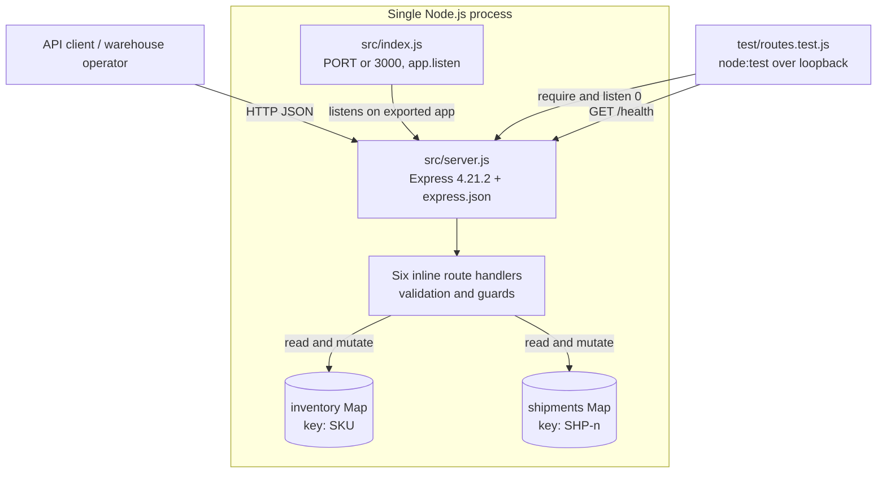

**Core technical approach.** Five choices define how the system is built:

- **One exported app, no listening side effect.** `src/server.js` ends with `module.exports = app` (`:53`), so the same configured application serves the bootstrap in `src/index.js` and the test's own `app.listen(0)` (`test/routes.test.js:8`). Port resolution belongs solely to `src/index.js:2-3`.
- **Framework and module system.** Express `4.21.2`, pinned exactly rather than by range, is the only dependency; CommonJS `require` throughout; no TypeScript, no build step, no transpiler (`package.json:6`; `src/server.js:1`).
- **Synchronous handlers over in-memory maps.** Every handler is synchronous and touches no external I/O, so a request either mutates a map or returns an error — there is no partial-write or retry path to reason about (`src/server.js:8-51`).
- **Validation by inline presence and type checks.** Payload rejection uses `!sku || !name || !Number.isInteger(quantity) || quantity < 0` for inventory and `!Number.isInteger(quantity) || quantity <= 0` for shipments; `reorderLevel` is stored as supplied and never validated (`src/server.js:11-12, 27-28`). No schema library exists in the manifest.
- **Status codes as the error protocol.** Validation failures are `400`, missing entities `404`, and state conflicts `409`, each with a short JSON `error` string; the dispatcher relies on those distinctions rather than on an exception hierarchy (`src/server.js:13,15,26,28,30,40,46,47`).

Shipment creation shows the interaction order the design depends on — every guard runs before the mutation, which is what makes a rejected request side-effect free (`src/server.js:25-35`):

1. Resolve the SKU: absent from `inventory` → `404 sku not found`.
2. Validate the quantity as a positive integer → else `400 quantity must be positive`.
3. Compare against stock on hand → insufficient → `409 insufficient inventory`.
4. Only then decrement `item.quantity` and record the shipment as `created`.

### 1.2.3 Success Criteria

**Measurable objectives.** Each row restates a checkable property the code already defines, together with its present state. The current state is what the automated suite demonstrates today, not an aspiration.

| Objective | How it is measured | Present state |
|---|---|---|
| Service boots and answers liveness | `GET /health` → `200` and body deep-equal to `{ status: 'ok' }` | Met — `npm test` passes 1 of 1 (`test/routes.test.js:11-13`) |
| Duplicate SKUs are refused | Second `POST /inventory` for an existing SKU → `409 duplicate sku`, original unchanged | Implemented, unverified (`src/server.js:15`) |
| Stock never goes negative | `POST /shipments` exceeding stock on hand → `409 insufficient inventory` with the quantity unchanged | Implemented, unverified (`src/server.js:30-31`) |
| A shipment dispatches exactly once | Second `POST /shipments/:id/dispatch` → `409`; first returns `status: 'dispatched'` with a carrier | Implemented, unverified (`src/server.js:47-50`) |
| Every route is exercised | Automated tests reach all six declared routes | Not met — 1 of 6; gap stated in `README.md:12-13` |

**Critical success factors.** Conditions outside the code that must hold for the system to behave as designed:

- **Single-instance, single-process operation.** Both registers are module-level maps, so horizontal scaling would silently partition stock and defeat the oversell guard (`src/server.js:5-6`).
- **A trusted network boundary.** With no credential anywhere in the code, authorisation must be supplied by infrastructure the repository does not describe.
- **Acceptance of restart data loss.** Unless a caller re-seeds stock after every restart, records simply vanish; nothing in the repository restores them.
- **JSON content type on writes.** Only `express.json()` is installed, so bodies posted with a different content type reach the handlers as an object without the expected fields and are rejected `400` — verified for an absent body and for malformed JSON.
- **Resolving the documented start path.** `README.md:5-7` instructs `npm install` then `npm start`, but `npm start` exits without listening; any deployment must invoke `node src/index.js` until the script is corrected (`package.json:5` versus `src/index.js:3`).
- **Extending the suite before changing behaviour.** Five of six routes have no test, so a change to the stock guard or dispatch rule is currently unguarded by verification.

**Key performance indicators.** The repository declares no KPI, SLO or SLA, and no timing, throughput or availability measurement exists in it. The indicators below are the ones its own contract makes computable from the response codes and record fields it already produces; they are proposed operational measures, not existing commitments.

| KPI | Definition from the code's own signals |
|---|---|
| Route success ratio | Share of `2xx` responses per route, against its `400`/`404`/`409` rejections (`src/server.js:8-51`) |
| Stock-conflict rate | Count of `409 insufficient inventory` responses — demand exceeding recorded stock (`:30`) |
| Data-hygiene rejection rate | Count of `409 duplicate sku` responses on intake (`:15`) |
| Dispatch completion ratio | Shipments with `status: 'dispatched'` over shipments created, observable through `GET /shipments/:id` (`:33,48`) and `POST /shipments/:id/dispatch` (`:44-51`) |

One further indicator is worth stating plainly because it is absolute rather than tunable: durable-record retention is currently zero, since every record dies with the process that created it.


## 1.3 Scope

Scope is defined here against what the five tracked files actually implement. Everything in `src/server.js` is in scope by construction; everything the repository is silent about is out of scope, and the silence is evidenced rather than assumed.

### 1.3.1 In-Scope

**Must-have capabilities.** Six HTTP routes constitute the complete in-scope functional surface. Each of the first five except liveness carries an explicit rejection contract, and those rejections are as much in scope as the success paths.

| Capability | Route | Accepted input | Outcomes |
|---|---|---|---|
| Liveness | `GET /health` | none | `200 { status: 'ok' }` (`src/server.js:8`) |
| Receive stock | `POST /inventory` | `{ sku, name, quantity, reorderLevel? }` | `201` item; `400 invalid inventory payload`; `409 duplicate sku` (`:10-19`) |
| List stock | `GET /inventory` | none | `200` array of every item incl. `reorderLevel` (`:21`) |
| Create shipment | `POST /shipments` | `{ sku, quantity, destination }` | `201` shipment; `404 sku not found`; `400 quantity must be positive`; `409 insufficient inventory` (`:23-36`) |
| Look up shipment | `GET /shipments/:id` | path `id` | `200` shipment; `404 shipment not found` (`:38-42`) |
| Dispatch shipment | `POST /shipments/:id/dispatch` | path `id`, optional `{ carrier }` | `200` dispatched record; `404 shipment not found`; `409 shipment cannot be dispatched` (`:44-51`) |

The validation rules those rejections encode are themselves must-have: a SKU and name must be present, quantity must be a non-negative integer on intake (`:12`) and a positive integer on shipping (`:27`), `reorderLevel` defaults to `5` when absent (`:11`), and stock on hand must cover the requested quantity (`:30`).

**Primary user workflows.** Three end-to-end journeys cover everything the system is designed to do.

| Workflow | Steps | Success outcome |
|---|---|---|
| Stock intake | `POST /inventory` with SKU, name, quantity; optional reorder level | `201` with the stored item; a repeat of the same SKU stops at `409` (`:10-19`) |
| Ship goods against stock | `POST /shipments` for a known SKU → stock decremented → `GET /shipments/:id` to confirm | `201` with a `SHP-<n>` id and `status: 'created'`; stock on hand reduced by the shipped quantity (`:23-36`) |
| Dispatch goods | `POST /shipments/:id/dispatch`, optionally with a carrier | `200` with `status: 'dispatched'` and `carrier` defaulting to `standard`; a second attempt stops at `409` (`:44-51`) |

Stock review (`GET /inventory`, `:21`) is the read path common to all three: it is the only way to observe the decrement performed by shipment creation.

**Essential integrations.** The system's entire integration requirement is one inbound HTTP boundary plus one environment variable.

| Integration | Requirement as implemented |
|---|---|
| Inbound clients | Any HTTP client able to send and receive JSON; `express.json()` is the only body parser installed (`src/server.js:3`) |
| Port selection | `process.env.PORT`, falling back to `3000`; read once at start-up and not validated or range-checked (`src/index.js:2`) |
| Outbound systems | None — no HTTP client, queue, database driver or file I/O appears anywhere in the repository |
| Verification harness | The app is required directly and bound to an ephemeral port (`app.listen(0)`) for tests over a real loopback socket (`test/routes.test.js:8-11`) |

**Key technical requirements.**

| Requirement | Implementation | Evidence |
|---|---|---|
| Runtime | Node.js with the built-in `node:test` runner and global `fetch`; the manifest declares no `engines` constraint, and the environment observed runs Node.js v22.23.5 with npm 11.21.3 | `package.json`; `test/routes.test.js:1-2,11` |
| Framework | Express, pinned exactly to `4.21.2`; the only runtime dependency; `devDependencies` is an empty object | `package.json:6-7` |
| Module system | CommonJS `require`/`module.exports` throughout; no `"type"` key, so no ESM | `package.json`; `src/server.js:1,53` |
| Entry point for serving traffic | `node src/index.js` — the only caller of `app.listen` on the configured port; the declared `npm start` runs `src/server.js`, which exits without listening | `src/index.js:2-3`; `package.json:5` |
| Process model | One process holding two module-level `Map`s; correctness of the stock guard depends on that single writer | `src/server.js:5-6` |
| Payload format | JSON in, JSON out, with `400`/`404`/`409` as the error protocol | `src/server.js:3,13-47` |
| Test command | `npm test` → `node --test`, discovering `test/` | `package.json:5`; verified: 1 test, 1 pass |

**Implementation boundaries.**

| Boundary | In scope | Evidence |
|---|---|---|
| System boundary | A single Node.js process serving one Express app from process memory; no external system is called, read or written | root contains only `README.md`, `package.json`, `src/`, `test/`; `package.json:6` |
| User groups covered | Any unauthenticated HTTP caller that can reach the port — in practice receiving clerks, dispatch operators and analysts; no identity, role, or per-user data exists | all routes `src/server.js:8-51`; no auth construct in the repository |
| Geographic / market coverage | None encoded: `destination` is a free-text string, with no address, country, currency, timezone or site identifier anywhere; one implicit warehouse per process | `src/server.js:24,33` |
| Data domains included | Two record types only — inventory items `{ sku, name, quantity, reorderLevel }` and shipments `{ id, sku, quantity, destination, status, carrier? }`, with `status` in `created` \| `dispatched` | `src/server.js:16,33,48-49` |

Nothing beyond those two record types is stored: no users, customers, suppliers, locations, bins, carriers as entities, prices, or audit events.

### 1.3.2 Out-of-Scope

**Explicitly excluded features and capabilities.** Each exclusion below is a demonstrated absence in the repository, not a deferred decision recorded anywhere in it.

| Excluded capability | Evidence of exclusion |
|---|---|
| Persistence of any kind (database, file, cache) | No driver, ORM or filesystem call exists; the sole dependency is Express; both registers are in-process `Map`s (`package.json:6`, `src/server.js:5-6`) |
| Inventory update, adjustment, delete or restock | Only `POST /inventory` and `GET /inventory` are declared; no `PUT`, `PATCH` or `DELETE` route exists (`src/server.js:8-51`) |
| Shipment listing, cancellation or amendment | Only creation, lookup by exact id, and dispatch are declared (`src/server.js:23-51`) |
| Reorder-level alerting or replenishment logic | `reorderLevel` is accepted, defaulted to `5`, and stored, but no route reads or acts on it (`src/server.js:11,16`) |
| Authentication, authorisation, users, roles, sessions | No auth, token, session, cookie or credential construct anywhere in the repository |
| Multi-warehouse, multi-tenant, or multi-site operation | SKU is the sole inventory key and no site/tenant field exists; a second site's SKU is a `409 duplicate sku` (`src/server.js:15,17`) |
| Carrier integration, tracking numbers, rate shopping | `carrier` is a free-text string defaulting to `standard`; no outbound call is made (`src/server.js:49`) |
| Pricing, invoicing, payments, customer records | No monetary or customer field in either record (`src/server.js:16,33`) |
| API versioning, pagination, filtering, sorting | Routes sit at bare root paths and `GET /inventory` returns the whole map (`src/server.js:8-51`) |
| CORS, TLS, rate limiting, structured logging, metrics | None configured; the only logging is one start-up `console.log` (`src/index.js:3`) |
| Uniform JSON error handling for malformed input | No error middleware; malformed JSON yields Express's default `text/html` 400 with a stack trace on stderr |
| Graceful shutdown, signal handling, bind-error handling | The listener handle from `app.listen` is discarded and no signal handler exists (`src/index.js:3`) |
| CI, containerisation, infrastructure code, committed lockfile | No workflow, `Dockerfile`, IaC file or lockfile is tracked; only five files exist in git |

**Future phase considerations.** The repository proposes no roadmap; it does record its own gaps. These candidates follow directly from what those files state and leave unresolved.

| Candidate next step | Trigger in the repository |
|---|---|
| Automate the five uncovered journeys and three conflict behaviours | `README.md:12-13` names them exactly: receiving inventory, creating a shipment, verifying the decrement, retrieving and dispatching a shipment; duplicate SKU, insufficient inventory, repeated dispatch |
| Make the documented start path serve traffic | `README.md:5-7` says `npm start`, but `package.json:5` points at `src/server.js`, which never listens |
| Introduce durable storage | Both registers are in-process `Map`s, so all records die with the process (`src/server.js:5-6`) |
| Act on `reorderLevel` | The field is captured on intake but consumed by nothing (`src/server.js:11,16`) |
| Add error middleware and API versioning | Express's default handler breaks the JSON error convention; routes are unversioned (`src/server.js:8-51`) |
| Harden shipment id generation | `SHP-${shipments.size + 1}` would reuse ids if records ever expire or are deleted (`src/server.js:32`) |

**Integration points not covered.**

| Integration | Status |
|---|---|
| ERP, WMS, accounting or procurement systems | Not present; the service exchanges data only with its own HTTP callers |
| Carrier / 3PL APIs, label generation, tracking feeds | Not present; `carrier` is stored as free text (`src/server.js:49`) |
| Barcode, RFID or scanner hardware | Not present |
| Event streams, webhooks, message brokers | Not present; no publish path, no outbox, no subscriber |
| Identity provider, SSO, API gateway | Not present; no credential is validated |
| Observability, log aggregation, APM | Not present; a single start-up `console.log` (`src/index.js:3`) |
| Browser single-page front end | Not present, and no CORS configuration exists that would let one call the API cross-origin |

**Unsupported use cases.** Each of these fails against the current code, and each is stated with the path that fails:

- **Surviving a restart.** Stock and shipments are lost on exit; nothing re-seeds them (`src/server.js:5-6`).
- **Running more than one instance behind a load balancer.** Registers diverge per process, so two instances can each believe the same stock is available and both accept a shipment that the single-instance guard was written to prevent (`src/server.js:25-31`).
- **Shipping the same SKU from two concurrent writers in different processes.** Guard and decrement are not atomic across processes (`src/server.js:30-31`).
- **Correcting a mistaken shipment.** There is no cancel, reverse or restock route; dispatch only moves `created` → `dispatched` (`src/server.js:44-51`).
- **Tracing what happened to a record.** Quantity and status are overwritten in place, so no history of an item or a shipment is retained (`src/server.js:31,48`).
- **Setting different stock levels for the same SKU at two sites.** The SKU is the sole key, so the second site is rejected as a duplicate (`src/server.js:15`).
- **Recalling a dispatch with a different carrier, or querying by carrier, destination or SKU.** Dispatch is one-way and `GET` supports only exact id lookup (`src/server.js:38-51`).
- **Posting HTML form-encoded bodies or non-JSON payloads.** Only JSON parsing is installed, so such requests are rejected `400` (`src/server.js:3,12`).
- **Browsing a very large catalogue.** `GET /inventory` returns every item with no pagination (`src/server.js:21`).
- **Operating the system as an untrusted or internet-facing API.** No authentication, TLS, CORS policy or rate limiting exists anywhere in the repository.


## 1.4 References

- `README.md` — purpose statement ("An Express service for inventory intake, shipment creation, shipment lookup and dispatch"), the `npm install`/`npm start`/`npm test` instructions, the "Child Two — Warehouse Catalogue API" title, and the stated deliberate analysis gaps in test coverage.
- `package.json` — service identity (`warehouse-catalogue-api`, `1.0.0`, `"private": true`), the `start` and `test` scripts, the exact `express` `4.21.2` pin as the sole runtime dependency, the empty `devDependencies`, and the absence of `engines`/`type`/`main`/`exports` constraints.
- `src/` — the complete application layer: the three-line process bootstrap and the fifty-three-line Express API, and nothing else.
- `src/index.js` — port resolution via `process.env.PORT || 3000`, the `app.listen` call that makes the service serve traffic, the start-up log line, and the absence of bind-error, signal and shutdown handling.
- `src/server.js` — the entire HTTP contract (six routes, lines 8-51), the `express.json()` configuration, the two in-memory `Map` registers (lines 5-6), the validation and conflict guards (`:12,15,27-28,30,47`), the shipment id scheme and status lifecycle (`:32-33,48-49`), and `module.exports = app` (`:53`).
- `test/routes.test.js` — the single integration test of `GET /health` over a loopback socket on an ephemeral port, the `node:test`/`node:assert/strict` tooling, the `try/finally` listener shutdown, and the comment recording that full workflow coverage is intentionally absent.
- `test/` — the complete verification layer, containing that one file and no sub-folders.


# 2. Product Requirements

## 2.1 Feature Catalog

The catalog contains exactly the capabilities the repository implements: six HTTP routes in `src/server.js:8-51`, the process bootstrap in `src/index.js:2-3`, and the verification harness declared by `package.json:5` and written in `test/routes.test.js`. No feature is proposed that the code does not already perform, and no route is split into more than one feature. Eight features result, each identified as `F-###` and each carrying the metadata, description and dependency record defined below. Priorities rank the features by how much of the documented end-to-end flow (`README.md:3`) breaks without them; statuses record implementation state at the current commit, not intent.

### 2.1.1 Catalog at a Glance

| Feature ID | Feature Name | Category | Priority |
|---|---|---|---|
| F-001 | Inventory Intake | Inventory Management | Critical |
| F-002 | Inventory Listing | Inventory Management | High |
| F-003 | Shipment Creation with Stock Decrement | Shipment Management | Critical |
| F-004 | Shipment Lookup | Shipment Management | Medium |
| F-005 | Shipment Dispatch | Shipment Management | Critical |
| F-006 | Service Liveness Probe | Platform & Operations | High |
| F-007 | Process Bootstrap and Port Configuration | Platform & Operations | Critical |
| F-008 | Automated Verification Harness | Quality Engineering | High |

Implementation state, with the evidence that fixes it:

| Feature ID | Status | Evidence |
|---|---|---|
| F-001 | Completed | Handler at `src/server.js:10-19`; no automated test |
| F-002 | Completed | Handler at `src/server.js:21`; no automated test |
| F-003 | Completed | Handler at `src/server.js:23-36`; no automated test |
| F-004 | Completed | Handler at `src/server.js:38-42`; no automated test |
| F-005 | Completed | Handler at `src/server.js:44-51`; no automated test |
| F-006 | Completed | Handler at `src/server.js:8`; covered by `test/routes.test.js:7-17` |
| F-007 | In Development | `src/index.js:2-3` binds a port, but the declared `start` script runs `src/server.js`, which only exports the app (`package.json:5`, `src/server.js:53`); `npm start` exits `0` without listening |
| F-008 | In Development | One of six routes is covered (`test/routes.test.js:7-17`); `README.md:12-13` records the missing journeys as a deliberate gap |

### 2.1.2 F-001 Inventory Intake

#### 2.1.2.1 Feature Metadata

| Field | Value |
|---|---|
| Unique ID | F-001 |
| Feature Name | Inventory Intake |
| Feature Category | Inventory Management |
| Priority Level | Critical |
| Status | Completed |
| Surface | `POST /inventory` (`src/server.js:10-19`) |

#### 2.1.2.2 Description

**Overview.** Accepts a JSON body of `{ sku, name, quantity, reorderLevel? }`, validates it, refuses a SKU already held in the register, and stores the item in the `inventory` Map keyed by SKU. It is the only route that can create a stock record, so it is the entry point of every workflow the service supports.

**Business value.** Every downstream operation reads the register this feature populates: a shipment cannot be created for a SKU that was never received (`src/server.js:25-26`). Refusing duplicate SKUs (`:15`) keeps stock on hand a single, unambiguous number per item rather than an accumulating set of records that would have to be summed elsewhere.

**User benefits.** A receiving clerk gets the stored item echoed back with the resolved reorder level, so the accepted state is confirmed in the same round trip (`:16-18`). A malformed submission is rejected with a named reason instead of being partially written: `400 invalid inventory payload` distinguishes a bad payload from `409 duplicate sku`, a SKU that is well formed but already present.

**Technical context.** The handler validates inline with `!sku || !name || !Number.isInteger(quantity) || quantity < 0` (`:12`), then a `Map.has` guard (`:15`), then a single `Map.set` (`:17`). No schema library, database or file write is involved; the record lives in process memory only. Because the whole handler is synchronous, a rejected request performs no mutation at all.

#### 2.1.2.3 Dependencies

| Kind | Dependency | Evidence |
|---|---|---|
| Prerequisite Features | F-007 — the app must be listening before a request can arrive | `src/index.js:3` |
| System Dependencies | Node.js runtime; Express `4.21.2` with `express.json()`; module-level `inventory` Map | `package.json:6`; `src/server.js:3,5` |
| External Dependencies | None — no database, queue, identity provider or outbound call | `package.json:6`; `src/server.js:10-19` |
| Integration Requirements | Callers must send `content-type: application/json`; a body without that header reaches the handler as `{}` and is rejected `400` (verified) | `src/server.js:3,12` |

### 2.1.3 F-002 Inventory Listing

#### 2.1.3.1 Feature Metadata

| Field | Value |
|---|---|
| Unique ID | F-002 |
| Feature Name | Inventory Listing |
| Feature Category | Inventory Management |
| Priority Level | High |
| Status | Completed |
| Surface | `GET /inventory` (`src/server.js:21`) |

#### 2.1.3.2 Description

**Overview.** Serialises every value in the `inventory` Map to a JSON array and returns it with `200`. It takes no input, applies no filter, and is the only read view of stock in the service.

**Business value.** It is the sole means by which the stock decrement performed by shipment creation becomes observable: without it, `POST /shipments` would reduce a number nothing could display. Stock reconciliation, spot-checking and post-incident review of on-hand quantities all rest on this one route.

**User benefits.** A single call returns the complete catalogue with `sku`, `name`, `quantity` and `reorderLevel` per item (`src/server.js:16`), so a client needs no join or second request. An empty register returns `200` with `[]` rather than an error (verified), which lets a freshly started process be distinguished from a failing one.

**Technical context.** The handler is `res.json([...inventory.values()])` — one spread of the Map into an array, so cost grows linearly with the number of items and the entire register is serialised on every call. Query parameters are ignored: `GET /inventory?limit=1` returns the full array (verified). There is no pagination, sorting or filtering hook.

#### 2.1.3.3 Dependencies

| Kind | Dependency | Evidence |
|---|---|---|
| Prerequisite Features | F-001 — nothing can be listed until a record is received | `src/server.js:17,21` |
| System Dependencies | The `inventory` Map, shared with F-001 (writes) and F-003 (mutating reads) | `src/server.js:5,17,21,31` |
| External Dependencies | None | `src/server.js:21` |
| Integration Requirements | Consumers must accept an unbounded array; the response has no envelope, paging cursor or version field | `src/server.js:21` |

### 2.1.4 F-003 Shipment Creation with Stock Decrement

#### 2.1.4.1 Feature Metadata

| Field | Value |
|---|---|
| Unique ID | F-003 |
| Feature Name | Shipment Creation with Stock Decrement |
| Feature Category | Shipment Management |
| Priority Level | Critical |
| Status | Completed |
| Surface | `POST /shipments` (`src/server.js:23-36`) |

#### 2.1.4.2 Description

**Overview.** Accepts `{ sku, quantity, destination }`, resolves the SKU against the inventory register, validates the quantity, refuses the request when stock on hand does not cover it, then decrements the stored quantity and records a shipment with status `created` and a generated `SHP-<n>` id.

**Business value.** This is the feature that makes the register a stock ledger rather than a static catalogue: it enforces the invariant that shipped quantity never exceeds recorded stock, and it ties each outgoing movement to a retrievable shipment record. It is also the only feature that changes stock after intake, which is why its guard order matters commercially — a rejected shipment must leave the register untouched.

**User benefits.** A dispatch operator receives `201` with the shipment id on success and a distinct failure for each cause of rejection: `404 sku not found` (no such item), `400 quantity must be positive` (bad quantity), `409 insufficient inventory` (not enough stock). The three codes let a client show the right remedy without parsing prose. All four outcomes were reproduced against a live instance.

**Technical context.** Guards run in a fixed order before any mutation (`:25-31`): SKU resolution first, then quantity validation, then the stock comparison; only after all three does `item.quantity -= quantity` execute (`:31`). The id is derived as `SHP-${shipments.size + 1}` (`:32`). Because every handler is synchronous and single-threaded, the guard-and-decrement pair cannot interleave with another request inside this process; the same guarantee does not extend across processes.

#### 2.1.4.3 Dependencies

| Kind | Dependency | Evidence |
|---|---|---|
| Prerequisite Features | F-001 — the SKU must first exist in the register | `src/server.js:25-26` |
| System Dependencies | The `inventory` Map (read and mutate) and the `shipments` Map (write); `shipments.size` for id generation | `src/server.js:5-6,32` |
| External Dependencies | None — no carrier, tax, price or address service is called; `destination` is stored as free text | `src/server.js:24,33` |
| Integration Requirements | JSON body with `content-type: application/json`; the client must hold the exact SKU string used at intake, since matching is by `Map` key and case-sensitive | `src/server.js:3,25` |

### 2.1.5 F-004 Shipment Lookup

#### 2.1.5.1 Feature Metadata

| Field | Value |
|---|---|
| Unique ID | F-004 |
| Feature Name | Shipment Lookup |
| Feature Category | Shipment Management |
| Priority Level | Medium |
| Status | Completed |
| Surface | `GET /shipments/:id` (`src/server.js:38-42`) |

#### 2.1.5.2 Description

**Overview.** Returns the full shipment record for an exact id, or `404 shipment not found`. It is the only way to observe a shipment after creation, since no list route is declared.

**Business value.** It closes the fulfilment loop: creation returns a `SHP-<n>` id and this route is how that id is later resolved to a status, whether the intent is to confirm the record exists before dispatching or to verify afterwards that the status changed to `dispatched`.

**User benefits.** The response carries the same object the creator and dispatcher exchange, so `status` and `carrier` are read from one shape rather than three. A mistyped id fails cleanly with `404` instead of an empty `200` body, so a caller cannot mistake "not found" for "no data yet".

**Technical context.** A single `shipments.get(req.params.id)` against the Map, with the id taken verbatim from the path (`:39`). The record is returned by reference, so the response reflects later mutation of the same object — which is why the lookup shows `dispatched` and a carrier after F-005 runs, with no write by F-004 itself. There is no collection route: `GET /shipments` is not declared, and no filter by SKU, status, destination or carrier exists.

#### 2.1.5.3 Dependencies

| Kind | Dependency | Evidence |
|---|---|---|
| Prerequisite Features | F-003 — an id can only be looked up after a shipment is created | `src/server.js:34,39` |
| System Dependencies | The `shipments` Map, shared with F-003 and F-005 | `src/server.js:6,34,39,45` |
| External Dependencies | None | `src/server.js:38-42` |
| Integration Requirements | The caller must retain the `SHP-<n>` id returned by F-003; there is no discovery route | `src/server.js:32-35,38` |

### 2.1.6 F-005 Shipment Dispatch

#### 2.1.6.1 Feature Metadata

| Field | Value |
|---|---|
| Unique ID | F-005 |
| Feature Name | Shipment Dispatch |
| Feature Category | Shipment Management |
| Priority Level | Critical |
| Status | Completed |
| Surface | `POST /shipments/:id/dispatch` (`src/server.js:44-51`) |

#### 2.1.6.2 Description

**Overview.** Moves an existing shipment from `created` to `dispatched`, records a carrier (defaulting to `standard`), and returns the updated record. A shipment can cross that boundary once and only once.

**Business value.** The status field is the only state machine in the product, and this route is the only transition in it. The guard at `:47` makes dispatch idempotent-by-rejection rather than by silent repetition: a second dispatch attempt cannot overwrite the carrier or the status of a shipment that has already left, so the recorded outcome of the first dispatch survives.

**User benefits.** An operator sees `200` with `status: "dispatched"` and the effective carrier on success, and a second attempt yields `409 shipment cannot be dispatched` — an unambiguous signal that the work was already done, distinguishable from `404` for an unknown id. Both were reproduced against a live instance.

**Technical context.** The guard is a status comparison (`shipment.status !== 'created'`, `:47`); on success the handler writes `status = 'dispatched'` and `carrier = req.body.carrier || 'standard'` (`:48-49`) directly onto the stored object, then returns it. The carrier is neither validated nor type-checked — a numeric `42` is stored and echoed back verbatim (verified) — and it remains a free-text label with no carrier integration behind it. No reversal, cancellation or re-dispatch path exists.

#### 2.1.6.3 Dependencies

| Kind | Dependency | Evidence |
|---|---|---|
| Prerequisite Features | F-003 — a shipment must exist; it must also still be in status `created` | `src/server.js:33,45,47` |
| System Dependencies | The `shipments` Map and the `status`/`carrier` fields it stores | `src/server.js:6,33,48-49` |
| External Dependencies | None — no carrier API, tracking service or label generator is called; `carrier` is stored text | `src/server.js:49` |
| Integration Requirements | JSON body optional; an absent body still dispatches with `standard` (verified). Callers wanting a named carrier must post it in the body as `carrier` | `src/server.js:3,49` |

### 2.1.7 F-006 Service Liveness Probe

#### 2.1.7.1 Feature Metadata

| Field | Value |
|---|---|
| Unique ID | F-006 |
| Feature Name | Service Liveness Probe |
| Feature Category | Platform & Operations |
| Priority Level | High |
| Status | Completed |
| Surface | `GET /health` (`src/server.js:8`) |

#### 2.1.7.2 Description

**Overview.** Returns `200` with the constant body `{ status: 'ok' }`. It touches neither register, takes no input and cannot fail.

**Business value.** It is the only signal the service exposes that a process is up and routing requests, and it is the only feature whose behaviour the repository verifies automatically (`test/routes.test.js:7-17`). Any deployment check, smoke test or uptime monitor the service were to have would key off this route.

**User benefits.** An operator can confirm that the process answers HTTP and that Express is mounted, independently of whether any stock or shipment data exists — verified: the route returns `ok` against an empty register.

**Technical context.** A one-line handler, `res.json({ status: 'ok' })` (`:8`). It does not report version, uptime, dependency health, register sizes or readiness to serve writes, so it establishes reachability only. Because nothing in it can throw, a `200` here is a weaker signal than an end-to-end success.

#### 2.1.7.3 Dependencies

| Kind | Dependency | Evidence |
|---|---|---|
| Prerequisite Features | F-007 — the listener must be bound for the route to be reachable | `src/index.js:3` |
| System Dependencies | Express routing; no access to `inventory` or `shipments` | `src/server.js:5-8` |
| External Dependencies | None | `src/server.js:8` |
| Integration Requirements | Unauthenticated `GET` over plain HTTP; the body is the fixed object `{ status: 'ok' }`, which the test asserts exactly by deep equality | `test/routes.test.js:13` |

### 2.1.8 F-007 Process Bootstrap and Port Configuration

#### 2.1.8.1 Feature Metadata

| Field | Value |
|---|---|
| Unique ID | F-007 |
| Feature Name | Process Bootstrap and Port Configuration |
| Feature Category | Platform & Operations |
| Priority Level | Critical |
| Status | In Development |
| Surface | `src/index.js:2-3`; `start` script at `package.json:5` |

#### 2.1.8.2 Description

**Overview.** Resolves the listening port once as `process.env.PORT || 3000`, opens the listener on the app exported by `src/server.js`, and logs `warehouse API listening on ${port}`. It is the only code in the repository that calls `app.listen` on a configured port.

**Business value.** It is the feature that turns the exported Express application into a running service. Every other feature is unreachable without it, and the environment variable it reads is the sole deployment knob the repository exposes.

**User benefits.** An operator can place the service on a chosen port with one variable — `PORT=4517 node src/index.js` binds 4517 and logs it (verified) — and the start-up line gives immediate confirmation of the port actually used.

**Technical context.** Three lines, no exported value (`src/index.js:1-3`). The port is used as a raw string when the variable is set and never parsed, validated or range-checked; the listener handle is discarded, so there is no bind-error handling, no signal handler, no graceful shutdown and no TLS. The declared `start` script points at `src/server.js`, which merely exports the app, so `npm start` exits `0` without opening a listener (verified) — the defect that keeps this feature's status at In Development.

#### 2.1.8.3 Dependencies

| Kind | Dependency | Evidence |
|---|---|---|
| Prerequisite Features | None — it is the root of the serving chain | `src/index.js:1` |
| System Dependencies | The Express app exported by `src/server.js`; Node.js `http` listener created by `app.listen` | `src/server.js:53`; `src/index.js:1,3` |
| External Dependencies | The operator's environment supplying `PORT`; the OS supplying a bindable port | `src/index.js:2` |
| Integration Requirements | Invoked as `node src/index.js`; `npm start` is documented (`README.md:5-7`) but does not serve traffic until the script is corrected | `package.json:5`; `src/server.js:53` |

### 2.1.9 F-008 Automated Verification Harness

#### 2.1.9.1 Feature Metadata

| Field | Value |
|---|---|
| Unique ID | F-008 |
| Feature Name | Automated Verification Harness |
| Feature Category | Quality Engineering |
| Priority Level | High |
| Status | In Development |
| Surface | `test/routes.test.js:1-17`; `test` script at `package.json:5` |

#### 2.1.9.2 Description

**Overview.** A single integration test that requires the exported app, binds it to an ephemeral port, fetches `/health` over a real loopback socket, asserts `200` and the exact body, and closes the listener in a `finally` block. It runs under the Node.js built-in runner via `npm test` → `node --test`.

**Business value.** It is the repository's only executable statement of expected behaviour, and the pattern it establishes — drive the real app over HTTP, assert code and body, close the listener — is the one the five uncovered journeys need. It also proves the export-without-listening design of F-007/RQ-003 works, since the suite can bind the same app instance independently.

**User benefits.** A developer gets a pass/fail gate in one command with no install of a test framework beyond what the manifest already carries; `npm test` reports 1 test, 1 pass, 0 fail (verified). `README.md:12-13` states plainly which journeys the harness does not yet cover, so the gap is visible to any reader rather than discovered later.

**Technical context.** Uses `node:test`, `node:assert/strict` and the global `fetch`; `devDependencies` is an empty object, so no Jest, Mocha, Vitest, supertest or mocking library exists (`package.json:7`). `app.listen(0)` avoids port collisions and `server.close()` in `finally` prevents a hung process. Coverage is one route of six, and none of the three conflict behaviours is exercised.

#### 2.1.9.3 Dependencies

| Kind | Dependency | Evidence |
|---|---|---|
| Prerequisite Features | F-007 — the app must be importable without a listening side effect, and F-006, the route under test | `src/server.js:53`; `test/routes.test.js:3,8` |
| System Dependencies | Node.js `node:test` and `node:assert/strict`; global `fetch`; `node --test` discovery of `test/` | `test/routes.test.js:1-2,11`; `package.json:5` |
| External Dependencies | None — no network access beyond loopback and no third-party test package | `package.json:7`; `test/routes.test.js:11` |
| Integration Requirements | Runs as `npm test`; requires a Node.js version providing `node:test` and `fetch` (the environment observed runs v22.23.5, the manifest declares no `engines`) | `package.json`; verified `npm test` → 1 pass |

## 2.2 Functional Requirements Table

Every requirement below is derived from a specific guard, branch or response in `src/server.js` and is stated so that a single request can prove or disprove it. Thirty-four requirements cover the eight features of Section 2.1. Acceptance criteria that name exact status codes and exact response bodies were reproduced against a live instance of the app (`app.listen(0)`, Node.js v22.23.5, Express 4.21.2); where the code and a probe disagreed, the probe result is recorded.

### 2.2.1 Requirement Conventions

| Convention | Definition |
|---|---|
| Identifier | `F-XXX-RQ-YYY`, where `F-XXX` is the owning feature of Section 2.1 and `YYY` is the requirement's sequence within that feature. IDs are append-only: a superseded requirement is retired and a new `YYY` is issued, so traceability in Section 2.4 never points at a re-used identifier. |
| Priority | **Must-Have** — a documented workflow in `README.md:3` fails without it. **Should-Have** — implemented and relied on, but a caller can proceed with a documented workaround. **Could-Have** — a by-product of the implementation rather than a designed guarantee. |
| Complexity | Relative effort to build or re-verify the requirement from the current baseline: **Low** (single guard or field, one branch), **Medium** (ordering between guards, shared mutable state, or multi-step setup), **High** (cross-request or cross-process invariants). |
| Version | All requirements in this section are at version **1.0.0**, matching `package.json:3` and commit `3b9b969`. Section 2.2.10 records the baseline. |

### 2.2.2 F-001 Inventory Intake Requirements

**Requirement details and acceptance criteria.**

| Req ID | Requirement | Acceptance criteria | Priority · Complexity |
|---|---|---|---|
| F-001-RQ-001 | A valid intake request stores a new item and returns it | `POST /inventory` with `{sku:'A1',name:'Bolt',quantity:10}` returns `201` with body `{sku:'A1',name:'Bolt',quantity:10,reorderLevel:5}` | Must-Have · Low |
| F-001-RQ-002 | Intake requires both `sku` and `name` | A body missing `sku`, missing `name`, or empty returns `400 {"error":"invalid inventory payload"}`, and `GET /inventory` is unchanged | Must-Have · Low |
| F-001-RQ-003 | `quantity` must be a non-negative integer | `-1`, `1.5`, `"5"` and an absent `quantity` each return `400`; `0` returns `201` | Must-Have · Low |
| F-001-RQ-004 | A SKU may be received only once | A second `POST /inventory` for `sku:'A1'` returns `409 {"error":"duplicate sku"}` and the stored item keeps its original `name`, `quantity` and `reorderLevel` | Must-Have · Low |
| F-001-RQ-005 | `reorderLevel` defaults to `5` and is otherwise stored unvalidated | A body without `reorderLevel` returns `reorderLevel: 5`; `reorderLevel:"abc"` returns `201` and echoes `"abc"` | Should-Have · Low |
| F-001-RQ-006 | The stored record carries exactly four fields | Response keys are `sku`, `name`, `quantity`, `reorderLevel` and nothing else; an extra request field such as `evil:'x'` is absent from the response and from `GET /inventory` | Could-Have · Low |

**Technical specifications.**

| Req ID | Input parameters | Output / response | Data requirements |
|---|---|---|---|
| F-001-RQ-001 | JSON object: `sku` (string, required), `name` (string, required), `quantity` (integer, required), `reorderLevel` (any, optional) | `201` + stored item object | One `inventory` entry keyed by `sku`; process memory only, lost on exit |
| F-001-RQ-002 | As above, with `sku` or `name` absent or falsy | `400 {"error":"invalid inventory payload"}` | None written |
| F-001-RQ-003 | As above, with `quantity` of any JSON type | `400 {"error":"invalid inventory payload"}` | None written |
| F-001-RQ-004 | As above, with a `sku` already present in the register | `409 {"error":"duplicate sku"}` | Existing entry retained unchanged |
| F-001-RQ-005 | `reorderLevel` omitted, or any JSON value | `201` + item with `reorderLevel: 5`, or the supplied value verbatim | `reorderLevel` stored as the raw JSON value; no numeric coercion |
| F-001-RQ-006 | Object with additional undeclared properties | `201` + the four-field record | Undeclared properties discarded at destructuring |

**Performance criteria.** The handler performs one `Map.has` and one `Map.set` and no I/O; a request completes in well under a millisecond for any body inside the parser's 100 KB default limit. A body above that limit is rejected with `413` and an HTML error page before the handler runs (verified at 120 KB).

**Validation rules.**

| Req ID | Business rule | Data validation | Security / compliance |
|---|---|---|---|
| F-001-RQ-002 | A stock record must identify the item by SKU and by name | Falsy check only: `!sku \|\| !name`. Whitespace-only values pass — `sku:"  "` was accepted `201`; no length, charset or format constraint exists | No authentication, no authorisation, no sanitisation, no audit record |
| F-001-RQ-003 | Stock on hand cannot start negative | `Number.isInteger(quantity) && quantity >= 0`; no upper bound, so `2147483648` and larger are accepted | None |
| F-001-RQ-004 | One SKU is one stock record | `inventory.has(sku)` before insert; comparison is exact and case-sensitive, so `a1` and `A1` are distinct SKUs | None |
| F-001-RQ-005 | A default reorder threshold applies when none is given | None — the value is stored as supplied, so a string, object or negative number persists unmodified | None |

### 2.2.3 F-002 Inventory Listing Requirements

**Requirement details and acceptance criteria.**

| Req ID | Requirement | Acceptance criteria | Priority · Complexity |
|---|---|---|---|
| F-002-RQ-001 | The full register is returned as a JSON array | `GET /inventory` with three stored items returns `200` and an array of three objects, each carrying `sku`, `name`, `quantity`, `reorderLevel` | Must-Have · Low |
| F-002-RQ-002 | An empty register returns an empty array, not an error | `GET /inventory` on a freshly started process returns `200 []` | Must-Have · Low |
| F-002-RQ-003 | The listing reflects stock decremented by shipment creation | With `A1` at `quantity:10`, a shipment of `4` leaves `GET /inventory` reporting `quantity:6`; a further shipment of `6` leaves `quantity:0` | Must-Have · Low |
| F-002-RQ-004 | Query parameters do not alter the response | `GET /inventory?limit=1` returns every stored item; order is `Map` insertion order | Could-Have · Medium |

**Technical specifications.**

| Req ID | Input parameters | Output / response | Data requirements |
|---|---|---|---|
| F-002-RQ-001 | None | `200` + array of item objects | Reads every entry of `inventory` |
| F-002-RQ-002 | None | `200 []` | None |
| F-002-RQ-003 | None; the state change originates in `POST /shipments` | `200` + array showing the decremented `quantity` | Reads the same objects F-003 mutates in place |
| F-002-RQ-004 | Any query string | `200` + the entire array | Query string parsed by Express and never read by the handler |

**Performance criteria.** Serialisation cost is linear in register size: every item is spread into a new array and written in full on each call, with no paging, projection or compression. No request takes more than one pass over the Map, and no I/O occurs.

**Validation rules.**

| Req ID | Business rule | Data validation | Security / compliance |
|---|---|---|---|
| F-002-RQ-001 | Stock on hand must be observable | None — the handler applies no filter and returns every record | No authentication; every stored item, including all SKUs and quantities, is disclosed to any caller who can reach the port |
| F-002-RQ-003 | The listing is the authoritative view of stock after shipping | None; the handler trusts the in-place `quantity` written by F-003 | No change history is retained, so a decrement cannot be reconstructed from the listing |
| F-002-RQ-004 | Whole-register reads are the only read mode | No pagination, sorting or filtering parameter is recognised | Payload size is unbounded by the service, so a large catalogue is returned in a single unauthenticated response |

### 2.2.4 F-003 Shipment Creation with Stock Decrement Requirements

**Requirement details and acceptance criteria.**

| Req ID | Requirement | Acceptance criteria | Priority · Complexity |
|---|---|---|---|
| F-003-RQ-001 | An unknown SKU is refused before the quantity is examined | `POST /shipments` with `{sku:'NOPE',quantity:0}` returns `404 {"error":"sku not found"}`, not `400` | Must-Have · Medium |
| F-003-RQ-002 | The shipped quantity must be a positive integer | `quantity` of `0`, `"2"` or absent returns `400 {"error":"quantity must be positive"}`; `-1` and `1.5` likewise | Must-Have · Low |
| F-003-RQ-003 | A shipment may not exceed stock on hand | With `A1` at `quantity:6`, a request for `6` returns `409 {"error":"insufficient inventory"}` and `GET /inventory` still reports `6` | Must-Have · Medium |
| F-003-RQ-004 | An accepted shipment decrements stock by exactly the requested quantity | `201` returned and `GET /inventory` for that SKU falls from `10` to `6` after a shipment of `4`; no other item changes | Must-Have · High |
| F-003-RQ-005 | Each shipment receives a sequential `SHP-<n>` id and status `created` | The first two shipments of a process return `id:"SHP-1"` then `id:"SHP-2"`, each with `status:"created"` | Must-Have · Low |
| F-003-RQ-006 | `destination` is optional and stored verbatim | `201` with `destination:"Oslo"` echoed; a request omitting `destination` still returns `201` and the record then has no `destination` key | Should-Have · Low |

**Technical specifications.**

| Req ID | Input parameters | Output / response | Data requirements |
|---|---|---|---|
| F-003-RQ-001 | `{sku, quantity, destination?}` with a `sku` absent from `inventory` | `404 {"error":"sku not found"}` | None written |
| F-003-RQ-002 | `quantity` of any JSON type | `400 {"error":"quantity must be positive"}` | None written |
| F-003-RQ-003 | `quantity` greater than the stored `item.quantity` | `409 {"error":"insufficient inventory"}` | `item.quantity` unmodified |
| F-003-RQ-004 | `quantity` ≤ stock on hand | `201` + shipment object | `inventory` entry mutated in place; one `shipments` entry created |
| F-003-RQ-005 | Server-assigned | `201` + `{id, sku, quantity, destination?, status:'created'}` | Key is `SHP-${shipments.size + 1}` |
| F-003-RQ-006 | `destination` free text, optional | `201`; the key is omitted from the JSON when `undefined` | Stored as supplied; no address, country or site structure |

**Performance criteria.** Three Map operations and no I/O. The guard sequence and the decrement execute in one synchronous handler, so within a single process no other request can observe stock between the comparison and the subtraction. Across processes the same sequence is unguarded — two instances reject nothing and each decrements its own copy.

**Validation rules.**

| Req ID | Business rule | Data validation | Security / compliance |
|---|---|---|---|
| F-003-RQ-001 | Goods cannot be shipped from an item that was never received | `inventory.get(sku)` truthiness; ordering places this check ahead of the quantity check, so the more specific failure wins | No authentication; any caller can probe which SKUs exist through the `404`/`409` distinction |
| F-003-RQ-002 | A shipment must move a positive, whole quantity | `Number.isInteger(quantity) && quantity > 0`; string numerals are rejected, so no implicit coercion | None |
| F-003-RQ-003 | Stock on hand may never go negative | `item.quantity < quantity` before mutation; equality is allowed, so stock may reach `0` exactly | None |
| F-003-RQ-004 | Every accepted shipment is fully reflected in stock | Single in-place decrement, `item.quantity -= quantity`, after all guards pass | No transaction, no idempotency key, no audit trail; a retried request creates a second shipment and decrements twice |
| F-003-RQ-006 | Destination is descriptive, not operational | None — no required check, no format check, no length limit | Free text is stored and returned unescaped; no carrier or address validation occurs |

### 2.2.5 F-004 Shipment Lookup Requirements

**Requirement details and acceptance criteria.**

| Req ID | Requirement | Acceptance criteria | Priority · Complexity |
|---|---|---|---|
| F-004-RQ-001 | A known id returns the full shipment record | `GET /shipments/SHP-1` returns `200` with `id`, `sku`, `quantity`, `status` and, when set, `destination` and `carrier` | Must-Have · Low |
| F-004-RQ-002 | An unknown id returns `404` | `GET /shipments/SHP-99` returns `404 {"error":"shipment not found"}` | Must-Have · Low |
| F-004-RQ-003 | Lookup addresses one shipment by exact id, with no discovery route | `GET /shipments` is not declared and returns Express's `404`; the record returned for `SHP-1` shows `status:"dispatched"` and `carrier:"standard"` after F-005 runs | Could-Have · Medium |

**Technical specifications.**

| Req ID | Input parameters | Output / response | Data requirements |
|---|---|---|---|
| F-004-RQ-001 | Path parameter `id`, matched exactly (case-sensitive) | `200` + shipment object | One `shipments` read; the object is returned by reference |
| F-004-RQ-002 | Path `id` not present in the register | `404 {"error":"shipment not found"}` | None |
| F-004-RQ-003 | No collection or filter input exists | `404` for `GET /shipments` | No index by SKU, status, carrier or destination exists |

**Performance criteria.** One `Map.get` and no I/O. Because the stored object is returned by reference, the response reflects later mutation by F-005 without a second write.

**Validation rules.**

| Req ID | Business rule | Data validation | Security / compliance |
|---|---|---|---|
| F-004-RQ-001 | A shipment's current state must be retrievable by its id | None beyond presence in the Map | No authentication and no ownership check; sequential ids make every shipment enumerable |
| F-004-RQ-002 | A missing shipment must be distinguishable from an empty one | Absence check only | None |
| F-004-RQ-003 | Shipment history is not part of the product | No route lists, filters or searches shipments | Absence of a listing route limits bulk disclosure; the predictable id scheme removes most of that practical limit |

### 2.2.6 F-005 Shipment Dispatch Requirements

**Requirement details and acceptance criteria.**

| Req ID | Requirement | Acceptance criteria | Priority · Complexity |
|---|---|---|---|
| F-005-RQ-001 | Dispatching an unknown id returns `404` | `POST /shipments/SHP-99/dispatch` returns `404 {"error":"shipment not found"}` | Must-Have · Low |
| F-005-RQ-002 | Only a shipment in status `created` may be dispatched | A second `POST` to the same id returns `409 {"error":"shipment cannot be dispatched"}`, and the record retains the first dispatch's `status` and `carrier` | Must-Have · Medium |
| F-005-RQ-003 | A successful dispatch sets status `dispatched` and returns the record | First dispatch returns `200` with `status:"dispatched"` | Must-Have · Low |
| F-005-RQ-004 | `carrier` defaults to `standard` and is stored without validation | Dispatch with no body, or with a falsy `carrier`, records `carrier:"standard"`; `carrier:42` is stored and echoed as the number `42` | Should-Have · Low |

**Technical specifications.**

| Req ID | Input parameters | Output / response | Data requirements |
|---|---|---|---|
| F-005-RQ-001 | Path `id` | `404 {"error":"shipment not found"}` | None written |
| F-005-RQ-002 | Path `id` of a non-`created` shipment | `409 {"error":"shipment cannot be dispatched"}` | `status` and `carrier` unchanged |
| F-005-RQ-003 | Path `id` of a `created` shipment | `200` + updated shipment object | `status` overwritten to `dispatched` in place |
| F-005-RQ-004 | Optional JSON body: `carrier` (any type) | `200` + record with the effective `carrier` | `carrier` added to the shipment object as supplied, or `'standard'` |

**Performance criteria.** One `Map.get` and two property writes; no I/O and no external call, so dispatch cannot block on a carrier system. A request without a body is accepted — `express.json()` leaves `req.body` as `{}`, and the default carrier is applied (verified).

**Validation rules.**

| Req ID | Business rule | Data validation | Security / compliance |
|---|---|---|---|
| F-005-RQ-001 | Only an existing shipment can be dispatched | Presence check against `shipments` | No authentication, so dispatch requires no credential of any kind |
| F-005-RQ-002 | Dispatch happens once per shipment; the first outcome is final | `shipment.status !== 'created'` guard before any write; there is no reversal, recall or re-dispatch route | No audit trail of who dispatched, or when |
| F-005-RQ-004 | A carrier is recorded for every dispatch | Falsy fallback `req.body.carrier \|\| 'standard'`; no type, format or membership check, so any JSON value persists | Carrier is free text with no integration behind it; nothing verifies that a real carrier accepted the goods |

### 2.2.7 F-006 Service Liveness Probe Requirements

**Requirement details and acceptance criteria.**

| Req ID | Requirement | Acceptance criteria | Priority · Complexity |
|---|---|---|---|
| F-006-RQ-001 | The health route reports the service as up | `GET /health` returns `200` with a body deep-equal to `{status:'ok'}` | Must-Have · Low |
| F-006-RQ-002 | Liveness is independent of stored data and of any credential | `GET /health` returns `200 {status:'ok'}` on a process with empty `inventory` and `shipments`, and with no header, token or cookie sent | Must-Have · Low |

**Technical specifications.**

| Req ID | Input parameters | Output / response | Data requirements |
|---|---|---|---|
| F-006-RQ-001 | None | `200` + `{"status":"ok"}`, `content-type: application/json` | Reads no register |
| F-006-RQ-002 | None | As above, regardless of register contents | No state consulted, so the response cannot vary with data |

**Performance criteria.** A constant response with no Map access, no I/O and no allocation beyond the body object; it is the cheapest route in the service. Response headers include `X-Powered-By: Express` and no `Access-Control-Allow-Origin` (verified).

**Validation rules.**

| Req ID | Business rule | Data validation | Security / compliance |
|---|---|---|---|
| F-006-RQ-001 | An operator must be able to test reachability | None | No authentication; the route is safe to leave open because it discloses only readiness |
| F-006-RQ-002 | Liveness must not depend on data state | None | It does not report version, uptime, dependency health or readiness to write, so a `200` here must not be read as a data-integrity signal |

### 2.2.8 F-007 Process Bootstrap and Port Configuration Requirements

**Requirement details and acceptance criteria.**

| Req ID | Requirement | Acceptance criteria | Priority · Complexity |
|---|---|---|---|
| F-007-RQ-001 | The listening port comes from `PORT`, defaulting to `3000` | `PORT=4517 node src/index.js` binds `4517` and answers `GET /health`; with `PORT` unset the process binds `3000` | Must-Have · Low |
| F-007-RQ-002 | A start-up log line states the port actually used | The process writes `warehouse API listening on 4517` to stdout once bound | Should-Have · Low |
| F-007-RQ-003 | Requiring the application module must not bind a port | `require('./src/server')` returns the configured app without opening a listener, so a test can call `app.listen(0)` on it | Must-Have · Low |
| F-007-RQ-004 | The documented start command must serve traffic | `npm start` binds `PORT` or `3000` and answers `GET /health` with `200`. **Currently unmet:** `npm start` exits `0` without listening because the script runs `src/server.js` | Must-Have · Low |

**Technical specifications.**

| Req ID | Input parameters | Output / response | Data requirements |
|---|---|---|---|
| F-007-RQ-001 | Environment variable `PORT`, any string | A bound TCP listener | The value is passed to `app.listen` unparsed; a non-numeric value surfaces as an uncaught error, since no bind-error handler exists |
| F-007-RQ-002 | None | One `console.log` line | None |
| F-007-RQ-003 | `require` of `src/server.js` | The Express app object | Module-level Maps initialised, nothing bound |
| F-007-RQ-004 | `npm start` | Today: exit code `0`, no listener, no log line (verified) | None |

**Performance criteria.** Binding happens once at start-up with no retry, backoff or readiness gate. The listener handle returned by `app.listen` is discarded, so the process cannot report bind failures, cannot close the listener on a signal, and cannot drain in-flight requests on shutdown.

**Validation rules.**

| Req ID | Business rule | Data validation | Security / compliance |
|---|---|---|---|
| F-007-RQ-001 | Deployment must be able to choose the port | None — `process.env.PORT \|\| 3000`, no integer check, no range check, no conflict detection | No TLS termination and no host binding restriction, so the service listens on the default interface |
| F-007-RQ-003 | The app must be testable without a listening side effect | None needed; the export is the whole contract | None |
| F-007-RQ-004 | The documented run instructions must work | Not validated by any test | `README.md:5-7` documents `npm install` then `npm start`, which does not start the service — a documented-versus-actual discrepancy an operator must know about |

### 2.2.9 F-008 Automated Verification Harness Requirements

**Requirement details and acceptance criteria.**

| Req ID | Requirement | Acceptance criteria | Priority · Complexity |
|---|---|---|---|
| F-008-RQ-001 | `npm test` runs the suite with the built-in runner and exits clean | `npm test` exits `0` reporting 1 test, 1 pass, 0 fail in about 86 ms | Must-Have · Low |
| F-008-RQ-002 | The health journey is verified end to end over HTTP | The suite binds the exported app to port `0`, fetches `/health` over loopback, asserts `200` and the exact body, and closes the listener in `finally` | Must-Have · Low |
| F-008-RQ-003 | The five unverified success journeys are covered | Tests exist and pass for intake, listing, shipment creation with decrement, shipment lookup and dispatch. **Currently unmet:** `README.md:12-13` names these as absent | Must-Have · Medium |
| F-008-RQ-004 | The three conflict behaviours are covered | Tests exist and pass for duplicate SKU (`409`), insufficient inventory (`409`) and repeated dispatch (`409`). **Currently unmet** | Should-Have · Medium |
| F-008-RQ-005 | The suite needs no third-party package and no external network | `devDependencies` stays `{}`; every assertion runs against a loopback socket or the exported app directly | Should-Have · Low |

**Technical specifications.**

| Req ID | Input parameters | Output / response | Data requirements |
|---|---|---|---|
| F-008-RQ-001 | `npm test` | TAP output and exit code | Discovers `test/routes.test.js` under the `test/` directory |
| F-008-RQ-002 | Ephemeral port from `app.listen(0)` | Assertions on status and parsed body | A fresh app instance per run; the Maps are empty at start |
| F-008-RQ-003 | Additional test cases on the same pattern | Pass/fail per journey | Requires seeding inventory before shipment tests, and ordering or per-test app instances to avoid `409` interference |
| F-008-RQ-004 | Additional test cases for the three `409` paths | Pass/fail per conflict | Requires arranging stock exactly at the boundary, and a shipment already dispatched |
| F-008-RQ-005 | No install step beyond `npm install` of `express` | Suite result | None outside the process |

**Performance criteria.** The whole suite completes in 86.29 ms, the health subtest in 19.9 ms, with the server started and stopped inside the single test. Because `app.listen(0)` is used, the suite cannot collide with a running instance on the configured port.

**Validation rules.**

| Req ID | Business rule | Data validation | Security / compliance |
|---|---|---|---|
| F-008-RQ-002 | A regression in liveness must fail the build | Exact deep equality on `{status:'ok'}`, so a changed body fails even at `200` | The listener is closed in `finally`, so a failing assertion cannot leave a port open |
| F-008-RQ-003 | Every documented journey must be provable | Not currently enforced; five of six routes have no assertion | Shared module-level Maps mean tests must be ordered or isolated to stay deterministic |
| F-008-RQ-004 | The stock and dispatch guards must be provable | Not currently enforced | No test asserts that a rejected request left state unchanged, which is the property the guards exist to protect |

### 2.2.10 Requirement Baseline and Version Tracking

| Aspect | Value |
|---|---|
| Requirement set version | 1.0.0 |
| Source baseline | Commit `3b9b969`; `package.json:3` declares `1.0.0` |
| Requirements defined | 34 across 8 features |
| Requirements met by implementation | 31 — the exceptions are F-007-RQ-004 and F-008-RQ-003/004 |
| Requirements verified by `npm test` | 2 — F-006-RQ-001 and F-008-RQ-001/002 |
| Change rule | Any change to a guard, status code or response shape in `src/server.js` requires a new requirement version and a re-run of the traceability matrix in Section 2.4.3 |

## 2.3 Feature Relationships

The eight features are not eight independent services: they are six handlers mounted on one Express instance, reading and writing two module-level `Map`s in one process (`src/server.js:2-6`). Every relationship below is a shared object, an ordering constraint or an HTTP call that exists in the source; no relationship is inferred from domain convention.

### 2.3.1 Feature Dependency Map

**Ordering dependencies.** A feature may only be exercised after its prerequisite has succeeded.

| Dependent Feature | Depends On | Nature of the Dependency |
|---|---|---|
| F-001, F-002, F-003, F-004, F-005, F-006 | F-007 | No route is reachable until `src/index.js:3` binds a listener on the exported app |
| F-002 | F-001 | The listing can only return records intake has written (`src/server.js:17,21`) |
| F-003 | F-001 | `inventory.get(sku)` returning nothing short-circuits to `404` (`:25-26`); no shipment is possible for an unstocked SKU |
| F-004 | F-003 | A `SHP-<n>` id only exists after creation (`:32-35`) |
| F-005 | F-003 | Dispatch requires a stored shipment whose `status` is still `created` (`:45,47`) |
| F-008 | F-007 | The suite requires the app without a listening side effect and binds it itself (`test/routes.test.js:3,8`; `src/server.js:53`) |
| F-008 | F-001 … F-006 | Every journey it must cover is one of the six routes; only F-006 is presently asserted (`test/routes.test.js:7-17`) |

**Data-observation dependencies.** These pairs share no control flow but one feature's effect is only visible through another:

| Producer | Observer | What Becomes Visible |
|---|---|---|
| F-003 | F-002 | The in-place `item.quantity -= quantity` (`src/server.js:31`) appears in `GET /inventory` (`:21`) |
| F-005 | F-004 | `status` and `carrier` written at `:48-49` appear in `GET /shipments/:id` (`:38-42`), which returns the same object by reference |
| F-001 | F-003 | The stored `quantity` is the ceiling the `insufficient inventory` guard compares against (`:30`) |

**Independence.** F-006 touches neither register (`src/server.js:8`), so its result is unaffected by every other feature — verified by receiving `ok` against an empty service. No feature of the six reads `reorderLevel`; it is written at `:16` and consumed by nothing, so it has no relationship to any other feature.

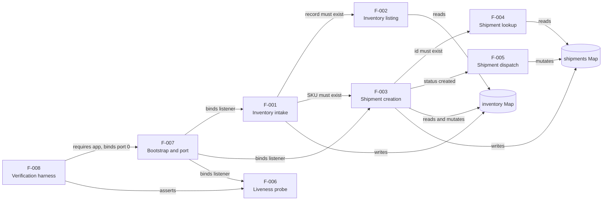

### 2.3.2 Integration Points

| Integration Point | Direction | Features Involved | Contract as Implemented |
|---|---|---|---|
| HTTP/JSON request and response | Inbound | F-001 … F-006 | Six routes at bare root paths; JSON in, JSON out; `400`/`404`/`409` carry `{error: string}` (`src/server.js:8-51`) |
| `express.json()` body parsing | Internal | F-001, F-003, F-005 supply bodies; all routes share the middleware | Applies to `application/json` only, 100 KB default limit, `req.body` is `{}` when no body is sent (verified) |
| `PORT` environment variable | Inbound configuration | F-007 only | `process.env.PORT \|\| 3000`, used unparsed (`src/index.js:2`) |
| Exported app object | Internal | F-007 → F-001 … F-006; F-007 → F-008 | `module.exports = app` (`src/server.js:53`) is the only export; nothing binds on import |
| Loopback HTTP | Internal (test only) | F-008 → F-006 | `app.listen(0)` then `fetch` on `127.0.0.1` (`test/routes.test.js:8-11`) |
| `npm start` / `npm test` commands | Inbound tooling | F-007, F-008 | `node src/server.js` (does not listen) and `node --test` (`package.json:5`) |
| Outbound integrations | None | None | No HTTP client, queue, database driver or file write exists anywhere in the repository; `destination` and `carrier` are stored text, not delivered anywhere (`:24,49`) |

### 2.3.3 Shared Components

| Component | Location | Shared By | Nature of the Sharing |
|---|---|---|---|
| Express application instance | `src/server.js:2` | F-001 … F-006, and F-007/F-008 through the export | One object carries every route; a change made for one feature is deployed for all of them simultaneously |
| `express.json()` middleware | `src/server.js:3` | F-001, F-003, F-005 | Single parser, single content-type rule, single 100 KB limit and a single `413` behaviour for oversized bodies |
| `inventory` Map | `src/server.js:5` | F-001 writes, F-002 reads, F-003 reads and mutates | Single key space per process; `sku` is the only key, so intake, listing and shipping cannot disagree about which item is which |
| `shipments` Map | `src/server.js:6` | F-003 writes, F-004 reads, F-005 mutates | Single key space per process; `shipments.size` also drives the id generator (`:32`) |
| JSON error shape `{error: string}` | `src/server.js:13,15,26,28,30,40,46,47` | F-001, F-003, F-004, F-005 | One error envelope for all handler-produced failures; it is not applied to parser failures, which return HTML (`400` malformed JSON, `413` oversized body) |
| Status-code protocol `400`/`404`/`409` | Same lines as above | F-001, F-003, F-004, F-005 | Validation, missing entity and state conflict are distinguished by code, not by an error-type field |
| Shipment id generator `SHP-${shipments.size + 1}` | `src/server.js:32` | F-003 produces, F-004 and F-005 address | A single derivation shared by all shipment routes; because nothing deletes from the Map, ids are unique in practice but not by construction |
| Application export | `src/server.js:53` | F-007 serves it, F-008 tests it | The same instance is used in production and in the suite, so tests exercise the routes that ship |

### 2.3.4 Common Services

The service carries no cross-cutting service of its own. The absences are structural, not incidental, and each one binds the features above in a specific way:

| Absent Service | Consequence for the Feature Set |
|---|---|
| Authentication and authorisation | Every requirement in 2.2 executes for any caller who can reach the port; F-001, F-003 and F-005 mutate shared state with no credential and no record of who acted |
| Persistence | F-001 and F-003 write only to process memory, so the stock and shipment records that F-002 and F-004 expose cease to exist on restart (`src/server.js:5-6`) |
| Request logging, metrics and tracing | Nothing records which feature served a request; the only logging is the start-up line in `src/index.js:3` |
| Error middleware | `app.use((err, req, res, next) => …)` does not exist, so parser failures bypass the JSON error shape every feature uses and return an HTML page instead |
| Concurrency control beyond the event loop | The F-003 stock guard and decrement are safe only while one process is the sole writer; no lock, transaction or idempotency key exists |
| Scheduled or background work | Nothing runs except in response to a request; `reorderLevel` is never re-evaluated, so no replenishment signal is produced from the data F-001 stores |

Section 1.3.2 records the same exclusions from a scope perspective; they are repeated here only as constraints on the feature set.

### 2.3.5 End-to-End Process Flow

The flow every relationship above serves, with each decision matching a named requirement in Section 2.2:

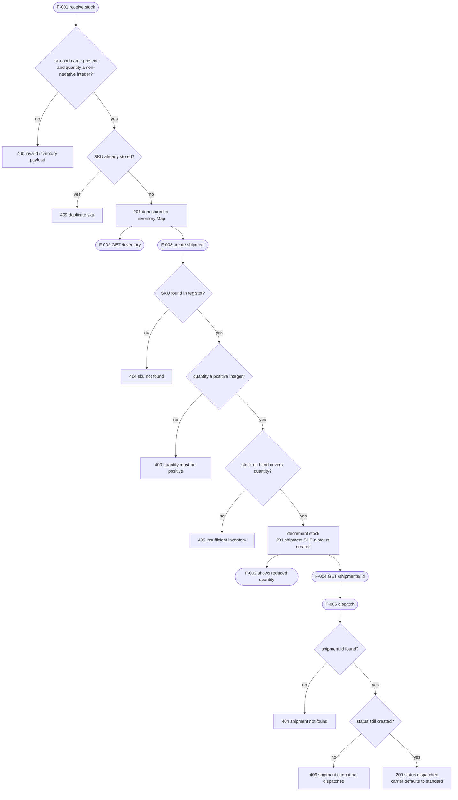

The component-level view of the same flow — how the process, the app and the two registers are arranged — is the flowchart in Section 1.2.2. Section 2.4.3 traces every node above to a source line and to the test that would prove it.

## 2.4 Implementation Considerations

The considerations below follow from the implementation as it stands: one process, two `Map`s, six synchronous handlers, no persistence and no credential. Each is tied to the feature it constrains so that a change to one feature can be assessed against the others it affects.

### 2.4.1 Universal Constraints

| Constraint | Detail | Features Affected |
|---|---|---|
| Single process, in-memory state | Both registers are module-level `Map`s (`src/server.js:5-6`); all records are lost on exit and no two processes share stock | F-001, F-002, F-003, F-004, F-005 |
| JSON-only request bodies | `express.json()` is the sole parser (`:3`); `application/x-www-form-urlencoded` and bodyless requests reach handlers as `{}` and are rejected `400` (verified) | F-001, F-003, F-005 |
| 100 KB body limit | Express's default parser limit; a 120 KB payload returned `413` with an HTML error page before the handler ran (verified) | F-001, F-003, F-005 |
| Unversioned root paths | Routes are declared at `/health`, `/inventory`, `/shipments` (`:8,10,21,23,38,44`), so any contract change is breaking for every client | All |
| No authentication or authorisation | No token, session, cookie or credential construct exists; every mutation is open to any caller reaching the port | F-001, F-003, F-005 |
| No error middleware | Handler failures follow the JSON `{error}` convention, but parser failures return Express's HTML page with a stack trace on stderr (verified) | All |
| Pinned dependency, no engine constraint | `express: "4.21.2"` exact (`package.json:6`); no `engines` key, so the runtime version is unconstrained even though the harness needs `node:test` and global `fetch` | All |

### 2.4.2 Technical Constraints, Performance and Scalability by Feature

| Feature | Technical constraints | Performance and scalability |
|---|---|---|
| F-001 Inventory Intake | No update, patch, restock or delete route exists, so a mis-entered `quantity` or `reorderLevel` can never be corrected in place; `sku` is the only key and is case-sensitive; whitespace-only values pass validation | Two Map operations, no I/O, sub-millisecond. Memory grows by one record per unique SKU, unbounded and never reclaimed; state is per-process, so N instances hold N registers |
| F-002 Inventory Listing | Returns the full register every call; no pagination, sorting, projection or filter parameter is read; `reorderLevel` may be any JSON value because intake does not constrain it | Linear in register size on every request, with no cache, `ETag` or conditional `GET`. The first route to become a bottleneck as the catalogue grows, and its payload is unbounded |
| F-003 Shipment Creation | Guard order is part of the contract — `404` before `400` before the stock comparison (`:25-31`); ids derive from `shipments.size` (`:32`), so a future delete or expiry would reuse them; no idempotency key exists, so a retried request creates a second shipment and decrements stock twice | Three Map operations, synchronous. Atomic within one process because handlers cannot interleave; not atomic across processes, where two instances can each pass their own stock check and both accept a shipment |
| F-004 Shipment Lookup | Exact-id addressing only, with sequential predictable ids; no collection, filter or search route; the record is returned by reference, so the response reflects later mutation | One Map read; constant time. No index by SKU, status, carrier or destination exists, so any reporting beyond id lookup requires listing every id |
| F-005 Shipment Dispatch | One-way transition `created → dispatched` (`:48`); the status vocabulary is two string literals compared by equality (`:47`), so a third state requires changing that comparison; no cancel, reverse or re-dispatch route; `carrier` is unvalidated | Minimal cost, no external call, so dispatch never blocks on a carrier system. Because nothing leaves the process, dispatch records an intention and makes no delivery commitment |
| F-006 Liveness Probe | Fixed body `{status:'ok'}`; reports reachability only — no version, uptime, dependency health or readiness-to-write signal | Constant cost, no Map access. Safe to poll frequently, but a `200` must not be read as data integrity |
| F-007 Bootstrap and Port | `PORT` is passed to `app.listen` unparsed and unchecked (`src/index.js:2`); the listener handle is discarded, so no bind-error handling, signal handling, graceful shutdown or TLS exists; `npm start` does not bind at all (`package.json:5`) | One bind at start-up with no retry or backoff. No drain on shutdown and no clustering, so a restart drops in-flight requests and all state at once |
| F-008 Verification Harness | `node:test` + `node:assert/strict` + global `fetch`, with `devDependencies: {}`; the module-level Maps persist across tests in one process, so test order or per-test app instances must be managed when coverage expands | The full suite runs in 86.29 ms and the health subtest in 19.9 ms, both well inside any CI budget; `app.listen(0)` prevents collisions with a running instance |

### 2.4.3 Security Implications and Maintenance Requirements

| Feature | Security implications | Maintenance requirements |
|---|---|---|
| F-001 | Unauthenticated creation of stock records; any caller can probe which SKUs exist via `409` versus `201`; no audit trail of receipt. Input is not sanitised beyond presence and integer type — a SKU is any string, stored and echoed unescaped — but it is used only as a Map key, so no query or path is constructed from it | Changing the four-field record shape changes both the intake response and the listing contract; the `409 duplicate sku` rule is the only uniqueness guarantee and must survive any storage change |
| F-002 | Discloses every SKU, name and on-hand quantity to any caller; no rate limiting, so the route is also the cheapest way to load the process | Any field added to the stored item appears here automatically, so the read contract cannot evolve independently of the write contract |
| F-003 | Unauthenticated deduction of stock; no record of who shipped what; a client retry silently double-decrements; the `404`/`409` distinction lets a caller enumerate stock levels one request at a time | The guard order, the `SHP-${shipments.size + 1}` derivation and the status literal `created` are all referenced by other features and by any future test; changing any of them changes the client-visible contract |
| F-004 | Sequential ids make every shipment addressable by enumeration; records disclose SKU, quantity and destination without any ownership check | The response is the stored object by reference, so adding a field or mutating one is immediately visible here — the reason a later dispatch shows up without a second write |
| F-005 | Unauthenticated state transition to `dispatched`; `carrier` accepts any JSON value, including a number (verified), and is stored verbatim; no operator identity or timestamp is captured | Adding a state, a cancellation or a carrier integration requires replacing the equality check at `:47`; a reversal route would also need to restore stock, which no feature currently does |
| F-006 | Open by design and discloses only readiness; the `X-Powered-By: Express` header advertises the framework (verified) | The single test asserts this body exactly, so the body is a fixed contract until the test changes with it |
| F-007 | Listens on the default interface with no TLS and no bind-error handling, so a port conflict surfaces as an uncaught process error; environment-supplied `PORT` is never validated | Correcting `package.json:5` to `node src/index.js` is a one-line change that must be made together with `README.md:5-7`, which currently documents the non-serving path; adding signal handling requires retaining the listener handle |
| F-008 | Runs only against loopback and holds no credential, so no secret can leak through the suite | Five of six routes and all three conflict behaviours remain uncovered (`README.md:12-13`); every new test must isolate or order state because both Maps are shared module-level objects |

### 2.4.4 Traceability Matrix

Every requirement in Section 2.2 traced to its implementation and to the check that proves it. "Probe-verified" means the behaviour was reproduced against a live instance during this analysis but no committed test asserts it; such a requirement can regress unnoticed.

| Requirement | Feature | Implementation | Verification |
|---|---|---|---|
| F-001-RQ-001 | F-001 | `src/server.js:16-18` | Probe-verified; no test |
| F-001-RQ-002 | F-001 | `src/server.js:12-14` | Probe-verified; no test |
| F-001-RQ-003 | F-001 | `src/server.js:12` | Probe-verified; no test |
| F-001-RQ-004 | F-001 | `src/server.js:15` | Probe-verified; no test |
| F-001-RQ-005 | F-001 | `src/server.js:11,16` | Probe-verified; no test |
| F-001-RQ-006 | F-001 | `src/server.js:11,16-18` | Probe-verified; no test |
| F-002-RQ-001 | F-002 | `src/server.js:21` | Probe-verified; no test |
| F-002-RQ-002 | F-002 | `src/server.js:21` | Probe-verified; no test |
| F-002-RQ-003 | F-002 | `src/server.js:21,31` | Probe-verified; no test |
| F-002-RQ-004 | F-002 | `src/server.js:21` | Probe-verified; no test |
| F-003-RQ-001 | F-003 | `src/server.js:25-26` | Probe-verified; no test |
| F-003-RQ-002 | F-003 | `src/server.js:27-29` | Probe-verified; no test |
| F-003-RQ-003 | F-003 | `src/server.js:30` | Probe-verified; no test |
| F-003-RQ-004 | F-003 | `src/server.js:31,34` | Probe-verified; no test |
| F-003-RQ-005 | F-003 | `src/server.js:32-33` | Probe-verified; no test |
| F-003-RQ-006 | F-003 | `src/server.js:24,33` | Probe-verified; no test |
| F-004-RQ-001 | F-004 | `src/server.js:39-41` | Probe-verified; no test |
| F-004-RQ-002 | F-004 | `src/server.js:40` | Probe-verified; no test |
| F-004-RQ-003 | F-004 | `src/server.js:38-42` | Probe-verified; no test |
| F-005-RQ-001 | F-005 | `src/server.js:45-46` | Probe-verified; no test |
| F-005-RQ-002 | F-005 | `src/server.js:47` | Probe-verified; no test |
| F-005-RQ-003 | F-005 | `src/server.js:48,50` | Probe-verified; no test |
| F-005-RQ-004 | F-005 | `src/server.js:49` | Probe-verified; no test |
| F-006-RQ-001 | F-006 | `src/server.js:8` | `test/routes.test.js:7-17` |
| F-006-RQ-002 | F-006 | `src/server.js:8` | `test/routes.test.js:7-17`, which binds a fresh app with empty registers |
| F-007-RQ-001 | F-007 | `src/index.js:2-3` | Probe-verified (`PORT=4517`); no test |
| F-007-RQ-002 | F-007 | `src/index.js:3` | Probe-verified; no test |
| F-007-RQ-003 | F-007 | `src/server.js:53` | Implied by `test/routes.test.js:3,8`; no explicit assertion |
| F-007-RQ-004 | F-007 | `package.json:5` | Probe-verified as failing; no test |
| F-008-RQ-001 | F-008 | `package.json:5` | `npm test` run: 1 test, 1 pass |
| F-008-RQ-002 | F-008 | `test/routes.test.js:7-17` | The test itself |
| F-008-RQ-003 | F-008 | Absent | Not met — `README.md:12-13` |
| F-008-RQ-004 | F-008 | Absent | Not met — `README.md:12-13` |
| F-008-RQ-005 | F-008 | `package.json:7` | `npm test` run with no dev dependencies installed |

Coverage result: three requirements carry a committed automated check (`F-006-RQ-001`, `F-008-RQ-001`, `F-008-RQ-002`), which are the two evidence sources counted in Section 2.2.10; two more are implied structurally (`F-006-RQ-002`, `F-007-RQ-003`); the remaining twenty-nine rest on manual verification only.

### 2.4.5 Assumptions and Constraints

| ID | Assumption or Constraint | Basis |
|---|---|---|
| A-01 | One process is the sole writer of the registers, and stock correctness depends on it | `src/server.js:5-6`; guards mutate a local Map with no cross-process coordination |
| A-02 | Losing all records on restart is acceptable to the operator | No persistence anywhere in the repository |
| A-03 | The network boundary around the service supplies the authorisation the code does not | No credential construct exists in any file |
| A-04 | Clients send `application/json` and tolerate an unpaginated array from `GET /inventory` | `src/server.js:3,21`; other content types rejected `400` (verified) |
| A-05 | The runtime provides `node:test` and global `fetch`; no version is declared | `test/routes.test.js:1-2,11`; `package.json` has no `engines`; the environment observed runs Node.js v22.23.5 |
| A-06 | Express stays at exactly `4.21.2` | `package.json:6`, pinned with no range operator |
| A-07 | Deployment invokes `node src/index.js`, not the documented `npm start` | `src/index.js:3` versus `package.json:5`; confirmed by running both |
| A-08 | `reorderLevel` is descriptive data with no consumer | Written at `src/server.js:11,16`; no route reads it |
| A-09 | One implicit warehouse per process; `destination` and `carrier` are free text | `sku` is the sole inventory key (`:15,17`); `destination` (`:24`) and `carrier` (`:49`) are unvalidated strings |
| C-01 | Requirements in this section describe behaviour at commit `3b9b969` only | `package.json:3` declares version `1.0.0` |
| C-02 | Any change to a status code, body shape or guard order invalidates the affected requirement IDs | Section 2.2.1 versioning rule |

### 2.4.6 Related Specifications

| Reference | What It Supplies to This Section |
|---|---|
| Section 1.2 System Overview | The component arrangement behind these features, the capability table the catalog mirrors, and the component-level flowchart referenced in Section 2.3.5 |
| Section 1.3 Scope | The in-scope capability list these features expand into requirements, and the out-of-scope table that explains the absences in Section 2.3.4 |
| Section 1.4 References | The file-and-line inventory every implementation reference above points into |
| Section 2.1 Feature Catalog | The eight features, their metadata and their dependency records |
| Section 2.2 Functional Requirements Table | The 34 requirement IDs traced in Section 2.4.4 |
| Section 2.3 Feature Relationships | The dependency map, integration points and the end-to-end process flow referenced throughout this section |

## 2.5 References

- `src/server.js` — the whole functional surface: `express.json()` (`:3`), the `inventory` and `shipments` Maps (`:5-6`), the six route handlers (`:8-51`), every validation and conflict guard (`:12,15,27-28,30,47`), the shipment id and status fields (`:32-33,48-49`) and `module.exports = app` (`:53`); the implementation reference for all 34 requirements.
- `src/index.js` — the three-line bootstrap: `process.env.PORT || 3000` (`:2`), `app.listen` and the start-up log line (`:3`); the basis for F-007.
- `package.json` — identity, version `1.0.0`, the `start` and `test` scripts (`:5`), the exact `express` `4.21.2` pin and empty `devDependencies` (`:6-7`); the basis for F-008 and for the unmet F-007-RQ-004.
- `test/routes.test.js` — the single integration test of `GET /health` over a loopback socket on an ephemeral port, with `try/finally` shutdown (`:7-17`); the only committed verification referenced by the traceability matrix.
- `README.md` — the purpose statement (inventory intake, shipment creation, shipment lookup and dispatch, `:3`), the run and test instructions (`:5-10`) and the declared test gaps (`:12-13`) behind F-008-RQ-003 and F-008-RQ-004.
- `src/` — the complete application layer, holding only the bootstrap and the Express API.
- `test/` — the complete verification layer, holding only `routes.test.js`.
- Sections 1.2 System Overview, 1.3 Scope and 1.4 References — the component arrangement, the in-scope and out-of-scope capability lists, and the file inventory this section builds on.
- No external or web sources were consulted; every claim in this section derives from the repository files above and from behaviour reproduced against a live instance of the application.

# 3. Technology Stack

## 3.1 Programming Languages

The repository's stack is one language on one runtime with one third-party dependency. JavaScript executes on Node.js; `express@4.21.2` is the only package the manifest declares; the test harness uses only modules that ship inside the runtime. Nothing in the codebase spans a second platform, a second language or a compile step.

### 3.1.1 Stack Composition at a Glance

| Layer | Technology | Version | Where it is established |
|---|---|---|---|
| Runtime | Node.js | `v22.23.5` in the analysis environment; the manifest constrains nothing | `node --version`; `package.json` has no `engines` key |
| Application language | JavaScript (CommonJS) | ES2015+ source syntax | `src/index.js`, `src/server.js` — `require` at `src/server.js:1`, `module.exports` at `:53` |
| Test language | JavaScript (CommonJS) | ES2017 `async`/`await` | `test/routes.test.js:7-16` |
| HTTP framework | Express | `4.21.2`, pinned exactly (no range operator) | `package.json:6` |
| Body parser | `express.json()` → `body-parser` | `1.20.3`, supplied transitively by Express | `src/server.js:3`; `express`'s own dependency list |
| Test runner | `node:test` (built in) | Ships with Node.js | `test/routes.test.js:1`; script `"test": "node --test"` at `package.json:5` |
| Assertions | `node:assert/strict` (built in) | Ships with Node.js | `test/routes.test.js:2` |
| HTTP client (tests only) | global `fetch` (built in) | Ships with Node.js 18+ | `test/routes.test.js:11` |
| Package manager / registry | npm against `registry.npmjs.org` | `npm 11.21.3` observed | `package.json`; `package-lock.json` `resolved` URLs |
| Data store | In-process `Map` | n/a — no product, no driver | `src/server.js:5-6` |
| Build step | None | n/a | No bundler, transpiler, `tsconfig`, or `postinstall` hook anywhere |

**The reference stack does not describe this repository.** The section brief proposes a default enterprise stack spanning AWS, Terraform, GitHub Actions, Docker, Python with Flask, Auth0, MongoDB, Langchain, React with TypeScript, React Native, Swift, Kotlin, Objective-C and Electron. Each of those is absent, and the absence is textual rather than inferred: a repository-wide search across every file outside `node_modules` and `.git` for `aws`, `amazon`, `s3`, `terraform`, `github actions`, `docker`, `kubernetes`, `python`, `flask`, `auth0`, `mongo`, `langchain`, `react`, `swift`, `kotlin`, `objective-c`, `electron`, `tailwind` and `typescript` returns zero matches. `package.json` is the complete declaration of the system's outside surface: `dependencies` is exactly `{"express": "4.21.2"}` and `devDependencies` is exactly `{}`, with no `peerDependencies`, `optionalDependencies`, `bundledDependencies`, `overrides`, `resolutions` or `workspaces` block.

| Reference-stack component | Status in this repository | Consequence for later sections |
|---|---|---|
| AWS, S3, any cloud service | Absent — no SDK, no client, no endpoint, no credential | Deployment target is whatever host runs `node`, and is unrecorded (Section 3.6.3) |
| Terraform, any IaC | Absent — no `.tf` file exists | Infrastructure is unmanaged by the repository |
| GitHub Actions, any CI | Absent — no workflow file exists | Verification is manual: a maintainer runs `npm test` |
| Docker | Absent — no `Dockerfile`, no compose file | The unit of deployment is a Node.js process on a host, per `src/index.js:3` |
| Python + Flask | Absent — no `.py` file, no `requirements.txt`, no `pyproject.toml` | The service language is JavaScript; Section 3.1 is accordingly a single-language section |
| Auth0 or any identity provider | Absent — no auth construct in any file | The service is unauthenticated by design of the code (Section 3.4.2) |
| MongoDB or any database | Absent — no driver, no connection string | State is process memory only (Section 3.5) |
| Langchain or any AI framework | Absent — no model client, no prompt, no inference call | No AI capability exists to document |
| React, Tailwind, React Native | Absent — no front-end source, no bundler, no `index.html` | There is no first-party client; the API is the product |
| Swift, Kotlin, Objective-C, Electron | Absent — no native or desktop project | No client platform is covered |
| TypeScript | Absent — no `tsconfig`, no `.ts` file, no build script | Types are enforced only at runtime (Section 3.1.4) |

The one structural property the actual stack shares with the reference stack is that it is a single-language JSON API; everything else about it is smaller.

### 3.1.2 Language by Platform and Component

The system has exactly one platform — a server-side Node.js process — so the language-per-platform view collapses to one language distributed across three executables, one data file and one document.

| Component | Path | Language / dialect | Module system | Syntax level required |
|---|---|---|---|---|
| Process bootstrap | `src/index.js` (3 lines) | JavaScript | CommonJS (`require('./server')`) | ES2015 — `const`, template literal, arrow callback |
| HTTP application | `src/server.js` (53 lines) | JavaScript | CommonJS (`module.exports = app`) | ES2015 — destructuring with defaults, arrow handlers, `Map`, `Number.isInteger`, spread |
| Verification suite | `test/routes.test.js` (17 lines) | JavaScript | CommonJS | ES2017 — `async`/`await`, `try`/`finally`, plus the runtime's `node:`-prefixed built-ins |
| Manifest | `package.json` (8 lines) | JSON — declarative data, not code | n/a | n/a |
| Lockfile (untracked) | `package-lock.json` | JSON — declarative data | n/a | n/a |
| Documentation | `README.md` (13 lines) | Markdown, embedding three shell commands | n/a | n/a |

Three details of the dialect matter for anyone extending the code:

- **The application's syntax floor is ES2015.** `src/server.js` uses destructuring with a default (`const { sku, name, quantity, reorderLevel = 5 } = req.body`, `:11`), arrow handlers on all six routes, template literals for ids (`SHP-${shipments.size + 1}`, `:32`), `Map` for both registers (`:5-6`) and spread to array-ify one (`[...inventory.values()]`, `:21`). No syntax newer than ES2015 appears: there is no optional chaining, no nullish coalescing, no class, no generator and no `async` handler in `src/`.
- **The test's syntax floor is ES2017 plus Node.js 18 built-ins.** `async`/`await` and `try`/`finally` appear at `test/routes.test.js:7-16`, and the file depends on `node:test` (`:1`), `node:assert/strict` (`:2`) and the global `fetch` (`:11`). None of these is installed by the manifest.
- **No platform other than the server is represented.** There is no front end, no mobile client, no desktop client, no CLI and no worker process; a single request/response path from an HTTP socket into a `Map` is the whole execution model.

### 3.1.3 Selection Criteria and Justification

The repository holds no architecture decision record, no design note and no README rationale — `README.md` documents only how to run and test the service and which tests are missing. The justification below is therefore read off the properties the code actually exhibits, not quoted from a recorded decision, and is presented as such.

| Selection criterion | How JavaScript on Node.js satisfies it here | Evidence |
|---|---|---|
| Source is the deployable artefact | No transpiler, bundler, or `postinstall` step exists, so `src/*.js` runs unmodified; the whole system is 94 tracked lines across five files | Root manifest and file set; `package.json:5` |
| One language across application and tests | The test file is JavaScript using runtime built-ins, so no second toolchain or language runtime is needed to verify the service | `test/routes.test.js:1-3` |
| JSON in, JSON out without translation | Records are plain objects and the wire format is JSON, so a handler builds a response object directly (`res.json(item)`, `src/server.js:18`) with no mapping layer or serialisation schema | `src/server.js:3,18,21,35,41,50` |
| Dependency surface kept to one package | Express provides routing plus the JSON parser; everything else the service needs — maps, integer checks, test runner, HTTP client — is in the runtime | `package.json:6-7`; `src/server.js:1-3` |
| Synchronous work only | All six handlers are synchronous arrow functions touching no external I/O, which is what makes each request atomic against the in-memory registers | `src/server.js:8-51` |
| Cheap, real integration testing | Because the app is exported rather than auto-listening (`src/server.js:53`), the test can construct the same application and bind it to an ephemeral port, then exercise it over a real socket with the runtime's own `fetch` | `test/routes.test.js:3,8-11` |
| Zero-configuration startup | The process reads a single environment variable and defaults it, then listens; no config file, no secret, no service discovery | `src/index.js:2-3` |

The trade the choice makes is explicit in the code: a very small, dependency-light, build-free service, paid for with no static typing (Section 3.1.4) and no isolation from the host process (Section 3.5.3).

### 3.1.4 Constraints and Dependencies

| Constraint | Effect on the system | Evidence |
|---|---|---|
| Runtime version is undeclared | `package.json` has no `engines` key, so nothing prevents installing on a Node.js release that lacks `fetch` or a stable `node:test`. The floor is implied only by the harness: global `fetch` exists from Node.js 18, `node:test` is stable from Node.js 20, and `node:`-prefixed core modules need Node.js 16 or later. Deployment and CI must agree on the version out of band | `package.json` (keys: name, version, private, scripts, dependencies, devDependencies); `test/routes.test.js:1-2,11` |
| CommonJS only | With no `"type"` field, every `.js` file is a CommonJS module. Adopting ESM requires either renaming to `.mjs` or adding `"type": "module"`, and the latter breaks the suite at once because `test/routes.test.js:3` calls `require('../src/server')` and `src/index.js:1` calls `require('./server')` | `package.json`; `src/index.js:1`; `src/server.js:53`; `test/routes.test.js:3` |
| No static type checking | Record shapes are unenforced objects: nothing validates that an inventory item has exactly `{ sku, name, quantity, reorderLevel }` or that a shipment carries `status` and `carrier`. Correctness rests on the runtime checks at `:12` and `:27` and on convention | `src/server.js:16,33`; no `tsconfig` or JSDoc type annotation in either source file |
| Numeric model is IEEE-754 double | `Number.isInteger` rejects strings and fractions (`:12,27`), but no upper bound or safe-integer guard exists, so a quantity near 2^53 would be accepted and arithmetic would lose precision; `quantity < 0` is the only magnitude check on intake | `src/server.js:12,27,31` |
| Single-threaded event loop | Handler atomicity — and therefore the oversell guard at `:30-31` — depends on handlers never yielding mid-request. Introducing an `await` between the stock comparison and the decrement would open a window in which another request could pass the same check | `src/server.js:25-31` |
| No transpilation | The ES2015+ syntax in `src/` is exactly what the runtime executes; there is no down-levelling path, so supporting an older runtime is a source rewrite, not a build-configuration change | `src/server.js:11,21,32`; no build script in `package.json` |
| Package is private | `"private": true` makes `npm publish` refuse the package; the service is consumable only by running it, which is consistent with the absent distribution artefacts | `package.json:4` |
| Express 4.21.2 is the compatibility bottleneck | Every runtime, parser and routing behaviour the service relies on — `req.body` defaulting to `{}`, `express.json()` semantics, `:id` path parameters — is a property of this framework line. The implications of moving to Express 5 are set out in Section 3.2.3 | `package.json:6`; `src/server.js:1-3,38,44` |


## 3.2 Frameworks & Libraries

The service runs on one framework and no libraries of its own. Express supplies routing, response helpers and JSON body parsing; the runtime supplies everything else the code touches. Every other framework and library in the brief's reference stack is absent.

### 3.2.1 Core Framework: Express 4.21.2

| Property | Value | Evidence |
|---|---|---|
| Package and version | `express@4.21.2`, pinned exactly with no range operator | `package.json:6` |
| Declared role | Sole runtime dependency; required by one file | `package.json:6`; `src/server.js:1` |
| Framework line status | 4.x is in **maintenance** — Express moved 4.x to maintenance-only when 5.1.0 took the npm `latest` tag, and that line receives security patches and high-priority fixes rather than features | Express LTS timeline announcement (31 Mar 2025); registry tags |
| Current registry tags | `latest` = `5.3.0`; `latest-4` = `4.22.3` — so the pin sits one minor behind the newest 4.x patch and one major behind the default install | `npm view express dist-tags` |
| Framework's own engine claim | `node >= 0.10.0`, which imposes no meaningful constraint | `node_modules/express/package.json` |
| Framework's dependency weight | 31 direct dependencies (20 pinned exactly, 11 as `~` ranges), resolving to 69 packages installed | `node_modules/express/package.json`; `npm install` output |
| Transitive footprint | 70 lockfile entries, 67 directories in `node_modules` | `package-lock.json`; `node_modules/` listing |

**What Express actually provides to this application.** The framework surface in use is narrow, and each element below is observable in the running process:

| Express capability used | Where | Observable effect |
|---|---|---|
| Application factory | `const app = express()` at `src/server.js:2` | One application object per process, exported at `:53` |
| Route registration for five verbs/paths | `app.get`/`app.post` at `:8,10,21,23,38,44` | Six endpoints at bare root paths, all matching by literal path segments plus one `:id` parameter |
| JSON body parsing | `app.use(express.json())` at `:3` | `req.body` populated for `application/json`; 100 KB default limit; 413 with an HTML body above it (verified with a 120 KB payload) |
| `res.json` / `res.status` helpers | `:8,13,15,18,21,26,28,30,35,40,41,46,50` | `Content-Type: application/json; charset=utf-8` on every handler response (verified) |
| Default response headers | Framework defaults, not configured | `X-Powered-By: Express` and a weak `ETag` on every response (verified), so the framework advertises itself and enables conditional responses the routes never requested |
| Default 404 and error handling | `finalhandler`, reached because no app-level error middleware is registered | Malformed JSON returns `400` with `text/html; charset=utf-8` and prints a `SyntaxError` stack trace to stderr (verified) |
| Query parsing | Implicit `qs` middleware, though no handler reads `req.query` | Any query string is parsed and discarded |
| Path parameter extraction | `req.params.id` at `:39,45` | `SHP-<n>` addressing for lookup and dispatch |

All six handlers are inline arrow functions; the repository defines no class, no controller module, no `express.Router()` instance and no middleware of its own. The application therefore has a flat route table with no layering to document.

### 3.2.2 Supporting Libraries

**Libraries supplied by the runtime rather than installed.** These carry the verification path and need no entry in the manifest:

| Capability | Source | Use in the repository |
|---|---|---|
| Test runner, TAP reporting, per-test isolation | `node:test` (built in) | `test/routes.test.js:1`; invoked by `"test": "node --test"` (`package.json:5`), which discovers the file under `test/` |
| Strict equality and deep-equality assertions | `node:assert/strict` (built in) | `assert.equal(response.status, 200)` and `assert.deepEqual(await response.json(), { status: 'ok' })` at `test/routes.test.js:12-13` |
| HTTP client | global `fetch` (built in, Node.js 18+) | Loopback request to `http://127.0.0.1:${port}/health` at `test/routes.test.js:11` |
| Key-value registers | `Map` (language built in) | `inventory` and `shipments` at `src/server.js:5-6` |
| Integer validation | `Number.isInteger` (language built in) | Payload guards at `:12` and `:27` |

Because `devDependencies` is an empty object, `npm install` installs nothing for testing: no Jest, Mocha, Vitest, `supertest`, `nock` or mocking library exists in the repository.

**Third-party libraries present transitively and actually exercised.** These arrive with Express and are part of the runtime behaviour whether or not the source names them:

| Library | Version | Exercised because |
|---|---|---|
| `body-parser` | `1.20.3` | Backs `express.json()`; produces the 100 KB limit, the 413 above it, and the HTML 400 on malformed JSON (all verified) |
| `raw-body` | `2.5.2` | Reads the request stream for `body-parser`; source of the `PayloadTooLargeError` surfaced on stderr |
| `qs` | `6.13.0` | Parses query strings by default; carries the moderate-severity advisories in Section 3.3.4 |
| `path-to-regexp` | `0.1.12` | Compiles `/shipments/:id` and `/shipments/:id/dispatch`; carries a high-severity advisory |
| `finalhandler` | `1.3.1` | Renders the default 404 and the HTML error page when no app-level handler exists |
| `etag`, `fresh` | `1.8.1`, `0.5.2` | Produce and evaluate the `ETag` header observed on every response |
| `media-typer`, `type-is`, `content-type` | `0.3.0`, `1.6.18`, `1.0.5` | Decide whether a request body is JSON, which is why a form-encoded body reaches the handler as `{}` and is rejected `400` (verified) |

Nine further Express dependencies — `serve-static` `1.16.2`, `send` `0.19.0`, `cookie` `0.7.1`, `cookie-signature` `1.0.6`, `proxy-addr` `2.0.8`, `merge-descriptors` `1.0.3`, `methods` `1.1.2`, `vary` `1.1.2`, `escape-html` `1.0.3` — are installed but never reached: no `express.static` mount, no cookie middleware, no `trust proxy` configuration and no content negotiation appear in the source.

**Deliberately absent libraries.** Each capability below is conventionally a library choice; in this repository it is either absent or replaced by a few lines of standard code.

| Capability | Library present? | How the system handles it instead |
|---|---|---|
| Schema validation | No (no `joi`, `zod`, `ajv`, `express-validator`) | Inline presence and integer checks at `src/server.js:12,27` |
| Security headers | No (`helmet` absent) | None — `X-Powered-By: Express` is left on (verified) |
| CORS | No (`cors` absent) | None configured, so cross-origin browser clients cannot call the API |
| Configuration | No (`dotenv` absent) | One environment variable read directly at `src/index.js:2` |
| Structured logging | No (`pino`, `winston`, `morgan` absent) | One `console.log` at start-up (`src/index.js:3`) |
| Metrics / tracing | No client library | None |
| Persistence | No driver, ORM or ODM | Two `Map` instances (`src/server.js:5-6`) |
| Rate limiting / compression | No (`express-rate-limit`, `compression` absent) | None |
| Dev reload | No (`nodemon` absent) | `node src/index.js` restarted by hand |

### 3.2.3 Compatibility Requirements

| Requirement | Statement | Established by |
|---|---|---|
| Node.js floor | Node.js 18 or later is the hard floor for the suite (global `fetch`, `node:test` present); Node.js 20 or later is the practical floor (`node:test` stable). The analysis environment runs `v22.23.5` with `npm 11.21.3` | `test/routes.test.js:1-2,11`; observed runtime |
| Node.js ceiling | None declared. `package.json` has no `engines` field, so `npm install` will not refuse any Node.js version, including ones too old to run the suite — `express@4.21.2` itself claims `node >= 0.10.0` | `package.json`; `node_modules/express/package.json` |
| Module system | CommonJS for every file. The app and the suite are joined by `require('../src/server')` (`test/routes.test.js:3`), which fails if `src/server.js` becomes an ES module | `src/server.js:53`; `test/routes.test.js:3`; `src/index.js:1` |
| Content-Type contract | Request bodies must be `application/json`. A form-encoded body is not parsed, reaches the handler as `{}` and is rejected `400`; a body sent without a matching content type is likewise rejected `400` (both verified) | `src/server.js:3,12` |
| Request body ceiling | 100 KB by default from `body-parser`; above it the request is rejected `413` with an HTML body before any handler runs (verified with 120 KB) | `src/server.js:3`; `body-parser@1.20.3` default |
| Express 5 migration — `req.body` | Express 5 documents that `req.body` is `undefined` when no parser has populated it, where Express 4 supplies `{}`. Two lines in this code depend on the Express 4 behaviour: `:49` reads `req.body.carrier` unconditionally on `POST /shipments/:id/dispatch` — a call that currently succeeds with no body at all (verified `200` with `carrier: "standard"`) and would throw a `TypeError` under Express 5 — and `:11` destructures `req.body` on `POST /inventory`, which would turn the current `400` for a form-encoded body into a `500` | `src/server.js:11,49`; Express 5 migration guide and 5.x request API reference |
| Express 5 migration — routing syntax | Express 5 matches routes with `path-to-regexp` 8.x, which rejects regexp sub-expressions in string paths, requires named wildcards, and replaces the `?` optional marker with braces. The six routes here use only literal segments and one named parameter (`:id`), so their syntax remains valid; the risk is concentrated in `req.body` and in `req.params` values that Express 5 omits rather than sets to `undefined` | `src/server.js:8,10,21,23,38,44`; Express 5 migration guide |
| Express 5 migration — maintenance posture | Because the pin is exact, no upgrade, patch or major, can occur through `npm install`; it needs a manifest edit either way. The 4.x line still receives security patches, so staying on 4.x is viable provided the pin moves to `4.22.3` (Section 3.3.4) | `package.json:6`; Express version-support page |
| Package manager | npm against `registry.npmjs.org`. Any lockfile-writing npm is acceptable, but a lockfile is only produced by a local install because none is tracked (Section 3.3.3) | `package-lock.json` (untracked); `npm install` output |

### 3.2.4 Justification for Major Choices

| Choice | What it buys the system | What it costs | Evidence |
|---|---|---|---|
| Express instead of the built-in `node:http` module | Routing for six endpoints, `res.json`, JSON body parsing with a size limit, `:id` parameter extraction and default 404/error rendering — all replaced by roughly a dozen lines of configuration, against hand-written stream reading and dispatch | A 67-package transitive tree, an HTML error format that breaks the JSON convention, and `X-Powered-By` disclosure | `src/server.js:1-3`; verified headers and error bodies |
| Express **4** rather than 5 | The code was written against 4.x semantics: `req.body` defaulting to `{}` is what lets dispatch tolerate a bodyless request and lets the inventory guard answer `400` instead of throwing | Sits on a maintenance-only line and inherits advisories that only 4.22.3 fixes | `src/server.js:11,49`; `package.json:6` |
| An exact pin (`"4.21.2"`) rather than a caret or tilde | The framework version is identical on every install, so routing and parser behaviour cannot drift between environments | Also freezes the known-vulnerable transitive set: `npm audit` offers only `express@4.22.3`, which the annotation reports as "outside the stated dependency range" | `package.json:6`; `npm audit --omit=dev` |
| No test framework dependency | The suite runs on a clean checkout with `npm install` producing zero dev packages; `npm test` completes in about 84 ms | No mocking, snapshot, coverage or fixture tooling; each test must manage the shared module-level `Map`s itself | `package.json:7`; `npm test` output (1 test, 1 pass) |
| No schema-validation library | Validation stays visible next to the rule it protects, in the same block as the mutation it guards | Four hand-written conditions; `reorderLevel` and `carrier` are stored without any check at all | `src/server.js:12,27,49` |
| No ORM or ODM | Nothing to configure, migrate or connect; a request is a `Map` lookup | No durability and no single-writer beyond one process (Section 3.5) | `src/server.js:5-6` |


## 3.3 Open Source Dependencies

The open-source surface of this service is a single package and the tree it drags in. Nothing is vendored, nothing is forked, no private registry is configured, and no development dependency is declared.

### 3.3.1 Direct Dependencies and Registry

| Package | Constraint in manifest | Resolved version | Registry | Class | Declared at |
|---|---|---|---|---|---|
| `express` | `"4.21.2"` — exact, no operator | `4.21.2` | `registry.npmjs.org` | Runtime | `package.json:6` |

That row is the entire declared dependency set. Specifics that bound it:

- **No scoped packages.** There is no `@scope/name` entry anywhere in `package.json` or the lockfile.
- **No non-registry sources.** No dependency is declared as `git+`, `file:`, `link:`, a tarball URL or an alias.
- **No optional, peer or bundled dependencies**, and no `overrides` or `resolutions` block — so no rule exists that could force a transitive version.
- **No workspaces.** The manifest is a single package, not a monorepo root.
- **No private or proxied registry.** There is no `.npmrc` in the repository or in the analysis user's home directory, and every `resolved` URL in `package-lock.json` points at `https://registry.npmjs.org`.
- **`devDependencies` is `{}`.** No open-source development tooling is declared: no test framework, linter, formatter, coverage tool, mock library or transpiler.

**Version policy.** The manifest expresses exactly one constraint, and it is a pin rather than a range — the only operator-free version string in the file.

| Policy | Count in `package.json` | Effect |
|---|---|---|
| Exact version (`"4.21.2"`) | 1 | Top-level framework version is identical on every install |
| Caret range (`^x.y.z`) | 0 | — |
| Tilde range (`~x.y.z`) | 0 in the manifest; 11 inside `express`'s own dependency list | Transitive patch drift is possible within those 11 packages only |
| Wildcard or `latest` | 0 | — |

### 3.3.2 Transitive Dependency Inventory

Installing the one declared package produces a tree of 69 additional packages. The counts below come from three independent sources that agree: `npm install` on a clean checkout reports "added 69 packages"; `npm ls --all` renders a tree of that size; and `package-lock.json` holds 70 `packages` entries — the root plus 69.

| Metric | Value |
|---|---|
| Direct dependencies of the declared package (`express`'s own manifest) | 31 |
| Of those, pinned exactly / pinned as tilde ranges | 20 / 11 |
| Packages installed alongside it | 69 |
| Entries in `package-lock.json` (`lockfileVersion` 3) | 70 |
| Directories in `node_modules/` | 67 (nested duplicates sit inside parents) |
| Redundant versions inside the tree | `encodeurl` appears twice (`2.0.3` at top level, `1.0.4` nested under `send`); `ms` appears twice (`2.0.0` at top level, `2.1.3` nested under `send`) |

| Package | Version | Role in this service | Disposition |
|---|---|---|---|
| `body-parser` | `1.20.3` | Backs `express.json()`: parse, 100 KB limit, 413, HTML 400 on bad JSON | Exercised on every write |
| `raw-body` | `2.5.2` | Reads the request stream; source of `PayloadTooLargeError` | Exercised on every write |
| `qs` | `6.13.0` | Parses query strings through Express's implicit query middleware | Loaded and invoked per request, though no handler reads `req.query` |
| `path-to-regexp` | `0.1.12` | Compiles the two `:id` route patterns | Exercised at route registration and per request |
| `finalhandler` | `1.3.1` | Renders the default 404 and the HTML error page | Exercised on malformed JSON (verified) |
| `etag`, `fresh` | `1.8.1`, `0.5.2` | Generate and evaluate the weak `ETag` seen on every response | Exercised on every response |
| `media-typer`, `type-is`, `content-type` | `0.3.0`, `1.6.18`, `1.0.5` | Decide whether a body is JSON, hence the 400 on form-encoded input | Exercised on every write |
| `merge-descriptors`, `methods` | `1.0.3`, `1.1.2` | Mix the application prototype onto the app object; register the HTTP verb methods used by `app.get`/`app.post` | Exercised once at application creation |
| `serve-static`, `send` | `1.16.2`, `0.19.0` | Static file serving and file responses | Loaded at framework initialisation, never invoked — there is no `express.static` mount and no `res.sendFile` call |
| `cookie`, `cookie-signature` | `0.7.1`, `1.0.6` | Response cookie serialisation | Loaded, never invoked — no `res.cookie` call |
| `proxy-addr` | `2.0.8` | Resolves client address when `trust proxy` is set | Loaded, never invoked — no `trust proxy` setting |
| `vary`, `escape-html` | `1.1.2`, `1.0.3` | Content negotiation and redirect escaping | Loaded; reached only inside `res.format`/`res.location`, which the service never calls |
| Remaining leaf utilities (`accepts`, `bytes`, `depd`, `debug`, `http-errors`, `iconv-lite`, `inherits`, `on-finished`, `parseurl`, `range-parser`, `safe-buffer`, `safer-buffer`, `setprototypeof`, `statuses`, `unpipe`, `utils-merge`, plus the `side-channel`/`get-intrinsic`/`call-bind` family) | pinned per the lockfile | Support the modules above | Loaded as needed by them |

This disposition refines the grouping stated in Section 3.2.2, which listed nine transitives as never reached: `merge-descriptors` and `methods` are in fact exercised at application creation, while the other seven are loaded at framework initialisation but never invoked on any request path this service can take.

### 3.3.3 Lockfile Status and Reproducibility

A lockfile exists on disk but is not part of the repository.

| Fact | Evidence |
|---|---|
| `package-lock.json` is present, `lockfileVersion` 3, 70 entries, and its root record mirrors `package.json` exactly | `package-lock.json` |
| It is **untracked** — `git ls-files` lists five files, none of them a lockfile | `git ls-files`; `git status --porcelain` shows `?? package-lock.json` and `?? node_modules/` |
| There is no `.gitignore`, so `node_modules/` and the lockfile appear as untracked noise rather than being deliberately excluded | repository root listing |
| A fresh `git archive HEAD` checkout contains only `README.md`, `package.json`, `src/`, `test/` | Clean-checkout test |
| `npm ci` on that checkout fails with `EUSAGE`: "can only install with an existing package-lock.json or npm-shrinkwrap.json" | `npm ci` on the clean checkout |
| `npm install` on that checkout succeeds and adds 69 packages, resolving `express@4.21.2` | `npm install --dry-run` |

The reproducibility consequence is narrow but real. The declared package cannot drift, because it is pinned exactly and re-resolves to `4.21.2` on every install. The tree beneath it can: 20 of `express`'s 31 dependencies are pinned exactly, so they are fixed with it, but the 11 tilde-pinned packages (`accepts ~1.3.8`, `content-type ~1.0.4`, `encodeurl ~2.0.0`, `escape-html ~1.0.3`, `etag ~1.8.1`, `methods ~1.1.2`, `parseurl ~1.3.3`, `proxy-addr ~2.0.7`, `range-parser ~2.1`, `type-is ~1.6.18`, `vary ~1.1.2`) will accept any later patch release of the same minor. Two installations performed months apart can therefore hold different code, and no committed artefact records which tree the audit results in Section 3.3.4 describe. Because no CI workflow exists, nothing runs `npm ci`, `npm audit`, Dependabot or Renovate on a schedule; dependency currency is whatever a developer's local `npm install` produces.

### 3.3.4 Vulnerability Posture

`npm audit --omit=dev` against the installed tree reports four findings: zero critical, three high, one moderate.

| Advisory subject | Severity | Affected range | Path to this service | Exposure here |
|---|---|---|---|---|
| `path-to-regexp` — ReDoS via multiple route parameters | High | `< 0.1.13` | Installed as `0.1.12`; compiles the route patterns at `src/server.js:38,44` | Low. The advisory concerns patterns with multiple parameters; the two parameterised routes carry one (`:id`) each, and route patterns are fixed in source rather than attacker-supplied |
| `body-parser` — invalid `limit` value silently disables size enforcement | High | `<= 1.20.8` | Installed as `1.20.3`; `express.json()` at `src/server.js:3` | Low. The precondition is an explicitly configured limit option; the service passes none and runs on the parser default of 100 KB (verified: 120 KB → `413`) |
| `body-parser` — DoS via trailing bytes after a compressed request body | High | `<= 1.20.8` | Same parser instance | Reachable. `body-parser` inflates compressed bodies by default; a `Content-Encoding: gzip` request was accepted with `201` (verified), so compressed request handling is on the live path |
| `qs` — five denial-of-service advisories (comma array parsing, bracket-notation memory exhaustion, `isBuffer` handling, `stringify` crashes) | Moderate | `<= 6.16.0` | Installed as `6.13.0`; Express's implicit query middleware parses the query string of every request, including the six routes here | Reachable in principle. No handler reads `req.query`, so the parsed result is discarded, but the parsing work happens before any handler runs |

The aggregated finding for `express` itself is High over the range `4.0.0-rc1 – 4.22.2`, and the audit offers exactly one remedy: upgrade to `express@4.22.3`. The exact pin in `package.json:6` prevents that automatically — `npm audit fix` declines and reports that installing `4.22.3` would be "outside the stated dependency range", while `npm audit fix --force` would rewrite the manifest. Remediation is therefore a one-character-class edit to `package.json:6` from `4.21.2` to `4.22.3`, a patch release within the same maintenance line that fixes the bundled `path-to-regexp` and `qs` versions, followed by re-running `npm test`; nothing in the service's own code depends on a version-specific behaviour that a 4.21 → 4.22 patch change would disturb.

The compensating controls and the gaps around this tree are worth stating together, because the stack supplies very few of the former:

| Control | Status in this stack |
|---|---|
| Dependency auditing | Manual only — `npm audit` must be run by hand; no CI job and no bot configuration exists |
| Lockfile-enforced installs | Absent — the lockfile is untracked, so `npm ci` cannot run on a clean checkout |
| Request body ceiling | Present — the parser's 100 KB default is the only volumetric brake in the system (verified) |
| Content-type restriction | Present — only `application/json` is parsed, so form-encoded input is rejected before reaching a handler (verified) |
| Security headers (`helmet`, CSP, HSTS) | Absent — the framework's `X-Powered-By: Express` header is sent unfiltered (verified), advertising the exact stack to any client |
| Rate limiting | Absent |
| TLS | Absent — `app.listen` is called with no options at `src/index.js:3`, so traffic is plaintext HTTP |
| Authentication of callers | Absent (Section 3.4.2) |


### 3.3.5 Direct Dependency Constraint Reference

The authoritative constraint set behind Sections 3.3.2 and 3.3.3, taken verbatim from `express@4.21.2`'s own `dependencies` and paired with the version each resolves to in the installed tree. Twenty are exact pins and therefore fixed at install time; eleven are tilde ranges whose patch component may drift.

| Dependency of `express@4.21.2` | Declared constraint | Resolved here | Drift possible |
|---|---|---|---|
| `accepts` | `~1.3.8` | `1.3.8` | Patch within 1.3 |
| `array-flatten` | `1.1.1` | `1.1.1` | No |
| `body-parser` | `1.20.3` | `1.20.3` | No |
| `content-disposition` | `0.5.4` | `0.5.4` | No |
| `content-type` | `~1.0.4` | `1.0.5` | Patch within 1.0 |
| `cookie` | `0.7.1` | `0.7.1` | No |
| `cookie-signature` | `1.0.6` | `1.0.6` | No |
| `debug` | `2.6.9` | `2.6.9` | No |
| `depd` | `2.0.0` | `2.0.0` | No |
| `encodeurl` | `~2.0.0` | `2.0.3` | Patch within 2.0 |
| `escape-html` | `~1.0.3` | `1.0.3` | Patch within 1.0 |
| `etag` | `~1.8.1` | `1.8.1` | Patch within 1.8 |
| `finalhandler` | `1.3.1` | `1.3.1` | No |
| `fresh` | `0.5.2` | `0.5.2` | No |
| `http-errors` | `2.0.0` | `2.0.0` | No |
| `merge-descriptors` | `1.0.3` | `1.0.3` | No |
| `methods` | `~1.1.2` | `1.1.2` | Patch within 1.1 |
| `on-finished` | `2.4.1` | `2.4.1` | No |
| `parseurl` | `~1.3.3` | `1.3.3` | Patch within 1.3 |
| `path-to-regexp` | `0.1.12` | `0.1.12` | No |
| `proxy-addr` | `~2.0.7` | `2.0.8` | Patch within 2.0 |
| `qs` | `6.13.0` | `6.13.0` | No |
| `range-parser` | `~2.1.2` | `2.1.2` | Patch within 2.1 |
| `safe-buffer` | `5.2.1` | `5.2.1` | No |
| `send` | `0.19.0` | `0.19.0` | No |
| `serve-static` | `1.16.2` | `1.16.2` | No |
| `setprototypeof` | `1.2.0` | `1.2.0` | No |
| `statuses` | `2.0.1` | `2.0.1` | No |
| `type-is` | `~1.6.18` | `1.6.18` | Patch within 1.6 |
| `utils-merge` | `1.0.1` | `1.0.1` | No |
| `vary` | `~1.1.2` | `1.1.2` | Patch within 1.1 |

Five of the eleven tilde-ranged packages have already floated one or more patches beyond the version that Express 4.21.2 was released against (`content-type` 1.0.4 → 1.0.5, `encodeurl` 2.0.0 → 2.0.3, `proxy-addr` 2.0.7 → 2.0.8, plus the `send`-nested `encodeurl` 1.0.4 and `ms` 2.1.3 copies). That drift is the concrete mechanism behind the unreproducible-install finding in Section 3.3.3, and it is also why the advisory set in Section 3.3.4 can change without any edit to this repository.


## 3.4 Third-Party Services

The service integrates with no third party. It calls nothing, authenticates nothing through an identity provider, reports to no monitoring service and runs on no named cloud platform. Every absence in this sub-section is a textual fact about the repository, not an inference.

### 3.4.1 External APIs and Integrations

| Integration category | Status | Evidence |
|---|---|---|
| Outbound HTTP or HTTPS calls from application code | None | No `fetch`, `http`/`https` request, socket or client library appears in `src/`; `package.json` declares no HTTP client |
| Carrier, 3PL, label-generation or tracking API | None | Dispatch only sets `status` and `carrier` on the stored record (`src/server.js:48-49`); a live dispatch returned `200` with no outbound traffic |
| ERP, WMS, procurement or accounting system | None | No client, endpoint, credential or mapping code exists |
| Address validation or geocoding | None | `destination` is an unvalidated free-text string stored verbatim (`src/server.js:24,33`) |
| Message broker, event stream or webhook | None | No publish path, outbox, subscriber or queue client |
| Object or blob storage | None | No SDK and no file write anywhere in `src/` |

The only network I/O in the repository belongs to the test suite, which calls the service's own loopback socket at `test/routes.test.js:11`. In production the process is a pure leaf: requests arrive on the listener opened at `src/index.js:3` and nothing leaves the process.

### 3.4.2 Authentication and Identity Services

There is no identity layer. A search of every source, manifest and documentation file finds no token, session, cookie, API-key, OIDC, OAuth, SAML, JWT or `Authorization` header construct. The framework's cookie helpers (`cookie`, `cookie-signature`) are loaded with Express but never invoked, because no route calls `res.cookie`.

Three consequences follow directly, and they set the security baseline for the whole stack:

| Consequence | Detail | Evidence |
|---|---|---|
| Every endpoint is open to any caller that can reach the port | All six routes execute without any credential check, including the four that mutate state | `src/server.js:8-51` |
| Access control is entirely a network-boundary responsibility | With nothing to validate, the operator must supply isolation — a private network, a proxy, or both — and the repository documents none of it | Repository contains no proxy, gateway or network configuration |
| No client identity is recorded | No handler stores or forwards a user, role or caller identifier, so no record can be attributed and no audit exists | Record shapes at `src/server.js:16,33` hold no actor field |

Two further framework-level facts belong here because they shape what a browser-facing deployment would require: no CORS policy is configured, so a browser client on another origin cannot call the API; and `X-Powered-By: Express` is emitted on every response (verified), advertising the framework and version line to any caller.

### 3.4.3 Monitoring, Logging and Observability Services

| Capability | Status | Detail |
|---|---|---|
| APM or tracing agent | None | No agent package, no instrumentation hook, no OpenTelemetry dependency |
| Metrics endpoint or exporter | None | No counter, histogram or scrape path exists |
| Structured logging | None | One `console.log` at start-up: `warehouse API listening on ${port}` (`src/index.js:3`); no request log, no correlation id, no log level |
| Error reporting | None | No reporting SDK; unhandled parser errors are rendered by `finalhandler` and their stack traces are printed to stderr by the framework itself (verified with malformed JSON and with a 120 KB body) |
| Health signal | Present but shallow | `GET /health` returns a fixed `{ status: 'ok' }` (`src/server.js:8`); it reports process reachability only — it does not check a dependency, because the process has none |

An operator adopting this service must supply logging, metrics and error capture outside the application, and must expect nothing in the process to survive the host: the start-up line is the only evidence it emits.

### 3.4.4 Cloud and Platform Services

The platform contract of this service is a single environment variable and a TCP port.

| Platform concern | How the stack handles it | Evidence |
|---|---|---|
| Port assignment | `process.env.PORT`, defaulting to `3000`, read once and passed to `app.listen` unparsed | `src/index.js:2-3` — the only `process.` reference in the repository |
| Configuration and secrets | None — no config file, no `.env`, no secrets manager, no credential of any kind | No `.env` file; no `dotenv` dependency |
| Service discovery, load balancing, autoscaling | Not addressed; the design assumes one process holding all state, so any horizontal scaling partitions the registers | `src/server.js:5-6` |
| TLS termination | Not in the process — `app.listen(port, cb)` is called with no options, so the listener is plaintext HTTP. A TLS-terminating proxy would be required and is not documented anywhere | `src/index.js:3` |
| Container or serverless packaging | None — no `Dockerfile`, no compose file, no handler export for a serverless runtime | Repository file set |
| Target cloud or hosting provider | Unrecorded. No provider reference exists in any file, and `README.md:5-7` documents only `npm install` then `npm start` | Repository-wide search returns no provider name |
| Managed database, cache or queue service | None provisioned or referenced | Section 3.5 |

### 3.4.5 What Adopting a Service Would Require

Recording the absences is only useful if it is clear what introducing a service would cost. Each row below names the code that a new integration must touch, using the constraints established in Sections 3.1.4 and 3.2.3.

| Integration | Change the stack forces | Blocker to plan for |
|---|---|---|
| Identity provider or API gateway | Middleware must be registered between `express.json()` (`src/server.js:3`) and the first route (`:8`); every route must then choose a policy, and none currently reads a credential | There is no error middleware, so an authentication failure raised as an exception would surface as an HTML 500 |
| Carrier or tracking API | A dispatch handler would have to become `async` and gain timeout and retry handling (`src/server.js:44-51`) | Handlers are synchronous by design; introducing `await` before the state mutation at `:48` opens an interleaving window on the shipment record |
| APM agent or logger SDK | The agent must be required ahead of the app at `src/index.js:1`, and a flush-on-exit hook needs the listener handle that is currently discarded at `:3` | No signal handling exists to flush on shutdown |
| Metrics exporter | A new `GET` route would be added alongside the six existing ones; Express's `X-Powered-By` and default `ETag` would apply to it automatically | Routes sit at bare root paths with no versioning, so a scrape path becomes a permanent part of the public contract |
| Correlation and request logging | A middleware would wrap every handler and read `req.headers`, which the code never inspects today | No structured output convention exists to log into; the only precedent is a single unstructured `console.log` |


## 3.5 Databases & Storage

There is no database, no file store and no cache. The service's entire data layer is two module-level `Map` objects created when `src/server.js` is loaded, and they are lost when the process exits. This sub-section documents that model precisely, because every storage constraint the service has follows from it.

### 3.5.1 Persistence Model as Implemented

| Register | Declaration | Key | Value shape | Written at | Read at |
|---|---|---|---|---|---|
| Inventory | `const inventory = new Map()` — `src/server.js:5` | `sku` string, exactly as supplied | `{ sku, name, quantity, reorderLevel }` (`:16`) | `:17` (insert), `:31` (quantity decremented in place) | `:15` (duplicate check), `:21` (full listing), `:25` (stock lookup) |
| Shipments | `const shipments = new Map()` — `src/server.js:6` | `` `SHP-${shipments.size + 1}` `` (`:32`) | `{ id, sku, quantity, destination, status, carrier? }` (`:33`) | `:34` (insert), `:48` (status set to `dispatched`), `:49` (carrier appended) | `:32` (size, for id derivation), `:39` and `:45` (lookup by id) |

Characteristics that define the persistence model:

- **Process-scoped lifetime, no durability layer.** No `fs` call, no database driver, no ORM or ODM, no connection string, no migration and no seed script appears anywhere in the repository. A restart begins with two empty maps, so an operator must re-run `POST /inventory` for every SKU after each restart. Section 1.2 and Section 2.4 record the same constraint from the functional side.
- **Values are stored and returned by reference.** `res.json([...inventory.values()])` (`:21`) and `res.json(shipment)` (`:41,50`) serialise the very objects held in the maps. There is no copy, no projection and no DTO, which is why a dispatch performed at `:48-49` is visible through a later `GET /shipments/:id` without any second write.
- **Two write operations per shipment.** Creation decrements the inventory record (`:31`) and inserts a shipment record (`:34`) as separate statements with no transaction, no rollback and no compensating path. Within one process the sequence cannot interleave, which is the only thing making it effectively atomic (Section 3.1.4).
- **The registers are the source of truth, not a cache.** No other copy of the data exists, so there is nothing to invalidate, rebuild or warm on start-up.

### 3.5.2 Caching, Secondary Storage and Retention

| Concern | Status | Evidence |
|---|---|---|
| External cache (Redis, Memcached, any client) | None | No cache client in `package.json` or the lockfile |
| In-process cache separate from the registers | None | The two maps are the only data structures; no memoisation or lookup table exists |
| HTTP response caching | Partially on by framework default, unconfigured by the service | Express emits a weak `ETag` on every response and honours conditional requests — a `GET /health` with `If-None-Match` returned `304` with an empty body (verified). The service itself sets no `Cache-Control`, `Expires` or `Last-Modified` header (verified absent) |
| Retention policy, TTL or expiry | None | Nothing removes a record: no delete route, no sweeper, no timestamp field on either record shape (`:16,33`) |
| Eviction or capacity limit | None | Both maps grow without bound — one entry per unique SKU and per shipment, for the life of the process |
| Pagination or windowing on read | None | `GET /inventory` returns every item every time (`:21`) |
| Backup, replica or point-in-time recovery | None | Nothing to back up outside process memory, and no mechanism that could capture it |
| Secondary or analytic store | None | No export path, no batch writer, no stream |

The id derivation at `:32` is worth naming here as a retention-coupled decision: `SHP-${shipments.size + 1}` is unique only because records are never removed. Introducing retention — a delete, an expiry or a sweep — would make the next id collide with an existing one.

### 3.5.3 Storage Evolution Constraints

Any move to durable storage must preserve the behaviours below, because each is part of the externally visible contract. The constraints are derived from the guard clauses themselves, not from a roadmap.

| Invariant to preserve | Why it is binding | Where it lives today |
|---|---|---|
| SKU uniqueness per register | A second intake for an existing SKU must still return `409 duplicate sku`. Today the guarantee is a check-then-write on one map (`:15` before `:17`); a shared store needs a unique constraint, or two writers can both pass the check | `src/server.js:15-17` |
| Nothing oversold | Stock must never go negative, and a rejected request must have no side effect. Today the comparison and the decrement are adjacent and unbroken (`:30-31`); a store needs a conditional update (compare-and-set or a guarded decrement), not a read-modify-write | `src/server.js:25-31` |
| Client-visible guard order | `404 sku not found` precedes `400 quantity must be positive`, which precedes `409 insufficient inventory`. Reordering these changes the contract for every client, whatever the storage engine | `src/server.js:26-30` |
| Shipment id format | Ids are `SHP-1`, `SHP-2`, … derived from `shipments.size`. A durable store needs a sequence or counter, since a row count changes as soon as anything is removed | `src/server.js:32` |
| Status vocabulary | `status` is compared by string equality against `'created'` (`:47`) and set to `'dispatched'` (`:48`). A store that constrains the column, or a migration that renames a state, must keep both literals meaningful | `src/server.js:47-48` |
| Response identity | Records are returned by reference from the maps, so a mutation is immediately visible on read. A store that serialises rows per query changes that behaviour — and a store that caches rows must decide when to discard them | `src/server.js:21,41,50` |
| Synchronous handler model | Every handler is synchronous today, which is what makes each request atomic. A store introduces I/O, therefore `async` handlers, therefore interleaving between the stock check and the decrement, and therefore a need for the error middleware that does not exist | `src/server.js:8-51`; no `app.use((err, …))` anywhere |
| Test isolation | `test/routes.test.js:3` requires the same module the server exports, so the registers are shared across every test in one process and persist between them. Replacing the maps means changing how the suite isolates state | `test/routes.test.js:3,8`; `src/server.js:53` |
| Configuration surface | A store needs an address and credentials. That would add the first secret and the second environment variable to a system whose entire configuration is `process.env.PORT` | `src/index.js:2` |


## 3.6 Development &amp; Deployment

The development and deployment story of this service is two npm scripts and a runtime, with no build, no pipeline and no packaging. What exists is verified by running it; what does not exist is absent from the file set.

### 3.6.1 Development Toolchain

| Tool | Present? | Detail |
|---|---|---|
| Node.js runtime | Yes | `v22.23.5` in the analysis environment; no version is declared in the manifest, so nothing enforces it |
| npm | Yes | `11.21.3` observed; used for install and for both scripts |
| Package lockfile | On disk but untracked | `package-lock.json`, `lockfileVersion` 3 — see Section 3.3.3 |
| Type checker | No | No `tsconfig.json`, no `// @ts-check`, no JSDoc type annotations, no `typescript` dependency |
| Linter | No | No `.eslintrc*`, `eslint.config.*`, `tslint.json`, `jshintrc`, `biome.json` or `standard` config |
| Formatter | No | No `.prettierrc*`, `.editorconfig` or `dprint.json` |
| Node version pin | No | No `.nvmrc`, `.node-version`, `.tool-versions` or `engines` field |
| Test framework | Runtime built-in only | `node:test` + `node:assert/strict`; no dev dependency |
| Watch/reload tool | No | No `nodemon`, `tsx`, `node --watch` script or `concurrently` |
| Pre-commit hook | No | No `.husky/`, `.git/hooks` content in the tree, no `lint-staged` |
| Debug or editor config | No | No `.vscode/`, `.idea/`, `launch.json` |
| Container/VM dev environment | No | No `.devcontainer/`, `Dockerfile`, `Vagrantfile` or `Makefile` |

The practical consequence is that code style and type discipline are conventions held by the authors rather than enforced by tooling: `npm test` is the only automated check the repository can run.

### 3.6.2 Build, Run and Test Commands

| Command | Declared as | What actually happens | Verified |
|---|---|---|---|
| `npm install` | Not a script — implicit | Resolves `express@4.21.2` and installs 69 packages from `registry.npmjs.org`; `devDependencies` installs nothing | Yes, on a clean checkout |
| `npm start` | `"start": "node src/server.js"` (`package.json:5`) | Loads the application module, assigns `module.exports = app` at `src/server.js:53` and **exits 0 without ever opening a listener** | Yes — process ends immediately, no port bound |
| `node src/index.js` | Not a script — the serving path | Resolves `process.env.PORT || 3000`, calls `app.listen`, logs `warehouse API listening on ${port}` | Yes — served requests on ports 4981–4985 during this analysis |
| `npm test` | `"test": "node --test"` (`package.json:5`) | Discovers `test/routes.test.js`, runs one test over a loopback socket on an ephemeral port | Yes — 1 test, 1 pass, ~84 ms |
| Build | None | There is no build step; the ES2015+ source in `src/` is the artefact that runs | n/a |
| Lint / typecheck / audit | None | No script and no tool exists for any of them | n/a |

The `npm start` discrepancy is the single most consequential deployment fact in this section: the command `README.md:5-7` instructs a new developer to run is not the command that serves traffic. Any runbook, container entrypoint or process manager must invoke `node src/index.js` until `package.json:5` is corrected.

### 3.6.3 Containerization, CI/CD and Infrastructure as Code

| Artefact | Status | Evidence |
|---|---|---|
| `Dockerfile`, `.dockerignore`, `docker-compose*.yml` | Absent | Repository file set is five tracked files |
| Kubernetes, Helm, Nomad or ECS task definitions | Absent | No manifest of any kind |
| CI pipeline (GitHub Actions, GitLab CI, CircleCI, Jenkins, Azure Pipelines) | Absent | No `.github/`, `.gitlab-ci.yml`, `.circleci/`, `Jenkinsfile` or `azure-pipelines.yml` |
| Infrastructure as Code (Terraform, Pulumi, CloudFormation, CDK, Ansible) | Absent | No `.tf`, `.tfstate`, `.pulumi/`, template or playbook file |
| Dependency-update automation (Dependabot, Renovate) | Absent | No config file; with no CI, no scheduled job runs `npm audit` |
| Environment provisioning or `.env.example` | Absent | Configuration is the single `PORT` variable read at `src/index.js:2` |
| Release or version tagging | Absent | `version` is `1.0.0` in the manifest; two commits exist in history and no tag was used |

Nothing in the repository verifies a change before it ships, measures coverage, or reproduces an install. The verification loop is a developer running `npm test` on their own machine against whatever Node.js and dependency tree their environment happens to hold.

### 3.6.4 Deployment Requirements Implied by the Stack

These are the conditions under which the stack as written behaves as designed. Each is derived from a specific line, and each is currently undocumented in the repository.

| Requirement | Why the stack imposes it | Evidence |
|---|---|---|
| Start with `node src/index.js`, not `npm start` | Only `src/index.js` opens a listener | `src/index.js:3`; `package.json:5`; both executed |
| Furnish Node.js 20 or later | The suite needs stable `node:test` and the global `fetch`; the manifest enforces nothing | `test/routes.test.js:1-2,11`; no `engines` field |
| Provide `PORT` or accept `3000` | The value is read once, unvalidated, and passed straight to `app.listen`; a non-numeric value surfaces as an uncaught bind error | `src/index.js:2-3` |
| Run exactly one instance | Stock and shipments are process-local maps; two instances hold two independent registers and both can pass the oversell guard | `src/server.js:5-6,25-31` |
| Terminate TLS in front of the process | `app.listen(port, cb)` is called with no options, so the listener is plaintext HTTP | `src/index.js:3` |
| Set `NODE_ENV=production` | With `NODE_ENV` unset — the repository's default, since nothing sets it — Express renders the full error stack, including absolute server filesystem paths and `node_modules` paths, into the HTTP response body of a malformed-JSON `400`. With `NODE_ENV=production` the same request returns only `Bad Request` | Verified: unset → HTML containing `/…/node_modules/body-parser/lib/types/json.js:92:19`; production → `<pre>Bad Request</pre>` |
| Capture stderr | Parser failures print `SyntaxError` stack traces to stderr on every malformed request, whether or not the response body discloses them | Verified on every malformed-JSON probe |
| Supervise and restart the process | `app.listen`'s handle is discarded, so there is no signal handling, no graceful shutdown and no bind-retry; an unhandled bind error ends the process | `src/index.js:3` |
| Accept full state loss on restart | No persistence exists; nothing re-seeds either register | `src/server.js:5-6` |
| Restrict network reachability | No authentication, no CORS policy, no rate limit; any caller that reaches the port can mutate stock | `src/server.js:8-51` |
| Send `Content-Type: application/json` | Any other content type reaches handlers as `{}` and is rejected `400`; bodies above 100 KB are refused `413` before any handler runs | `src/server.js:3`; verified |


## 3.7 Stack Integration and Security Posture

The components documented in Sections 3.1 to 3.6 meet at a small number of well-defined boundaries. This sub-section maps those boundaries, states what each requires of the other, and sets out the security consequences of the choices.

### 3.7.1 Component Integration Map

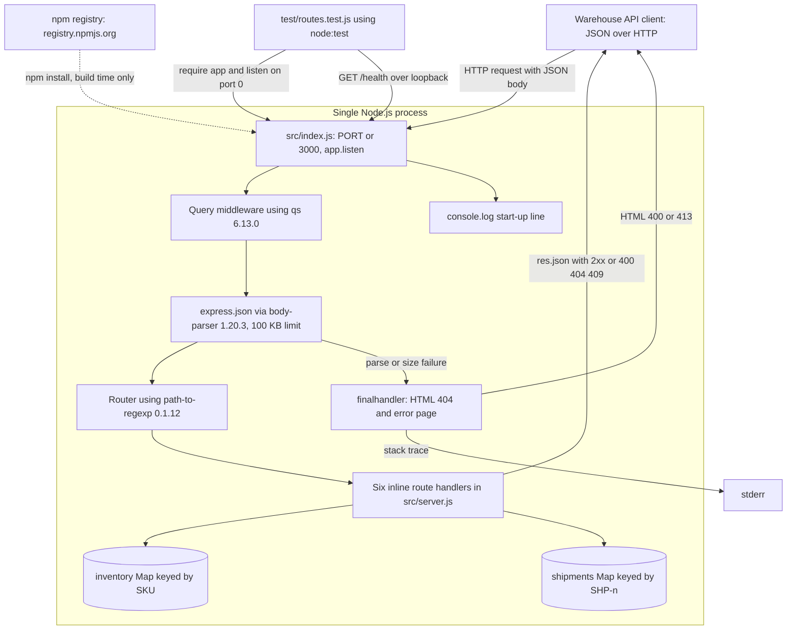

Two properties of that map drive everything else in this section: the framework is the only component between the socket and the handlers, and the maps are the only components behind them. There is no layer, queue, store or service to fail between those two points.

### 3.7.2 Integration Requirements Between Components

| Link | Mechanism | Requirement for it to work | Failure mode if unmet |
|---|---|---|---|
| Host → Node.js process | OS process launch | A Node.js release providing `node:test` and global `fetch` (18 minimum, 20 for a stable runner) | `require('node:test')` fails, so `npm test` cannot start; no `engines` field prevents the mismatch |
| npm → registry | `npm install` over HTTPS at build time | Network access to `registry.npmjs.org` and no lockfile requirement | Offline install fails; without a tracked lockfile the resulting tree is not reproducible (Section 3.3.3) |
| Operator → listener | `app.listen(PORT)` | The serving entry point must be `src/index.js`; the port must be bindable | Using `npm start` binds nothing; a bad `PORT` value surfaces as an uncaught bind error and the process exits |
| Client → Express | HTTP/1.1 with `Content-Type: application/json` | Bodies within 100 KB and JSON-encoded | Form-encoded or untyped bodies reach handlers as `{}` and return `400`; bodies over 100 KB return `413` — both verified |
| Express → `body-parser` | `express.json()` registered before any route (`src/server.js:3`) | The parser must stay first in the middleware chain | If a route were registered before it, `req.body` would be empty and every write would fail validation |
| Express → `qs` | Implicit query middleware on every request | Nothing — no handler reads `req.query` | None functionally; the parse cost and the advisory exposure in Section 3.3.4 remain |
| Router → handlers | Literal path segments plus one `:id` parameter | Route patterns must remain expressible in `path-to-regexp` 8 syntax (they are) | A pattern that Express 5 rejects would fail at registration, not at request time |
| Handlers → maps | Direct synchronous `get`/`set`/`size` calls | Handlers must not yield between a guard and its mutation | Inserting an `await` between the stock check (`:30`) and the decrement (`:31`) would allow two requests to pass the same check |
| Framework → `finalhandler` | Invoked because no app-level error middleware is registered | A JSON client must tolerate an HTML error body | Malformed JSON returns `text/html`, breaking the JSON error convention every other failure follows, and discloses a stack trace when `NODE_ENV` is unset (Section 3.6.4) |
| Handlers → client | `res.status(...).json(...)` | Clients must key on `400`/`404`/`409` distinctions | A client treating all failures the same would retry a `409 insufficient inventory`, which cannot succeed until stock changes |
| Test suite → app | `require('../src/server')` then `app.listen(0)` | `src/server.js` must never listen on its own | If the module opened a listener at import time, the suite would bind a real port and fail to close it |
| Process → operator | One stdout line at start-up; stack traces on stderr | A supervisor must capture both streams | Without stderr capture, parser failures are invisible; without the stdout line there is no start-up confirmation |

### 3.7.3 Security Implications of the Stack

| Stack property | Security implication | Control present | Control absent |
|---|---|---|---|
| No authentication or authorisation in any layer | All four mutating routes are open to any caller that reaches the port, including stock creation, shipment creation and dispatch | Network isolation, if the operator supplies it | Tokens, sessions, API keys, mTLS, gateway policy |
| No TLS in the process | Credentials would travel in clear text if any were added; today the payloads and the `409`-based stock oracle are exposed to anyone on the path | None | HTTPS listener, HSTS |
| Express's default error rendering | With `NODE_ENV` unset, a malformed request returns an HTML page containing absolute server filesystem paths and `node_modules` locations; with `NODE_ENV=production` it returns `Bad Request` (both verified) | `NODE_ENV=production` if the operator sets it | Error middleware, and any documentation of the `NODE_ENV` requirement |
| `X-Powered-By: Express` | Every response advertises the framework, narrowing an attacker's search to Express 4.21.2 advisories | None | `app.disable('x-powered-by')` or `helmet` |
| Only the JSON parser is installed | Attack surface is narrower than a full-featured stack: no urlencoded, multipart, static-file or template engine route is reachable | Content-type restriction and the 100 KB parser limit | Explicit body-size tuning; no rate limiting |
| `qs` parses every query string | The moderate-severity advisories in Section 3.3.4 sit on a path every request traverses | No handler consumes `req.query`, so malformed input has no downstream effect | A strict query parser, or `query parser: false` on the app |
| Exact dependency pin | The framework version is fixed, but so are its known advisories: `npm audit fix` refuses to move past the pin | The pin guarantees no unexpected version drift | Any automated patch path (Section 3.3.4) |
| Untracked lockfile | Two installs can hold different transitive code, so "what was audited" is not "what runs" | The exact express pin fixes the framework itself | `npm ci` in a pipeline, a committed lockfile |
| Inputs stored and echoed verbatim | `name`, `destination`, `reorderLevel` and `carrier` are stored as supplied and returned unescaped in JSON. No HTML is rendered, so the service itself does not reflect them into markup, but any consuming UI inherits the obligation to escape them | JSON responses carry `application/json`, which browsers do not render as HTML | Field validation, length caps, output encoding at the consumer |
| Records returned by reference | A caller sees the live object, so a later mutation appears in an earlier response's future reads | None needed within one process | Any isolation between concurrent readers |
| Sequential shipment ids | Every shipment is addressable by enumeration (`SHP-1`, `SHP-2`, …), with no ownership check to limit the reach | None | Unguessable identifiers, authorisation per record |

### 3.7.4 Stack-Level Risk Register

| Risk | Trigger | Effect | Mitigation available within the current stack |
|---|---|---|---|
| Express 4 line reaches its support boundary | The 4.x line is maintenance-only and receives security patches rather than features; its published EOL target is expressed as a goal, not a commitment | Security fixes stop arriving for a framework the whole service depends on | Move the pin to `4.22.3` now (fixes the current advisories); plan the Express 5 migration against the hazards in Section 3.2.3 |
| Advisories persist behind the exact pin | Any new advisory in a 4.22.x release | The service cannot patch without a manifest edit, and nothing automates that edit | Change `package.json:6` to `4.22.3`; adopt a committed lockfile and a scheduled audit |
| Non-reproducible installs | A clean checkout with no tracked lockfile; 11 tilde-ranged transitives | Different code in different environments, including different vulnerability exposure | Commit `package-lock.json`, run `npm ci` in a pipeline |
| Runtime drift | No `engines`, no `.nvmrc`, no CI | A host on an older Node.js breaks the suite silently at install time and possibly at runtime | Declare `engines.node` and pin the version in the deployment image |
| Documented run path does not serve | `README.md:5-7` says `npm start`; `package.json:5` runs `src/server.js` | A first-time deploy appears to succeed and binds nothing | Correct the script to `node src/index.js` |
| Lost state on every restart | Two process-local maps, no persistence | Every restart destroys the register and any dispatch history | Out of scope for the stack as it stands — requires a store (Section 3.5.3) |
| Error-format inconsistency | No error middleware; `finalhandler` renders HTML | JSON clients must parse two response formats; stack traces may leak when `NODE_ENV` is unset | Add error middleware returning `{ error }`, and set `NODE_ENV=production` |
| Verification gap | One test of six routes, no CI | Regressions in five routes and three conflict behaviours ship unverified (`README.md:12-13`) | Extend the `node:test` suite; the harness needs no new dependency |


## 3.8 References

Every factual claim in this section traces to one of the sources below.

**Repository files**

- `package.json` — the complete dependency declaration: `express` pinned exactly at `4.21.2`, `devDependencies` empty, scripts `start` and `test`, `private: true`, and the absence of `engines`, `type`, `main`, `license`, `overrides`, `resolutions`, `workspaces` and any peer, optional or bundled dependency block.
- `package-lock.json` — `lockfileVersion` 3, 70 package entries, a root record mirroring the manifest, and `resolved` URLs all on `registry.npmjs.org`. Present on disk but untracked by git.
- `src/index.js` — the entire process bootstrap in three lines: `process.env.PORT || 3000`, `app.listen`, one `console.log`, and a discarded listener handle. The only `process.env` reference in the repository.
- `src/server.js` — the whole API in 53 lines: `express()`, `express.json()`, the two module-level `Map` registers, all six route handlers, the guard order at `:25-31`, the `SHP-${shipments.size + 1}` id derivation at `:32`, the unconditional `req.body.carrier` read at `:49`, and `module.exports = app` at `:53`.
- `test/routes.test.js` — the entire verification suite: `node:test`, `node:assert/strict`, global `fetch`, `app.listen(0)` over loopback, and the single health assertion.
- `README.md` — the documented run path (`npm install`, `npm start`), the test command, and the self-declared coverage gap naming the untested journeys and conflict behaviours.

**Repository folders**

- `src/` — contains only `index.js` and `server.js`; establishes that there is no controller, service, model, middleware or configuration module.
- `test/` — contains only `routes.test.js`; establishes that verification is a single file with a single test.
- `node_modules/` — contains 67 installed directories including two nested duplicate packages; source of the `express` manifest (31 dependencies, 20 exact and 11 tilde-ranged, `engines node >= 0.10.0`) and of the Express source paths examined to determine which transitives are loaded at initialisation and which are invoked per request.

**Verified by execution**

- `node --version` (`v22.23.5`), `npm --version` (`11.21.3`), `npm view express dist-tags` (`latest` 5.3.0, `latest-4` 4.22.3), `npm ls --depth=0` and `npm ls --all`.
- `npm test` — 1 test, 1 pass, ~84 ms.
- `npm start` — exits 0 without binding a port; `node src/index.js` — serves on the configured port.
- Live HTTP probes against ports 4981–4985 — `X-Powered-By: Express` and weak `ETag` headers, `304` on `If-None-Match`, absence of `Cache-Control`/`Expires`/`Last-Modified`, `400` for form-encoded bodies, `413 text/html` for a 120 KB body, `400 text/html` with a full stack trace for malformed JSON when `NODE_ENV` is unset versus `<pre>Bad Request</pre>` when it is `production`, `201` for a gzip-encoded JSON body, and `200` for a bodyless dispatch.
- `npm audit --omit=dev` — 4 vulnerabilities (3 high, 1 moderate) across `express`, `body-parser`, `path-to-regexp` and `qs`, with `express@4.22.3` as the sole remedy, reported as outside the stated dependency range.
- `git ls-files`, `git status --porcelain` and `git archive HEAD` — five tracked files and 94 lines; `package-lock.json` and `node_modules/` untracked; the clean checkout on which `npm ci` fails with `EUSAGE`.

**Web sources**

- [web] npm registry metadata for `express` (`registry.npmjs.org/express`, corroborated by `npm view express dist-tags`) — confirmed `latest` = 5.3.0 and `latest-4` = 4.22.3, so the pinned 4.21.2 sits behind both tags.
- [web] Express.js, "Express@5.1.0: Now the Default on npm with LTS Timeline" (31 March 2025) — established that the 4.x line moved to maintenance-only and receives security patches and high-priority fixes rather than features.
- [web] Express.js, "Upgrade to Express v5" migration guide — established that `req.body` is `undefined` when unparsed in Express 5 where Express 4 supplies `{}`, and that Express 5 routes through `path-to-regexp` 8.x with changed wildcard, optional-parameter and regexp syntax.
- [web] Express.js, Express 5.x API reference (Request object) — confirmed the `req.body` default of `undefined` and that `express.json()` leaves it `undefined` when no body is parsed or the content type does not match.
- [web] Node.js documentation for the test runner and global objects — established that `node:test` shipped in Node.js 18 and became stable in Node.js 20, and that global `fetch` arrived by default in Node.js 18, which together define the runtime floor the manifest fails to declare.
- [web] GitHub Advisory Database entries surfaced by `npm audit` — `GHSA-37ch-88jc-xwx2` (`path-to-regexp` ReDoS) and the `qs` denial-of-service family (`GHSA-w7fw-mjwx-w883`, `GHSA-6rw7-vpxm-498p`, `GHSA-q8mj-m7cp-5q26`, `GHSA-4mjr-xmp4-gh2g`, `GHSA-6pq8-jhm2-2vcw`), plus the `body-parser` advisories on limit enforcement and compressed trailing bytes, which together define the vulnerability posture in Section 3.3.4.


# 4. Process Flowchart

## 4.1 Workflow Scope, Actors and System Boundaries

The repository implements seven executable workflows and nothing else: five request-response business processes on the six routes of `src/server.js:8-51` (lookup and dispatch share one process), the process bootstrap in `src/index.js:1-3`, and the verification sequence in `test/routes.test.js:7-17`. Every business workflow is synchronous, runs entirely inside one Node.js process, and terminates in the same HTTP response that started it. No workflow calls an external system, queues work for later, or leaves a compensating action behind, so there is no distributed flow and no cross-service transaction to document.

| Workflow | Trigger | Route / entry point | Terminating state | Feature reference |
|---|---|---|---|---|
| W-01 Stock intake | Operator submits an item | `POST /inventory` (`src/server.js:10-19`) | One `inventory` entry, or a rejection with no state change | F-001 (Section 2.1.2) |
| W-02 Stock read-out | Operator requests the register | `GET /inventory` (`src/server.js:21`) | `200` array; no state change | F-002 (Section 2.1.3) |
| W-03 Shipment creation with stock decrement | Operator ships goods against a SKU | `POST /shipments` (`src/server.js:23-36`) | Decremented `inventory` quantity plus one `shipments` entry in status `created` | F-003 (Section 2.1.4) |
| W-04 Shipment lookup | Operator resolves a shipment id | `GET /shipments/:id` (`src/server.js:38-42`) | `200` record or `404`; no state change | F-004 (Section 2.1.5) |
| W-05 Shipment dispatch | Operator releases a created shipment | `POST /shipments/:id/dispatch` (`src/server.js:44-51`) | `status: "dispatched"` with a `carrier` | F-005 (Section 2.1.6) |
| W-06 Bootstrap and liveness | Deployer starts the process; monitor probes it | `src/index.js:2-3`; `GET /health` (`src/server.js:8`) | Bound TCP listener plus a constant `200 {"status":"ok"}` | F-007, F-006 (Sections 2.1.8, 2.1.7) |
| W-07 Verification run | Developer runs the suite | `npm test` → `test/routes.test.js:7-17` | One passing assertion against a loopback listener that is then closed | F-008 (Section 2.1.9) |

### 4.1.1 Actors and User Touchpoints

| Actor | Swim lane | Touchpoints | What the actor can and cannot do |
|---|---|---|---|
| Warehouse operator / API client | External | Five JSON routes: intake, listing, shipment creation, shipment lookup, dispatch (`src/server.js:10,21,23,38,44`) | Can create stock, read the whole register, decrement stock by shipping, read one shipment and dispatch it once. Cannot list shipments, amend or delete stock, cancel a shipment, or re-dispatch one that has left |
| Deployer / operator process | External (configuration) | `PORT` environment variable read once in `src/index.js:2`; the `start` script in `package.json:5` | Chooses the listening port; has no other configuration knob — no host binding, TLS, log level, database URL or feature flag exists |
| Monitoring / readiness probe | External | `GET /health` (`src/server.js:8`) | Confirms the process answers HTTP; cannot infer that the registers are usable, since the route reads neither Map |
| Express application and router | Internal | `express.json()` at `src/server.js:3`, then route matching | Parses JSON bodies up to the parser's default 100 KB limit and dispatches to one of six inline handlers; rejects unmatched method/path pairs with Express's own HTML `404` |
| Route handler | Internal | Validation and guard blocks at `src/server.js:11-17,25-34,45-49` | The only place business rules, state mutation and status-code selection occur |
| `inventory` Map | Internal store | `src/server.js:5`, written at `:17`, mutated at `:31`, read at `:21,25` | Single key space keyed by `sku`; has no delete, update-name or restock path |
| `shipments` Map | Internal store | `src/server.js:6`, written at `:34`, read at `:39,45`, mutated at `:48-49` | Single key space keyed by `SHP-<n>`; also the source of the next id through `shipments.size` |
| Test runner | Internal (verification only) | `app.listen(0)` and `fetch` over loopback (`test/routes.test.js:8,11`) | Binds the exported app on an ephemeral port and asserts the health contract; reaches no other route |

### 4.1.2 System Boundaries

Three boundaries define every flow in this section.

**Trust boundary — the listening socket.** It is the only gateway into the system, and it is unguarded. A text search of every tracked file (`README.md`, `package.json`, `src/index.js`, `src/server.js`, `test/routes.test.js`) returns no authentication, token, session, cookie, CORS, rate-limit or TLS construct; the sole `app.use` in the repository is `express.json()` (`src/server.js:3`). Any client that can reach the port is indistinguishable from any other, which is why no workflow below contains an authorisation decision to draw.

**State boundary — the process heap.** Both registers are module-level `Map` instances (`src/server.js:5-6`) with no driver, ORM, file write or cache behind them. A restart therefore begins with an empty register and every workflow's history is gone, including shipments that were already dispatched.

**Outbound boundary — none.** No HTTP client, message broker, scheduler or database driver appears in the manifest (`package.json:6` carries `express` alone) or in the source. `destination` (`src/server.js:24`) and `carrier` (`:49`) are descriptive text that is stored and echoed; nothing delivers, prints or verifies them.

### 4.1.3 Timing and Service-Level Posture

The repository declares no SLA, SLO, timeout, retry count or throughput target, and the source contains no timer of any kind — no `setTimeout`, `setInterval`, deadline or cancellation token. All timing statements in this section are therefore measured properties of the running process rather than commitments: on Node.js v22 against Express 4.21.2 over loopback, a `GET /health` round trip averaged **0.370 ms** across 300 sequential calls, a `POST /inventory` round trip averaged **0.483 ms** across 200 sequential calls, and a full `GET /inventory` serialising 202 items (11,204 bytes) completed in **0.80 ms**. Each workflow's only latency source is JSON parsing and serialisation, and the parser's 100 KB default body limit bounds the first while register size bounds the second.

### 4.1.4 Workflows the Repository Does Not Contain

The absence of asynchronous machinery is a property of the code, not an omission in this document: with no scheduler, no queue consumer and no outbound call, every state change is initiated by an inbound request. The consequences are recorded where they belong — event processing in Section 4.4.2, batch processing in Section 4.4.3, and the replenishment flow that `reorderLevel` implies but no code performs in Section 4.5.2.


## 4.2 High-Level System Workflow

Every journey the service supports traverses the same five stages: a process that has already opened a listener receives a JSON request, the `express.json()` edge parses it, the router selects one of six inline handlers, that handler runs its guards and then reads or mutates one of two in-memory registers, and the result is serialised back as JSON. Nothing is deferred, so the response the client receives is the final state of the journey.

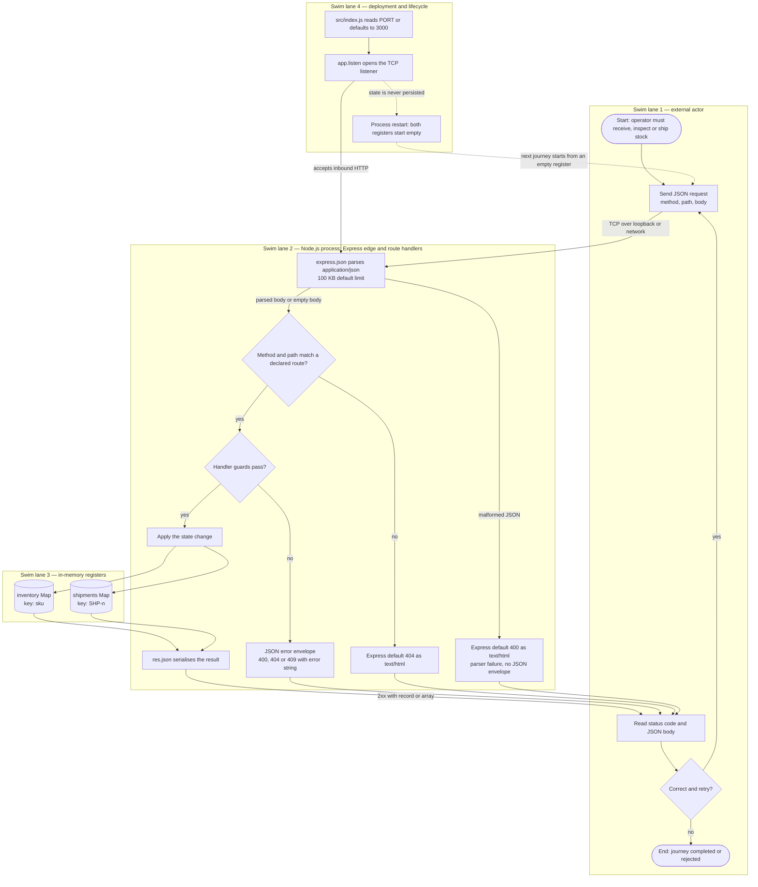

### 4.2.1 Stage-by-Stage Description

| Stage | Mechanism | Evidence | Failure it can produce |
|---|---|---|---|
| Bootstrap | `process.env.PORT || 3000` resolved once, passed unparsed to `app.listen` | `src/index.js:2-3` | A port conflict surfaces as an uncaught process error — the listener handle is discarded, so no bind-error callback exists |
| Ingress and parsing | Only `application/json` is parsed; any other content type leaves `req.body` as `{}` | `src/server.js:3`; verified: a `text/plain` body reached the handler as `{}` and was rejected `400 invalid inventory payload` | Malformed JSON is answered by Express's default handler as `text/html` `400` with a stack trace on stderr — the workflow never reaches a route |
| Route matching | Six explicit routes; every other method/path pair falls through to Express's default handler | `src/server.js:8,10,21,23,38,44`; verified: `GET /shipments` → `404 Cannot GET /shipments` (`text/html`), `PUT /inventory` → `404 Cannot PUT /inventory` | A `404` that carries HTML rather than the JSON error shape |
| Guarding | Per-handler `if` blocks in a fixed order; all guards precede any mutation | `src/server.js:12-15,25-30,46-47` | `400`, `404` or `409` with `{error: "<reason>"}` |
| Mutation | `Map.set` for new records, in-place field writes for existing ones | `src/server.js:17,31,34,48-49` | None — the mutation is a synchronous memory write that cannot fail or partially apply |
| Serialisation | `res.status(...).json(...)` or `res.json(...)` | `src/server.js:8,18,21,35,41,50` | None reachable; the values are plain JSON-safe objects |
| Termination | Response returned; no continuation, callback or background write follows | `src/server.js:8-51` | None — the journey is over when the response is sent |

### 4.2.2 The Decision Points of the Whole System

Nine decisions exist across the six handlers, and each maps to exactly one status code. This table is the system-level index; the flows that expand each decision are in Section 4.3.

| # | Decision | Where | Outcome when true | Outcome when false | Verified |
|---|---|---|---|---|---|
| D1 | Is the body valid JSON? | `express.json()`, `src/server.js:3` | Handler runs | `400 text/html` from the parser | Yes — `{bad` → `400 text/html`, `SyntaxError` on stderr |
| D2 | Does a declared route match the method and path? | Express router | Handler runs | `404 text/html` | Yes — `GET /shipments`, `PUT /inventory` both HTML `404` |
| D3 | Are `sku`, `name` present and `quantity` a non-negative integer? | `src/server.js:12` | Continue | `400 invalid inventory payload` | Yes |
| D4 | Is the SKU already stored? | `src/server.js:15` | `409 duplicate sku` | Store and `201` | Yes |
| D5 | Does the SKU resolve in the register? | `src/server.js:25-26` | Continue | `404 sku not found` | Yes — `{sku:'NOPE',quantity:0}` returns `404`, so D5 outranks D6 |
| D6 | Is the shipment `quantity` a positive integer? | `src/server.js:27-29` | Continue | `400 quantity must be positive` | Yes |
| D7 | Does stock on hand cover the quantity? | `src/server.js:30` | Decrement and `201` | `409 insufficient inventory` | Yes — 6 of 6 accepted at stock 6; 7 of 6 rejected |
| D8 | Does the shipment id exist? | `src/server.js:39,45-46` | Continue | `404 shipment not found` | Yes — for both lookup and dispatch |
| D9 | Is the shipment still in status `created`? | `src/server.js:47` | Dispatch and `200` | `409 shipment cannot be dispatched` | Yes — second dispatch returns `409` |

The order inside each handler is itself a process rule: D5 is evaluated before D6, so an unknown SKU reported with a bad quantity yields `404`, not `400`; and D3 collapses four distinct payload defects (missing `sku`, missing `name`, non-integer `quantity`, negative `quantity`) into one message, so the client learns that the payload is invalid but not which field caused it.

### 4.2.3 Error States and Their Recovery Paths

| Error state | Client-visible signal | What the system did | Recovery path available today |
|---|---|---|---|
| Invalid payload | `400 {"error":"..."}` | Nothing written; the request is side-effect free | Client corrects the payload and retries the same route |
| Unknown SKU or shipment | `404 {"error":"..."}` | Nothing written | Client receives the entity first (`POST /inventory`) or re-reads the id it holds |
| State conflict (duplicate SKU, over-stock, second dispatch) | `409 {"error":"..."}` | Nothing written; the conflicting record is left intact | Client reads current state (`GET /inventory`, `GET /shipments/:id`) and re-plans; no server-side override exists |
| Unparseable body | `400 text/html` | Nothing written; the parser rejected before routing | Client re-sends a syntactically valid JSON body |
| Unknown route or method | `404 text/html` | Nothing written | Client must correct the request; no JSON envelope is returned for this class |
| Process restart | Not signalled by the service | Entire register lost, silently | Operator must re-run intake for every SKU; dispatched shipments cannot be reconstructed at all |

The last row is the only unrecoverable state in the system and the one no workflow in the code addresses: because there is no persistence layer (`package.json:6` declares `express` alone, and neither `src/index.js` nor `src/server.js` references `fs`), recovery is manual, external and lossy.


## 4.3 Core Business Processes

Five request-response processes carry the product: intake writes stock, read-out exposes it, shipment creation consumes it, lookup resolves a shipment, and dispatch closes it. Each is expanded below with its start and end points, process steps, decision diamonds, touchpoints, error states and measured timing. Requirement identifiers are those of Section 2.2; the feature narrative is in Section 2.1.

### 4.3.1 Stock Intake Process (W-01, `POST /inventory`)

**Start:** an operator submits `{ sku, name, quantity, reorderLevel? }` as JSON. **End:** either one four-field record exists in the `inventory` Map and is echoed with `201`, or the register is untouched and a rejection is returned.

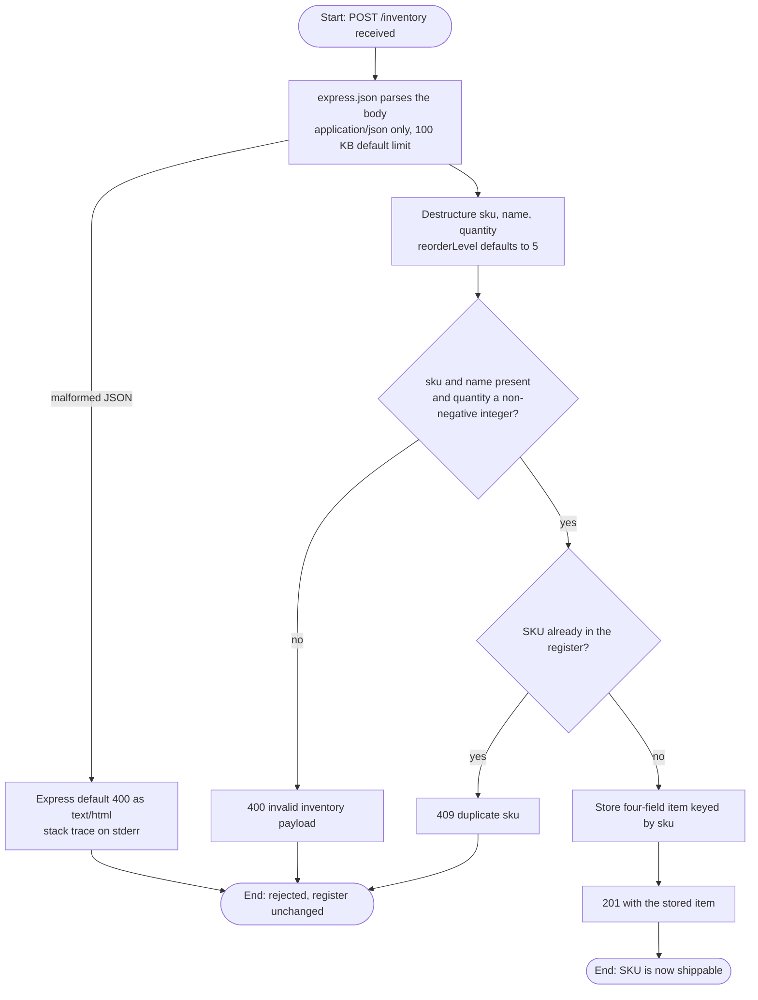

| Step | Operation | Decision | Rejection and its exact body | Evidence |
|---|---|---|---|---|
| 1 | Body parsed by the shared middleware | D1 — valid JSON? | `400 text/html` from Express, `SyntaxError` logged | `src/server.js:3`; verified |
| 2 | Fields destructured with `reorderLevel = 5` | — | — | `src/server.js:11` |
| 3 | Combined presence and type guard | D3 | `400 {"error":"invalid inventory payload"}` | `src/server.js:12-14`; verified |
| 4 | Duplicate-SKU lookup | D4 | `409 {"error":"duplicate sku"}` | `src/server.js:15`; verified |
| 5 | `inventory.set(sku, item)` | — | — | `src/server.js:16-17` |
| 6 | `201` with the item | — | — | `src/server.js:18`; verified body `{"sku":"A1","name":"Bolt","quantity":10,"reorderLevel":5}` |

**Business and validation rules at each step.** D3 requires the SKU and name to be truthy and the quantity to be an `integer` that is not negative, so `0` is accepted and `"5"`, `1.5`, `-1` and an absent quantity are each refused. The guard is a single falsy/type expression, so whitespace-only identifiers pass and the client cannot tell which of the four defects fired. `reorderLevel` is never validated — a string or negative value is stored verbatim — and it is read by no other workflow. Undeclared body fields are discarded at destructuring, so the stored record always carries exactly `sku`, `name`, `quantity`, `reorderLevel` (Section 2.2, F-001-RQ-006).

**Error states and recovery.** All three handler rejections occur before `Map.set`, so a rejected intake writes nothing and the caller may simply retry with a corrected payload. The parser rejection is the only path that bypasses the JSON error envelope.

**Timing.** Two Map operations and one serialisation; no I/O. Measured mean round trip over loopback: 0.483 ms (200 sequential calls). No timeout or deadline applies.

**Process consequence worth stating explicitly.** Because intake is the only writer of `inventory` and a second intake of the same SKU is refused `409`, stock can never be increased within a process lifetime — there is no top-up, adjustment or restock route. A shipment that empties an item leaves it permanent at `quantity: 0` until the process restarts (Section 4.5.2).

### 4.3.2 Stock Read-Out Process (W-02, `GET /inventory`)

**Start:** a client calls `GET /inventory`. **End:** a `200` array of every stored item, in `Map` insertion order.

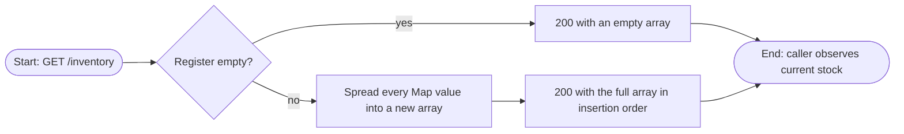

| Characteristic | Behaviour | Evidence |
|---|---|---|
| Inputs | None read: no query parameter, header, filter, sort or page is recognised | `src/server.js:21`; Section 2.2, F-002-RQ-004 |
| Output | Every record with `sku`, `name`, `quantity`, `reorderLevel`; no envelope, cursor or version field | `src/server.js:16,21` |
| Empty state | `200 []`, not an error — it distinguishes a fresh process from a failing one | verified |
| Error paths | None reachable: the handler performs no check that can fail | `src/server.js:21` |
| Timing | Linear in register size; 202 items serialised in 0.80 ms for 11,204 bytes | measured |
| Touchpoint | The only view of the decrement performed by W-03, so it is where a stock discrepancy is observed | Section 2.3.1, data-observation dependency F-003 → F-002 |

This is the only workflow in the system with no decision point and no error state. Its cost grows with the number of items because the entire register is materialised and serialised on every call.

### 4.3.3 Shipment Creation with Stock Decrement (W-03, `POST /shipments`)

**Start:** an operator submits `{ sku, quantity, destination }`. **End:** either stock is reduced by exactly the requested quantity and a shipment is recorded in status `created` with a generated id, or nothing at all changed.

This is the only workflow that mutates two registers, and its guard order is the rule that makes a rejection side-effect free: all three checks run before the decrement on line 31.

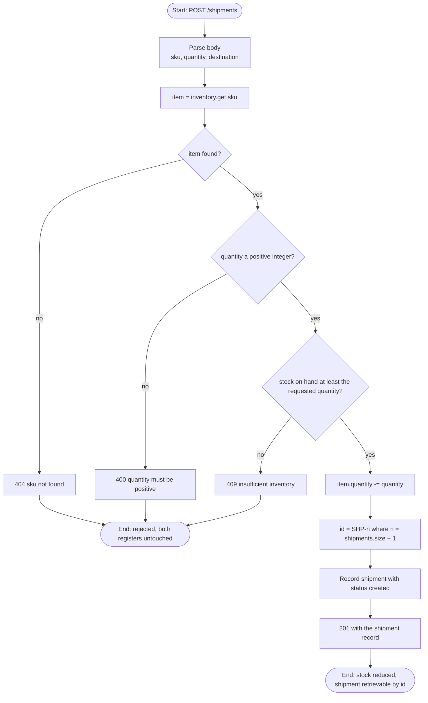

| Step | Operation | Decision | Outcome | Evidence |
|---|---|---|---|---|
| 1 | Destructure `sku`, `quantity`, `destination` | — | — | `src/server.js:24` |
| 2 | Resolve the SKU in the register | D5 | Absent → `404 {"error":"sku not found"}` | `src/server.js:25-26`; verified with `{sku:'NOPE',quantity:0}` → `404`, proving D5 precedes D6 |
| 3 | Validate the requested quantity | D6 | Not a positive integer → `400 {"error":"quantity must be positive"}` | `src/server.js:27-29`; verified for `0` and `"2"` |
| 4 | Compare against stock on hand | D7 | Insufficient → `409 {"error":"insufficient inventory"}` | `src/server.js:30`; verified — 7 of 6 rejected, 6 of 6 accepted |
| 5 | Decrement stock in place | — | `item.quantity` falls by the requested amount, reaching `0` at the boundary | `src/server.js:31`; verified 10 → 6 → 0 |
| 6 | Generate the id | — | `SHP-${shipments.size + 1}` — `SHP-1`, `SHP-2`, … | `src/server.js:32`; verified |
| 7 | Record the shipment | — | `{id, sku, quantity, destination?, status:'created'}`, `destination` omitted from JSON when undefined | `src/server.js:33-34`; verified — the record created without a destination has no `destination` key |
| 8 | Respond | — | `201` with the record | `src/server.js:35` |

**Business rules embodied in the flow.** Shipped quantity may never exceed stock on hand, but equality is permitted, so a shipment can legitimately take an item to zero. `destination` is optional free text with no address, country or site structure, and it is stored and echoed without validation. The id is a function of `shipments.size`, which is only unique because nothing in the repository ever deletes a shipment; any future expiry or cancellation would reuse ids. There is no idempotency key and no deduplication, so a retried creation produces a second shipment and a second decrement (Section 4.7.2).

**Error states and recovery.** All three rejections precede the decrement, so a rejected request leaves both registers exactly as they were — verified by shipping 4 of 10, receiving `409` on a request for 7, and observing stock at 6 rather than a negative value. Recovery is entirely client-side: the operator reads `GET /inventory` for the true ceiling and retries.

**Timing and concurrency.** Three Map operations, one id derivation and one serialisation; measured mean round trip 0.483 ms-class (same handler profile as intake). The guard-and-decrement sequence is synchronous, so inside one process no other request can observe stock between D7 and step 5 — verified with six concurrent one-unit shipments against stock of 5, which produced five `201` and one `409` with stock settling at `0`. That guarantee does not survive a second process (Section 4.8.2).

### 4.3.4 Shipment Lookup and Dispatch (W-04, W-05)

**Lookup. Start:** a client calls `GET /shipments/:id` with an id it already holds. **End:** `200` with the record, or `404 {"error":"shipment not found"}`. The handler performs one `shipments.get(req.params.id)` and returns the object by reference, so a lookup made after dispatch shows the mutated `status` and `carrier` without any write by this workflow (`src/server.js:38-42`). There is no collection route: `GET /shipments` yields Express's `404 Cannot GET /shipments` as `text/html`, and no index by SKU, status, destination or carrier exists.

**Dispatch. Start:** an operator posts to `POST /shipments/:id/dispatch`, optionally with `{ carrier }`. **End:** the record carries `status: "dispatched"` and an effective carrier, or the request is refused and the record keeps the outcome of the first dispatch.

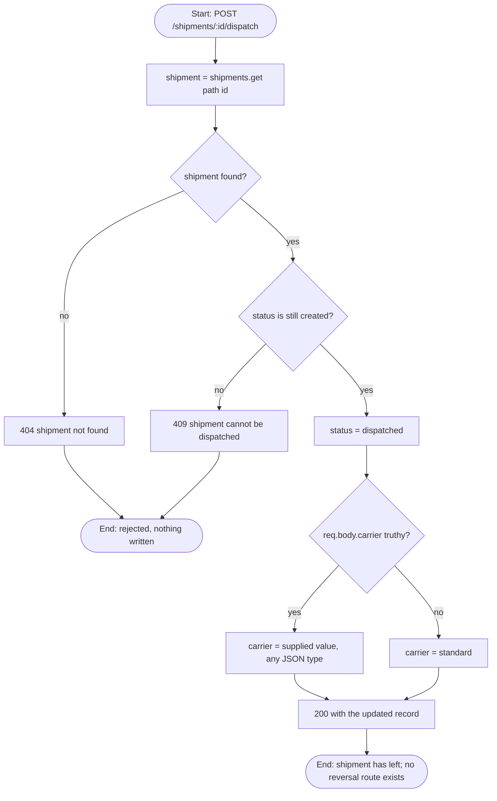

| Step | Operation | Decision | Outcome | Evidence |
|---|---|---|---|---|
| 1 | Resolve the id from the path | D8 | Absent → `404 {"error":"shipment not found"}` | `src/server.js:45-46`; verified `SHP-99` → `404` |
| 2 | Test the status | D9 | Not `created` → `409 {"error":"shipment cannot be dispatched"}` | `src/server.js:47`; verified second attempt → `409` |
| 3 | Write the new status | — | `dispatched` | `src/server.js:48` |
| 4 | Resolve the carrier | — | Supplied value verbatim, or `standard` when falsy or absent | `src/server.js:49`; verified — a bodyless dispatch returned `carrier:"standard"` |
| 5 | Respond | — | `200` with the record | `src/server.js:50` |

**User touchpoint.** The same record shape travels through creation, lookup and dispatch, so an operator reads `id`, `sku`, `quantity`, `destination`, `status` and `carrier` from one object rather than from three contracts.

**Error states and recovery.** `404` means the id was never created; `409` means the work was already done. Neither path writes, and neither is distinguished by an error type field — only by code and message. The dispatch guard makes the transition exactly-once by rejection rather than by silent repetition, which is the property that stops a retry from overwriting the carrier of a shipment that has already left. No reversal, cancellation or re-dispatch route exists, so a mistaken dispatch is final for the process's lifetime.

**Timing.** One `Map.get` and two property writes, with no call to any carrier system — dispatch therefore cannot block on an external party. Both writes happen inside one synchronous handler, so the intermediate state where `status` is `dispatched` but `carrier` is still unset is not observable by another request in the same process.

### 4.3.5 Bootstrap and Liveness Process (W-06)

**Start:** a deployer invokes a start command. **End:** a listener is bound and `GET /health` answers `200 {"status":"ok"}`, or — on the documented command — the process exits without serving traffic.

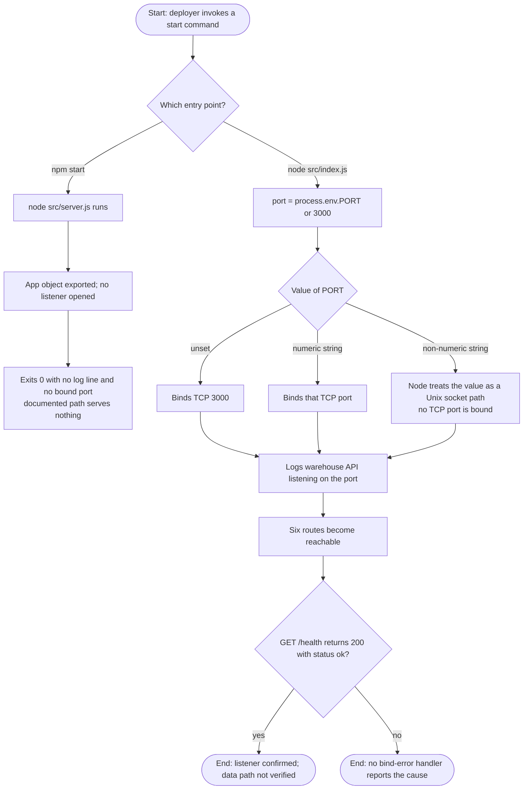

| Step | Detail | Evidence |
|---|---|---|
| Entry point | Only `src/index.js` calls `app.listen` on a configured port; `npm start` runs `src/server.js`, which ends at `module.exports = app` | `src/index.js:3`; `package.json:5`; `src/server.js:53`; verified — `npm start` printed the npm banner and exited `0` without a listener |
| Port resolution | `process.env.PORT \|\| 3000`, resolved once, never parsed or range-checked | `src/index.js:2` |
| Non-numeric `PORT` | The string is handed to `app.listen`, which Node interprets as a pipe path: the process logs `listening on abc`, stays alive, and creates a socket file in the working directory instead of binding TCP | verified |
| Confirmation signal | One `console.log` line `warehouse API listening on <port>` — the only log the service produces | `src/index.js:3` |
| Bind failure | The listener handle is discarded, so a port conflict becomes an uncaught process error with no recovery and no log line | `src/index.js:3` |
| Liveness probe | `GET /health` returns the constant `{status:'ok'}` without reading either register, so it proves reachability only, never readiness to write | `src/server.js:8`; asserted by `test/routes.test.js:13` |

**Business consequence.** A green health probe says nothing about whether intake or dispatch will succeed: a process whose registers are empty, or whose stock is fully depleted, reports `ok` identically. Operators must therefore read `GET /inventory` to distinguish a usable service from a live but empty one.


## 4.4 Integration Workflows

The service has exactly one integration direction: inbound HTTP/JSON. It initiates no outbound call, subscribes to no topic and reads no external datum beyond one environment variable, so no workflow in this section crosses a process boundary on its own initiative. The tables and diagrams below record the request lifecycle, then the two integration families the prompt asks about that the repository does not implement, together with what their absence means for a caller.

### 4.4.1 HTTP Request Lifecycle and Data Flow Between Systems

The most data-intensive journey is shipment creation, because it reads and writes `inventory` and then writes `shipments`. Its sequence shows how the request body, the resolved item and the generated id flow between the boundary, the handler and the two registers.

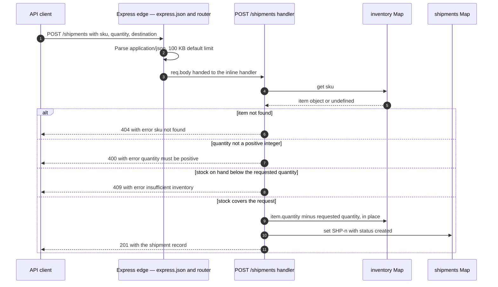

| Boundary crossed | Data that crosses it | Direction | Evidence |
|---|---|---|---|
| Client ↔ TCP listener | HTTP request line, headers, JSON body; JSON response body and status | Inbound request, outbound response | `src/server.js:2-3,8-51` |
| Express edge → handler | `req.body` (an object, or `{}` when no parsable JSON body is present) and `req.params.id` | Internal | `src/server.js:3,11,24,39,45` |
| Handler → `inventory` Map | `sku` key, `{sku, name, quantity, reorderLevel}` value, in-place `quantity` mutation | Internal, read and write | `src/server.js:5,17,21,25,31` |
| Handler → `shipments` Map | `SHP-<n>` key, `{id, sku, quantity, destination?, status, carrier?}` value, in-place `status` and `carrier` mutation | Internal, read and write | `src/server.js:6,32-34,39,45,48-49` |
| Handler → client | Record, array, or `{error: "<reason>"}` with `400`, `404` or `409` | Outbound | `src/server.js:13,15,18,21,26,28,30,35,40,46,47,50` |
| Environment → bootstrap | `PORT`, a string, used unparsed | Inbound at start-up only | `src/index.js:2` |
| Process → external systems | Nothing: no HTTP client, broker client or database driver exists in the manifest or the source | None | `package.json:6` (only `express`) |

**Data-shape guarantees along the path.** The client's JSON is never coerced: `quantity` must already be a number for the guards at `src/server.js:12` and `:27` to pass, so a string numeral is rejected at the boundary rather than converted. Undeclared fields are dropped at destructuring (`:11`, `:24`), so what reaches a register is always a fixed shape. What comes back is the stored object itself, so a client sees exactly the state the next request will read.

### 4.4.2 Event Processing Flows

The repository contains no event processing of any kind. A text search of every tracked file finds no message broker, queue, publisher, subscriber, worker, `setInterval`, `setTimeout` or scheduler; the only asynchronous construct is `express.json()` reading a request body. Every state change is therefore request-driven and synchronously completed before the response is sent.

| Event-processing capability | Present? | Evidence | Consequence for callers |
|---|---|---|---|
| Domain event emission on intake, shipment or dispatch | No | `src/server.js:10-51` — handlers only return a response | No other party can learn of a state change except by polling the read routes |
| Asynchronous or queued work | No | No queue client in `package.json:6`; no producer or consumer anywhere | A response is never `202`; the outcome is always final when received |
| Scheduled sweep, reconciliation or expiry job | No | No timer function in the repository | Shipments never age out, and stock is never reconciled automatically |
| Retry queue or dead-letter path | No | All work is synchronous and in-process | A failed request simply ends; nothing is replayed on the caller's behalf |
| Webhook or callback delivery | No | No outbound HTTP client exists | `destination` and `carrier` are stored text only; nothing is notified downstream |

The one flow the domain implies but the code does not implement is replenishment. `reorderLevel` is accepted, defaulted and stored, and then read by nothing:

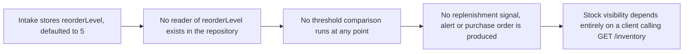

The operational effect is that every monitoring or replenishment workflow must sit outside this service and poll `GET /inventory`, comparing `quantity` against `reorderLevel` itself — and that comparison works only while the process that holds the data is still running (Section 4.5.3).

### 4.4.3 Batch Processing and Verification Sequences

No batch job exists: nothing operates on more than one record per invocation, `GET /inventory` is the only multi-record read, and there is no bulk write, import or export route. The only repeated, scripted sequence in the repository is the verification run, which batch-exercises the app through a real loopback socket.

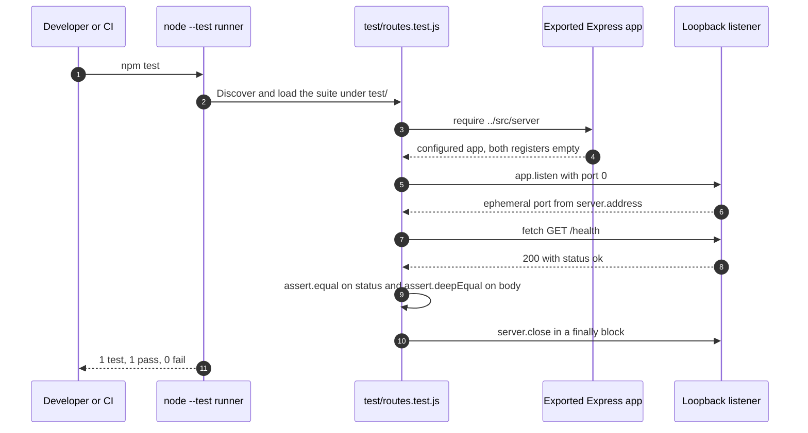

| Property of the verification sequence | Behaviour | Evidence |
|---|---|---|
| Isolation | Binds port `0`, so it cannot collide with a running instance on the configured port, and closes the listener in `finally` | `test/routes.test.js:8,15` |
| Batch scope | One request, one route: only `GET /health` is exercised | `test/routes.test.js:7-17` |
| Shared state hazard for future flows | The suite requires the same app instance with module-level Maps, so added workflow cases must be ordered or isolated per test, or a `409` from an earlier case will leak into a later one | `src/server.js:5-6`; Section 2.2, F-008-RQ-003 |
| Required sequencing for the unverified journeys | Intake must precede shipment creation, which must precede lookup and dispatch — the dependency order of Section 4.3 — because each flow depends on records the previous one wrote | `README.md:12-13`; `src/server.js:25,45` |
| Environment requirement | A Node.js runtime providing `node:test` and the global `fetch`; the manifest declares no `engines` constraint | `package.json`; `test/routes.test.js:1-2,11` |


## 4.5 State Transitions, Persistence and Transaction Boundaries

The system holds two state variables that ever change — a shipment's `status` and an inventory item's `quantity` — and both live only in process memory (Section 4.5.3). Everything else a record carries is written once at creation and never modified.

### 4.5.1 Shipment Status State Machine

`status` is the only state machine in the product, it has two states, and it has exactly one transition. It is created as `created` at `src/server.js:33` and moved to `dispatched` by the single guarded write at `src/server.js:48`; the `carrier` field exists only after that transition (`:49`).

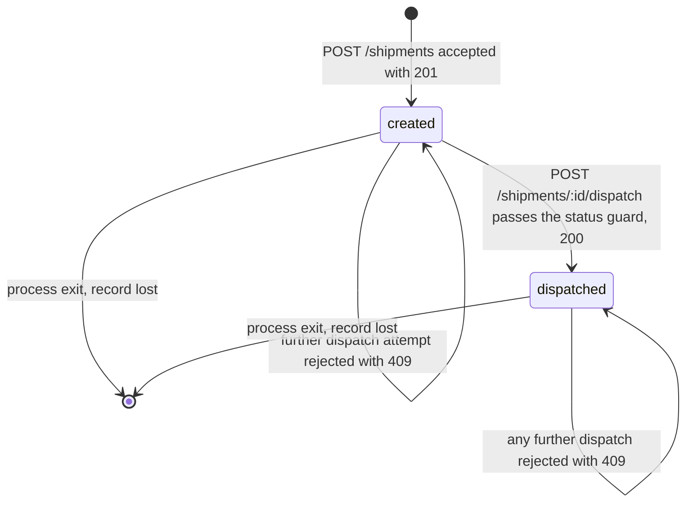

| Transition | Trigger | Guard that must pass | Fields written | Observable through | Evidence |
|---|---|---|---|---|---|
| *(none)* → `created` | `POST /shipments` | D5 SKU exists, D6 quantity positive integer, D7 stock sufficient | `id`, `sku`, `quantity`, `destination?`, `status` | `GET /shipments/:id` | `src/server.js:32-35` |
| `created` → `dispatched` | `POST /shipments/:id/dispatch` | D8 id exists, D9 `status === 'created'` | `status`, `carrier` | `GET /shipments/:id` — the same object, returned by reference | `src/server.js:45-50` |
| `created` → `created` (refused) | Second dispatch attempt | Fails D9 | Nothing | `409 {"error":"shipment cannot be dispatched"}` | `src/server.js:47`; verified |
| `dispatched` → `dispatched` (refused) | Any further dispatch | Fails D9 | Nothing | Same `409` | `src/server.js:47`; verified |

**Transitions that do not exist.** There is no `dispatched` → `created` reversal, no `cancelled`, `returned`, `delivered` or `lost` state, no expiry and no deletion. `status` therefore has no terminal state in code — a dispatched record stays dispatched until the process exits, at which point it disappears with the register rather than reaching an archived state.

**Persistence point of the transition.** The write at `src/server.js:48` is applied directly to the stored object before the response is sent, so the very next `GET /shipments/:id` observes the new status. No copy, event or deferred write intervenes — but nothing durable is written either, so the transition survives only as long as the process.

### 4.5.2 Inventory Quantity Transitions

Stock has one entry state and one exit state, and its quantity moves in one direction only. Because intake refuses a SKU that already exists (`src/server.js:15`) and no adjustment, restock or delete route is declared, `quantity` can only decrease after creation.

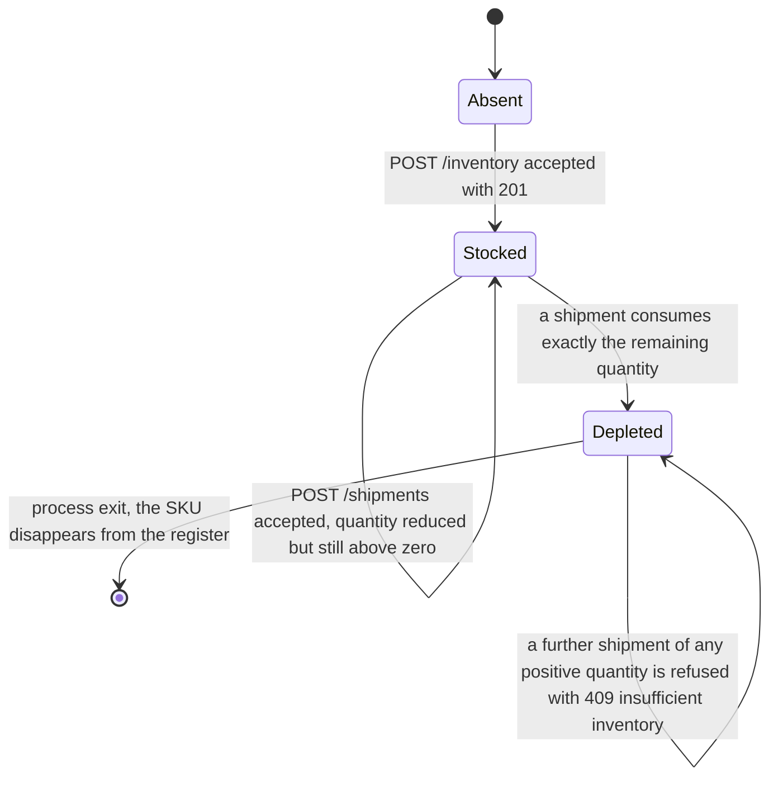

| Transition | Trigger | Rule enforced | Resulting state | Evidence |
|---|---|---|---|---|
| Absent → Stocked | `POST /inventory` | D3 payload valid, D4 SKU not already stored | `quantity` set to the supplied non-negative integer, `0` allowed | `src/server.js:12-18`; verified `quantity: 0` → `201` |
| Stocked → Stocked | `POST /shipments` | D7 `item.quantity >= quantity` with strict inequality on the shortfall only | `quantity` reduced in place | `src/server.js:30-31`; verified 10 → 6 |
| Stocked → Depleted | `POST /shipments` with the exact remaining quantity | D7 permits equality | `quantity` becomes `0` | `src/server.js:30`; verified 6 of 6 → `201`, listing showed `0` |
| Depleted → Depleted | Any shipment for that SKU | D7 fails because `0` is below any positive quantity | No change | `src/server.js:30`; consequence of D6 requiring a positive integer |
| Depleted → increased | *None* | No write path raises `quantity` | Unreachable | No `PUT`, `PATCH` or restock route in `src/server.js`; second intake refused `409` |

The `reorderLevel` field is set once and never read by any handler, so it participates in no transition: a depleted item produces no signal even when `quantity < reorderLevel`, which is the missing replenishment flow recorded in Section 4.4.2.

### 4.5.3 Persistence Points, Caching and Transaction Boundaries

| Concern | Implementation as it exists | Evidence | Consequence for a workflow |
|---|---|---|---|
| Persistence points | None. Both registers are module-level `Map` instances created when the module is first required | `src/server.js:5-6`; `package.json:6` declares no database driver; no `fs` usage anywhere | A successful `201` is a memory write only; a restart discards every intake, shipment and dispatch with no error and no record |
| Durable artifacts written by the service | None — no file, log file, table or object store | Same as above | Nothing exists to restore, reconcile or audit after a crash |
| Caching layer | None. The Maps are the system of record, not a cache in front of one, so there is no TTL, eviction or invalidation | `src/server.js:5-6,17,21,31,34,48` | Reads are never stale within a process — a handler returns the stored object itself — but a restart is total data loss rather than a cache miss |
| Snapshot or backup procedure | None | No code in the repository | Recovery is manual: re-run intake for every SKU; dispatched shipment records cannot be reconstructed at all |
| Transaction scope | One synchronous handler invocation. All guards for a route run before its first write, so a request either performs every write must follow or none | `src/server.js:12-18,25-35,45-50` | A rejected request is side-effect free; verified for duplicate SKU, over-stock shipment and repeated dispatch |
| Multi-register atomicity | `POST /shipments` writes `inventory` (`:31`) and then `shipments` (`:34`) with no explicit transaction wrapping | `src/server.js:31,34` | No rollback exists. The two writes cannot currently fail between each other — both are plain in-memory operations — so the boundary holds by construction rather than by design; any future I/O inserted between the lines would leave stock decremented with no shipment recorded |
| Isolation between requests | Provided by the Node.js event loop alone: handlers are synchronous end to end, so no two requests interleave inside a guard | `src/server.js:8-51` | The guard-then-mutate pair is effectively atomic within one process, which is why concurrent demand cannot oversell a single instance (Section 4.8.2) |
| Isolation between processes | None | `src/server.js:5-6` | Two instances hold two independent stock registers and two independent id sequences; no lock, lease or shared store exists |
| Commit visibility | The response is serialised after the mutation, so a client that receives `2xx` knows the write has already happened | `src/server.js:18,35,50` | Read-your-write holds for the next request that reaches the same process, and fails across processes |


## 4.6 Validation Rules and Authorization Checkpoints

Validation in this service is inline and handler-local: there is no schema library, no model layer and no validation middleware, so each route's rules exist only in the `if` statements of its own arrow function. Authorisation, by contrast, has no implementation at all — the pipeline below has three gates, and the one labelled as absent is absent by construction.

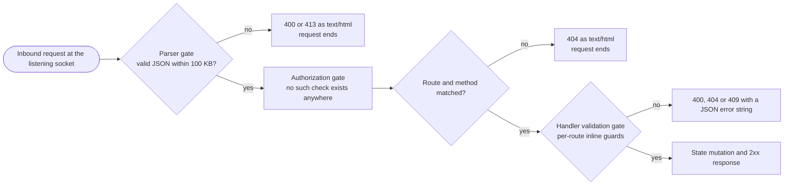

### 4.6.1 Business Rules and Data Validation at Each Step

| Workflow | Step | Business rule | Data validation actually performed | On failure | Evidence |
|---|---|---|---|---|---|
| W-01 intake | Field extraction | A stock record must identify an item by SKU and by name | Destructuring with a default: `reorderLevel = 5` | — | `src/server.js:11` |
| W-01 intake | Combined guard | Stock on hand cannot start negative, and an item must be identifiable | `!sku \|\| !name \|\| !Number.isInteger(quantity) \|\| quantity < 0` — truthiness and integer type only; no length, charset, format or upper bound | `400 invalid inventory payload` | `src/server.js:12-14` |
| W-01 intake | Duplicate check | One SKU is one stock record | `inventory.has(sku)` — exact, case-sensitive key comparison, so `a1` and `A1` are different items | `409 duplicate sku` | `src/server.js:15` |
| W-02 listing | Serialisation | Stock on hand must be observable | None — no filter, projection or paging | Cannot fail | `src/server.js:21` |
| W-03 shipment | SKU resolution | Goods cannot ship from an item that was never received | `inventory.get(sku)` truthiness, evaluated before the quantity check | `404 sku not found` | `src/server.js:25-26` |
| W-03 shipment | Quantity guard | A shipment must move a positive, whole quantity | `Number.isInteger(quantity) && quantity > 0`; string numerals are rejected, so no coercion occurs | `400 quantity must be positive` | `src/server.js:27-29` |
| W-03 shipment | Stock guard | Stock on hand may never go negative | `item.quantity < quantity`; equality is allowed, so stock may reach `0` exactly | `409 insufficient inventory` | `src/server.js:30` |
| W-03 shipment | Destination | None — destination is descriptive, not operational | No required check, no format check, no length limit; stored verbatim and omitted from JSON when undefined | Never fails | `src/server.js:24,33` |
| W-04 lookup | Id resolution | A shipment must be retrievable by the id it was given | `shipments.get(req.params.id)` — literal, case-sensitive match | `404 shipment not found` | `src/server.js:39-40` |
| W-05 dispatch | Id resolution | Only an existing shipment can be dispatched | Presence check against the register | `404 shipment not found` | `src/server.js:45-46` |
| W-05 dispatch | Status guard | Dispatch happens once per shipment; the first outcome is final | `shipment.status !== 'created'` evaluated before either write | `409 shipment cannot be dispatched` | `src/server.js:47` |
| W-05 dispatch | Carrier | A carrier is recorded for every dispatch | Falsy fallback `req.body.carrier \|\| 'standard'`; no type, format or membership check, so any JSON value persists | Never fails | `src/server.js:49` |

**Where validation is thinner than the rule it stands for.** The intake guard collapses four distinct payload defects into one message, so a client cannot tell whether `sku`, `name` or `quantity` was at fault. Whitespace-only identifiers satisfy the truthiness test and are stored (Section 2.2, F-001-RQ-002). `reorderLevel` is stored as the raw JSON value — a string or negative number persists unmodified — even though it is documented as a numeric threshold. `destination` and `carrier` are free text with no carrier or address integration behind them, so nothing verifies that a real party will collect the goods.

### 4.6.2 Guard-Ordering Constraints

Order is part of the contract, not an implementation detail, because two of these paths would otherwise report the wrong cause.

| Ordering rule | Why it matters | Verified behaviour |
|---|---|---|
| SKU resolution before quantity validation (D5 before D6) | An unknown item is a more specific failure than a bad quantity, and reporting `400` first would imply the item exists | `{sku:'NOPE',quantity:0}` → `404 sku not found`, not `400` |
| Payload guard before duplicate check (D3 before D4) | A malformed submission for an existing SKU must not be reported as a conflict | Guard at `src/server.js:12` returns before `:15` |
| All shipment guards before the decrement (D5–D7 before `:31`) | Makes a rejected request side-effect free, which is the property the stock invariant depends on | Oversell of 7 against stock 6 returned `409` and left stock at 6 |
| Id resolution before status test in dispatch (D8 before D9) | Distinguishes "never existed" from "already done" | Unknown id → `404`; second dispatch → `409` |

### 4.6.3 Authorization Checkpoints

No authorisation checkpoint exists. A text search of every tracked file finds no credential, token, session, cookie, role, permission, tenant or ownership construct, and the only middleware mounted is `express.json()` (`src/server.js:3`).

| Checkpoint a fulfilment service would need | Present in this repository | Consequence observed in the flows |
|---|---|---|
| Caller authentication | No | Any client that reaches the port can create stock, ship goods and dispatch them; the six handlers cannot distinguish callers |
| Role or scope check (receiving vs shipping vs dispatch) | No | The same caller may perform every transition, including taking stock to zero and dispatching it |
| Ownership or tenant isolation | No | One register serves every caller; `GET /inventory` discloses every SKU, name, quantity and reorder level to anyone |
| Resource-level check before mutation | No | `POST /shipments/:id/dispatch` needs no credential of any kind; only the id, which is sequential and therefore enumerable |
| Audit record of who acted | No | No handler writes an actor, timestamp or request id; the only log line in the service is the start-up message at `src/index.js:3` |
| Transport security | No | No TLS listener is configured; `src/index.js:3` binds plain HTTP and sets no header such as `Strict-Transport-Security` |

**Information the absence of authorisation leaks through the flows themselves.** The `404`/`409` distinction answers questions about state: `POST /shipments` with an unknown SKU returns `404 sku not found` while a known but insufficient SKU returns `409 insufficient inventory`, so an unauthenticated caller can probe which SKUs exist. Sequential ids (`SHP-1`, `SHP-2`, …) make every shipment addressable, and `GET /shipments/:id` returns it without a credential.

### 4.6.4 Regulatory and Compliance Checks

The repository implements no compliance control: no consent, retention, erasure, residency, encryption-at-rest, export or subject-access mechanism appears in any file, and no requirement of that kind is asserted anywhere in the code.

| Control | Present | Why it matters for these workflows |
|---|---|---|
| Data retention policy | No | Records live only in memory, so retention is effectively zero and is set by the process lifetime rather than by policy |
| Erasure or "right to be forgotten" | No | No delete route exists for inventory or shipments, so a record that should be removed cannot be, short of a restart that removes all of them |
| Data minimisation / field typing | Partial in practice | The stored fields are `sku`, `name`, `quantity`, `reorderLevel`, `id`, `destination`, `status`, `carrier`; `name` and `destination` are unrestricted free text that could carry personal data with no masking, limit or classification |
| Encryption in transit and at rest | No | Plain HTTP listener; plain in-memory values |
| Audit trail for regulated movements | No | Dispatched quantities and carriers are recorded without actor, timestamp or sequence of events, so a stock movement cannot be attributed or reconstructed after a restart |
| Access logging for investigation | No | Nothing records which route served which caller |


## 4.7 Error Handling and Recovery Flows

The service handles errors by returning a status code at the point of failure and writing nothing. There is no `try`/`catch` in the repository, no `throw`, no error middleware and no recovery routine; the nine handler failures are `if` statements that return a response, and the two framework failures are Express's own defaults.

### 4.7.1 Error Taxonomy and Propagation

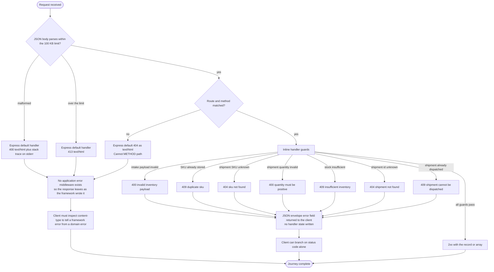

| # | Failure class | Status | Body shape | Content type | State written | Where it is produced |
|---|---|---|---|---|---|---|
| E1 | Unparseable JSON | `400` | HTML error page; the `SyntaxError` also reaches stderr | `text/html` | None — before routing | Express default handler; verified |
| E2 | Body over the parser's 100 KB limit | `413` | HTML error page | `text/html` | None | Express default handler (Section 2.2, F-001 performance criteria) |
| E3 | No route for the method and path | `404` | `Cannot GET /shipments`-style HTML | `text/html` | None | Express default handler; verified for `GET /shipments` and `PUT /inventory` |
| E4 | Intake payload defect | `400` | `{"error":"invalid inventory payload"}` | `application/json` | None | `src/server.js:13` |
| E5 | Duplicate SKU | `409` | `{"error":"duplicate sku"}` | `application/json` | None | `src/server.js:15` |
| E6 | Unknown SKU on shipment | `404` | `{"error":"sku not found"}` | `application/json` | None | `src/server.js:26` |
| E7 | Shipment quantity not a positive integer | `400` | `{"error":"quantity must be positive"}` | `application/json` | None | `src/server.js:28` |
| E8 | Requested quantity exceeds stock | `409` | `{"error":"insufficient inventory"}` | `application/json` | None | `src/server.js:30` |
| E9 | Unknown shipment id | `404` | `{"error":"shipment not found"}` | `application/json` | None | `src/server.js:40,46` |
| E10 | Shipment already left `created` | `409` | `{"error":"shipment cannot be dispatched"}` | `application/json` | None | `src/server.js:47` |

**Two distinct error protocols coexist.** Every handler-produced failure uses the JSON envelope `{error: "<reason>"}` with a code that names the class — `400` validation, `404` missing entity, `409` state conflict. Every framework-produced failure uses Express's default HTML page, so a client that always attempts `response.json()` will throw on a malformed body or an unmatched route instead of receiving a reason. The absence of `app.use((err, req, res, next) => …)` is what keeps those two protocols apart; the code contains no such middleware.

**What the handler paths guarantee.** Because each guard returns before any write, the state tables in Section 4.5 hold for every error: a rejected request leaves both registers byte-for-byte unchanged. Verified for the duplicate-SKU, over-stock and repeated-dispatch paths, and for the intake guard (a rejected intake leaves `GET /inventory` unchanged).

### 4.7.2 Retry, Fallback, Notification and Recovery Procedures

**Retry mechanisms.** The repository implements none: no client retry, no backoff, no retry counter, no idempotency key, no request-id deduplication and no timer. Retry is therefore entirely a caller decision, and its safety differs per workflow because nothing marks a request as already processed.

| Workflow | Retrying after an unknown outcome is | Why | Evidence | Recommended client procedure |
|---|---|---|---|---|
| `GET /health`, `GET /inventory`, `GET /shipments/:id` | Safe — read-only | No state is written on any path | `src/server.js:8,21,38-42` | Retry freely |
| `POST /inventory` | Conditionally safe | A retry of a request that did succeed returns `409 duplicate sku`; the item is not duplicated, but the caller learns only that the SKU exists, not that its own values were the ones stored | `src/server.js:15` | On `409`, read `GET /inventory` and compare fields before concluding success |
| `POST /shipments` | Unsafe | A retry of a request that did succeed creates a second shipment and decrements stock a second time; no idempotency key exists | `src/server.js:31-34`; Section 2.2, F-003-RQ-004 | Read `GET /inventory` and reconcile the decrement, or decide against retrying at all |
| `POST /shipments/:id/dispatch` | Safe — idempotent by rejection | The second attempt fails D9 with `409`, and the first dispatch's `status` and `carrier` survive untouched | `src/server.js:47-49`; verified | Treat `409` as confirmation that the shipment has already left |

**Fallback processes.** There are none in the error sense. The only defaults are input defaults resolved on success: `reorderLevel = 5` when the field is omitted (`src/server.js:11`) and `carrier = 'standard'` when the supplied value is falsy or absent (`:49`). No degraded mode, circuit breaker, secondary store or cached response exists to fall back to, and no partial success is reported — the outcome is always a single status code.

**Error notification flows.** The service emits one log line in its entire lifetime, the start-up message at `src/index.js:3`. There is no request logging, no error logging inside any handler, no metrics endpoint, no tracing header, and no webhook or alert. The only two notification channels an operator has are the start-up line on stdout and Express's default behaviour of printing parser stack traces to stderr — both of which surface framework failures but say nothing about `400`, `404` or `409` business rejections, which are silent on the server side.

**Recovery procedures.**

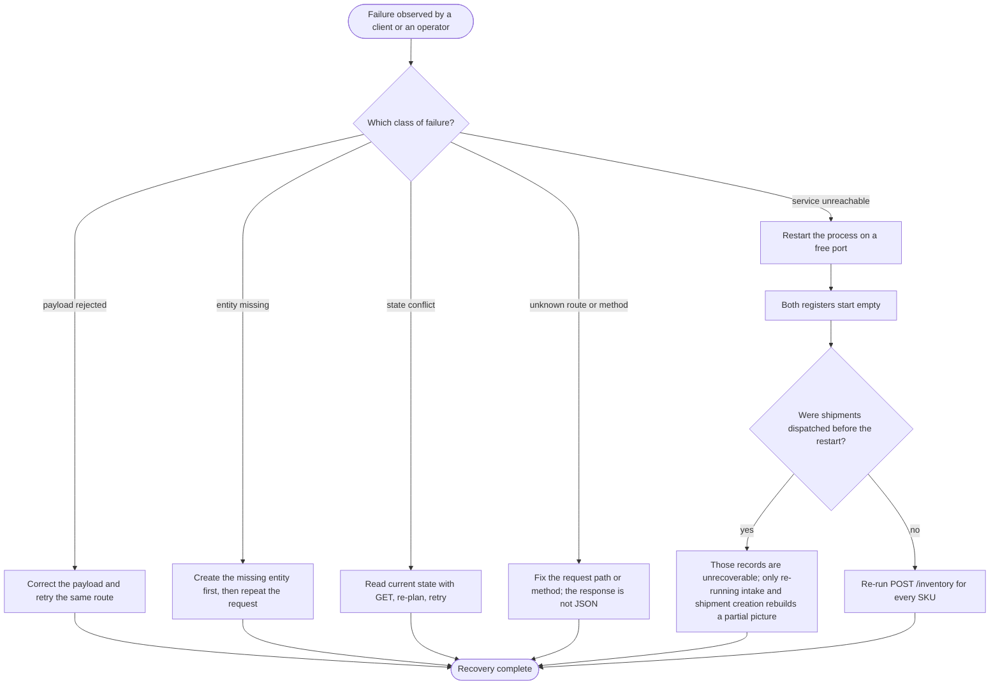

| Recovery scenario | Procedure available in the code | Residual loss |
|---|---|---|
| Rejected request | None needed — the request wrote nothing; the client corrects its input | None |
| Wrong id or unknown SKU | None needed — the entity simply does not exist yet | None |
| Conflict (`409`) | The client reads current state and re-plans; there is no override, force flag or administrative bypass | A shipment that is over-shipped or double-recorded has no correction path |
| Over-shipped stock | No compensating route exists: stock cannot be increased and a shipment cannot be cancelled | The register's quantity stays wrong for the life of the process |
| Process crash or restart | Restart the process and re-seed stock through intake | Every shipment record, including dispatched ones, and every previous intake is lost |
| Port unavailable at start-up | Change `PORT` and restart | None, but the failure is silent apart from the process dying: the listener handle is discarded, so no handler reports the cause (`src/index.js:3`) |


## 4.8 Timing, Concurrency and Failure Modes

### 4.8.1 Measured Timing and the Absence of a Declared SLA

The repository declares no SLA, SLO, latency budget, timeout, throughput target or availability objective — not in `README.md`, not in `package.json`, and not in any comment in `src/`. The figures below are therefore measurements of the running service (Node.js v22, Express 4.21.2, loopback, registers in memory), recorded so that a reader knows what the flows cost rather than what they promise.

| Measurement | Conditions | Result |
|---|---|---|
| `GET /health` | 300 sequential requests, warm process | 111.0 ms total, **0.370 ms mean** |
| `POST /inventory` | 200 sequential requests with distinct SKUs | 96.7 ms total, **0.483 ms mean** |
| `GET /inventory` | Register holding 202 items, 11,204-byte body | **0.80 ms** |
| `POST /shipments` | Single call against a stocked SKU | 0.83 ms and 1.05 ms observed |
| `GET /shipments/:id` | Single call | 0.45 ms and 0.65 ms observed |
| `POST /shipments/:id/dispatch` | Single call with and without a body | 0.60 ms and 0.49 ms observed |
| Cold-start first request | First request after `app.listen` | 8.05 ms to 17.80 ms — module and route warm-up, not steady state |

**Where the time goes.** Each workflow's cost is JSON parsing plus one to three `Map` operations plus serialisation. No handler performs I/O, opens a socket or awaits anything, so there is no network, disk or queue latency to budget for. `GET /inventory` is the only workflow whose cost grows with data: it materialises every value into a new array and serialises the whole register on every call, so its latency and payload size are linear in the number of stored SKUs (Section 4.3.2).

**Timing constraints that do apply.** None are set by the application; the only limits come from the runtime and the parser. The listener the app creates carries Node's defaults — `headersTimeout` 60 s, `requestTimeout` 300 s, `keepAliveTimeout` 5 s, no per-socket `timeout` and no `maxRequestsPerSocket` cap — none of which the repository overrides. `express.json()` enforces its default 100 KB body limit, above which the request is refused with `413` before any handler runs (Section 2.2, F-001 performance criteria).

**The only signal usable for availability.** `GET /health` is the cheapest workflow and the only one an external monitor can use, but it reads neither register, so a `200` proves the process answers HTTP and nothing about whether intake or dispatch will succeed. Because no metric, log line or counter records business outcomes, any availability or error-rate indicator for these flows must be computed outside the service from status codes it returns (the candidate indicators named in Section 1.2.3).

### 4.8.2 Concurrency: In-Process Atomicity and Multi-Instance Divergence

Every handler is synchronous from the first guard to the last write (`src/server.js:8-51`), so on Node's single-threaded event loop no second request can observe or interleave with a guard-and-mutate sequence. The stock guard is therefore sound for one process without any lock.

| Property | Single process | Two or more processes |
|---|---|---|
| Guard-then-decrement for oversell | Atomic — verified: six concurrent one-unit shipments against stock of 5 produced five `201` and one `409`, leaving stock at `0` | Not atomic — each instance compares against its own copy |
| Duplicate SKU check | Atomic — `has` then `set` in one synchronous handler (`src/server.js:15-17`) | Not atomic — two instances can each accept the same SKU |
| Shipment id generation | Unique while nothing deletes: `shipments.size + 1` (`:32`) | Collides — every instance starts again at `SHP-1` |
| Dispatch-once guard | Atomic — status is compared and written in one handler (`:47-48`) | Not atomic — each instance's copy is still `created` |
| Read consistency | Full: handlers return the stored object itself | Partitioned — a read reflects only the instance that served it |

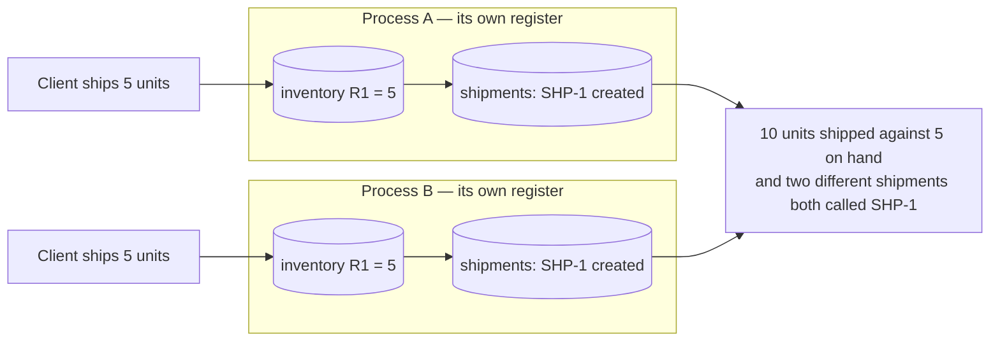

Neither process can detect the other: there is no shared store, no lock, no lease and no coordination of any kind (`src/server.js:5-6`). Horizontal scaling would silently defeat the stock invariant and the id scheme, which is why the deployment shape the code supports is exactly one instance.

### 4.8.3 Failure-Mode Catalog

| Failure mode | Trigger | Observable symptom | Detectable by `GET /health`? | Recovery |
|---|---|---|---|---|
| Documented start path serves nothing | `npm start` runs `node src/server.js`, which only exports the app | Process exits `0`; no log line, no bound port | No — nothing is listening | Invoke `node src/index.js` instead (`package.json:5`; `src/index.js:3`) |
| Port conflict at start-up | Another process holds the chosen port | Uncaught error kills the process; no log line | No | Restart on a free `PORT`; no bind-error handler reports the cause |
| Non-TCP listen on a non-numeric `PORT` | `PORT` set to a non-numeric string | `listening on <value>` logged, process alive, socket file created, no TCP port bound | No — probes on TCP fail | Supply a numeric `PORT` |
| Total data loss on restart | Process stop, crash or redeploy | Registers empty on the next request; dispatched shipments vanish | No — service reports `ok` with empty registers | Re-seed stock by intake; shipment history is unrecoverable |
| Silent data loss on crash | Any in-memory write followed by a crash | The `201` already returned cannot be honoured later | No | None available |
| Double shipment on retry | Client retries `POST /shipments` after a lost response | Two shipments, two decrements | No | Read `GET /inventory`; no compensation route exists |
| Malformed body breaks the JSON contract | Request body that is not valid JSON | `400 text/html` instead of `{"error":…}`, stack trace on stderr | No | Client fixes the payload |
| Oversized body | Body above the parser's 100 KB limit | `413 text/html` | No | Client reduces the payload |
| No graceful shutdown | `SIGTERM`/`SIGINT` while requests are in flight | Process exits; no signal handler drains or closes the listener | Temporarily, then no | Restart; in-flight requests are lost |
| Unauthenticated mutation and enumeration | Any client able to reach the port | Stock created, shipped and dispatched by an unknown caller; sequential ids enumerable | No | None — external network control is the only mitigation |


## 4.9 References

Every statement in this section rests on the files below, all read at commit `3b9b969`. No external source was consulted, because every workflow described here is defined by the repository itself.

**Source files**

- `src/server.js` — the complete workflow surface: `express.json()` edge at line 3, the `inventory` and `shipments` Maps at lines 5-6, and the six inline handlers (`GET /health` 8-9, `POST /inventory` 10-19, `GET /inventory` 21, `POST /shipments` 23-36, `GET /shipments/:id` 38-42, `POST /shipments/:id/dispatch` 44-51) with every guard, status code and in-place mutation used in Sections 4.2–4.8.
- `src/index.js` — bootstrap flow: port resolution `process.env.PORT || 3000` at line 2, the sole `app.listen` call and the `warehouse API listening on ${port}` log line at line 3; source of the bind-failure and non-TCP `PORT` findings in Sections 4.3.5 and 4.8.3.
- `package.json` — the pinned `express` 4.21.2 dependency and empty `devDependencies` at lines 6-7, and the `start`/`test` scripts at line 5 that establish both the documented-versus-actual start path and the verification entry point.
- `test/routes.test.js` — the verification sequence in Section 4.4.3: `app.listen(0)` at line 8, the loopback `fetch` at line 11, the two assertions at lines 12-13 and the `finally` close at line 15.
- `README.md` — the documented run instructions at lines 5-7 and the stated analysis gaps at lines 12-13, which identify the five untested journeys and three untested conflict behaviours referenced throughout Section 4.4.3 and Section 4.7.

**Folder**

- `src/` — confirmed to contain only `index.js` and `server.js`, establishing that no additional handler, middleware or persistence module participates in any workflow.
- `test/` — confirmed to contain only `routes.test.js`, establishing that the verification sequence is a single test and that no batch or fixture-driven workflow exists.

**Runtime observations**

All status codes, response bodies and timings quoted above were reproduced against the exported app bound to an ephemeral port on Node.js v22 with Express 4.21.2 from the installed `node_modules`. The listener defaults in Section 4.8.1 (`headersTimeout` 60 s, `requestTimeout` 300 s, `keepAliveTimeout` 5 s) were read from that live listener and are not set anywhere in the repository.


# 5. System Architecture

## 5.1 High-Level Architecture

### 5.1.1 System Overview

`warehouse-catalogue-api` is a **single-tier, single-process, synchronous monolith**. One Node.js process loads one Express application, and that application holds the entire behaviour of the service: routing, input validation, business rules, state mutation and response serialisation all execute inside six inline arrow handlers of a 53-line module (`src/server.js:1-53`). There is no controller/service/repository split, no domain entity type, no dependency-injection container, no build or transpile step, and no datastore. The repository draws exactly one internal boundary — process bootstrap (`src/index.js`, 3 lines) versus the application it starts (`src/server.js`) — plus a verification boundary at `test/routes.test.js`.

**Architecture style and rationale.** The style is best described as a *two-module vertical slice with an in-heap register*. Each of the five capabilities the service offers (intake, stock listing, shipment creation, shipment lookup, dispatch) is implemented end to end by one handler that validates, decides, mutates and responds; nothing is shared between handlers except the two module-level maps they close over. Four properties of the code explain the arrangement:

- **The application is exported, never self-started.** `src/server.js:53` assigns `module.exports = app` and contains no `listen` call, so the same configured app serves both the real bootstrap (`src/index.js:3`) and a test that binds an ephemeral port (`test/routes.test.js:8`). This is the one design decision in the repository with a demonstrable payoff.
- **Port resolution is isolated to the process edge.** Only `src/index.js:2` reads `process.env.PORT`, defaulting to `3000`; no other file reads environment state, so the application itself is configuration-free.
- **State is a heap-resident register, not a service.** `const inventory = new Map()` and `const shipments = new Map()` (`src/server.js:5-6`) are the entire persistence layer, reached directly by handlers rather than through a data-access interface.
- **The dependency graph is a single edge.** Express `4.21.2`, pinned exactly, is the only runtime dependency (`package.json:6`); `src/index.js` and the test file have no third-party imports of their own, so the framework is pulled in transitively through `src/server.js:1`.

**Key architectural principles and patterns.** These are the patterns the code actually exhibits, each with the construct that embodies it.

| Principle / pattern | How the code expresses it | Evidence |
|---|---|---|
| Layered separation at module granularity only | Bootstrap owns the process and port; the application owns all request behaviour; the suite owns verification. No further layering exists | `src/index.js:1-3`; `src/server.js:1-53` |
| Middleware pipeline with one stage | A single body parser is registered before all routes, so `req.body` is populated for every handler and nothing else can alter the request | `src/server.js:3` |
| Guard-clause validation before mutation | Every handler validates and returns early; only an all-guards-pass path writes | `src/server.js:12-15, 25-31, 46-49` |
| Status code as the error contract | `400` validation, `404` missing entity, `409` state conflict, each with a short JSON `error` string; no exceptions and no error middleware | `src/server.js:13,15,26,28,30,40,46,47` |
| Singleton store via module closure | The maps are module-scoped constants captured by every handler, so all requests share one register | `src/server.js:5-6` |
| Sequential dependency check ordering | Shipment creation resolves the SKU, then the quantity, then the stock level — the order that makes each rejection side-effect free | `src/server.js:25-30` |
| Trust-the-caller boundary | No credential, session, token or role check on any route; authorisation is entirely external | `src/server.js:8-51` (no auth construct anywhere) |

**System boundaries and major interfaces.** The service has four interfaces and no others:

- **The HTTP interface** — six routes at bare root paths (`/health`, `/inventory`, `/shipments`, `/shipments/:id`, `/shipments/:id/dispatch`) exchanging JSON (`src/server.js:8-51`). There is no API version segment, so the routes themselves are the contract.
- **The process interface** — one environment variable, `PORT`, and one stdout line at start-up (`src/index.js:2-3`).
- **The module interface** — a single default export, the configured Express app (`src/server.js:53`), consumed by the bootstrap and by the test.
- **The tooling interface** — two npm scripts, `start` and `test` (`package.json:5`).

Nothing leaves the process. There is no outbound HTTP call, no message broker client, no file read or write, no DNS or socket client other than the listener itself, and no dependency on any other repository service — the README's "Child Two" title (`README.md:1`) implies a family of services, but no sibling, shared library or parent manifest exists in the checkout.

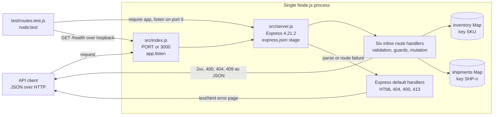

**What the architecture deliberately does not contain.** Each absence below is confirmed by the file set, not merely by the absence of a directory: no data-access layer or ORM, no schema or validation library, no error middleware, no authentication or authorisation filter, no CORS or security-header middleware, no request logger, no metrics or health-of-dependency endpoint, no configuration file or `.env`, no container, deployment or CI descriptor, no TypeScript or bundler configuration, and no caching tier. Section 1.2.1 records the operational consequences of each; Section 3.7.3 records their security consequences.

### 5.1.2 Core Components

Seven components make up the system. Two are code modules, two are in-memory registers, one is the framework-provided request pipeline, one is the verification suite, and one is the manifest that makes the others runnable.

| Component | Primary responsibility | Key dependencies and integration points | Critical considerations |
|---|---|---|---|
| **Process bootstrap** — `src/index.js` (3 lines) | Resolve the port once and open the listener on the exported app; log one start-up line | Depends on `src/server.js` via relative `require`; integrates with the host OS socket layer and with `PORT` from the environment | Listener handle discarded, so a bind failure is an uncaught process error; no signal handling, graceful shutdown or TLS; not exercised by the test suite |
| **HTTP application** — `src/server.js:2-3` (Express app plus `express.json()`) | Instantiate the framework, register the body parser, own the router and the two registers, expose itself as the module export | Depends on `express` 4.21.2, which supplies the router, `res.json`, the query middleware and `finalhandler`; consumed by `src/index.js` and by the test | Parser must stay registered before every route, or `req.body` is empty and all writes fail validation; no error middleware, so framework failures bypass the JSON error contract |
| **Route handler set** — six handlers, `src/server.js:8-51` | Hold every rule the service enforces: field presence and integer checks, duplicate-SKU rejection, stock arithmetic, state-transition guard, default values | Reads and writes the two registers through module closure; reads `req.body` and `req.params`; writes via `res.status(...).json(...)` | All handlers are synchronous with no `await`, which is what keeps each guard-then-mutate pair atomic on the event loop; the logic is not reusable outside the route table and is untested for five of six routes |
| **Inventory register** — `inventory` Map, `src/server.js:5` | Be the single source of truth for stock on hand, keyed by SKU, holding `{ sku, name, quantity, reorderLevel }` | Reached only by `POST /inventory`, `GET /inventory` and `POST /shipments`; no external system reads or writes it | Lives and dies with the process; `quantity` is mutated in place by shipment creation, and the stored object is the same reference returned to callers; `reorderLevel` is never validated |
| **Shipment register** — `shipments` Map, `src/server.js:6` | Hold shipment records keyed by generated id, carrying `{ id, sku, quantity, destination, status, carrier? }` | Reached only by `POST /shipments`, `GET /shipments/:id` and `POST /shipments/:id/dispatch`; the id derives from `shipments.size + 1` | Non-durable; ids are sequential and enumerable; `carrier` appears only after dispatch, so the record shape differs before and after that transition |
| **Verification suite** — `test/routes.test.js` (18 lines) | Prove the app boots and that `GET /health` returns `200` with the exact body | Uses `node:test` and `node:assert/strict` only; imports the app with `require('../src/server')` and binds port `0` | One test against six routes; no CI wiring, so nothing runs it automatically; the suite requires that `src/server.js` never listens on its own |
| **Build and run manifest** — `package.json` | Declare identity (`warehouse-catalogue-api`, `1.0.0`, `private`), the pinned Express dependency, and the `start`/`test` scripts | Read by npm and by the host's `npm install`; delegates to `node src/server.js` and `node --test` | The `start` script targets a module that never listens, so the documented run path (`README.md:5-7`) produces no listener; no `engines`, `main` or `type` key constrains runtime or module dialect |

### 5.1.3 Data Flow Description

Every interaction the service supports is a completed request-response cycle over a single in-memory pipeline. There is no background processing, no scheduled job, no event emission and no outbound call, so the flow of a request is the flow of the system.

**The request pipeline.** A request enters through the socket the bootstrap opened, crosses the Express app's middleware stack — query parsing, then `express.json()` — reaches the router, is dispatched to one of six handlers, reads or mutates one map, and returns through `res.json`. Five points in that path change the data, and each is a distinct transformation step.

```mermaid
flowchart TD
    Ingress["Socket ingress<br/>HTTP/1.1 bytes"] --> CT{"Content-Type<br/>application/json?"}
    CT -->|"no"| Empty["req.body resolves to an empty object<br/>handler rejects with 400"]
    CT -->|"yes"| Size{"valid JSON within 100 KB?"}
    Size -->|"over limit"| TooLarge["413 from Express default handler<br/>never routed"]
    Size -->|"unparseable"| BadJson["400 from Express default handler<br/>never routed"]
    Size -->|"yes"| Parsed["JavaScript object from body-parser 1.20.3"]
    Parsed --> Whitelist["Destructuring whitelist<br/>unknown fields discarded"]
    Whitelist --> Defaults["Defaults applied<br/>reorderLevel 5, carrier standard"]
    Defaults --> Guards{"Guard clauses<br/>all conditions met?"}
    Guards -->|"no"| Reject["400, 404 or 409 JSON error<br/>no state written"]
    Guards -->|"yes"| Mutate["Map read, in-place mutation, insert"]
    Mutate --> Serialise["res.status().json()<br/>Content-Type application/json, ETag added"]
    Serialise --> Egress["Response egress"]
```

**Primary data flows.** Six flows exist; five write or read the registers and one only reports liveness. The table states what each touches, because that determines what a failure can leave behind.

| Flow | Records read | Records written | Response |
|---|---|---|---|
| Liveness — `GET /health` | None | None | `200 { status: 'ok' }` (`src/server.js:8`) |
| Intake — `POST /inventory` | `inventory` by SKU, for the duplicate check | One `inventory` entry | `201` with the stored item, or `400`/`409` (`:10-19`) |
| Stock listing — `GET /inventory` | All `inventory` values, in insertion order | None | `200` array (`:21`) |
| Shipment creation — `POST /shipments` | One `inventory` entry | One mutated `inventory` entry **and** one new `shipments` entry | `201` with the shipment, or `400`/`404`/`409` (`:23-36`) |
| Shipment lookup — `GET /shipments/:id` | One `shipments` entry | None | `200` with the record, or `404` (`:38-42`) |
| Dispatch — `POST /shipments/:id/dispatch` | One `shipments` entry | That entry's `status` and `carrier` | `200` with the record, or `404`/`409` (`:44-51`) |

Shipment creation is the only flow that touches both registers, and therefore the only place where a partial write would be observable. The handler is structured so that it cannot occur: the four mutations (`src/server.js:31-34`) execute in one synchronous pass after every guard, with no `await`, no callback and no I/O between them, so no other request can interleave and no rejection can fire midway. There is no compensating action, rollback or two-phase step because none is reachable.

**Integration patterns and protocols.** The pattern is synchronous, client-initiated request-response over HTTP/1.1 with JSON payloads in both directions. Reads are the only pull pattern; there is no server push, polling contract, webhook, queue or stream. Express answers `OPTIONS` for any routed path with `Allow` headers derived from the route table, but no CORS headers are emitted, so a cross-origin browser client cannot use the service despite that reply.

**Data transformation points.** Table below records each transformation, the rule applied and the verified effect.

| Transformation | Rule applied | Observable effect |
|---|---|---|
| Bytes → JavaScript object | `express.json()` delegates to `body-parser` 1.20.3 with its defaults: type `application/json`, limit `100kb`, strict mode, inflation enabled | Bodies of another content type become `{}` and are rejected `400`; bodies over the limit return `413`; unparseable bodies return `400` as `text/html` |
| Payload → record fields | Destructuring admits only the named fields: `{ sku, name, quantity, reorderLevel = 5 }` and `{ sku, quantity, destination }` | An extra property sent on intake is silently discarded and never stored |
| Missing → default values | `reorderLevel = 5` at destructuring; `carrier = req.body.carrier \|\| 'standard'` at dispatch | Intake without `reorderLevel` stores `5`; dispatch without a carrier stores `standard` |
| Quantity arithmetic | `item.quantity -= quantity` on the stored object | Stock on hand falls by the shipped amount; the intake response object a client already holds reflects the new quantity on later reads because it is the same reference |
| Identity synthesis | `SHP-${shipments.size + 1}` | Ids run `SHP-1…n` in creation order, unique only because nothing is ever deleted |
| Record → JSON | `res.json` serialises with `JSON.stringify` semantics, so `undefined` properties are omitted | A shipment created without `destination` returns without that field; `carrier` is absent until dispatch |
| Response shaping | Express adds `Content-Type: application/json; charset=utf-8`, an `ETag` and `X-Powered-By: Express` | Every handler response is identical in envelope; only framework-generated errors differ |

**Key data stores and caches.** There are two stores and no caches. Both are `Map` instances in the process heap (`src/server.js:5-6`), created at module load and never cleared. `Map` gives key lookup by SKU or id, preserves insertion order for iteration (which fixes the ordering of `GET /inventory`), and holds the record objects by reference — so `GET /inventory` builds a new array of live objects rather than a copy of the data, and any caller holding a previous response sees subsequent mutations. Neither store has a size bound, eviction policy, serialisation format, backup path or reload path. The absence of a cache is consistent with the absence of an external store: every read is served from the authoritative copy in memory.

### 5.1.4 External Integration Points

The service is a leaf: it initiates no outbound connection at runtime. Its integration surface is confined to callers reaching its listener and to the build-time and process-level systems around it. The SLA column records what the repository actually commits to, which in every case is nothing beyond the framework's own defaults.

| System | Integration type | Data exchange pattern and format | SLA requirements |
|---|---|---|---|
| **Warehouse API clients** (operator tooling, upstream services) | Inbound synchronous API, at runtime | Client-initiated request-response; JSON request bodies and JSON responses carrying the record, the array or `{ error }`; Express also answers `OPTIONS` with `Allow` headers | None declared — no timeout, rate limit, availability target, retry guidance or versioning commitment exists in the repository. The only enforced bounds are framework defaults: a `100kb` body limit and a 5-second keep-alive |
| **Host OS and process supervisor** | Process lifecycle, at runtime | One stdout line `warehouse API listening on <port>`; uncaught errors and parser stack traces on stderr; readiness signalled only by the port accepting connections | None declared — no health or readiness probe contract beyond `GET /health`, no restart policy, no shutdown signal handling in `src/index.js` |
| **npm registry** (`registry.npmjs.org`) | Outbound artifact fetch, at build time only | HTTPS tarball retrieval during `npm install`; the lockfile resolves `express@4.21.2` from a single integrity-checked tarball | None declared — the exact version pin fixes the framework, but the lockfile is untracked, so two installs are not guaranteed to resolve identical transitive code |
| **Test harness** (`node --test` plus loopback client) | In-process verification, at test time | The suite requires the exported app, binds an ephemeral port, issues `GET /health` over `http://127.0.0.1:<port>` with the built-in `fetch`, and closes the listener in `finally` | None declared — no CI workflow exists in the repository, so the suite runs only when `npm test` is invoked manually |
| **Other services** | None | The service makes no outbound call and consumes no inbound event, message or file. No sibling service, shared library or parent manifest appears in the checkout | Not applicable |


## 5.2 Component Details

### 5.2.1 Process Bootstrap — `src/index.js`

**Purpose and responsibilities.** The bootstrap is the repository's only entry point that opens a listener, and it owns exactly three things: requiring the configured application, resolving the port once, and starting the HTTP server.

```javascript
const app = require('./server');
const port = process.env.PORT || 3000;
app.listen(port, () => console.log(`warehouse API listening on ${port}`));
```

It contains no function, class, export or conditional. Everything it decides is decided at module load, which means the side effect of listening happens simply by requiring the file.

**Technologies and frameworks.** Node.js CommonJS with no third-party import of its own; `process.env` for the single configuration input; `app.listen`, which delegates to Node's `http.Server`; `console.log` bound to stdout. Express reaches it transitively through `src/server.js:1`. No TLS module, no `cluster`, no `worker_threads`, no signal handler, no logger library.

**Key interfaces.**

| Interface | Direction | Contract as implemented |
|---|---|---|
| `PORT` environment variable | In | `process.env.PORT \|\| 3000`; any non-empty string is passed through unparsed, so a non-numeric value makes Node bind a Unix domain socket at that path instead of a TCP port (verified: `PORT=notaport` created a socket file and the start-up line still printed), while `0` yields an ephemeral port and an empty value falls back to `3000` |
| `require('./server')` | In | Receives the fully configured Express app, including its two registers, created when that module is evaluated |
| Bound listener | Out | A `net.Server` handle that is discarded at `src/index.js:3` — never stored, so it cannot be closed, inspected or given an `error` listener |
| stdout start-up line | Out | Exactly one line per process, `warehouse API listening on <port>`; that string is the only runtime output the application emits on success |
| Process exit code | Out | `0` when the file is run by `npm start`, because `package.json:5` targets `src/server.js` rather than this file and that module only assigns an export; a non-zero uncaught exception when the port cannot be bound, since no `error` handler is attached (both paths verified) |

**Data persistence requirements.** None. The bootstrap neither reads nor writes any store; the registers come into existence as a side effect of requiring `src/server.js` before the listener opens, and the bootstrap has no code path that could restore them.

**Scaling considerations.**

- **One listener per process on one port.** Horizontal scale means N processes, normally behind a proxy the repository does not describe. Because each process holds its own maps (`src/server.js:5-6`), the stock guard at `src/server.js:30` is per-instance: N instances can jointly oversell a SKU by up to N times its stock.
- **No graceful shutdown.** The handle is discarded and no `SIGTERM`/`SIGINT` handler exists, so a supervisor's stop signal terminates the process with requests in flight and all state unrecovered.
- **Degraded failure reporting.** With no `error` listener, `EADDRINUSE` surfaces as an uncaught exception and stack trace rather than a controlled exit; a non-numeric `PORT` binds a socket file instead of failing, which makes a typo look like a successful start.
- **No multi-core use by design.** JavaScript execution is single-threaded here and nothing forks workers, so one instance uses one core; throughput scales only by adding instances, which is exactly what breaks the stock guard's integrity.

### 5.2.2 HTTP Application — `src/server.js`

**Purpose and responsibilities.** This module is the whole service. It creates the Express app, installs the only middleware, declares the two registers, defines all six routes as inline arrow handlers, and exports the app. It performs no process action of its own, which is what allows the suite to mount it on an ephemeral port.

**Technologies and frameworks.** Express `4.21.2`, pinned exactly (`package.json:6`). Within Express the request crosses four framework stages: the implicit query parser (`qs`), the JSON body parser registered at `src/server.js:3` (delegating to `body-parser` 1.20.3), the router built on `path-to-regexp`, and `finalhandler` for unmatched routes and parser errors. Response serialisation is `res.json`, which sets `Content-Type: application/json; charset=utf-8` and an `ETag`. No template engine, static-file middleware, CORS, cookie, session, compression, rate-limiting or error middleware is registered.

**Middleware pipeline.** Registration order fixes the behaviour of every request.

| Stage | Registration | Effect on the request |
|---|---|---|
| Query parsing | Implicit in Express's application initialisation | Parses the query string into `req.query`; no handler reads it, so the result is unused |
| JSON body parsing | `app.use(express.json())`, `src/server.js:3` | Parses bodies whose content type is `application/json` up to `100kb`; other content types leave `req.body` as `{}`; over-limit bodies and unparseable JSON leave the pipeline through `finalhandler` as `413` and `400` `text/html` |
| Routing | The six route registrations, `src/server.js:8-51` | Matches method and path; an unmatched pair exits as `404` `text/html`; otherwise calls the handler |

**Key interfaces and APIs.** The route table is the service's public contract.

| Method and path | Request input | Success response | Failure responses |
|---|---|---|---|
| `GET /health` | None | `200 { status: 'ok' }` | None |
| `POST /inventory` | JSON `{ sku, name, quantity, reorderLevel? }` | `201` the stored item, with `reorderLevel` defaulted to `5` | `400 invalid inventory payload` when `sku` or `name` is falsy or `quantity` is not a non-negative integer; `409 duplicate sku` |
| `GET /inventory` | None | `200` array of every stored item in insertion order | None |
| `POST /shipments` | JSON `{ sku, quantity, destination }` | `201` the shipment with `status: 'created'` | `404 sku not found`; `400 quantity must be positive`; `409 insufficient inventory` |
| `GET /shipments/:id` | Path parameter `id` | `200` the shipment record | `404 shipment not found` |
| `POST /shipments/:id/dispatch` | Path parameter `id`, optional JSON `{ carrier }` | `200` the shipment with `status: 'dispatched'` and a `carrier` | `404 shipment not found`; `409 shipment cannot be dispatched` |

Three properties of that table are architectural rather than incidental. Routes sit at bare root paths with no version segment, so any contract change is breaking for every client. `destination` is not validated, so a shipment can be created without one and the field is then omitted from the JSON (`destination` is `undefined`, and `JSON.stringify` drops it — verified). The dispatch route both reads and writes its record, so it is the only handler whose success depends on a field it also changes.

**Data persistence requirements.** The module owns both registers and persists nothing itself: no database driver, no file write, no `fs` import, no serialisation to disk. Its persistence requirement is therefore the inverse of a store's — that every record be reproducible from request input alone, which today means re-seeding by hand after each restart.

**Scaling considerations.**

- **Shared in-process state.** The registers are module-scoped constants created once per process, and Node caches modules, so every listener created from the same app object in one process shares the same register — the test's `app.listen(0)` observes identical state to the bootstrap's listener would.
- **Unbounded memory growth.** Neither map bounds its size, evicts or expires entries, so memory grows with every intake and every shipment for the life of the process.
- **Synchronous handlers are the correctness mechanism.** No handler contains `await`, a callback or I/O, so each handler runs to completion on the event loop without interleaving. Introducing asynchronous work between the stock guard (`src/server.js:30`) and the decrement (`:31`) would open the oversell window the design currently closes.
- **No backpressure or admission control.** Beyond the parser's `100kb` limit and Node's keep-alive timeout, no rate limit, queue, timeout or concurrency cap exists, so load translates directly into event-loop queueing.

### 5.2.3 Inventory Register

**Purpose and responsibilities.** `const inventory = new Map()` (`src/server.js:5`) is the single source of truth for stock on hand. It is keyed by SKU and holds objects of the shape `{ sku, name, quantity, reorderLevel }`. It answers one question — how much of this SKU is available — and it is the only component that can refuse a shipment.

**Technologies and frameworks.** The built-in `Map` collection in the process heap. No database, ORM, schema, index or serialiser. Lookup is by key at constant average cost; iteration follows insertion order, which is what makes `GET /inventory` deterministic across repeated reads.

**Key interfaces.** Only three handlers reach it, through four `Map` operations and no other access path.

| Operation | Call site | Semantics |
|---|---|---|
| `has(sku)` | `src/server.js:15` | Duplicate-SKU guard on intake; the only uniqueness enforcement in the system |
| `set(sku, item)` | `src/server.js:17` | Insert on successful intake; never used to update, because a duplicate is refused instead |
| `get(sku)` | `src/server.js:25` | Resolve the item a shipment will draw from; returns the live record, which the handler then mutates |
| `[...values()]` | `src/server.js:21` | Snapshot of the records into a new array for `GET /inventory`; the array is new, the records in it are not |

There is no delete, no clear, no enumeration by field, and no route that adjusts stock upward. A quantity, once decremented, can only be raised by restarting the process and re-seeding.

**Data persistence requirements.** None are met and none are declared. The register is created at module load and destroyed with the process; nothing in the repository writes it anywhere. Its in-memory invariants are worth stating because they hold today only by construction: the key equals the record's own `sku`; `quantity` is a non-negative integer at insertion (enforced by `src/server.js:12`) and never falls below zero (enforced by the comparison at `:30` preceding the subtraction at `:31`); and `reorderLevel` carries no invariant at all — a string is accepted and stored verbatim (verified: `reorderLevel: "abc"` returned `201`).

**Scaling considerations.**

- **The guard is local.** Correctness of "never ship more than is on hand" depends on one process serialising all writes. Nothing coordinates across processes, so the register partitions cleanly and wrongly under horizontal scale.
- **Records are shared by reference.** The object stored is the object returned in the intake response and the object placed in the listing array, so a client holding a former response observes later decrements on re-read. There is no copy-on-read and no versioning.
- **Unbounded growth with no lifecycle.** Every intake adds an entry permanently; there is no compaction, archival or eviction, and the entire register is returned by one route, so response size grows with catalogue size.

### 5.2.4 Shipment Register

**Purpose and responsibilities.** `const shipments = new Map()` (`src/server.js:6`) holds the shipment lifecycle. It is keyed by a generated identifier and holds `{ id, sku, quantity, destination, status, carrier? }`, where `status` distinguishes the two reachable states and `carrier` exists only after dispatch.

**Technologies and frameworks.** The same built-in `Map` in the process heap, with no schema enforcement, no secondary index and no persistence. The stored record is a plain object literal built inline at `src/server.js:33` and extended in place at `:48-49`.

**Key interfaces.**

| Operation | Call site | Semantics |
|---|---|---|
| `set(id, shipment)` | `src/server.js:34` | Insert a new record after stock has been decremented |
| `get(req.params.id)` | `src/server.js:39` | Lookup for `GET /shipments/:id`; a miss returns `404` |
| `get(req.params.id)` | `src/server.js:45` | Lookup for dispatch; the same miss returns `404` before any state check |
| `size` | `src/server.js:32` | Source of the next identifier, `SHP-${size + 1}` |

Two structural consequences follow from that table. The register is write-once and mutate-in-place — there is no update route beyond dispatch, no cancellation, and no delete, so a record's only lifecycle is creation, one status change, and process death. And there is no listing route and no index by SKU, so shipments can only be retrieved if the caller retained the identifier it was given.

**Data persistence requirements.** None are met. Because the record is the only durable artefact a client might need later and it exists solely in heap, dispatch history and shipment identity vanish on restart — a loss that cannot be reconstructed from the inventory register, which retains only the decremented quantity.

**Scaling considerations.**

- **Identifiers are sequential and enumerable.** `SHP-1…n` in creation order, with no uniqueness check and no authorisation on read, so any caller can walk the sequence. The scheme is also only collision-free while nothing is ever removed: introducing a delete or an expiry would make `size + 1` reuse an id still in use.
- **Inconsistent record shape by design.** Before dispatch a record may lack `destination` (unvalidated) and always lacks `carrier`; after dispatch it carries both the status change and the carrier. Consumers must treat `carrier` as optional and must not assume `destination` exists.
- **No cross-register integrity.** A shipment stores the `sku` string, not a reference to an inventory entry, so the two registers are joined only by convention and nothing enforces that the referenced SKU still exists.

### 5.2.5 Verification Suite — `test/routes.test.js`

**Purpose and responsibilities.** The suite proves two things: that the exported app can be mounted and serve a request, and that `GET /health` returns `200` with the exact body `{ status: 'ok' }`. Its comments state the limit explicitly — health route and one validation contract, with full workflow coverage intentionally absent (`test/routes.test.js:5-6`), a gap the README repeats (`README.md:12-13`).

**Technologies and frameworks.** `node:test` as runner, `node:assert/strict` for assertions, the global `fetch` for the request, and `app.listen(0)` for an ephemeral port. No third-party test dependency exists (`package.json:7` declares empty `devDependencies`), and `npm test` runs `node --test`, which discovers the file without configuration.

**Key interfaces.**

| Interface | Detail |
|---|---|
| Module import | `require('../src/server')`, which is why the application must never bind a port at import time |
| Listener | `app.listen(0)` — port `0` delegates selection to the OS, so concurrent runs cannot collide |
| Request | `fetch('http://127.0.0.1:<port>/health')`, crossing the real HTTP boundary rather than mocking it, which makes this an integration test despite its size |
| Assertions | `assert.equal(response.status, 200)` and `assert.deepEqual(await response.json(), { status: 'ok' })` |
| Cleanup | `server.close()` in a `finally` block, so the listener is released on success or failure |

**Data persistence requirements.** None, and no reset mechanism exists. Because the registers are module singletons created on first `require`, any test added to this file shares state with every other test in the file — an intake performed by one test remains visible to the next. The current single test is unaffected because it touches no register; the constraint becomes binding as soon as the missing journeys are added.

**Scaling considerations.**

- **Coverage is one of six routes.** Inventory intake, listing, shipment creation, lookup and dispatch have no automated check, so the stock guard, the duplicate-SKU rule and the double-dispatch rule are all unverified by the suite (verified `npm test`: 1 test, 1 pass, ~84 ms).
- **No CI wiring.** No workflow, hook or pipeline file exists in the repository, so the suite runs only when a developer invokes `npm test`; a regression in any of those rules reaches a commit unnoticed.
- **Cheap to extend.** The harness needs no new dependency and no fixture server: a test can bind `0`, seed stock through `POST /inventory`, and assert on any route, which is the shape the README's list of missing journeys describes.

### 5.2.6 Component Interaction Diagram

The diagram below shows every runtime and build-time relationship between components. Two properties are worth reading from it directly: all business logic sits on the edge between the router and the registers, and the only path that bypasses the JSON contract is the framework's own error rendering.

```mermaid
flowchart TD
    Client["API client"]
    subgraph Proc["Single Node.js process"]
        Boot["Process bootstrap<br/>src/index.js"]
        Query["Query parser<br/>qs, implicit"]
        Parser["express.json<br/>body-parser 1.20.3"]
        Router["Router<br/>path-to-regexp"]
        H1["GET /health handler"]
        H2["POST /inventory handler"]
        H3["GET /inventory handler"]
        H4["POST /shipments handler"]
        H5["GET /shipments/:id handler"]
        H6["POST /shipments/:id/dispatch handler"]
        Inv[("inventory Map<br/>sku maps to item")]
        Shp[("shipments Map<br/>id maps to shipment")]
        Final["finalhandler<br/>404 and parser errors"]
        Out["stdout start-up line"]
        Err["stderr stack trace"]
        Boot -->|"app.listen on PORT"| Query
        Query --> Parser
        Parser --> Router
        Router --> H1
        Router --> H2
        Router --> H3
        Router --> H4
        Router --> H5
        Router --> H6
        H2 -->|"has and set"| Inv
        H3 -->|"read all values"| Inv
        H4 -->|"get, decrement"| Inv
        H4 -->|"set new record"| Shp
        H5 -->|"get"| Shp
        H6 -->|"get, mutate status and carrier"| Shp
        Parser -->|"parse failure"| Final
        Router -->|"no match"| Final
        Final --> Err
        Boot --> Out
    end
    Client -->|"HTTP request"| Boot
    H1 --> Client
    H2 --> Client
    H3 --> Client
    H4 --> Client
    H5 --> Client
    H6 --> Client
    Final -->|"text/html error"| Client
    Suite["test/routes.test.js"] -.->|"require app, listen 0"| Router
    Suite -.->|"GET /health"| Client
```

### 5.2.7 Shipment State Transition Diagram

Shipments have exactly two states and one permitted transition. The transition is guarded by the current status, which makes repeated dispatch a rejection rather than a second effect. The inventory register has no equivalent: `quantity` is an integer decremented in place, not a state machine, and no route moves it back up.

```mermaid
stateDiagram-v2
    [*] --> Absent
    Absent --> Created : POST /shipments accepted, stock decremented
    Absent --> Absent : reject 404 sku not found, or 400, or 409 insufficient inventory
    Created --> Dispatched : POST dispatch accepted, carrier set
    Created --> Created : GET reads record, no change
    Dispatched --> Dispatched : repeated dispatch rejected 409, record unchanged
    Created --> [*] : process exit, record lost
    Dispatched --> [*] : process exit, record lost
```

Three consequences follow from the diagram. There is no path from `Dispatched` back to `Created`, so a dispatch cannot be reversed, corrected or re-carried. The rejection self-loops write nothing, which is why a refused request leaves both registers unchanged. And termination is only ever `[*]` via process exit — no route removes a shipment, so a record's history ends when the heap does.

### 5.2.8 Sequence Diagrams for Key Flows

**Intake — `POST /inventory`.** Validation precedes every write, and the duplicate check is the only uniqueness enforcement in the system.

```mermaid
sequenceDiagram
    autonumber
    participant C as API client
    participant P as express.json
    participant H as POST /inventory handler
    participant I as inventory Map
    C->>P: POST /inventory with sku, name, quantity, optional reorderLevel
    P->>H: req.body populated, unknown fields discarded
    H->>H: check sku and name present, quantity integer and not negative
    alt payload invalid
        H-->>C: 400 invalid inventory payload
    else payload valid
        H->>I: has(sku)
        alt sku already stored
            H-->>C: 409 duplicate sku
        else sku new
            H->>I: set sku to item with reorderLevel defaulted to 5
            H-->>C: 201 stored item
        end
    end
```

**Shipment creation — `POST /shipments`.** This is the only flow that touches both registers, and the guard order is what keeps each rejection side-effect free: the decrement cannot happen unless the quantity check and the stock comparison have both passed.

```mermaid
sequenceDiagram
    autonumber
    participant C as API client
    participant H as POST /shipments handler
    participant I as inventory Map
    participant S as shipments Map
    C->>H: POST /shipments with sku, quantity, destination
    H->>I: get(sku)
    alt sku unknown
        H-->>C: 404 sku not found
    else sku known
        I-->>H: live item record
        H->>H: verify quantity is a positive integer
        alt quantity invalid
            H-->>C: 400 quantity must be positive
        else quantity valid
            H->>H: compare item quantity against requested quantity
            alt stock insufficient
                H-->>C: 409 insufficient inventory
            else stock sufficient
                H->>I: subtract quantity from item quantity
                H->>S: insert record at SHP-n plus one with status created
                H-->>C: 201 shipment record
            end
        end
    end
```

**Dispatch — `POST /shipments/:id/dispatch`.** The status guard at `src/server.js:47` is what makes the transition single-shot; the carrier default is applied only on the successful path.

```mermaid
sequenceDiagram
    autonumber
    participant C as API client
    participant H as dispatch handler
    participant S as shipments Map
    C->>H: POST /shipments/SHP-1/dispatch with optional carrier
    H->>S: get(id)
    alt id unknown
        S-->>H: undefined
        H-->>C: 404 shipment not found
    else id found and status is created
        S-->>H: live shipment record
        H->>S: set status to dispatched and carrier to body carrier or standard
        H-->>C: 200 dispatched record
    else id found and status is not created
        S-->>H: live shipment record
        H-->>C: 409 shipment cannot be dispatched
    end
```


## 5.3 Technical Decisions

### 5.3.1 Architecture Style Decision

The service is a **single-deployment, single-process, in-process-state monolith** with a two-module internal split. The repository contains no decision log, so the records in this sub-section are reconstructed from the code; each states what the artefacts demonstrate, and where the artefacts show only the outcome and no rationale, the entry says so rather than inventing one.

| Dimension | Decision as built | Alternative it displaces | Consequence visible in the code |
|---|---|---|---|
| Internal layering | Two modules — process bootstrap and application — with validation, rules, state access and serialisation fused inside each route handler | Controller / service / repository layering, or a domain model with separate persistence mapping | The whole service fits in 53 lines and reads top to bottom, but no rule is reusable or testable without an HTTP request (`src/server.js:8-51`) |
| Deployment unit | One Node.js process, one listener, one port | Independently deployable components, or a serverless handler per route | Port resolution, framework boot and business logic ship together; a change to any rule redeploys everything (`src/index.js:1-3`) |
| State ownership | State is owned by the application process, held in module-level collections | State owned by an external store and reached through a data-access layer | Restart destroys all records; horizontal scale partitions the register (`src/server.js:5-6`) |
| Framework | Express `4.21.2`, exact pin, no plugins beyond the built-in JSON parser | Express 5, Fastify, Koa, NestJS, or a hand-written `http` router | The middleware pipeline is one stage deep; all observability, security and error-treatments Express offers by way of middleware are absent (`package.json:6`; `src/server.js:3`) |
| Modularity posture | Vertical slice per capability — each handler owns its whole path | Shared service functions called by thin controllers | Five capabilities have no shared code path, so a rule change touches exactly one handler; consistency across capabilities is maintained by convention only |

**Tradeoff.** The style buys a complete, reviewable system in five tracked files with a single dependency, and a one-way dependency graph in which the bootstrap depends on the application and never the reverse. It pays for that with three structural limits that are properties of the style, not defects in implementation: correctness depends on a single writer, durability depends on never restarting, and every rule is reachable only through HTTP, which is why the untested routes are unverified rather than merely undocumented.

### 5.3.2 Communication Pattern Decision

| Aspect | Decision | Tradeoff |
|---|---|---|
| Interaction style | Synchronous, client-initiated request-response over HTTP/1.1; each request is self-contained | Trivial to consume and to test, but a caller gets no progress, no batch semantics and no way to observe an outcome it failed to receive |
| Payload format | JSON only, in both directions, parsed by one `express.json()` stage | One parser and one shape to reason about; form-encoded, multipart and untyped bodies are unsupported and arrive as `{}`, which is then rejected `400` |
| Error signalling | HTTP status codes as the protocol — `400` validation, `404` missing entity, `409` state conflict — with a `{ error }` body | Clients branch on a code alone; there is no error catalogue, no machine-readable code field and no correlation id |
| Routing surface | Six routes at bare root paths, no version segment, no content negotiation | The route is the contract, so any rename or shape change is breaking for every client; there is no deprecation path |
| Idempotency | No idempotency key, token or request id anywhere | Dispatch is idempotent only because a second attempt is rejected; intake is effectively idempotent on the SKU; shipment creation is not, and a retried create ships stock twice |
| Callback and streaming channels | None — no webhook, no long poll, no server-sent event, no queue producer or consumer | The system has one integration style to secure and none to operate, at the cost of having no way to notify a caller of a state change it did not request |

The pattern is the correct fit for the capability set — four commands and two queries over a record store — and its one irreducible weakness is the combination of a non-idempotent create with no correlation mechanism, which Section 4.7.2 documents as a per-workflow retry hazard.

### 5.3.3 Data Storage Solution Decision

| Aspect | Decision | Tradeoff |
|---|---|---|
| Store technology | Two built-in `Map` instances in the process heap, one per aggregate, keyed by SKU and by generated shipment id | Zero dependency, zero configuration, constant-time lookup and insertion-ordered iteration; no durability, no transactions, no query beyond key lookup, and no way to list shipments |
| Schema enforcement | None — records are plain object literals built inline from destructured request fields | Records are exactly as wide as the handler writes them, so unknown input fields are dropped and no migration is ever needed; nothing prevents a field holding the wrong type (`reorderLevel` accepts a string) |
| Identity | Natural key for inventory (SKU, enforced unique on intake); synthetic sequential key for shipments (`SHP-${size + 1}`) | Inventory keying gives free duplicate detection; shipment keying gives short, readable ids at the cost of enumerability and of reuse if deletion were ever added |
| Multi-record atomicity | None needed by design — the one two-register flow performs its mutations in a single synchronous pass | No transaction, lock or compensating action exists because no interleaving point exists; adding asynchronous work to that handler would introduce the first atomicity requirement the code has never had |
| Durability and recovery | Not implemented — no journal, snapshot, file or database anywhere in the repository | The store is always consistent with itself; it is never consistent with history, because history ends at process exit |

The absence of a database is coherent with the absence of an asynchronous code path: as long as the register is in heap and handlers are synchronous, the stock guard is atomic for free. Every durability option would introduce either an interleaving point (concurrent writers) or a partial-failure mode (a write that succeeds locally and fails remotely), which is why persistence is the decision that changes the most about this architecture (Section 3.5 records the store options).

### 5.3.4 Caching Strategy Decision

No cache exists at any tier — no in-process memo, no HTTP cache directive, no response cache, no reverse proxy — and none is needed while there is exactly one copy of the data in memory. Every read route serves the authoritative record: `GET /inventory` builds a fresh array of live records (`src/server.js:21`) and `GET /shipments/:id` returns the record itself (`:41`). Express does emit an `ETag` on responses by default, so a client may issue a conditional request, but nothing in the repository varies on it and no handler inspects `If-None-Match`.

| Consideration | Position in this system |
|---|---|
| Read amplification | Not a factor: reads touch in-heap data with no network hop, so a cache could only add a copy to invalidate |
| Consistency hazard | A cache would be a second copy of a register that handlers mutate in place at `src/server.js:31` and `:48-49`; correctness today follows from there being exactly one copy |
| What would force a cache | Introducing an external store, which turns each read into I/O. At that point the natural first step is a bounded cache on `GET /inventory`, because that route returns the entire catalogue on every call |
| Client-side caching | Not specified; the `ETag` header is present but no `Cache-Control` is set, so intermediaries fall back to heuristic freshness for `200` responses |

### 5.3.5 Security Mechanism Selection

| Control area | Decision as built | Residual risk carried by the decision |
|---|---|---|
| Authentication | Absent — no credential is read or checked on any of the six routes | Any caller reaching the port can create stock, create shipments and dispatch them; identity of the actor is unknowable |
| Authorisation | Absent — no role, scope or ownership check, and no per-record access rule | Shipments are addressable by sequential id, so one caller can read and dispatch another's records |
| Transport security | Absent — the process opens a plain HTTP listener and imports no TLS module | Payloads and the `409`-based stock oracle travel in clear text if the network is not otherwise protected |
| Input validation as a boundary | Presence and integer-type checks only, plus the parser's `100kb` cap and content-type restriction | `name`, `destination`, `reorderLevel` and `carrier` are stored and echoed verbatim; no length cap, no charset or format rule, and no schema |
| Framework fingerprinting | Not disabled — `X-Powered-By: Express` is emitted on every response | An attacker learns the framework and, with the exact pin, the version, narrowing the advisory search |
| Network boundary | Delegated entirely to the operator; nothing in the repository configures it | The security posture equals whatever isolation surrounds the process; the repository neither provides nor documents it |

The selection is coherent only under one assumption, which the architecture should state plainly: **the service is intended to run inside a trusted network whose perimeter supplies identity and access control.** Nothing in the repository asserts or verifies that assumption, and no code path would detect its violation.

### 5.3.6 Decision Tree

The tree below traces the branch points the architecture actually resolved. Each terminal names the choice the code took or the choice it did not take, so a reader can see which decisions are load-bearing rather than merely stylistic.

```mermaid
flowchart TD
    D1{"Must records survive a restart?"}
    D1 -->|"no"| A1["TAKEN - module-level Map per aggregate<br/>inventory and shipments"]
    D1 -->|"yes"| X1["NOT TAKEN - durable store<br/>would end the single-copy property"]
    A1 --> D2{"Will more than one process serve traffic?"}
    D2 -->|"no"| A2["TAKEN - single listener on PORT or 3000<br/>guard reads local state"]
    D2 -->|"yes"| X2["NOT TAKEN - external store or coordination<br/>required for the oversell guard"]
    A2 --> D3{"Do callers need to be identified?"}
    D3 -->|"no"| A3["TAKEN - no authentication or authorisation<br/>boundary delegated to the network"]
    D3 -->|"yes"| X3["NOT TAKEN - any credential, session or gateway policy"]
    A3 --> D4{"Is a read ever served from an external system?"}
    D4 -->|"no"| A4["TAKEN - no cache at any tier<br/>one authoritative copy"]
    D4 -->|"yes"| X4["NOT TAKEN - bounded cache with invalidation"]
    A4 --> D5{"Can a request fail after a partial write?"}
    D5 -->|"no"| A5["TAKEN - synchronous handlers, no await<br/>guards precede mutations"]
    D5 -->|"yes"| X5["NOT TAKEN - transaction, lock or compensation"]
    A5 --> D6{"Must framework failures match the JSON contract?"}
    D6 -->|"no"| A6["TAKEN - finalhandler renders HTML<br/>two error protocols coexist"]
    D6 -->|"yes"| X6["NOT TAKEN - error middleware returning error JSON"]
```

### 5.3.7 Architecture Decision Records

The repository holds no ADR directory and no decision document; the records below reconstruct the decisions the code embodies. Status is stated as it stands in code — `Accepted` where the choice is in force and nothing contradicts it, `Accepted with known gap` where the choice is in force but the code itself shows the gap.

| ID | Decision | Status | Consequence |
|---|---|---|---|
| ADR-01 | Export the configured app from `src/server.js` and start the listener only in `src/index.js` | Accepted — the only decision with a demonstrated payoff | The suite mounts the real app on port `0` (`test/routes.test.js:8`) with no mocking and no port fixed in advance; the cost is that `npm start`, which targets `src/server.js`, binds nothing |
| ADR-02 | Hold both aggregates in module-level `Map` instances rather than a database | Accepted with known gap | Zero infrastructure and single-copy reads; every record dies with the process and horizontal scale partitions stock (`src/server.js:5-6`) |
| ADR-03 | Put validation, rules and state access directly in inline route handlers, with no service or repository layer | Accepted | The whole contract is readable in one screen and the dependency graph is trivial; no rule is testable or reusable without HTTP, and five of six handlers are unverified |
| ADR-04 | Use HTTP status codes as the error protocol, with a `{ error }` body and no error middleware | Accepted with known gap | Handler failures are uniform and machine-readable, but parser and routing failures leave as `text/html` through `finalhandler`, so two protocols coexist (verified for `404` on an unmatched path and `400` on malformed JSON) |
| ADR-05 | Pin Express exactly to `4.21.2` with an empty `devDependencies` block | Accepted with known gap | No version drift and no test-framework lock-in, since the suite needs only `node:test`; the pin also freezes any known advisory, and the untracked lockfile leaves transitives unpinned |
| ADR-06 | Derive shipment identities from `shipments.size + 1` | Accepted with known gap | Identifiers are short, ordered and easy to assert in a test; they are also enumerable and would collide if deletion or expiry were ever introduced |
| ADR-07 | Keep handlers synchronous with no `await` between a guard and its mutation | Accepted | The stock guard and both mutations form one uninterruptible pass, so no transaction is needed; it is an invariant of the code rather than an enforced rule, and any future asynchronous step would silently break it |
| ADR-08 | Leave authentication, authorisation and transport security entirely outside the process | Accepted with known gap | The service has one integration surface to secure instead of several; its security posture is exactly the isolation the operator supplies, which the repository neither provides nor documents |
| ADR-09 | Serve the API at bare root paths with no version segment | Accepted | The route table is the contract and is the shortest possible; the reverse is that every future contract change is breaking with no deprecation path |
| ADR-10 | Verify only the health route and state the remaining gap in the README | Accepted with known gap | The suite proves the app boots and serves, in about 84 ms, with no dependency; the stock guard, duplicate-SKU rule and double-dispatch rule ship unverified (`README.md:12-13`) |


## 5.4 Cross-Cutting Concerns

### 5.4.1 Monitoring and Observability

The system is effectively unobservable from inside. It exposes no metrics, no counters, no timings and no dependency health, and it writes nothing about a request after it is served. The single observability asset is `GET /health`, which returns a constant.

| Signal | Available | Where it comes from |
|---|---|---|
| Liveness | Yes | `GET /health` returns `200 { status: 'ok' }` for as long as the process serves (`src/server.js:8`) |
| Readiness | Partially | The port accepting connections is the only readiness signal; the route does not verify the registers, though with no external dependency there is nothing else to verify |
| Dependency health | Not applicable | The process has no outbound dependency to check, so the constant reply is not misleading here |
| Request counts, rates, latencies, error rates | No | No instrumentation, no metrics library, no middleware and no endpoint publish them; the only route table is the contract itself (`src/server.js:8-51`) |
| Register size or stock level | Indirectly | `GET /inventory` returns the whole catalogue, so a poller can derive item count and per-SKU quantity — the only operational telemetry the API exposes |
| Process health events | No | Crashes, bind failures and parser errors appear only as process exit and stderr output; no alerting hook, webhook or health-change event exists |

Two consequences follow. An operator can distinguish "listening" from "not listening" and nothing else, so a process serving 100 % `409` responses looks identical to one serving normally. And any real observability must be added outside the process — a proxy or sidecar counting status codes — because nothing inside it reports.

### 5.4.2 Logging and Tracing

The application emits exactly one log line in its entire lifetime, the start-up message at `src/index.js:3`. There is no request log, no access log, no error log inside any handler, no log-level function, no structured field, no timestamp and no logger dependency.

| Event | Emitted | Destination |
|---|---|---|
| Successful start-up | Yes — `warehouse API listening on <port>` | stdout, once per process |
| Inbound request and its outcome | No | Nothing is written for any `2xx`, `400`, `404` or `409` |
| Business rejection (`409` duplicate SKU, `409` insufficient inventory, `409` dispatch refused) | No | Silent on the server; visible only to the caller |
| Malformed JSON | Yes, indirectly | Express's default handler writes the `SyntaxError` and a full stack through `body-parser` and `node_modules` paths to stderr (verified) |
| Unhandled framework error | Yes, indirectly | Same default path: the error and stack reach stderr |
| Bind failure at start-up | No dedicated path | The listener handle is discarded and no `error` listener exists, so the failure surfaces as an uncaught exception rather than a log statement |
| Trace correlation | None | No request id, correlation header, span, timing or `traceparent` is read, generated or propagated |

**Tracing strategy is absent by omission, not by design choice.** Because a request is handled entirely within one process and one synchronous call, there is no distributed path to trace — but there is also no way to follow one request through even that single hop, since nothing records the method, path, status or duration. Any incident reconstruction must come from a client-side log or a proxy.

### 5.4.3 Error Handling Patterns

Error handling rests on three constructs and no others: guard clauses that return a response, the framework's default handler for everything that fails before a handler runs, and an error contract carried by the status code. There is no `try`, no `catch`, no `throw`, no custom error type and no error middleware anywhere in the repository.

```mermaid
flowchart TD
    Req(["Inbound request"]) --> Parse{"Body parsed by express.json?"}
    Parse -->|"parse failure or over 100 KB"| Fw["Error passed to finalhandler<br/>no app-level error middleware exists"]
    Parse -->|"parsed, or non-JSON content type"| Match{"Route matched?"}
    Match -->|"no route for method and path"| Fw
    Match -->|"matched"| Guards["Handler guard clauses evaluate in order"]
    Guards -->|"any guard fails"| Ret["return res.status 400 404 or 409<br/>handler exits at that statement"]
    Guards -->|"all guards pass"| Write["Mutate registers, send 2xx"]
    Fw --> Html["text/html error page<br/>stack trace written to stderr"]
    Ret --> Json["application/json with error field<br/>both registers left untouched"]
    Write --> Ok["application/json record or array"]
    Html --> Client(["Client must parse two response formats"])
    Json --> Client
    Ok --> Client
```

| Pattern | Implementation | Strength | Weakness |
|---|---|---|---|
| Guard-clause validation | Ordered `if` checks that return immediately (`src/server.js:12, 15, 26, 27, 30, 40, 46, 47`) | Every rejection precedes every mutation, so a failed request writes nothing — verified for duplicate SKU, over-stock, invalid payload and repeated dispatch | Duplicated conditions across handlers; no shared validator, so intake and shipment rules can drift |
| Status code as contract | `400` validation, `404` missing entity, `409` state conflict, each with a short `error` string | A client can branch on the code alone; the distinctions are meaningful and consistently applied | No machine-readable error code, no field-level detail, no documented catalogue inside the API |
| Framework default fallback | `finalhandler` renders `404`, `400` and `413` as `text/html` | Correct HTTP semantics with no code | Breaks the JSON convention every other failure follows; leaks a stack trace when `NODE_ENV` is unset |
| No recovery attempt | No retry, no fallback, no compensation, no circuit breaker | Behaviour is completely predictable and side-effect free | An over-shipped or mis-created record has no correction path; the caller must compensate outside the system |

Section 4.7 tabulates all ten failure classes with their status, body shape, content type and the exact line that produces each, and states the recovery procedure per class.

### 5.4.4 Authentication and Authorization

Neither is implemented. No route reads a credential, resolves an identity or checks a permission; the only request-derived inputs are `req.body` and `req.params` (`src/server.js:11, 24, 39, 45, 49`). There is no middleware slot for an auth filter, no session or cookie handling, no token parsing, no role concept and no per-record ownership — so a caller cannot be distinguished from any other caller, and the shipment sequence `SHP-1…n` is a complete index of every record in the system.

| Layer where a control could sit | Present |
|---|---|
| Route guard or middleware filter | No |
| Credential verification (token, key, mTLS, session) | No |
| Role or scope check per capability | No |
| Per-record ownership or tenancy | No |
| Transport encryption | No — plain HTTP listener in `src/index.js` |
| Framework fingerprint suppression | No — `X-Powered-By: Express` is emitted on every response |
| Perimeter isolation | External to the repository; the only control in effect |

**The architectural assumption this section should state explicitly:** every mutating route — stock intake, shipment creation and dispatch — is open to anything that can reach the port, so the service is only safe inside a network boundary that supplies identity and access control. Nothing in the repository provides, configures or verifies that boundary. Section 3.7.3 tabulates the security consequences of the stack, and 5.3.5 records the decision and its residual risks.

### 5.4.5 Performance Requirements and SLAs

No performance requirement, SLO, SLA, timeout, throughput target or availability commitment is declared anywhere in the repository — not in `README.md`, not in `package.json`, not in code. The figures that do bound behaviour are framework defaults rather than requirements.

| Requirement class | Declared value | Source |
|---|---|---|
| Availability target | None | No SLA, error budget or uptime statement exists in the repository |
| Latency target | None | No timing, instrumentation or benchmark exists; the only observed duration is the whole suite completing in about 84 ms including Node start-up |
| Throughput target | None | No load test, concurrency setting or worker configuration exists; one process uses one core |
| Request body limit | `100kb` | Default of `express.json()` → `body-parser` 1.20.3; over-limit bodies return `413` (verified) |
| Request timeout | Node's server default | No application timeout is set; a slow client is bounded only by socket defaults |
| Connection keep-alive | 5 seconds | Express/Node default, visible as `Keep-Alive: timeout=5` on every response (verified) |
| Data retention | Zero beyond process lifetime | Both registers are heap-resident (`src/server.js:5-6`) |
| Backpressure or rate limiting | None | No limiter, queue, concurrency cap or circuit breaker is registered |

**Structural performance characteristics**, which are what any future target must be measured against:

- **Constant-time lookups, linear scans.** `POST /shipments`, `GET /shipments/:id` and dispatch are single key lookups. `GET /inventory` serialises the entire catalogue on every call, so its cost grows with item count and its response body grows with the whole register.
- **No I/O on the request path.** No handler awaits anything, so a request never occupies the event loop waiting on a socket or disk; latency is CPU-bound serialisation plus framework overhead.
- **Single-core ceiling.** JavaScript execution is single-threaded and nothing forks workers, so one instance's throughput is one core's throughput, and event-loop queueing is the only admission mechanism.
- **No compression or conditional-response optimisation.** No compression middleware is registered and no handler inspects `If-None-Match`, so full payloads are sent and the default `ETag` is informational only.

### 5.4.6 Concurrency and Consistency Model

The consistency model is **single-writer, read-your-writes within the process, with no isolation level and no cross-process guarantee**. It follows entirely from two code properties: Node executes JavaScript on one thread, and every handler is synchronous.

| Concern | Mechanism in force | Gap |
|---|---|---|
| Concurrent shipments of the same SKU | Serialised by the event loop: the guard at `src/server.js:30` and the decrement at `:31` execute in one uninterrupted pass, so a second request cannot observe the pre-decrement balance in between | The guarantee is a property of the code, not an enforced invariant — inserting any `await` between guard and mutation would reopen the oversell window |
| Read-then-write across two client requests | Not protected | There is no conditional-write support (no `If-Match`, no version field), so a client's stock check followed by a shipment is a race it cannot close |
| Visibility of a write to a later read | Immediate | The registers are the only copy, so a successful intake or dispatch is visible to the very next read |
| Concurrent dispatch of one shipment | Serialised; the second attempt sees `status: 'dispatched'` and is rejected `409` (`src/server.js:47`) | No idempotency key, so a client that lost the first response must interpret `409` as confirmation |
| Two processes sharing one catalogue | Not supported and not detected | Each process has its own maps, so the stock guard holds only per instance and two instances jointly oversell |
| Ordering of listing results | Insertion order of the underlying `Map` | Stable in practice, though nothing documents it as a contract |
| Duplicate identity under concurrency | Two simultaneous intakes of one SKU cannot both pass the `has` check, because the check and the `set` are in the same synchronous pass | The guarantee again depends on the absence of `await` |

### 5.4.7 Disaster Recovery

Recovery capability is **restart-based and lossy**. There is no backup, no replication, no journal, no write-ahead log, no snapshot and no restore command; the state that a disaster destroys cannot be rebuilt from anything the system retains.

| DR property | As implemented |
|---|---|
| Recovery point objective | Total loss — every inventory item, every shipment and every dispatch record created since start-up is gone at process exit (`src/server.js:5-6`) |
| Recovery time objective | Process restart plus manual re-seeding: the listener is available immediately, but the catalogue is empty until `POST /inventory` is replayed for each SKU |
| Backup mechanism | None — no file write, no export route, no dump script exists in the repository |
| Replication | None — a second instance holds a disjoint register rather than a replica |
| Failover | None — one process, one port, no standby and no shared address the repository configures |
| Data reconstruction | Partial and outward-looking: `GET /inventory` can be captured before a planned shutdown, and shipment records only if a client retained the recorded responses |
| Single points of failure | The process itself, the port it binds and the host's memory — any of which ends all state |

**Recovery procedure as the code permits it.** Detect the outage externally (nothing in the process reports it), restart on a free port, confirm the port accepts connections, then replay intake for every SKU. Shipment history cannot be recreated: re-posting a shipment would decrement stock a second time, so a recovered register is necessarily a fresh register rather than a restored one. Section 4.7.2 records the recovery path per failure class, including the case where the documented start command produces no listener at all.


## 5.5 References

## 5.5 References

Every claim in this section rests on the files below. No web source was consulted: the section documents only behaviour observable in the repository, and every framework-level statement was verified against the installed package rather than against external documentation.

**Repository files**

- `README.md` — the service's own description; establishes the four-capability scope (intake, shipment creation, lookup, dispatch), the documented run and test commands, and the acknowledged verification gap ("only the health route is currently tested").
- `package.json` — establishes identity (`warehouse-catalogue-api`, `1.0.0`, `private: true`), the exact `express` `4.21.2` pin as the sole runtime dependency, the empty `devDependencies` block, and the `start` (`node src/server.js`) and `test` (`node --test`) scripts.
- `package-lock.json` — present in the working tree but untracked by git; confirms `express` resolves to the single integrity-checked `4.21.2` tarball and that the manifest's image of the tree is otherwise unpinned.
- `src/index.js` — the process bootstrap: port resolution from `PORT` with a `3000` fallback, the single `app.listen` call on a configured port, the discarded listener handle, and the one startup log line.
- `src/server.js` — the entire application: the Express instance and `express.json()` stage, both module-level `Map` registers, all six route handlers with their guard clauses and defaults, the `SHP-<n>` identity scheme, and the sole `module.exports = app`.
- `test/routes.test.js` — the verification suite: `node:test` plus `node:assert/strict`, the `app.listen(0)` mount, the loopback `GET /health` request with its two assertions, the `finally` close, and the stated intentional coverage limit.

**Repository folders**

- `src/` — the two-module application boundary (bootstrap versus application) and the one-way dependency between them.
- `test/` — the complete verification layer; contains one file and no sub-folders.
- `node_modules/body-parser/lib/types/json.js` — the installed `body-parser` `1.20.3` parser that `express.json()` delegates to; establishes the defaults applied at `src/server.js:3` — limit `100kb`, `strict` mode, type `application/json`, inflation enabled.
- `node_modules/express/package.json` — confirms the installed framework version is `4.21.2`, matching the pin rather than a resolved range.

**Verified behaviours referenced in this section**

Each was exercised against a live listener started from `src/index.js` in this checkout, not inferred from the source:

- Route contracts and status codes for all six routes, including the stock decrement and the double-dispatch rejection.
- `reorderLevel` stored verbatim as a string, unknown payload fields discarded, and `destination` omitted from a shipment created without it.
- Framework-boundary failures: `text/html` `404` for an unmatched route, `text/html` `400` plus a stderr stack trace for malformed JSON, and `text/html` `413` for a body over `100kb`.
- Bootstrap behaviour: `npm start` exiting `0` without a listener, `node src/index.js` serving, and a non-numeric `PORT` binding a Unix domain socket instead of a TCP port.
- Response headers: `Content-Type: application/json; charset=utf-8`, an `ETag`, `X-Powered-By: Express`, `Keep-Alive: timeout=5`, and an `OPTIONS` reply carrying `Allow` with no CORS header.
- `npm test` reporting one passing test from the single suite.


# 6. SYSTEM COMPONENTS DESIGN

## 6.1 Core Services Architecture

### 6.1.1 Applicability Determination

**Core Services Architecture is not applicable for this system.**

`warehouse-catalogue-api` is one deployable unit. A single Node.js process loads one Express application, and that application implements every capability the service offers inside six inline route handlers of a 53-line module (`src/server.js:8-51`). There is no second process to call, no service boundary to cross, no remote dependency to protect, and no deployment descriptor that could describe more than one instance. Recording the catalogues of service boundaries, discovery, balancing, circuit breaking and auto-scaling as designed mechanisms would describe a system that does not exist.

Five facts establish the verdict, each verified against the tracked tree rather than inferred from a missing directory:

- **Exactly one runtime unit exists.** `src/index.js:3` is the repository's only caller of `app.listen`, and `src/server.js:53` (`module.exports = app`) exposes the same app object to the bootstrap and to the test. No other process, worker, or listener is created anywhere.
- **The service initiates no outbound communication.** A case-insensitive search of every tracked file for HTTP clients, `net.connect`, broker clients (`redis`, `amqp`, `kafka`, `mqtt`), and service-discovery clients (`consul`, `etcd`) returns a single hit: the test's loopback `fetch` at `test/routes.test.js:11`. At runtime the service is a leaf, as Section 5.1.4 records.
- **No distributed or resilience primitive is implemented.** The same search finds no `cluster`, `worker_threads`, `child_process`, retry, backoff, timeout wrapper, circuit breaker, fallback, replica, failover, `process.on`, `SIGTERM`/`SIGINT`, or `uncaughtException` construct in `src/`.
- **No scaling or deployment descriptor exists.** The working copy contains no `Dockerfile`, compose file, Kubernetes manifest, CI workflow, `Procfile`, process-manager configuration, `.env`, or config directory; `git ls-files` lists five files, all source or documentation.
- **State is process-local and non-replicable.** The entire persistence layer is two module-level `Map` instances (`src/server.js:5-6`) reached directly by handlers. There is no shared store, lock, or lease through which two instances could coordinate — Section 4.8.2 measures the resulting divergence.

**What remains applicable, and how this section is organised.** The system has a real, if small, internal architecture at the granularity of *one* service. Four properties constitute it: the exported app as the only composition seam (`src/server.js:53`), a single middleware stage that populates `req.body` before every route (`src/server.js:3`), the two maps as the only shared resources the handlers contend for (`src/server.js:5-6`), and synchronous guard-then-mutate handlers that make each operation atomic on the event loop (`src/server.js:8-51`). Sections 6.1.2 to 6.1.4 therefore document, for each area the service-architecture checklist names, three things: what exists, what is absent with line-level evidence, and the consequence for an operator or an integrating client.

| Area | Status in this repository | Decisive evidence | Documented in |
|---|---|---|---|
| Service boundaries and responsibilities | Applicable — one service, six operations, no sub-division | `src/server.js:8-51,53`; `src/index.js:1-3` | 6.1.2.1 |
| Inter-service communication | Absent — inbound-only HTTP, no outbound edge | `test/routes.test.js:11` is the only client call in the tree | 6.1.2.2 |
| Service discovery | Absent — `PORT` is the only address knowledge | `src/index.js:2` | 6.1.2.3 |
| Load balancing | Absent — one listener, no balancer, `trust proxy` unset | `src/index.js:3`; `src/server.js:2-3` | 6.1.2.3 |
| Circuit breaking, retry, fallback | Absent — no failure-isolation construct in `src/` | Search returns no match in `src/` | 6.1.2.4 |
| Horizontal and vertical scaling | Vertical only — scale-out provably corrupts state | Two instances both minted `SHP-1` (6.1.3.1) | 6.1.3.1 |
| Auto-scaling triggers | Absent — no orchestrator, no metrics, no limits | No descriptor exists; `GET /health` reads no state | 6.1.3.2 |
| Resource allocation | Implicit — one process, one thread, default heap | `src/index.js:3`; no limits declared | 6.1.3.3 |
| Performance optimisation | Partial — in-memory lookup, no compression or pagination | `src/server.js:5-6,21` | 6.1.3.4 |
| Capacity planning | Derivable from measurement, not declared | RSS 64→152 MB; 14,451 req/s intake (6.1.3.5) | 6.1.3.5 |
| Fault tolerance | Partial — guard clauses and in-process atomicity only | `src/server.js:12-15,27-31,46-48` | 6.1.4.1 |
| Data redundancy and failover | Absent — restart loses all state | Verified: register empty after restart | 6.1.4.2, 6.1.4.3 |
| Service degradation policy | Absent — binary up/error behaviour | 400/413/404 return `text/html` (6.1.4.4) | 6.1.4.4 |

The remainder of this section stays within what the code supports. Where a distributed mechanism is named, the text states its absence, the evidence, and what an operator must supply externally in its place; no scaling, discovery, or resilience behaviour is attributed to the repository that the repository does not implement.


### 6.1.2 Service Components

The repository contains one component that qualifies as a service: the Express application exported by `src/server.js:53` and started by `src/index.js:3`. The four areas below record how that single component is bounded, what it says over the wire, and which of the service-architecture mechanisms it substitutes for, if any.

#### 6.1.2.1 Service Boundaries and Responsibilities

One process is the sole deployable unit. Its responsibilities are six operations, and they are not partitioned into sub-services even where the domain suggests a split: intake, stock listing, shipment creation, shipment lookup and dispatch all live in the same route table and share the same two closure variables.

| Boundary | Kind | What crosses it | Evidence |
|---|---|---|---|
| HTTP listener | Interface boundary | Six routes exchanging JSON with any caller that reaches the port; binds all interfaces by default (bind errors name `:::port`) | `src/index.js:3`; `src/server.js:8-51` |
| Module export | Code boundary | The fully configured Express app object, consumed by the bootstrap and the test suite | `src/server.js:53`; `test/routes.test.js:3` |
| Process edge | Deployment boundary | `PORT` read once as configuration; one stdout line written on start-up | `src/index.js:2-3` |
| Register reference | State boundary | Live mutable record objects handed to callers, not copies | `src/server.js:5-6,21,31` |

Responsibility for each operation, its state effect, and the failure contract it owns:

| Operation | Route and handler | State effect | Failure contract |
|---|---|---|---|
| Liveness | `GET /health` (`src/server.js:8`) | None | None — always `200 { status: 'ok' }` |
| Intake | `POST /inventory` (`:10-19`) | Inserts one record, `reorderLevel` defaulting to `5` | `400` invalid payload; `409` duplicate sku |
| Stock listing | `GET /inventory` (`:21`) | None | None — always `200` with an array |
| Shipment creation | `POST /shipments` (`:23-36`) | Decrements `inventory` in place **and** inserts a shipment with status `created` | `404` unknown sku; `400` bad quantity; `409` insufficient inventory |
| Shipment lookup | `GET /shipments/:id` (`:38-42`) | None | `404` shipment not found |
| Dispatch | `POST /shipments/:id/dispatch` (`:44-51`) | Sets `status: 'dispatched'` and `carrier` (default `standard`) | `404` unknown id; `409` shipment cannot be dispatched |

**Where the responsibility boundary does not fall.** The domain implies two bounded contexts — inventory and shipments — but the code collapses them into one module and couples them through shared mutable state rather than an interface: shipment creation reaches the `inventory` map directly and mutates the stored object (`item.quantity -= quantity`, `src/server.js:31`) before inserting into `shipments` (`:32-34`). No inventory capability is exposed for the shipment handler to call; the record it decrements is the same object later returned by `GET /inventory` (`:21`). The two capabilities therefore cannot be versioned, deployed, or scaled independently without a code change, and the only transaction boundary protecting the paired write is the synchronous handler itself (Section 4.5). That coupling is the reason the component set has no sub-service seams at all.

#### 6.1.2.2 Inter-Service Communication Patterns

No inter-service communication exists in either direction. The service makes no outbound call — the only client code in the repository is the test's `fetch` on loopback (`test/routes.test.js:11`) — and it consumes no event, message, or file. All interaction is caller-initiated request-response against the listener.

| Property | Observed value | Evidence |
|---|---|---|
| Direction and pattern | Inbound only; synchronous request-response; no server push, polling contract, or webhook | `src/server.js:8-51`; no outbound client in `src/` |
| Protocol and addressing | HTTP/1.1 on `PORT` or `3000`; bare root paths with no version segment, so the route table is the contract | `src/index.js:2-3`; `src/server.js:8-51` |
| Payload format | JSON in both directions for handler responses; `express.json()` is the only middleware stage | `src/server.js:3` |
| Error envelope | Handler errors are JSON `{ error: "..." }`; parser and routing errors are `text/html` (`400` malformed JSON, `413` over 100 KB, `404` unknown route) | Measured; `src/server.js:13,15,26,28,30,40,46,47` |
| Size and connection bounds | 100 KB body limit; `keepAliveTimeout` 5 s; no app-level request timeout | body-parser default; Node defaults (Section 4.8.1) |
| Identity and authorisation | None — no credential, token, session, or role is read on any route | `src/server.js:8-51` |
| Idempotency | None — no idempotency key, request id, or deduplication of any kind | `src/server.js:23-36` |

Figure 6.1-1 shows the interaction as it exists, with the absent tiers drawn explicitly so that no reader mistakes the annotated boxes for components.

**Figure 6.1-1 — Service interaction diagram: one service, inbound edges only**

```mermaid
flowchart LR
    Op["Operator tooling"]
    Up["Upstream service"]
    subgraph Svc["Single Node.js process — the only deployable unit"]
        Boot["src/index.js<br/>PORT or 3000<br/>app.listen"]
        App["src/server.js<br/>Express 4.21.2<br/>express.json stage"]
        H["Six synchronous handlers"]
        Inv[("inventory Map<br/>key: SKU")]
        Shp[("shipments Map<br/>key: SHP-n")]
        Boot --> App
        App --> H
        H --> Inv
        H --> Shp
    end
    subgraph Absent["Not present in the repository"]
        Broker["Message broker or queue"]
        Peer["Peer service or caller library"]
        Registry["Service registry or discovery client"]
        Store["External datastore or cache"]
        Gateway["Load balancer or API gateway"]
    end
    Op -->|"request JSON"| Boot
    Up -->|"request JSON"| Boot
    H -->|"response JSON, or text/html on framework errors"| Op
    H -->|"response JSON, or text/html on framework errors"| Up
```

**Obligations this pattern places on a calling service.** Two are non-obvious and both are consequences of the code as written. First, a caller cannot branch on status code alone: a `400` can arrive as JSON from a handler (`src/server.js:13`) or as an HTML error page from the body parser, and the two carry different bodies, so the client's error handling must be content-type aware. Second, because no request carries a correlation or idempotency identifier, every retry decision must be made from the route's semantics (Section 6.1.2.4) rather than from anything the response supplies.

#### 6.1.2.3 Service Discovery and Load Balancing

Neither mechanism is implemented. There is exactly one address to know, and it is a bind port rather than a discoverable identity.

| Capability | Present | What an operator must supply | Evidence |
|---|---|---|---|
| Service discovery | No — no registry client, no peer-address configuration, no DNS-based resolution of its own | A statically configured host and port for every caller | `src/index.js:2` reads `PORT` only; no other environment access in `src/` |
| Load balancing | No — one listener, no upstream pool, no balancer descriptor | An external balancer in front of a single instance, if one is required at all | `src/index.js:3`; no descriptor exists in the tree |
| Proxy awareness | No — `trust proxy` is never enabled, so `X-Forwarded-For`/`-Proto` are ignored | A balancer that does its own client-identity handling | `src/server.js:2` (only `express.json()` is registered) |
| Instance coordination | No — no shared store, lock, or lease | Not implementable without changing the code | `src/server.js:5-6` |

Discovery has nothing to discover because the system has one movable part. Load balancing has nothing to balance because distributing requests across instances is unsafe: each instance holds its own registers and mints ids from its own counter, so two instances accept the same SKU and both create `SHP-1` (measured, Section 6.1.3.1; concurrency table in Section 4.8.2). Until state and id allocation are externalised, the correct deployment shape is one instance behind no balancer, and callers must be given its address out of band.

#### 6.1.2.4 Circuit Breaking, Retry and Fallback

None of the three patterns exists in the service, and the closest constructs in the code are business-state guards rather than failure isolation.

| Pattern | Present | Nearest existing construct | Consequence |
|---|---|---|---|
| Circuit breaker | No | `409` guards on duplicate SKU, insufficient stock and repeated dispatch (`src/server.js:15,30,47`) — business rejections, not failure isolation | There is no remote dependency to protect; a caller must wrap its own breaker around this service |
| Timeout | No app-level value | Node socket defaults only: `headersTimeout` 60 s, `requestTimeout` 300 s, `keepAliveTimeout` 5 s, no idle timeout, unlimited requests per socket | A slow handler is bounded only by runtime defaults the repository never overrides |
| Server-side retry or backoff | No | None | There is no internal failure source to retry against |
| Fallback or degraded response | No | None | Failure surfaces as an HTML framework error or refused connection, never as a reduced-but-valid response |
| Bulkhead or rate limit | No | None | One event loop and one heap serve every caller; no isolation between them |
| Dependency health check | No | `GET /health` reads neither register (`src/server.js:8`) | A `200` proves the process answers HTTP, not that intake or dispatch can succeed (Section 4.8.1) |

Because the service cannot retry on a caller's behalf, retry safety is a property of each route's effect. It is not uniform:

| Operation | Safe to retry after a lost response | Why |
|---|---|---|
| `GET /health`, `GET /inventory`, `GET /shipments/:id` | Yes | No state is written (`src/server.js:8,21,38-42`) |
| `POST /inventory` | Applied, reported as an error | The first attempt stored the SKU, so the retry returns `409 duplicate sku` (`:15`) although the record exists |
| `POST /shipments` | No | The retry decrements stock a second time and creates a second shipment; no idempotency key exists (`:31-35`) |
| `POST /shipments/:id/dispatch` | Applied, reported as an error | The first success set `status: 'dispatched'`, so the retry returns `409 shipment cannot be dispatched` (`:47`) and the client must read that as already applied |

That table is the whole of the service's retry contract: two operations change state on every accepted call, and two more answer a retry with a conflict rather than a replay of the original success.


### 6.1.3 Scalability Design

Scaling this service is a question about one process, because a second process cannot share its state. The measurements below were taken on one instance of the code as committed (Node.js v22.23.5, Express 4.21.2, loopback client) and are the only capacity evidence the repository supports.

#### 6.1.3.1 Horizontal and Vertical Scaling Approach

**Vertical scaling is the only supported direction.** Every handler is synchronous and served from one event loop, so a larger, faster instance raises the ceiling without changing behaviour. Measured on a single process: 14,451 intake requests per second at concurrency 25, a `GET /health` mean of 0.062 ms with 20,000 records resident, and a resident set that grows with the catalogue rather than with traffic (Section 6.1.3.3).

**Horizontal scaling is unsafe as written.** Two instances started on ports 3101 and 3102 were each given the same SKU and each shipped it, with the following results.

| Property | One instance | Two instances (measured) |
|---|---|---|
| Duplicate SKU check | Rejected `409` | Same SKU accepted `201` by both — `inventory.has(sku)` sees only the local map (`src/server.js:15`) |
| Shipment identity | `SHP-1…n` unique | Both instances minted `SHP-1` — ids derive from `shipments.size + 1` (`:32`) |
| Stock invariant | Atomic guard-then-decrement | Each instance decremented its own copy; stock is oversold in aggregate |
| Read consistency | Full — the stored object is returned | A read reflects only the instance that served it |
| Capacity gained | Not applicable | Requests spread, but business correctness lost |

Neither instance can detect the other: there is no shared store, lock, lease, or id coordinator anywhere in the code (`src/server.js:5-6`). Section 4.8.2 records the same divergence at the concurrency level.

**Figure 6.1-2 — Scalability architecture: supported vertical growth versus unsafe fan-out**

```mermaid
flowchart TD
    Req["Client traffic"]
    subgraph Safe["Supported: one instance, vertical growth"]
        One["One Node.js process<br/>single event loop<br/>registers in heap"]
        V1["Lever: larger memory ceiling<br/>raises catalogue cardinality"]
        V2["Lever: faster single core<br/>raises request throughput"]
        One --> V1
        One --> V2
    end
    subgraph Unsafe["Unsafe: horizontal fan-out (measured)"]
        IA["Instance A<br/>own inventory Map<br/>own id counter"]
        IB["Instance B<br/>own inventory Map<br/>own id counter"]
        D1["Same SKU accepted twice: 201 and 201"]
        D2["Both shipments numbered SHP-1"]
        D3["Stock oversold across instances"]
        IA --> D1
        IB --> D1
        IA --> D2
        IB --> D2
        IA --> D3
        IB --> D3
    end
    Req --> One
    Req -.->|"no shared state, no id coordination"| IA
    Req -.-> IB
    D2 -.-> Need["Prerequisites absent from the repository:<br/>external store with atomic decrement,<br/>shared id allocation, healthy-instance routing"]
```

Making the service horizontally scalable requires four code changes that do not exist: an external store that can perform the read-check-decrement atomically, a shared shipment-id allocator, routing that tolerates any instance, and stateless handlers. Until then, the safe deployment is exactly one instance, scaled vertically, with availability bought through restart rather than replication.

#### 6.1.3.2 Auto-Scaling Triggers and Rules

No auto-scaling mechanism, trigger, or rule is defined. The repository contains no orchestrator descriptor, no resource requests or limits, no metrics endpoint, and no probe configuration. The table records, for each signal an autoscaler would want, whether the code emits it at all.

| Candidate signal | Emitted today | Source | Usable as a scaling trigger |
|---|---|---|---|
| Process liveness | Yes | `GET /health` returns `{ status: 'ok' }` (`src/server.js:8`) | Only to restart or replace the instance; reads no state, so it cannot measure load |
| CPU utilisation | Only to the host | Single event loop, no metrics exporter | Externally observable via the host or runtime, not by the service |
| Memory / resident set | Only to the host | Registers in heap; no `/metrics` route | Externally observable; would track catalogue size, not traffic |
| Request rate, latency, error rate | No | No logging, counter, or instrumentation in `src/` | Not available from the service |
| Queue or backlog depth | Not applicable | No queue exists | Not applicable |
| Catalogue cardinality | Indirectly | `GET /inventory` body size | A load signal only in the sense of payload growth (6.1.3.4) |

Two constraints make auto-scaling largely moot here. First, scaling *out* on any of these signals produces the divergence in Section 6.1.3.1, so an automated rule that adds instances would turn a capacity measure into a correctness defect. Second, scaling *up* is a redeploy, not a runtime action, because the instance's capacity is fixed at start-up by its heap and core. The only defensible automated rule the repository supports is restart-on-unhealthy, keyed on `GET /health`, which restores service but discards all state (Section 6.1.4.3).

#### 6.1.3.3 Resource Allocation Strategy

Allocation is static and implicit: one process, one event loop, one default V8 heap, and no declared limits of any kind. There is no `cluster` or `worker_threads` usage, no connection pool (there is no downstream), and no buffer or object pool. The only allocated resource the code controls is the port, taken from `PORT` with a fallback of `3000` (`src/index.js:2-3`).

| Stage | Register size | Resident set | `GET /inventory` response |
|---|---|---|---|
| After start-up | 0 records | 64 MB | 2 bytes; 17.67 ms on the first request (cold start) |
| After intake load | 5,000 records | 120 MB | 385,001 bytes in 1.88 ms |
| After further load | 20,000 records | 152 MB | 1,925,001 bytes in 8.98 ms |

Allocation is therefore dictated by catalogue cardinality, and it grows monotonically: neither map has a size bound, an eviction policy, or a delete path, so memory is released only when the process exits. Serialised cost is roughly 96 bytes per record at 20,000 records, while the resident-set increase per record (about 2–4 KB observed, including V8 heap slack) is the figure that governs instance sizing. Shipment records allocate the same way and are never removed, so a long-lived instance accumulates both catalogues without limit.

#### 6.1.3.4 Performance Optimisation Techniques

The techniques present are the ones that follow from an in-heap design, and they are effective for the workloads measured.

| Technique | How it appears | Measured effect |
|---|---|---|
| In-memory keyed lookup | `Map.get`/`has` by SKU or shipment id (`src/server.js:25,39,45`) | Intake sustained 6,402 req/s on the first 5,000 writes and 14,451 req/s on the next 20,000 at concurrency 25 |
| Single parsing stage | One `express.json()` registered before all routes (`:3`) | No repeated parsing; `req.body` ready for every handler |
| Synchronous handlers | No `await`, callback, or I/O in any handler | Sub-millisecond handler cost; `GET /health` mean 0.062 ms with 20,000 records resident |
| Exact version pin | `"express": "4.21.2"` with no range operator (`package.json:6`) | Removes version drift as a performance variable |
| Automatic ETag | `res.json` emits an `ETag` per response | Allows conditional revalidation by a compliant client |

The optimisations absent are more consequential than those present, because each one shows up as a measured cost at scale.

| Missing technique | Why it matters here | Evidence |
|---|---|---|
| Pagination or streaming for the listing | The whole register is materialised into a new array and serialised on every call (`src/server.js:21`); cost is linear in catalogue size | 1.93 MB and 8.98 ms at 20,000 records |
| Compression | No gzip/deflate middleware, so a 1.93 MB listing crosses the wire uncompressed | No compression middleware in `src/server.js:1-3` |
| Cache-control policy | Only the framework `ETag` is present; no `Cache-Control` is set anywhere | `src/server.js:8-51` |
| Cluster or worker parallelism | One event loop means one core, so vertical scaling cannot use additional cores | No `cluster`/`worker_threads` anywhere in `src/` |
| Event-loop protection | A large listing blocks the loop for its full serialisation time, delaying every other request on the instance | 8.98 ms per 20,000-record listing |

A cache tier is correctly absent: every read already comes from the authoritative copy in memory, so caching could only add staleness. The single highest-value optimisation available without changing the data model is bounding the listing response, since that is the only operation whose cost grows with stored data.

#### 6.1.3.5 Capacity Planning Guidelines

Capacity for this service is measured in catalogue cardinality and single-core throughput, never in replica count. The guidelines below are derived from the measurements in Sections 6.1.3.1 to 6.1.3.4 and from the bounds the code enforces.

| Dimension | Measured or enforced value | Planning guideline |
|---|---|---|
| Sustained intake throughput | 6,402 req/s on the first 5,000 writes; 14,451 req/s on the next 20,000, at concurrency 25 | Plan against the lower figure for a warm instance on comparable hardware; there is no queue, so excess load appears as latency, not backlog |
| Liveness and lookup cost | `GET /health` mean 0.062 ms; 200 concurrent health calls in 146 ms | Health polling is effectively free but proves nothing about business readiness; do not size capacity from it |
| Listing cost growth | 1.88 ms and 385 KB at 5,000 records; 8.98 ms and 1.93 MB at 20,000 — linear, about 96 bytes per record | Size the catalogue so the largest expected `GET /inventory` fits the caller's response and latency budget; introduce pagination before exceeding it |
| Memory ceiling | 64 MB with no records; 120 MB at 5,000; 152 MB at 20,000; no eviction or bound | Provision instance memory for peak catalogue size plus the ~64 MB baseline, and expect monotonic growth for as long as the process runs |
| Request body bound | 100 KB parser limit, refused with `413` before any handler runs | Enforce the limit at the client; intake and shipment payloads are far smaller, so this is a guard rather than a constraint |
| Availability model | One instance, no replica, state only in heap | Plan a full outage window for every restart, with a recovery point of all writes since the process started |

Two planning consequences follow. First, the practical limit on this service is the size of the catalogue it can hold and still list, not the number of requests it can accept — the listing is the only operation that degrades as data accumulates. Second, any plan that expresses capacity as a number of instances is unsound until the state and id-allocation changes named in Section 6.1.3.1 are made; adding instances adds failure modes at the same rate as it adds throughput.


### 6.1.4 Resilience Patterns

Resilience in this service is confined to what a single synchronous handler can guarantee: it validates before it writes, it refuses state conflicts, and it cannot be interleaved with another request. Everything above that level — isolation, drain, restart policy, replication — is absent and must be supplied by the operator.

#### 6.1.4.1 Fault Tolerance Mechanisms

Five mechanisms exist, and each is a construct in the handler code rather than an infrastructure layer.

| Mechanism | Implementation | What it tolerates | Evidence |
|---|---|---|---|
| Presence and type validation | Guard clauses reject missing fields, non-integer quantities, and negative stock before any write | Malformed payloads, wrong types, negative quantities | `src/server.js:12-14,27-29` |
| State-conflict guards | `409` for duplicate SKU, insufficient inventory, and re-dispatch | Double intake of one SKU, oversell within an instance, double dispatch | `:15,30,47` |
| In-process atomicity | Synchronous guard-then-mutate with no `await`, callback, or I/O between check and write | Request interleaving: six concurrent one-unit shipments against stock of 5 produced five `201` and one `409` (Section 4.8.2) | `:8-51` |
| No partial write | In shipment creation every mutation follows every guard, so a rejected request leaves both maps untouched | Torn writes on rejected requests | `:31-34` |
| Parser fault containment | Express default error handling fails the individual request and keeps the process serving | Malformed JSON and over-limit bodies: measured `400`/`413`, process continued serving subsequent requests | `src/server.js:3`; measured |

The mechanisms absent are structural, and their absence defines the tolerance boundary.

| Absent mechanism | Consequence | Evidence |
|---|---|---|
| `try/catch` or error middleware | No four-argument error handler exists, so framework failures bypass the JSON contract and return `text/html` | No `(err, req, res, next)` handler in `src/server.js` |
| `uncaughtException` / `unhandledRejection` handlers | An unhandled error terminates the process | No `process.on` anywhere in `src/` |
| Signal handling and graceful drain | `SIGTERM` terminates immediately; in-flight requests are dropped | Measured; no listener in `src/index.js:1-3` |
| Supervision or restart policy | Nothing restarts the process; a crash is a sustained outage | No `Procfile`, process-manager config, or orchestrator descriptor |
| Rate limiting or admission control | Every caller competes for the same event loop with no isolation | No limiter middleware in `src/server.js:1-3` |
| Handler-level timeout | A slow handler is bounded only by Node's 300 s `requestTimeout` default | No timeout configuration in the repository |

**Figure 6.1-3 — Resilience pattern implementation: what each request path actually protects**

```mermaid
flowchart TD
    R["Inbound request"] --> P{"Body parses within 100 KB?"}
    P -->|"no"| F1["Express default handler<br/>400 or 413 as text/html"]
    P -->|"yes"| G{"Guard clauses pass?<br/>presence, integer, duplicate SKU,<br/>stock level, shipment status"}
    G -->|"no"| F2["JSON error with 400, 404 or 409<br/>no register written"]
    G -->|"yes"| M["Synchronous guard-then-mutate<br/>atomic on the event loop"]
    M --> OK["2xx with the record"]
    subgraph Missing["No implementation in the repository"]
        U1["try/catch or error middleware"]
        U2["Retry or backoff"]
        U3["Circuit breaker"]
        U4["Fallback or degraded read"]
        U5["Signal handler and graceful drain"]
        U6["Supervisor restart policy"]
    end
    F1 -.-> U1
    F2 -.-> U4
    OK -.-> U5
```

#### 6.1.4.2 Data Redundancy and Durability

There is no redundancy of any kind: no replica, snapshot, write-ahead log, backup, or export path. Both data sets exist once, in the heap of the one process that holds them, and are destroyed when it exits.

| Data set | Store and key | Redundancy | Outcome on process loss |
|---|---|---|---|
| Inventory records `{ sku, name, quantity, reorderLevel }` | `Map` keyed by SKU (`src/server.js:5`) | None | All stock lost; reconstructable only by re-posting each SKU |
| Shipment records `{ id, sku, quantity, destination, status, carrier? }` | `Map` keyed by `SHP-<n>` (`src/server.js:6`) | None | All shipment history lost, and unrecoverable even by replay of the API, since no collection route exists to enumerate it |

The durability window is exactly the process lifetime, verified directly: a `POST /inventory` that returned `201` for SKU `R9` was followed by a restart, after which `GET /inventory` returned `[]`. Two further properties matter for any recovery plan. Shipment creation's stock decrement is not journalled anywhere, so a lost process loses both the shipment and the evidence of the decrement. And because the only shipment read route is `GET /shipments/:id` (`:38-42`) with sequential, enumerable ids, an external system that recorded shipment ids is the sole surviving index of shipments after a restart.

| Recovery objective | Value the code supports | Basis |
|---|---|---|
| Recovery point (RPO) | Every write since the process started | No durable copy exists |
| Recovery time (RTO) | One restart plus the time to re-seed the catalogue through `POST /inventory` | Restart is the only recovery action available |
| Shipment recoverability | None | No list route, no store, no export |

#### 6.1.4.3 Failover and Disaster Recovery

No failover configuration exists. There is no standby instance, no leader election, no health-gated traffic switch, and no shared store to fail over *to* — every candidate mechanism would require state the repository does not keep. Recovery is therefore in-place restart, and the procedures that follow are the ones the observed behaviour actually supports.

| Failure | Observed behaviour | Recovery action | Data consequence |
|---|---|---|---|
| Using the documented run path (`npm start`) | Exit code `0`, no log line, nothing listening on `3000` — `package.json:5` targets `src/server.js`, which only exports | Start with `node src/index.js`, which binds `PORT` or `3000` (`src/index.js:2-3`) | None |
| Port already in use | Uncaught `EADDRINUSE` on `:::port`, exit code `1`, no log line; the incumbent instance unaffected | Restart the failed instance on a free `PORT` | None — the failed instance held no state |
| Crash or redeploy | Process disappears with no drain; in-flight requests are lost | Restart, then re-seed the catalogue with `POST /inventory` | All inventory and shipment state lost |
| `SIGTERM` or `SIGINT` | Immediate termination, no signal handler, no drain | Restart | All state lost; queued work discarded |
| Malformed or oversized request | `400` or `413` as `text/html`, process keeps serving | None required | None |
| Non-numeric `PORT` | Listens on a non-TCP endpoint; no port bound (Section 4.8.3) | Supply a numeric `PORT` | None |

Disaster recovery follows from the same table: there is no backup to restore, so a disaster response is a data-reconstruction exercise — restart the process, replay intake for every SKU, and accept that shipment history is gone unless an external system recorded it. Figure 6.1-4 in Section 6.1.5 places this recovery cycle in the process lifecycle.

#### 6.1.4.4 Service Degradation Policy

No degradation policy is implemented, and no partially degraded mode exists. The service is either serving every operation correctly or failing the request outright: there is no read-only mode, no cached fallback, no reduced-precision response, no queueing, and no load shedding. The observable behaviours that come closest to degradation are three, and none of them is a designed policy.

| Condition | Current behaviour | Degradation available | Consequence |
|---|---|---|---|
| Sustained or bursty load | Every request shares one event loop with no admission control; excess load lengthens latency rather than being refused | None | No backpressure or shedding; clients see rising latency with no signal |
| Large listing request | The register is serialised synchronously; a 20,000-record listing blocks the loop for 8.98 ms (measured) | None | Implicit head-of-line blocking on the whole instance for the duration |
| Parser-level rejection | `400`/`413` as `text/html`, process healthy | None | A caller that parses only JSON errors sees an unmodelled response |
| Stock exhausted | `409 insufficient inventory`, no shipment created (`src/server.js:30`) | Business rejection only | Correct refusal, not a degraded success |
| State loss after restart | Empty registers, `GET /health` still `ok` | None | A running instance reports healthy while holding no data |

Two operational rules follow directly. `GET /health` must be treated as a liveness probe and never as a readiness or capacity signal, because it reads neither register and returns `200` on a freshly restarted, empty instance (`src/server.js:8`; Section 4.8.1). And an operator who needs degradation — refusals under load, a read-only window during maintenance, or a fast-fail path to callers — must provide it outside the service, because the application has no switch to expose it.


### 6.1.5 Service Interaction and Topology Diagrams

The section prompt mandates three diagrams, all of which appear in the sub-section whose subject they illustrate. This sub-section indexes them and adds the deployment topology and process lifecycle that neither of the others covers.

| Required diagram | Figure | Where it appears |
|---|---|---|
| Service interaction | Figure 6.1-1 | Section 6.1.2.2 |
| Scalability architecture | Figure 6.1-2 | Section 6.1.3.1 |
| Resilience pattern implementation | Figure 6.1-3 | Section 6.1.4.1 |
| Deployment topology and process lifecycle | Figure 6.1-4 | This sub-section |

**Tier-by-tier topology.** The system occupies one host, one process, and one port. Every tier a distributed service architecture would normally populate is either absent or collapsed into the application process.

| Tier | Present | What occupies it |
|---|---|---|
| Client | External | Operator tooling or an upstream service, over HTTP/1.1 with JSON |
| Edge: balancer, gateway, CDN | Absent | Nothing; callers address the instance directly, and no proxy trust is configured (`src/server.js:2-3`) |
| Application | Yes — exactly one | One Node.js process serving one Express app (`src/index.js:3`; `src/server.js:53`) |
| Cache | Absent | Nothing; reads already come from the in-memory authoritative copy |
| Data | Yes — in-process | Two `Map` instances in the application heap (`src/server.js:5-6`) |
| Observability | Minimal | One stdout start-up line (`src/index.js:3`) and `GET /health` (`src/server.js:8`); no metrics, logs, or traces |
| Orchestration and supervision | Absent | No orchestrator descriptor, restart policy, or probe configuration in the repository |

**Figure 6.1-4 — Deployment topology and process lifecycle: start, serve, lose, restart**

```mermaid
flowchart TD
    Start["node src/index.js"] --> Port["Resolve PORT or 3000<br/>src/index.js:2"]
    Port --> Bind{"Bind succeeds?"}
    Bind -->|"no"| Crash["Uncaught EADDRINUSE<br/>exit code 1, no log line"]
    Bind -->|"yes"| Serve["Log listening line<br/>serve the six routes"]
    Serve --> Handle{"Request outcome"}
    Handle -->|"guards pass"| Write["Mutate registers, answer 2xx"]
    Handle -->|"rejected"| Err["400, 404 or 409 as JSON<br/>or text/html from Express defaults"]
    Write --> Serve
    Err --> Serve
    Serve -->|"SIGTERM, crash, or redeploy"| Down["Immediate exit, no drain<br/>heap state destroyed"]
    Down --> Restart["Operator restarts the process"]
    Restart --> Reseed["Re-seed catalogue via POST /inventory<br/>shipment history unrecoverable"]
    Reseed --> Start
    Crash --> Restart
```

The topology makes three assertions that the rest of this section relies on. There is no network hop inside the system, so no latency, retry, or partial-failure budget exists between components. There is no second copy of any state, so availability and durability are properties of one process's lifetime. And there is no routing layer, so a caller's address book is the deployment description — which is why Section 6.1.2.3 requires static configuration rather than discovery.


### 6.1.6 References

Every claim in this section derives from the tracked repository or from measurements of the service running from its own source. No external web source was consulted.

| Path | What it established |
|---|---|
| `src/server.js` | The whole HTTP surface: `express.json()` as the only middleware stage (`:3`), the two module-level `Map` registers (`:5-6`), all six route handlers and their guards (`:8-51`), and `module.exports = app` as the sole export (`:53`) — the basis for the single-service verdict, the responsibility and boundary tables (6.1.2.1), the guard-clause fault-tolerance table (6.1.4.1), and the absence of error middleware, retry, timeout, and signal handling |
| `src/index.js` | Port resolution from `PORT` with a `3000` fallback (`:2`) and the repository's only `app.listen` call (`:3`), with its handle discarded — the basis for the process boundary, discovery-free addressing (6.1.2.3), resource allocation (6.1.3.3), and the start-up and lifecycle paths (6.1.4.3, Figure 6.1-4) |
| `package.json` | Identity, `private: true`, the `start` and `test` scripts (`:5`), Express pinned exactly at `4.21.2` (`:6`), and empty `devDependencies` — the basis for the single-runtime-dependency claim, the broken documented run path, and the absence of any orchestrator or probe configuration |
| `package-lock.json` | Untracked lockfile confirming the installed `express` is `4.21.2` (MIT, registry tarball) and pinning transitive `body-parser` `1.20.3` and `finalhandler` `1.3.1` — the basis for the parser and error-page behaviour attributed to framework defaults |
| `test/routes.test.js` | The only client call in the entire tracked tree (`:11`, loopback `fetch` on an ephemeral port) and the reason outbound communication is provably absent — plus the proof that the app is consumed as an export rather than self-started (`:3,8`) |
| `README.md` | The documented run path `npm install` / `npm start` (`:5-7`) against which the missing listener was verified, and the stated test gaps (`:12-13`) |
| `src/` | Folder containing the entire service — two modules, 56 lines — scanned in full for every distributed, scaling, and resilience construct reported absent |
| `test/` | Folder containing the entire verification layer — one file, one test — confirming that no load, chaos, or failover test exists |

Measurements quoted in Sections 6.1.3 and 6.1.4 were taken by running `src/index.js` under Node.js v22.23.5 with the installed Express 4.21.2, driving the API over loopback with `fetch`, and reading process resident memory from `/proc/<pid>/status`: two instances on ports 3101 and 3102 for the divergence probe, one instance on port 3103 for the capacity and latency figures, and single instances on ports 3104 and 3105 for the bind-conflict, `SIGTERM`, and restart loss probes.


## 6.2 Database Design

### 6.2.1 Data Persistence Applicability

**Database Design is not applicable to this system.**

`warehouse-catalogue-api` contains no database, no database driver, no ORM or ODM, no schema definition, no migration tool, no connection string and no filesystem write. The entire state of the product is held in two module-level `Map` instances created when `src/server.js` is loaded — `inventory` at `src/server.js:5` and `shipments` at `:6` — and both are destroyed when that process exits. The conventional agenda of this section therefore has no implemented artefact behind any of its items: there is no catalogue of tables, no index to describe, no partition scheme, no replica, no backup set, no retention job and no audit trail. Recording them as designed mechanisms would describe a system that does not exist.

The verdict rests on six verified facts, each established against the tracked tree rather than inferred from a missing directory:

| Fact | Evidence |
|---|---|
| The only persistence technology is the JavaScript `Map` built into the runtime | `src/server.js:5-6`; no other data-holding construct in either module |
| No storage dependency is installed or declared | `package.json:6` declares `express` alone; the 70 entries of `package-lock.json` are exactly the Express 4.21.2 dependency chain — no `pg`, `mysql2`, `sqlite3`, `mongodb`, `redis`, `sequelize`, `prisma`, `knex` or equivalent |
| No file, stream or blob I/O exists in application code | No `fs`, `writeFile`, `createReadStream` or `stream` usage anywhere in `src/`; the only I/O is HTTP (`src/server.js:1-3`) |
| No schema, migration or seed artefact exists | Record shapes are inline object literals (`:16`, `:33`); the repository holds five tracked files, none of them a migration, DDL script, seed file or config |
| No credentials or store configuration exist | `process.env.PORT` at `src/index.js:2` is the only environment read in the repository |
| Values are stored and returned by reference, not serialised into any store | `res.json([...inventory.values()])` (`:21`) and `res.json(shipment)` (`:41,50`) serialise the very objects the handlers mutate at `:31` and `:48-49` |

**Why the section is still written.** The absence of a database does not mean the absence of a data model. Every functional statement the specification makes about stock, shipments and dispatch is a statement about two collections with fixed record shapes, constrained keys and guarded writes, and operators need that model documented at the same precision a schema would receive — because it *is* the schema, merely expressed in code rather than in DDL. Sections 6.2.2 to 6.2.6 therefore record, for each area the database-design checklist names, three things: the model as implemented, the mechanism that is absent with line-level evidence, and the consequence for an operator or integrating client. Section 3.5 covers the same store from the stack perspective and Section 4.5 from the transaction perspective; this section is the data-model reference, and its diagrams are the ones a schema document would carry.

**What would make this section conventionally applicable.** A single durable change turns every item below from "absent" into "required": an external store reached from the handlers. Because the handlers are synchronous today with no `await` between a guard and its mutation (`src/server.js:25-31`), introducing store I/O would add an interleaving point inside the stock guard and a partial-failure mode between the two writes of shipment creation (`:31` and `:34`), so the first durable store would need a conditional atomic decrement, a unique constraint on SKU and a shipment-id sequence. Section 3.5.3 states the full set of invariants such a store must preserve; Section 6.2.2.5 records which of them the current design obtains for free.


### 6.2.2 Schema Design

The store has two collections, each with a fixed record shape written inline by a single handler. There is no type system beyond the checks a handler performs before the write, so the "column type" of a field is exactly what the intake route accepted and what the write preserved. Field-level observations marked *verified* were confirmed by driving the running service over loopback.

#### 6.2.2.1 Entities, Attributes and Data Types

**Entity `inventory` — catalogue item, keyed by SKU.** Declared at `src/server.js:5`, written only by `POST /inventory` (`:10-19`), and read by the duplicate guard (`:15`), the listing (`:21`) and shipment creation (`:25`).

| Attribute | Type as accepted | Required and default | Notes and evidence |
|---|---|---|---|
| `sku` | Any JSON scalar that is truthy — string, number, even `"__proto__"` | Required; rejected when falsy | The `Map` key itself. No trimming, case folding or charset rule, so `101` (number) and `"101"` (string) are two distinct records — *verified*. Line `:11-17` |
| `name` | Any truthy value, including a number or object | Required; rejected when falsy | No length cap and no format rule; stored and echoed verbatim. Line `:12,16` |
| `quantity` | `Number.isInteger` and `>= 0`; no upper bound | Required; `0` valid | `1.5` → `400`; `1e15` → `201` — *verified*. Line `:12,16` |
| `reorderLevel` | Anything; defaulted only when absent | Optional; default `5` | `"high"` accepted and echoed unchanged, so the column is schema-less — *verified*. Line `:11,16` |

**Entity `shipments` — dispatch unit, keyed by generated id.** Declared at `src/server.js:6`, written by `POST /shipments` (`:33-34`) and `POST /shipments/:id/dispatch` (`:48-49`), and read by `:39` and `:45`.

| Attribute | Type as accepted | Required and default | Notes and evidence |
|---|---|---|---|
| `id` | String `` `SHP-${shipments.size + 1}` `` | Generated; never supplied by the caller | Derived from collection cardinality at `:32`. Sequential, enumerable and unique only while nothing is deleted (Section 3.5.2) |
| `sku` | Any value the inventory map resolved | Required in practice | Copied from the request at `:24,33`. Not re-validated on dispatch, so the shipment keeps the reference even if the item's `quantity` later reaches `0` |
| `quantity` | `Number.isInteger` and `> 0` | Required; zero and negatives refused | Distinct from the inventory rule, which permits `0`. Line `:27-29` |
| `destination` | Any value; not validated at all | Optional | Omitted from the request → the key is absent from the stored object, not `null` — *verified*. Line `:24,33` |
| `status` | Literal `'created'` or `'dispatched'` | Set to `'created'` at insert | Compared by string equality at `:47`, mutated at `:48`; no other value can be written |
| `carrier` | Any value, coerced to a default | Absent until dispatch | Added only at `:49`; any falsy value including `null` becomes `'standard'` — *verified* |

**Attributes that do not exist anywhere in the model.** No `createdAt`, `updatedAt`, `version`, `etag`, `deletedAt`, `tenantId`, `actorId` or correlation field appears on either record. This is the structural reason that archival, retention, audit and optimistic concurrency cannot be implemented without a code change: there is no column on which to base any of them (Sections 6.2.3.3 and 6.2.4.4).

**Structure-level behaviour common to both entities.** The object literal at the write site defines the record exactly, so unknown request fields are discarded rather than stored — a payload carrying `extra` and `createdAt` produced a record with neither, *verified*. Records are also handed out by reference: `res.json(shipment)` (`:41,50`) serialises the stored object, so a mutation performed at `:48-49` is immediately visible on the next read with no second write (Section 3.5.1).

#### 6.2.2.2 Entity Relationships

One logical relationship exists: each shipment names the catalogue item it draws from through `sku`. It is a pure value reference — no foreign-key declaration, no constraint, no cascade path and no join — because both sides live in separate `Map` instances that the handler couples directly at `src/server.js:25-34`.

```mermaid
erDiagram
    INVENTORY_ITEM {
        any sku PK
        any name
        integer quantity
        any reorderLevel
    }
    SHIPMENT {
        string id PK
        any sku FK
        integer quantity
        any destination
        string status
        string carrier
    }
    INVENTORY_ITEM ||--o{ SHIPMENT : "referenced by sku"
```

| Relationship property | Value as implemented | Evidence |
|---|---|---|
| Cardinality | One item to zero-or-many shipments; one shipment to exactly one item | `:25` resolves one item; `:33` copies its SKU into one shipment |
| Enforcement | None on insert beyond the existence check at `:25`; the key is copied, not linked | `:25-26,33` |
| Referential actions | No cascade, no restrict, no set-null, no orphan cleanup | No delete path exists on either map |
| Integrity on read | The relationship is never traversed — `GET /shipments/:id` returns the copied SKU only | `:38-42` |

**Why the missing constraint is currently harmless, and when it would not be.** Because nothing removes an inventory record — intake refuses an existing SKU (`:15`) and no delete route exists — a shipment cannot be orphaned today, so the absent constraint is unobservable. It also means the relationship is one-directional in practice: no route answers "which shipments belong to this SKU", because the map is keyed by shipment id and there is no secondary access path on `sku` (Section 6.2.2.4). The first deletion, expiry or re-import of catalogue records would therefore create dangling shipment references that no query in the service can detect.

#### 6.2.2.3 Keys, Constraints and Validation Rules

**Keys.** `inventory` uses the natural key `sku` taken verbatim from the payload, and the key's identity is the JavaScript value itself: `101` and `"101"` occupy separate entries, *verified*. `shipments` uses the synthetic key `` `SHP-${size + 1}` `` (`:32`), which behaves as a counter derived from the collection's length rather than from a stored sequence; it is unique only because records are never removed. Neither map has a composite key, a surrogate row identifier or a secondary uniqueness rule.

**Constraints enforced by guard clauses.** All of them are inline `if` statements that return before any mutation, so a rejected request leaves both registers untouched (Section 4.5.3).

| ID | Rule | Failure contract | Evidence |
|---|---|---|---|
| C1 | `sku` and `name` present and truthy; `quantity` an integer `>= 0` | `400 {"error":"invalid inventory payload"}` | `src/server.js:12-14` |
| C2 | `sku` not already a key of `inventory` | `409 {"error":"duplicate sku"}` | `:15` |
| C3 | Shipment's `sku` resolves to an inventory record | `404 {"error":"sku not found"}` | `:25-26` |
| C4 | Shipment `quantity` an integer `> 0` | `400 {"error":"quantity must be positive"}` | `:27-29` |
| C5 | `item.quantity >= quantity` — never oversell below zero | `409 {"error":"insufficient inventory"}` | `:30` |
| C6 | Shipment id exists in the map | `404 {"error":"shipment not found"}` | `:40,46` |
| C7 | `status === 'created'` before dispatch | `409 {"error":"shipment cannot be dispatched"}` | `:47` |

The order of C3, C4 and C5 is itself part of the contract: an unknown SKU is answered `404` even when the quantity is also invalid, because the lookup precedes the quantity check (`:25-30`). Section 3.5.3 records that order as an invariant any future store must preserve.

**Constraints that are absent.** Each absence is a property of the code, not an untested assumption.

| Missing constraint | Consequence | Evidence |
|---|---|---|
| Type/length/charset rules on `name`, `destination`, `carrier` | Arbitrary payloads are stored and echoed; the 100 KB body limit is the only ceiling | `:12,16,24,33,49`; no validators |
| Type rule on `reorderLevel` | A string or object is accepted and later returned unchanged — *verified* | `:11,16` |
| Upper bound on `quantity` | `1e15` units accepted — *verified*; `Number.MAX_SAFE_INTEGER` and beyond also pass `Number.isInteger` | `:12` |
| Enum or length rule on `status` | Only two literals are ever written, but nothing would reject a third if a future handler wrote one | `:33,48` |
| NOT NULL on `destination` | A shipment can exist with no destination field at all — *verified* | `:24,33` |
| Foreign key from `shipment.sku` to `inventory.sku` | Not needed while no delete path exists; no query could detect a violation | `:25-34` |
| Check that `quantity` remains `>= 0` across the shipment write | Holds by the guard at `:30`, not by any stored constraint | `:30-31` |
| Optimistic-lock or version column | Two dispatches of one id cannot both succeed only because of the status guard at `:47`; concurrent updates to the same record elsewhere in the model have no such protection | `:47-49` |

#### 6.2.2.4 Indexing Strategy

There is no index subsystem: an index in this design is a `Map` key, and the only query the service can perform is a single-key lookup or a full iteration of one map. The access-path inventory is therefore complete and short.

| Access path | Structure and cost | Serves | Evidence |
|---|---|---|---|
| Inventory by SKU | Hash lookup, O(1) average on the raw key value | Duplicate guard (`:15`), stock read for shipment creation (`:25`) | `src/server.js:5` |
| Inventory full scan | Iteration in insertion order, O(n) per call, then array materialisation and JSON serialisation | `GET /inventory` (`:21`) — the only listing in the service | `:21` |
| Shipment by id | Hash lookup, O(1) average on the exact string | `GET /shipments/:id` (`:39`), dispatch (`:45`) | `src/server.js:6` |
| Shipment count | O(1) `size` read, used as an id generator rather than an index | Id derivation for every new shipment (`:32`) | `:32` |
| Shipments by SKU, status or carrier | **Absent** — no secondary map, no scan path, no route | No query exists; the only shipment read takes an id | `:38-51` |
| Shipment listing at all | **Absent** — `shipments` is never iterated anywhere in the source | Confirms the recovery gap in Section 6.1.4.2 | No `shipments.values()` in `src/` |

Three consequences follow. **Ordering is a storage artefact, not a query feature:** `GET /inventory` returns records in the order the SKUs were first inserted, *verified*, because `Map` preserves insertion order — there is no sort key, no `order by` parameter and no comparator, so a listing ordered by SKU, name or quantity cannot be requested. **The listing is the only operation whose cost grows with data:** it is a full scan plus serialisation on every call, measured at 385 KB and 1.88 ms at 5,000 records and 1.93 MB and 8.98 ms at 20,000 (Section 6.1.3.3), with no pagination, filter or projection parameter to bound it. **The relationship in 6.2.2.2 has no index because it is never queried:** `shipment.sku` is written once and only ever read back verbatim, so the absence of an index on it costs nothing today and would cost a full scan the moment a by-SKU shipment query is added.

#### 6.2.2.5 Partitioning, Replication and Backup Architecture

None of the three mechanisms exists. Each row below records the absent mechanism, the evidence, and the property the single-copy design substitutes for it.

| Mechanism | Status | Evidence | Property substituted, or lost |
|---|---|---|---|
| Partitioning or sharding | Absent — one map per entity in one process heap; no partition key, no range or hash split | `src/server.js:5-6` | Vertical capacity only; heap size bounds catalogue cardinality (Section 6.1.3.3) |
| Replication | Absent — no primary/replica pair, no write-ahead log, no change capture, no follower | No store client in `package.json`; no `fs` write in `src/` | None. Every read is served by the same memory that was written |
| Backup | Absent — no snapshot, no dump, no export job, no restore path | No code in the repository | Inventory can be re-derived only from `GET /inventory` output held by a client; shipments have no listing route |
| Redundancy of any kind | Absent — one copy of every record, in one process | `src/server.js:5-6` | Availability and durability are properties of one process's lifetime (Section 6.1.4.2) |

**The accidental partition.** Two instances of the service do behave as uncoordinated partitions: each holds its own copy of both maps and mints ids from its own `shipments.size`, so the same SKU is accepted twice and both instances mint `SHP-1` (measured in Section 6.1.3.1; concurrency view in Section 4.8.2). That is partitioning without a partition key, a router or a coordinator — the data is split, uniqueness is lost, and no component can observe the split.

**Backup and restore posture in data terms.** The recovery objectives are fixed by the store's design rather than by policy: recovery point is every write since the process started, recovery time is one restart plus a re-seed of the catalogue through `POST /inventory`, and shipment history is unrecoverable unless an external system recorded the ids it received (Section 6.1.4.2). Figure 6.2-3 in Section 6.2.6 draws that as the replication and redundancy architecture the repository actually implements.


### 6.2.3 Data Management

The store is written by five statements and read by six, all inside synchronous handlers, and it has no lifecycle management of its own: nothing migrates it, versions it, archives it, or caches it. Each sub-section below records the mechanism that is absent, the behaviour the code supplies in its place, and the operational procedure the absence forces.

#### 6.2.3.1 Migration Procedures

No migration framework, DDL script, seed file, schema-version table or data-fix routine exists in the repository; record shapes live in the two object literals at `src/server.js:16` and `:33`. Migration in the conventional sense is unnecessary because a deploy does not preserve data — the process restart that applies new code also discards every record — so the shape of stored data is always the shape the running code writes. The cost is displaced from migration to re-seeding and, for shipments, to permanent loss.

| Change to the model | Procedure the code supports | Data consequence |
|---|---|---|
| Add an attribute to a record literal | Edit the literal, restart, re-seed via `POST /inventory` | Zero migration; every record carries the new shape from the next write; all prior records are gone |
| Change an accepted type or upper bound (for example, validating `reorderLevel`) | Edit the guard at `:11-14`, restart | Nothing to convert; previously accepted values no longer exist |
| Rename, split or retype a key (`sku`) | Edit key derivation, restart | Positional relationship preserved only if the client re-posts with the new keys |
| Change the shipment-id format | Edit `:32`, restart | Id sequence restarts at `SHP-1`; ids already issued to clients become ambiguous with new ones |
| Add a field that no handler writes | None — a record is exactly what the literal writes | A field never appears; missing fields surface as absent keys, not defaults (see 6.2.2.1) |

**Re-seeding procedure, and why it is not symmetric.** Inventory can be restored faithfully: read the last `GET /inventory` payload a client held and issue one `POST /inventory` per SKU — the guard order is irrelevant because intake has no dependencies between SKUs. Shipments cannot be restored by replay: re-posting them through `POST /shipments` would decrement stock a second time for stock that was never restored, and would mint fresh ids from a counter that has reset, so a replayed shipment is a new record with a new identity that takes more inventory. The only faithful recovery of shipment history is from an external system that recorded the ids it received from `:35` (Section 6.1.4.2).

**Two hazards specific to this model.** Because records are read back as whole objects, a shape change applied without a restart would leave one map holding records of two different shapes, and no handler would notice a missing field; the only defence is that applying code requires a restart, which clears the map. Second, `test/routes.test.js:3` requires the same module the server exports, so every test in one process shares the same two maps: there is no reset hook, and isolation is obtained only by running in a separate process.

#### 6.2.3.2 Versioning Strategy

Nothing in the data layer is versioned. There is no schema-version column, no migration ledger, no `version` field on either record, no data-format marker in a response, and no route-version segment — routes sit at bare root paths (`/inventory`, `/shipments`), so the payload shape itself is the only version identity a client can observe (Section 5.3.2; ADR-09 in Section 5.3.7). `package.json:3` carries `"version": "1.0.0"` for a `"private": true` package, which is a release label rather than a data-format contract.

| Evolution | Effect on stored data | Effect on clients |
|---|---|---|
| Add an output field | Applies to records written after the change | Tolerable if clients ignore unknown fields; no field is optional-marked |
| Rename or retype an output field | Not detectable from the response until it changes | Breaking; no deprecation path and no way to request the old shape |
| Change the interpretation of the `sku` key | Key identity changes with the value's type — `101` and `"101"` are already distinct entries — *verified* | Breaking in a way that is invisible in the JSON schema |
| Change the `status` vocabulary | Only `'created'` and `'dispatched'` are ever written (`:33,48`); a third literal would be matched by no guard | Breaking for dispatch semantics (`:47`) |
| Change the id format | Ids are derived from cardinality, so the sequence restarts with every process | Breaking for any client that stored ids |

Because no migration ledger or schema version exists, a client cannot detect which shape a given instance serves; it must rely on the exact pin in `package.json:6` and on the deployment it is addressing.

#### 6.2.3.3 Archival Policies

No archival mechanism exists at any layer: no cold store, no export job, no dump route for shipments, no timestamp on which to select old records, and no delete or expiry path. The one archival event in the model is process exit, and it is total, involuntary and irreversible — the records are not moved to a lower tier, they cease to exist (Section 3.5.2).

| Archival concern | Status | Consequence |
|---|---|---|
| Age-based archival | Impossible — neither record carries a date field | Retention can be neither measured nor enforced from inside the service |
| Cold or secondary tier | Absent — no writer, no stream, no batch export | Shipment history exists only in memory; `GET /inventory` is the sole extraction route and covers inventory only |
| Deletion and expiry | Absent — no route, no sweeper, no TTL | Registers grow monotonically for the life of the process (Section 6.1.3.3) |
| Capacity-driven eviction | Absent — both maps are unbounded | The only ceiling is the heap, and exceeding it ends the process with all data |

The absence of archival is load-bearing for identity: shipment ids are derived from `shipments.size` (`:32`), so the sequence is unique only because nothing is ever removed. Introducing a delete, an expiry or an archive-and-purge would make the next generated id collide with an existing record (Section 3.5.2).

#### 6.2.3.4 Data Storage and Retrieval Mechanisms

Storage is the `Map` primitive and retrieval is the matching read; there is no query language, no filter, no projection, no sort and no pagination anywhere in the service.

| Operation | Primitive | Cost | Used at |
|---|---|---|---|
| Insert a record | `map.set(key, object)` | O(1) average | `src/server.js:17,34` |
| Update a field in place | Direct property assignment on the stored object | O(1) | `:31` (`quantity`), `:48` (`status`), `:49` (`carrier`) |
| Read one record | `map.get(key)` | O(1) average | `:25,39,45` |
| Containment test | `map.has(key)` | O(1) average | `:15` |
| Iterate one collection | `[...inventory.values()]` — the only iteration in the source | O(n) plus serialisation | `:21` |
| Read cardinality | `map.size` — used as a counter, not a query | O(1) | `:32` |

**Value semantics.** Reads return the stored object, not a copy: `res.json(item)` at `:18`, `res.json([...inventory.values()])` at `:21` and `res.json(shipment)` at `:41,50` serialise live records, and the handlers mutate those same objects at `:31` and `:48-49`. Read-your-write therefore holds absolutely within the process, and no projection, DTO or field whitelist exists to drift from the stored shape. **Request handling bounds.** Retrieval assumes JSON: `express.json()` (`:3`) is the only parser, so a body sent with another content type arrives as `{}` and is rejected `400` by the handler's presence checks, and the parser's 100 KB default limit caps any payload before a handler runs. **What cannot be retrieved.** There is no route that lists shipments, so the only way to observe a shipment is to have kept its id; no route filters by SKU, status, carrier or quantity; and `GET /inventory` returns every field of every record with no way to request a subset (Section 6.1.3.4 measures the resulting payload growth).

#### 6.2.3.5 Caching Policies

No cache exists at any tier. The two maps are the system of record, not a read-through cache in front of one, so there is nothing to warm, invalidate or rebuild on start-up; this differs from a missing cache in a database-backed service, where the cache would be a second copy and staleness would be a hazard (Section 5.3.4).

| Tier | Status | Evidence |
|---|---|---|
| Application memoisation or query cache | None — no memo, lookup table or precomputed result anywhere in `src/` | `src/server.js:1-53` |
| External cache (Redis, Memcached) | None — no cache client in `package.json` or `package-lock.json` | `package.json:6` |
| HTTP response caching by the service | Unconfigured — no `Cache-Control`, `Expires` or `Last-Modified` is ever set | `src/server.js:8-51` |
| Conditional revalidation | Framework default only — Express emits a weak `ETag` and answers `If-None-Match` with `304`; verified in Section 3.5.2 | `res.json` default behaviour |
| Invalidation duties | None, because there is a single copy mutated in place at `:31,48-49` | Same lines |

The correct policy today is therefore the current one: no cache. Any cache would introduce a second copy of a register that handlers mutate in place, and would require invalidation hooks at the two mutation sites that have none. Caching becomes a real design question only when a store introduces I/O, and Section 6.2.5.2 records the condition under which it would pay.


### 6.2.4 Compliance Considerations

Every control in this area is absent, and the absences are structural rather than unimplemented policy: the model has no date field, no actor field, no delete path and no durable copy, so retention, audit, erasure and backup cannot be enforced within the service as written. The tables below record, for each control area, what exists, what is missing and the data-level evidence.

#### 6.2.4.1 Data Retention Rules

No retention rule is implemented, and none could be enforced without adding fields to the records. Both registers keep every entry for the life of the process, and the process lifetime is the only bound that exists.

| Retention question | Capability today | Evidence |
|---|---|---|
| How long is a record kept? | Until the process exits; unbounded while it runs | No delete route, no sweeper, no expiry in `src/server.js:1-53` |
| Can age be established? | No — neither record carries a timestamp | Record literals at `:16,33` contain none |
| Can a record be deleted on request? | No — no `DELETE` route and no map `delete()` call exists | No such statement in `src/` |
| Can retention be evidenced to an auditor? | No — no log, no ledger, no export for shipments | Only `GET /inventory` (`:21`) exposes stored data |

The practical consequence is that data retention equals process lifetime on both sides: nothing outlives the process, and nothing can be selectively removed while it lives. A retention obligation therefore cannot be met by configuration; it needs a store and at least one date field.

#### 6.2.4.2 Backup and Fault Tolerance Policies

There is no backup policy, no backup artefact, no restore procedure in code and no redundancy: both registers exist once, in one heap (Section 6.1.4.2). The policies below are what the observed behaviour actually supports rather than a designed scheme.

| Policy element | Value the implementation supports | Basis |
|---|---|---|
| Recovery point objective | Every write since the process started — all of it is lost | No durable copy anywhere |
| Recovery time objective | One restart plus the time to re-post each SKU to `POST /inventory` | Restart is the only recovery action |
| Snapshot procedure | `GET /inventory` is the only export path, and it covers inventory only | `src/server.js:21`; no shipments listing exists |
| Snapshot consistency | Partial by construction — inventory only, so a snapshot cannot be reconciled against shipment history | No route returns both collections |
| Backup retention | Not applicable — no backup set is ever created | No writer in `src/` |
| Restore verification | Manual; replayed shipments would decrement stock again and mint new ids | `:31-35` |

Fault tolerance in the data layer is confined to what one synchronous handler guarantees: all guards run before the first write, so a rejected request leaves both maps untouched, and no request interleaves inside a guard because no handler contains `await`, a callback or I/O (Section 4.5.3). That makes each accepted request atomic within one process; it provides no tolerance for process loss, heap exhaustion or a second instance.

#### 6.2.4.3 Privacy Controls

The model stores free-text values that will routinely carry personal data — `name` on a catalogue item and `destination` on a shipment — and it applies no privacy control to either. There is no field classification, no masking on read, no redaction, no erasure path, no encryption and no data-minimisation rule.

| Control | Status | Data-level evidence |
|---|---|---|
| Field classification or PII marking | None — `destination` is an unvalidated free-text value | `src/server.js:24,33`; no schema |
| Minimisation and purpose limitation | None — any value of any length (to the 100 KB body limit) is stored and echoed | `:12,24`; no length or format rule |
| Erasure of an individual's data | Impossible — no delete or update route; the only writes are field mutations at `:31,48-49` | No `map.delete` in `src/` |
| Masking, redaction or field projection on read | None — responses serialise the whole stored object | `:18,21,41,50` |
| Encryption at rest | Not applicable and not present — the store is process heap memory | No crypto import in `src/` |
| Encryption in transit | None — plain HTTP listener, no TLS module imported | `src/index.js:3`; Section 5.3.5 |
| Object-level authorisation | None — shipment ids are sequential (`SHP-1`, `SHP-2`, …), so one caller can read another's record by guessing | `:32,38-42`; Section 5.3.5 |

The privacy posture is therefore entirely delegated to the network perimeter, and one property makes that delegation fragile: because ids are enumerable and no route authenticates a caller, anyone who can reach the port can read any shipment's destination and mutate any item's stock (Section 6.2.4.5).

#### 6.2.4.4 Audit Mechanisms

No audit trail exists. There is no timestamp, no actor identity, no request log, no change ledger and no correlation id anywhere in the code; the only output the process produces is one start-up line (`src/index.js:3`). Every mutation is therefore unattributable and undated, and the state of the register after the fact cannot be reconstructed.

| Audit question | Answer from the system | Evidence |
|---|---|---|
| Who changed this record, and when? | Unknown — no actor field and no timestamp exist | Record literals `:16,33`; no logging in `src/` |
| What did stock look like at a past moment? | Unknown — `quantity` is overwritten in place with no history | `:31` |
| Who dispatched a shipment? | Unknown — `carrier` is recorded, the caller is not | `:48-49` |
| What happened to a rejected request? | Nothing is recorded; only the client sees the `400`/`404`/`409` | `:13,15,26,28,30,40,46,47` |

One partial surrogate exists and is worth naming precisely: because shipment creation is the only path that lowers `quantity`, the shipment record itself is the sole evidence that a decrement occurred — `sku` and `quantity` at `:33` let an observer infer the amount removed, though not when, by whom, or whether the request was retried. Nothing equivalent exists in the other direction: intake (`:16-17`) and dispatch (`:48-49`) leave no second record at all.

#### 6.2.4.5 Access Controls

The data layer enforces no access control: no credential, role, row rule, tenant filter or query condition stands between a handler and a map. Both maps are closure variables of the module, so any code loaded into the process reaches them directly, and the only gate on an external caller is network reachability of the port.

| Access-control layer | Status | Evidence |
|---|---|---|
| Identification and authentication | Absent — no credential is read on any of the six routes | `src/server.js:8-51` |
| Authorisation and role model | Absent — every caller may write, read and dispatch | `:10-51` |
| Record-level or tenant scoping | Absent — every record is visible to every caller; there is no tenant field | `:16,33` |
| Store credentials and key management | Absent — no secret is read; `process.env.PORT` is the only environment access | `src/index.js:2` |
| Isolation from other code in the process | Absent — the maps are module-scope and shared by every handler and by the test module | `src/server.js:5-6,53`; `test/routes.test.js:3` |
| Auditable access to stored data | Absent — no log of reads or writes | No logging in `src/` |

Because the store has no perimeter of its own, the access control that protects it is exactly the isolation the operator supplies around the process — and the repository neither provides nor documents that isolation (Section 5.3.5).


### 6.2.5 Performance Optimization

The performance profile of this store is the profile of an in-heap hash table: lookups are constant-time and effectively free, writes cost one object allocation, and the single operation that degrades with data is the full catalogue listing. Sections 6.1.3.3 to 6.1.3.5 carry the measurements; this sub-section reads them as data-layer properties.

#### 6.2.5.1 Query Optimization Patterns

| Pattern present | How it works here | Effect |
|---|---|---|
| Keyed access only | Every guard and every single-record read uses `map.get`/`map.has` on the exact key (`:15,25,39,45`) | No scan, no join and no planner: constant-time access regardless of catalogue size |
| Guards before writes | All rejects precede the first mutation (`:12-15,25-30,45-48`) | A refused request performs no allocation and no serialisation |
| Mutation in place | `item.quantity -= quantity` and the two dispatch assignments touch the stored object (`:31,48-49`) | No read-modify-write round trip, no version check, no second copy |
| Single parse per request | One `express.json()` stage populates `req.body` before any handler (`:3`) | The body is parsed once and never re-read |
| No query language overhead | No ORM, no SQL parsing, no result mapping | Handler cost is the guard logic plus `res.json` serialisation |

| Missing pattern | Why it costs | Evidence |
|---|---|---|
| Pagination, filtering or projection on the listing | The entire register is materialised into a new array and serialised on every call; cost is linear in records | 385 KB / 1.88 ms at 5,000 records; 1.93 MB / 8.98 ms at 20,000 — about 96 bytes per record (Section 6.1.3.3) |
| Response compression | A 1.93 MB listing crosses the wire uncompressed; no compression middleware is registered | `src/server.js:1-3` |
| Streaming or cursor iteration | `[...inventory.values()]` builds a full array before serialisation | `:21` |
| Bounded result sets | No `limit`, `offset`, `since` or `fields` parameter exists on any route | `:8-51` |

The listing is the only data-dependent cost in the system, and it blocks the event loop for its full serialisation time — 8.98 ms at 20,000 records delays every other request on the instance. Bounding that response is the highest-value optimisation available without changing the data model (Section 6.1.3.4).

#### 6.2.5.2 Caching Strategy and Conditional Revalidation

No cache tier is configured, and none would help while the authoritative copy is in memory: `GET /inventory` and `GET /shipments/:id` already read the same objects the writers mutate, so a cache could only add a copy to invalidate (Section 6.2.3.5).

| Caching option | Effect in this design | Verdict |
|---|---|---|
| In-process result cache for the listing | Would duplicate records that handlers mutate in place at `:31,48-49`; no invalidation hook exists | Harmful — correctness depends on there being exactly one copy |
| External cache in front of the store | No network hop exists to avoid | Pointless — reads are already heap reads |
| Conditional revalidation via `ETag` | Express emits a weak `ETag` automatically and honours `If-None-Match` with `304` and an empty body (verified, Section 3.5.2) | The only worthwhile mechanism, and it needs no code |
| `Cache-Control` policy | None is set anywhere, so intermediaries apply heuristic freshness to `200` responses | Gap worth closing if a shared proxy ever fronts the service |

A cache becomes a genuine design question only after a store introduces I/O. At that point the first candidate is bounded caching of `GET /inventory`, the only route whose cost grows with data, with invalidation on intake (`:17`) and on shipment creation's decrement (`:31`).

#### 6.2.5.3 Connection Pooling

Not applicable. The service opens no connection to any datastore, broker or cache, so there is no pool to size, no maximum-wait policy, no idle-reap interval and no connection state to recover. The only resources with lifetimes are the HTTP sockets themselves and the per-request body buffer.

| Resource | Bound in effect | Configured by |
|---|---|---|
| Inbound HTTP sockets | `keepAliveTimeout` 5 s, `headersTimeout` 60 s, `requestTimeout` 300 s; unlimited requests per socket | Node.js runtime defaults; nothing is set in `src/` |
| Request body buffer | 100 KB, refused with `413` before any handler | `body-parser` default via `express.json()` (`:3`) |
| Heap held by the store | Unbounded — no eviction, no size cap | `src/server.js:5-6` |
| Datastore connections | None exist | No store client in `package.json:6` |

Introducing a store would make pooling mandatory and would change the handler model: every handler is synchronous today (`:8-51`), so a pooled client would force `async` handlers, an interleaving point inside the stock guard, and the error middleware the repository does not have (Section 3.5.3).

#### 6.2.5.4 Read/Write Splitting

Not applicable. There is one copy of the data, written and read by the same process memory, so no read can be routed to a second node and no replication lag can exist. Read-your-write is absolute within an instance — a mutation at `:31` or `:48-49` is visible to the next request that reaches the same process — and undefined across instances.

| Property | One instance | Two instances (measured) |
|---|---|---|
| Read source | The same heap the write mutated | Each instance reads only its own heap |
| Read-your-write | Guaranteed for the next request on the process | Fails — a write on A is invisible to B |
| Divergence control | Not needed; single writer | None — same SKU accepted twice, both mint `SHP-1` (Section 6.1.3.1) |
| Splitting options | Nothing to split | No replica, no follower, no read endpoint to designate |

#### 6.2.5.5 Batch Processing and Bulk Ingest

No batch operation exists. Every route reads or writes exactly one record, and there is no bulk endpoint, transaction block, streaming import, export job or chunked upload anywhere in the service.

| Bulk need | What the code offers | Operational consequence |
|---|---|---|
| Seed the catalogue | One `POST /inventory` per SKU, issued by the client | Throughput is adequate — 6,402 req/s on the first 5,000 writes, 14,451 req/s on the next 20,000 at concurrency 25 (Section 6.1.3.5) — so seeding 20,000 SKUs takes seconds, not minutes |
| Bulk shipment creation | One `POST /shipments` per shipment | Each call re-checks stock and mints its own id; replaying a batch after a lost response ships stock twice, since no idempotency key exists |
| Partial-batch failure | A failing item returns `400`, `404` or `409` and the client continues | Earlier items remain applied with no rollback; recovery is per-item, not per-batch |
| Bulk read or export | `GET /inventory` returns the whole catalogue in one response; shipments have no listing route | A consumer cannot page, filter or stream, and shipment history cannot be exported at all |

Two properties make client-side batching tractable even without server support. Intake is effectively idempotent on its natural key, so a `409 duplicate sku` during a replay means the record already exists and can be treated as applied. Shipment creation is not idempotent in any form, so a defensive client must record each returned id (`.35`) as its only means of later reconciling what the batch actually created.


### 6.2.6 Data Flow and Storage Diagrams

Three diagrams are required for this section and a fourth is added because the store has no separate tier to draw. Together they show the logical schema, the write and read paths through it, the replication topology that exists (none), and the physical shape of the store.

| Figure | Subject | Where |
|---|---|---|
| Figure 6.2-1 | Logical schema — entity-relationship diagram for `inventory` and `shipments` | Section 6.2.2.2 |
| Figure 6.2-2 | Data flow — every write and read path through both maps | This sub-section |
| Figure 6.2-3 | Replication and redundancy architecture — one copy, no replica | This sub-section |
| Figure 6.2-4 | Physical storage layout — heap, map, entry, field | This sub-section |

**Figure 6.2-2 — Data flow through the store: three write paths, two read paths, one loss event**

```mermaid
flowchart TD
    subgraph Intake["Intake: POST /inventory"]
        I1["Parse JSON body<br/>100 KB cap"] --> I2{"sku and name truthy<br/>quantity integer >= 0"}
        I2 -->|"no"| IX["400 invalid inventory payload<br/>no write"]
        I2 -->|"yes"| I3{"inventory.has sku"}
        I3 -->|"yes"| IY["409 duplicate sku<br/>no write"]
        I3 -->|"no"| I4["set key to object literal<br/>line 16-17"]
    end
    subgraph Create["Shipment: POST /shipments"]
        S1["Parse JSON body"] --> S2{"inventory.get sku found"}
        S2 -->|"no"| SX["404 sku not found"]
        S2 -->|"yes"| S3{"quantity integer > 0"}
        S3 -->|"no"| SY["400 quantity must be positive"]
        S3 -->|"yes"| S4{"item.quantity >= quantity"}
        S4 -->|"no"| SZ["409 insufficient inventory"]
        S4 -->|"yes"| S5["decrement quantity in place<br/>line 31"]
        S5 --> S6["set id SHP-size+1<br/>line 32-34"]
    end
    subgraph Dispatch["Dispatch: POST /shipments/:id/dispatch"]
        D1["shipments.get id"] --> D2{"found"}
        D2 -->|"no"| DX["404 shipment not found"]
        D2 -->|"yes"| D3{"status is created"}
        D3 -->|"no"| DY["409 shipment cannot be dispatched"]
        D3 -->|"yes"| D4["status dispatched<br/>carrier written, line 48-49"]
    end
    subgraph Reads["Reads: authoritative memory, no cache"]
        R1["GET /inventory"] --> R2["Array of live records<br/>insertion order, line 21"]
        R3["GET /shipments/:id"] --> R4["Stored object by reference<br/>line 41"]
    end
    Inv[("inventory Map<br/>key: raw sku value")]
    Shp[("shipments Map<br/>key: SHP-n")]
    I4 --> Inv
    S2 --- Inv
    S5 --- Inv
    S6 --> Shp
    D1 --- Shp
    R1 --- Inv
    R3 --- Shp
    Inv --> Loss["Process exit<br/>every record destroyed"]
    Shp --> Loss
```

The diagram makes one asymmetry explicit: `POST /shipments` is the only path that touches both maps, and it does so as two separate statements with no transaction (`:31` then `:34`). Because both are plain memory operations inside one synchronous handler they cannot fail between each other, so the paired write is atomic by construction rather than by a transaction — See Section 4.5.3. Reads never modify state, and `GET /inventory` is the only path that iterates a whole collection.

**Figure 6.2-3 — Replication and redundancy architecture: one copy, no replica, no change capture**

```mermaid
flowchart LR
    subgraph Present["Present: the only topology the repository implements"]
        P1["Node.js process<br/>single heap, single writer"]
        P2[("inventory Map")]
        P3[("shipments Map")]
        P4["Writes at lines 17, 31, 34, 48, 49"]
        P1 --> P2
        P1 --> P3
        P4 --> P2
        P4 --> P3
    end
    subgraph Absent["Absent: nothing in the repository supplies these"]
        A1["Replica or follower"]
        A2["Write-ahead log or change stream"]
        A3["Snapshot, dump or export job"]
        A4["Backup set and restore procedure"]
        A5["Shared id allocator or lease"]
    end
    P2 -.->|"no change capture"| A2
    A2 -.->|"no path to a second copy"| A1
    P2 -.->|"only extraction route"| C1["Client-held snapshot of inventory<br/>GET /inventory"]
    P3 -.->|"no listing route"| C2["Shipment ids survive only<br/>in the systems that received them"]
    A3 -.-> A4
    A5 -.->|"prerequisite for a second writer"| A1
```

The dashed edges are the mechanisms that do not exist. The two solid paths out of the maps are the only data movement beyond the process: a client may hold the inventory listing, and a client may hold shipment ids it was given. Both are client-side state with no retention guarantee, which is why Section 6.2.4.2 sets the recovery point at "every write since the process started".

**Figure 6.2-4 — Physical storage layout: process heap to field**

```mermaid
flowchart TD
    Proc["Process heap<br/>module instance of src/server.js"] --> M1["inventory: Map"]
    Proc --> M2["shipments: Map"]
    M1 --> E1["Entry: key is the raw sku value<br/>value is the record object"]
    M2 --> E2["Entry: key is SHP-n<br/>value is the record object"]
    E1 --> F1["sku: any truthy scalar, primary key"]
    E1 --> F2["name: any truthy value, no length rule"]
    E1 --> F3["quantity: integer >= 0, no upper bound"]
    E1 --> F4["reorderLevel: any value, defaults to 5"]
    E2 --> G1["id: derived from shipments.size"]
    E2 --> G2["sku: copied value, no foreign key"]
    E2 --> G3["quantity: integer > 0"]
    E2 --> G4["status: created or dispatched"]
    E2 --> G5["destination: optional, unvalidated"]
    E2 --> G6["carrier: written only on dispatch"]
```

The physical view adds the two facts the logical ERD cannot show: the key of `inventory` is the raw JSON value, so its type is part of its identity (`101` and `"101"` are distinct entries — *verified*), and every field of both records lives only in that entry's object, with no side structure, overflow area or history retained anywhere.


### 6.2.7 References

Every claim in this section derives from the five tracked files of the repository or from direct probes of the service running from its own source. No web source was consulted.

| Path | What it established |
|---|---|
| `src/server.js` | The whole data layer: `inventory` and `shipments` maps (`:5-6`), the inventory record literal and its defaults (`:11-17`), the listing iteration (`:21`), the guard clauses C1–C7 (`:12-15,25-30,40,46-47`), the in-place stock decrement (`:31`), the cardinality-derived shipment id and its record literal (`:32-34`), the dispatch writes (`:48-49`), and `module.exports = app` (`:53`) — the basis for every schema, constraint, access-path and mutation claim in Sections 6.2.2 to 6.2.4 |
| `src/index.js` | `process.env.PORT` as the repository's only environment read (`:2`) and the single `app.listen` call (`:3`) — the basis for the "no store credentials or configuration" finding and for the process-lifetime boundary of the store |
| `package.json` | The single dependency `express` pinned at `4.21.2` (`:6`), empty `devDependencies` (`:7`), `private: true` and `version 1.0.0` (`:2-3`), and the `start`/`test` scripts (`:5`) — the basis for the absent-driver finding and for the distinction between release version and data-format version |
| `package-lock.json` | 70 entries, every one part of the Express 4.21.2 dependency chain — confirming that no database driver, ORM, cache client or migration tool is installed transitively |
| `test/routes.test.js` | The suite requires the same module the server exports (`:3`) and binds an ephemeral port (`:8`) — the basis for the shared-register isolation hazard in Section 6.2.3.1 |
| `README.md` | The documented workflow (intake, shipment creation, lookup, dispatch) the data model serves, and the stated test gaps (`:12-13`) that leave five of six handlers unverified |
| `src/` | Folder containing the entire service; scanned in full for any `fs` call, store client, schema, migration, delete path, timestamp field or cache |
| `test/` | Folder containing the entire verification layer; confirming that no data-layer test, fixture loader or reset hook exists |

**Basis for behaviours marked *verified*.** Field-level acceptance and retrieval behaviours — the typed `sku` key, the unvalidated `reorderLevel`, discarded unknown fields, the unbounded `quantity`, the absent `destination`, the coercing `carrier` default and insertion-order listing — were confirmed by driving the service over loopback with `fetch` against a temporary instance bound to an ephemeral port, then reading the JSON responses. Performance figures quoted in Section 6.2.5 (listing 385 KB / 1.88 ms at 5,000 records and 1.93 MB / 8.98 ms at 20,000; intake 6,402 and 14,451 req/s; RSS 64 → 152 MB) are those measured in Sections 6.1.3.3 and 6.1.3.5 on the same code under Node.js v22.23.5 with the installed Express 4.21.2.


## 6.3 Integration Architecture

### 6.3.1 Integration Scope and Applicability

**Integration Architecture is not applicable for this system.**

`warehouse-catalogue-api` integrates with nothing. It opens no outbound connection, subscribes to no broker, consumes no feed, calls no third-party API, and implements no adapter, gateway or contract against another system. Every one of the integration areas the checklist names — authentication of peers, message queues, stream processors, batch exchanges, external service contracts, gateway configuration — has nothing behind it in the tracked tree. Recording those mechanisms as designed artefacts would describe a system that does not exist.

The verdict rests on six verified facts, each established against the tracked tree or a running instance rather than inferred from a missing directory:

| Fact | Evidence |
|---|---|
| The only network call in the whole repository is a test's loopback request to the service itself | `test/routes.test.js:11` (`fetch` to `127.0.0.1` on an ephemeral port); no other client exists in the tree |
| No integration dependency is installed | `package.json:6` declares `express` alone; all 69 installed packages in `package-lock.json` are the Express 4.21.2 dependency chain — no broker client, no SDK, no HTTP client beyond the runtime |
| The source sets no request or response header of its own | `src/server.js` reads only `req.body` and `req.params`; it never calls `res.set`, `res.header` or `res.cookie`, and never reads `req.headers` |
| Configuration is a single bind port | `process.env.PORT` at `src/index.js:2` is the repository's only environment read |
| No event, queue or scheduled construct exists | No `EventEmitter`, `setInterval`, `setTimeout`, `worker`, `child_process` or stream usage anywhere in `src/` |
| No contract, gateway or descriptor file exists | `git ls-files` lists five files — `README.md`, `package.json`, `src/index.js`, `src/server.js`, `test/routes.test.js` — none of them OpenAPI, AsyncAPI, WSDL, XSD, `.env`, proxy or infrastructure configuration |

**Why the section is still written.** The absence of outbound integration does not mean the absence of an integration boundary. The service exists to be called, and the only way any external system — an order-management platform, a warehouse scanner, an operator's `curl` — can reach it is through the HTTP contract defined by six handlers in `src/server.js:8-51`. That contract *is* this system's integration architecture: it is what a consuming team codes against, what a gateway would front, and what a partner would need documented. The remaining sub-sections therefore document, for each area the checklist names, three things: the integration surface as implemented, the mechanism that is absent with line-level evidence, and the obligation the absence places on the integrating party.

**Figure 6.3-1 — Integration boundary: one inbound HTTP edge, no outbound edges, embedded libraries marked as in-process**

```mermaid
flowchart LR
    subgraph External["Outside the process — callers the repository never names"]
        C1["Upstream business system"]
        C2["Operator tooling or curl"]
        C3["Test suite on loopback<br/>test/routes.test.js:11"]
    end
    subgraph Boundary["The only integration surface"]
        E1["HTTP/1.1 listener<br/>PORT or 3000, all interfaces<br/>src/index.js:2-3"]
        E2["JSON contract<br/>six routes, src/server.js:8-51"]
    end
    subgraph InProcess["Inside the process — embedded libraries, not integrated peers"]
        L1["express 4.21.2"]
        L2["body-parser 1.20.3<br/>100 KB, JSON only"]
        L3["finalhandler 1.3.1"]
        S1[("inventory Map")]
        S2[("shipments Map")]
    end
    subgraph Absent["Absent: no code, dependency or descriptor in the repository"]
        A1["Outbound HTTP client"]
        A2["Message broker or queue"]
        A3["Stream or webhook contract"]
        A4["Batch or scheduled job"]
        A5["External service contract"]
        A6["API gateway or proxy config"]
    end
    C1 -->|"request JSON"| E1
    C2 -->|"request JSON"| E1
    C3 -->|"request JSON"| E1
    E1 --> E2
    E2 --> L2
    E2 --> S1
    E2 --> S2
    E2 -.->|"framework error path"| L3
    E2 -->|"response JSON, or text/html on framework errors"| C1
    E2 -->|"response JSON, or text/html on framework errors"| C2
    E2 -->|"response JSON"| C3
    A1 -.->|"would-be outbound edge"| E2
    A2 -.-> E2
    A3 -.-> E2
    A4 -.-> E2
    A5 -.-> E2
    A6 -.-> E1
```

The dashed edges mark mechanisms that do not exist. Two details in the diagram matter for an integrating team: the callers are unnamed because the service authenticates none of them (Section 6.3.2.2), and the libraries sit *inside* the process boundary as embedded dependencies rather than outside it as systems to be integrated (Section 6.3.4.1).

**What the integrating party must supply, because the service does not.** Each row below is a responsibility the checklist would normally place inside an integration layer, and the cross-reference names where the absence is established.

| Responsibility | Status in this repository | Where established |
|---|---|---|
| Peer authentication and authorization | Absent — no credential is read on any route | Section 6.3.2.2, 6.3.2.3 |
| TLS termination | Absent — plain HTTP listener, no TLS module imported | Section 6.3.4.3 |
| Traffic management: gateway, rate limits, queuing | Absent — one listener, no admission control, no backlog | Section 6.3.2.4, 6.3.4.3 |
| Retry classification and idempotency bookkeeping | Absent — no idempotency key, no request id; retry safety varies by route | Section 6.3.3.5 |
| Contract discovery and version negotiation | Absent — no OpenAPI document, no version segment in any path | Section 6.3.2.5, 6.3.2.6 |
| Durability and recovery of exchanged data | Absent — both registers live in process heap only | Section 6.1.4.2, Section 6.2.4.2 |

**How this section is organised.** Section 6.3.2 documents the inbound API contract exhaustively — protocol, status codes, and the six transport-level concerns the prompt enumerates. Section 6.3.3 records the message-processing posture, which is the absence of every asynchronous pattern with the synchronous request-response model that stands in their place. Section 6.3.4 covers external systems and the gateway-facing gaps an operator inherits. Sections 6.3.5 to 6.3.7 carry the required integration flow, API architecture and message flow diagrams, and Section 6.3.8 registers every external dependency at the boundary.


### 6.3.2 API Design

The API is the system's only integration artefact, so it is documented here at the precision a published contract would receive. Everything below was read from `src/server.js:8-51` and confirmed by driving a running instance over a raw HTTP client on an ephemeral port.

#### 6.3.2.1 Protocol Specification

**Transport and media types.** The service speaks HTTP/1.1 over plaintext TCP using the Node.js `http` server that Express wraps. It binds every interface on the resolved port (`src/index.js:2-3`); both `http://127.0.0.1:<port>` and `http://[::1]:<port>` answered during probing, so there is no loopback-only restriction and no TLS. Exactly one request parser is registered (`express.json()`, `src/server.js:3`), so the accepted request media type is `application/json` and nothing else.

| Property | As implemented | Evidence |
|---|---|---|
| Protocol and version | HTTP/1.1; keep-alive enabled with the runtime's 5 s idle timeout; chunked request bodies accepted | `src/index.js:3`; Node.js defaults; chunked `POST` returned `201` |
| Address | All interfaces on `PORT`, else `3000`; no host binding option exists | `src/index.js:2-3`; both loopback families reachable |
| Request media type | `application/json` only, parsed by a single `express.json()` stage; no `urlencoded`, `text`, `raw` or multipart parser | `src/server.js:3` |
| Response media type | `application/json; charset=utf-8` on every handler response; `text/html; charset=utf-8` on framework-generated errors | Probed on all six routes |
| Content negotiation | None — the `Accept` header is never read; `Accept: application/xml` still returned JSON | No `res.format`, no `req.accepts` in `src/` |
| Compression | None — no compression middleware; `Accept-Encoding: gzip` returned an uncompressed body | `src/server.js:1-3`; probed |
| Character set | UTF-8 only, fixed by the framework | `res.json` default |

**Endpoint catalogue.** Six routes exist. `HEAD` is answered automatically on every `GET` route and `OPTIONS` is synthesised per path with an `Allow` header; no other method is served anywhere, and unsupported methods resolve to the framework's `404` rather than a `405`.

| Method and path | Request body fields used | Success | Declared failures |
|---|---|---|---|
| `GET /health` | none | `200 {"status":"ok"}` | none — always `200` |
| `POST /inventory` | `sku`, `name`, `quantity`, `reorderLevel` (default `5`) | `201` with the stored item | `400`, `409` |
| `GET /inventory` | none | `200` with an array of every item | none — always `200` |
| `POST /shipments` | `sku`, `quantity`, `destination` | `201` with a `status: "created"` shipment | `400`, `404`, `409` |
| `GET /shipments/:id` | none | `200` with the shipment record | `404` |
| `POST /shipments/:id/dispatch` | `carrier` (default `standard`) | `200` with `status: "dispatched"` | `404`, `409` |

**Request-body handling, and the one trap in it.** A request whose `Content-Type` is not `application/json` — including a request that omits the header entirely — is not rejected as an unsupported media type. The parser skips it, `req.body` remains `{}`, and the handler's presence checks fail the request under the handler's own contract:

| Request as sent | Observed result | Why |
|---|---|---|
| `Content-Type: text/plain` with a valid-looking body | `400 {"error":"invalid inventory payload"}` | Parser skipped the body; handler saw `{}` |
| `Content-Type: application/x-www-form-urlencoded` | `400 {"error":"invalid inventory payload"}` | Same; no urlencoded parser is registered |
| No `Content-Type` header | `400 {"error":"invalid inventory payload"}` | Same |
| `Content-Type: application/json`, malformed body | `400` with a `text/html` body-parser error page | Parser threw before the handler ran |
| `Content-Type: application/json`, top-level JSON string | `400` `text/html` (`strict violation`) | `strict: true` requires an object or array |
| `Content-Type: application/json`, top-level JSON array | `400 {"error":"invalid inventory payload"}` | Array parsed, destructuring yielded `undefined` fields |
| `Content-Type: text/plain` on dispatch | `200` with `carrier: "standard"` | Body ignored, default applied — a silently discarded parameter, not an error |

An integrator must therefore send `Content-Type: application/json` on every write, and must treat a `400` on `POST /shipments/:id/dispatch` as impossible (dispatch has no `400` path) — a malformed body there is silently ignored rather than refused.

**Status-code inventory.** The service emits seven status codes and never emits `401`, `403`, `405`, `415`, `429` or any `5xx` from application code.

| Status | Exact body | Emitted by | Trigger |
|---|---|---|---|
| `200` | route-specific JSON | handlers; framework `OPTIONS` | Successful read, dispatch, or liveness |
| `201` | stored record JSON | `POST /inventory`, `POST /shipments` | Record created |
| `304` | empty | `res.send` freshness check | `If-None-Match` matching the response's weak `ETag` |
| `400` | `{"error":"invalid inventory payload"}` or `{"error":"quantity must be positive"}`, or a `text/html` page | handlers; `body-parser` | Field validation, malformed JSON, JSON scalar body |
| `404` | `{"error":"sku not found"}`, `{"error":"shipment not found"}`, or a `Cannot <METHOD> <path>` HTML page | handlers; `finalhandler` | Missing entity, or a path/method the route table does not serve |
| `409` | `{"error":"duplicate sku"}`, `{"error":"insufficient inventory"}`, `{"error":"shipment cannot be dispatched"}` | handlers | State conflict |
| `413` | `text/html` payload-too-large page | `body-parser` | Request body above 100 KB |

The exact error strings above are the entire error vocabulary; matching on them is the only way to distinguish the three `409` conditions, because no code field, error id or structured detail accompanies any of them.

**Header contract.** No header is set by application code — `src/server.js` never calls `res.set`, `res.header` or `res.cookie` — so every header below comes from the framework or its absence does.

| Header | Observed value | Origin | Integration consequence |
|---|---|---|---|
| `Content-Type` | `application/json; charset=utf-8` (or `text/html` on framework errors) | `res.json`; `finalhandler` | Clients must branch on content type, not status alone |
| `ETag` | weak validator, e.g. `W/"f-VaSQ4oDUiZblZNAEkkN+sX+q3Sg"` | Express default `etag: weak` | Enables conditional reads; a matching `If-None-Match` returned `304` with an empty body |
| `X-Powered-By` | `Express` | Express default, never disabled | Discloses the framework to any caller; nothing in the repository removes it |
| `Cache-Control` | absent | never set | Intermediaries apply heuristic freshness to `200` responses |
| `Access-Control-Allow-Origin` | absent | no CORS middleware | Browser-based callers cannot read responses cross-origin |
| `WWW-Authenticate`, `RateLimit-*`, `Retry-After` | absent | no auth or limiter exists | No challenge, quota or backpressure signal is ever sent |
| `Content-Encoding` | absent | no compression middleware | Full payloads cross the wire, including the whole catalogue listing |

**Protocol behaviours an integrator will meet but not expect.** Three are worth naming because they change client-side routing logic rather than payload parsing.

| Behaviour | Observed | Consequence |
|---|---|---|
| Unsupported method on a known path | `404 Cannot PUT /inventory` as `text/html` | A client cannot use `405` to detect "wrong verb"; a `404` here does not mean the resource is missing |
| Unversioned or invented path | `404 Cannot GET /v1/inventory` as `text/html` | No path prefix is routed; every request must target the exact route table (Section 6.3.2.5) |
| Trailing slash | `/health/` returned `200`; `/shipments/` returned `404` | Strict routing is off, so a slash is tolerated only where a route matches; there is no `/shipments` collection route at all |
| `OPTIONS` per path | `200` with `Allow: POST,GET,HEAD` (`/inventory`), `Allow: POST` (`/shipments`), `Allow: GET,HEAD` (`/shipments/:id`) | The only machine-readable description of the API the service emits; the body is `text/html`, not JSON |

**Bounds.** The protocol's practical limits are the parser's and the runtime's, since the application sets none: 100 KB per request body (`body-parser` default, `node_modules/body-parser/lib/types/json.js:56-57`), no page-size limit on any response, no request or response timeout configured by the application, and no limit on requests per connection. Section 6.1.3.5 quantifies what the unbounded listing costs at 20,000 records.

#### 6.3.2.2 Authentication Methods

**No authentication method exists.** No route reads a credential of any kind, and no response carries a challenge: every one of the six handlers executes for any caller who can open a TCP connection to the port.

| Method | Present | Evidence | Consequence |
|---|---|---|---|
| HTTP Basic | No | No `Authorization` read; no `WWW-Authenticate` header on any probed response | Credentials sent are ignored and unrecorded |
| Bearer token or JWT | No | No auth middleware in `src/server.js:1-3`; no token library in `package-lock.json` | Callers cannot be identified or distinguished |
| API key in header or query | No | `req.headers` and `req.query` are never read anywhere in `src/` | An integrator's key would have no effect |
| Session cookie | No | No `cookie-parser`; `cookie-signature` present only as an unused Express transitive dependency | No session state exists beyond the two data maps |
| Mutual TLS | No | No TLS module imported; listener is plain HTTP (`src/index.js:3`) | No client certificate can be presented or validated |
| Signed requests (HMAC) | No | No crypto usage in `src/`; no shared secret read from the environment | Replay of an authentic request cannot be detected |

**What the absence means in practice.** Identity stops at the socket. The service cannot attribute a write, cannot refuse one caller while allowing another, and cannot audit who dispatched a shipment — Section 6.2.4.4 records that every mutation is unattributable and undated. Because the listener binds all interfaces rather than loopback, reachability of the port is the only access control in force. Authentication for this API must therefore be enforced entirely in front of it — a reverse proxy, service mesh or network policy — and any caller permitted through that perimeter holds the full capability set described in Section 6.3.2.3.

#### 6.3.2.3 Authorization Framework

**No authorization framework exists.** There is no role, scope, permission, ownership, tenant or policy concept anywhere in the tree: no `role` field on either record, no per-route guard, and no code path that varies behaviour by caller. Authorization is uniformly permissive.

| Capability | Who may exercise it | Evidence | Risk carried |
|---|---|---|---|
| Create a catalogue item | Any reachable caller | `src/server.js:10-19` reads no identity | Arbitrary stock can be injected |
| Read the whole catalogue | Any reachable caller | `:21` returns every record | Full inventory disclosure |
| Decrement stock and create shipments | Any reachable caller | `:23-36`; no ownership of `sku` | Stock can be drained by anyone who can guess a SKU |
| Read any shipment by id | Any reachable caller | `:38-42`; ids are sequential `SHP-1…n` (`:32`) | Enumerable: `destination` and `carrier` of every shipment are readable by iterating ids |
| Dispatch any shipment | Any reachable caller | `:44-51`; the only guard is `status === 'created'` | Any caller can mark another caller's shipment dispatched |

Two structural facts make object-level authorization impossible without a model change: shipment identifiers are derived from collection cardinality (`SHP-${shipments.size + 1}`, `src/server.js:32`), so they are guessable rather than opaque, and neither record carries an owner or tenant field (Section 6.2.2.1). An integrating system that needs per-caller isolation must therefore partition by *deployment* — one instance, one perimeter — because the service offers no in-band mechanism to separate callers within one instance.

#### 6.3.2.4 Rate Limiting Strategy

**No rate limiting exists at any layer.** There is no limiter middleware, no token bucket, no concurrency cap, no queue and no admission control; no response carries `RateLimit-*`, `X-RateLimit-*` or `Retry-After`, and the service never emits `429`.

| Mechanism | Present | Evidence | Consequence |
|---|---|---|---|
| Request-rate limiting per caller | No | Only `express.json()` is registered (`src/server.js:3`); no limiter dependency in `package-lock.json` | One caller's burst degrades every other caller |
| Concurrency or queue-depth cap | No | Handlers are synchronous with no queue, semaphore or scheduler | Excess load appears as rising latency, never as refusal or backlog |
| Quota or plan enforcement | No | No identity exists to attach a quota to (Section 6.3.2.2) | Quotas must be enforced by an external gateway |
| Load shedding or priority | No | No admission decision anywhere in `src/` | No request is ever dropped by the application |
| Backpressure signal to clients | No | `429` and `Retry-After` are unemitted | Clients have no signal to slow down on |

**Where the cost actually lands.** The limiting factor is not request rate but the one operation whose cost grows with stored data: `GET /inventory` materialises and serialises the entire catalogue synchronously on one event loop (`src/server.js:21`). At 20,000 records that is a 1.93 MB, 8.98 ms blocking call, and every concurrent request on the instance waits behind it (Sections 6.1.3.3 and 6.1.3.4). A client that polls the listing in a loop therefore degrades the service more than one that polls a single shipment by id.

**Consequence for the integrating party.** Rate limiting is entirely a client-side and edge-side obligation: throttle locally, bound concurrency, and front the service with a limiter if more than one consumer exists. Any 429 an integrator encounters originates in a proxy they or the operator deployed, never in this code.

#### 6.3.2.5 Versioning Approach

**No versioning scheme is implemented.** Routes sit at bare root paths — `/health`, `/inventory`, `/shipments`, `/shipments/:id`, `/shipments/:id/dispatch` — and no alternative addressing form is routed: a request to `/v1/inventory` returned `404 Cannot GET /v1/inventory`.

| Strategy | Present | Evidence | Consequence |
|---|---|---|---|
| URL path versioning (`/v1/...`) | No | No version segment in any route (`src/server.js:8,10,21,23,38,44`); `/v1/inventory` probed `404` | Only one contract can be served; a second version requires a second route table |
| Header or media-type versioning | No | No `Accept-Version`, no custom `Accept` parsing, `Accept` ignored entirely | No negotiation is possible |
| Query-parameter version | No | `req.query` is never read | — |
| Response-level version marker | No | Responses are the stored records verbatim; no version field is added | A client cannot tell which contract an instance serves |
| Package release version as contract | Indirect only | `"version": "1.0.0"` in `package.json:3` describes the package, not the API | Not observable over the wire |

**What actually functions as the version identity.** Three things, none of them designed as a versioning mechanism: the exact pin `"express": "4.21.2"` (`package.json:6`), which fixes framework-level behaviours such as the `ETag` format and the `404` page; the route table itself; and the field sets of the two record literals (`src/server.js:16,33`). Section 6.2.3.2 records the same conclusion from the data side. The practical effect is that the payload shape *is* the contract, so any additive or breaking change becomes visible to every consumer simultaneously, with no deprecation window and no ability to run two contracts side by side.

| Change an integrator may face | Compatibility | Client obligation | Evidence |
|---|---|---|---|
| New field added to a record | Additive | Ignore unknown fields | Record literals written wholesale at `:16,33` |
| Field renamed or retyped | Breaking | Redeploy in lockstep | No alias, no version selector |
| `status` vocabulary extended | Breaking for dispatch semantics | Treat unknown statuses defensively | Only `created`/`dispatched` written (`:33,48`); guard compares exactly (`:47`) |
| Id format or sequence changed | Breaking | Re-derive identity from `POST /shipments` responses | Ids derive from `shipments.size` (`:32`) and restart with the process |
| Error string changed | Breaking for clients that match on it | Prefer status code, accept string drift | Exact strings at `:13,15,26,28,30,40,46,47` |

#### 6.3.2.6 Documentation Standards

**No API documentation artefact exists in the repository.** There is no OpenAPI or Swagger document, no AsyncAPI definition, no JSON Schema, no `.http` collection, no JSDoc or comment-annotated route block, and no Postman or Insomnia export. The `README.md` is 13 lines and covers only the title, a one-line description of the four capabilities, the `npm install`/`npm start` run path, the `npm test` command, and a statement of which tests are deliberately absent — it documents no route, field, status code or error envelope.

| Artefact | Present | Evidence |
|---|---|---|
| Machine-readable API description (OpenAPI, AsyncAPI, JSON Schema) | No | Absent from `git ls-files`; the five tracked files are documentation, manifest and source |
| Endpoint reference in prose | No | `README.md:1-13` names capabilities but lists no route or payload |
| Inline route or parameter comments | No | `src/server.js` contains no comment; all six handlers are unannotated arrow functions |
| Published examples or fixtures | No | `test/routes.test.js` exercises `GET /health` only and asserts `{ status: 'ok' }` |

**What stands in place of documentation.** Two things. First, the code itself: each handler's destructuring and guards at `src/server.js:11-14, 24-30, 46-49` are the only field specification that exists, so a consumer team reads the source to learn the contract. Second, the framework's synthesised `OPTIONS` response, which returns an `Allow` header per path (`Allow: POST,GET,HEAD` on `/inventory`, `Allow: POST` on `/shipments`, `Allow: GET,HEAD` on `/shipments/:id`) — the only machine-discoverable metadata the service emits, and it describes methods only, never fields, types or status codes.

**The drift risk this creates.** Because nothing declares the contract, the specification sections that describe it — this one, Section 6.2.2 for record shapes and Section 4.6 for validation rules — are the only prose reference, and they are derived from the code rather than maintained beside it. Any change to a handler silently invalidates them, and no test fails when it happens: the single existing test asserts one hard-coded body on one route (`test/routes.test.js:7-17`) and leaves the other five handlers unverified, as `README.md:12-13` itself states.


### 6.3.3 Message Processing

The service processes no messages. There is no broker, no queue, no stream, no scheduler and no event bus: every state change is the synchronous side effect of one HTTP request, executed inline on a single event loop. The sub-sections below record, for each pattern the checklist names, the construct that is absent with line-level evidence and the synchronous behaviour that stands in its place.

#### 6.3.3.1 Event Processing Patterns

**No event is produced, published or consumed.** No `EventEmitter` is instantiated in `src/`, no listener is registered, no callback URL is posted to, and no outbox or change-capture structure exists. A domain occurrence — stock received, stock decremented, shipment created, shipment dispatched — leaves no trace beyond the mutated record, so an interested party can learn of it only by polling `GET /inventory` or `GET /shipments/:id`.

| Pattern | Present | Nearest construct in the code | Consequence |
|---|---|---|---|
| Domain event emission | No | None — handlers only mutate maps and respond | Nothing is notified when stock or shipment state changes |
| Publish/subscribe | No | None; no broker client in `package-lock.json` | No fan-out to multiple consumers |
| Webhook or callback delivery | No | No outbound HTTP client anywhere in `src/` | A consumer cannot subscribe; there is no callback registry |
| Outbox or change-data-capture | No | No second write accompanies any mutation | No durable record of what changed or when |
| Event sourcing | No | Records are overwritten in place (`src/server.js:31,48-49`) | Prior states are unrecoverable |
| Polling contract | Implicit only | `GET /inventory` (`:21`) and `GET /shipments/:id` (`:38-42`) | The only discovery mechanism, and it covers shipments one id at a time |

**What plays the role of an event today.** Two things, both accidental. The response body of a successful write is the closest thing to an event notification: `POST /inventory` returns the stored item, `POST /shipments` returns the created shipment with its generated id, and `POST /shipments/:id/dispatch` returns the updated record — so a caller that retains those bodies holds the only durable evidence the interaction happened. Second, because shipment creation is the sole path that lowers stock, the shipment record itself evidences a decrement through its `sku` and `quantity` (`:31-33`), which Section 6.2.4.4 records as a partial audit surrogate. Neither is an event stream: there is no ordering guarantee across concurrent callers, no replay, and no delivery to anyone who was not the original requester.

| Business occurrence | Observable surface | How a consumer learns of it |
|---|---|---|
| Item received into stock | The item record | Response to its own `POST /inventory`, or a later `GET /inventory` diff |
| Stock decremented | Changed `quantity` on the item | `GET /inventory` and compare; no delta is published |
| Shipment created | The shipment record and a new id | Response to `POST /shipments`; the creator must retain the id |
| Shipment dispatched | `status` and `carrier` on the record | `GET /shipments/:id`; no collection route exists to poll for it |

#### 6.3.3.2 Message Queue Architecture

**No queue, broker or mailbox exists at any layer.** There is no producer, no consumer, no topic, no partition, no dead-letter queue and no delivery guarantee beyond the TCP connection that carries one request.

| Component | Present | Evidence | Consequence |
|---|---|---|---|
| Broker or queue client | No | No `amqplib`, `kafkajs`, `ioredis`, `mqtt`, `bullmq` or AWS SDK entry in `package-lock.json`; `express` is the only declared dependency (`package.json:6`) | No asynchronous message transport exists |
| Producer or publisher | No | No outbound write of any kind in `src/` | The service cannot enqueue work elsewhere |
| Consumer or worker loop | No | No `setInterval`, `setTimeout`, `worker_threads` or `child_process` in `src/` | Nothing drains a backlog |
| Work queue of its own | No | The two `Map`s (`src/server.js:5-6`) are keyed record stores read by exact key, never a FIFO | Insertion order is preserved only as an artefact of `Map` iteration, not as queue semantics |
| Retry queue or dead-letter path | No | A rejected request is answered and forgotten; nothing is re-driven | Failed work is lost, not parked (Section 6.3.3.5) |
| Delivery semantics | At-most-once by construction | One synchronous handler mutates memory and answers | Neither at-least-once nor exactly-once exists to configure |

**Why the absence matters for an integrating system.** Without a queue there is no buffer between a producer's pace and the service's capacity: a burst is absorbed only by the event loop, so overload shows up as latency rather than as backlog (Section 6.3.2.4). There is also no durability boundary — a request that returned `201` has mutated heap state that the next process does not inherit, which Section 6.1.4.2 measures as a recovery point of "every write since the process started". Any integration requiring durable hand-off (an order queue feeding inventory intake, for example) must place the queue on the *caller's* side and treat this API as a synchronous sink with a non-durable acknowledgement.

#### 6.3.3.3 Stream Processing Design

**No stream processing exists.** There is no stream abstraction in the application: no `stream` module import, no readable or writable pipeline, no chunked event feed, no server-sent events endpoint and no WebSocket upgrade path. Both request and response are single buffered documents.

| Stream concern | As implemented | Evidence |
|---|---|---|
| Request body handling | Fully buffered before the handler runs; the parser accumulates the whole body then parses JSON | `express.json()` at `src/server.js:3`; `body-parser` reads via `raw-body` |
| Body size ceiling | 100 KB, refused with `413` before any handler executes | `body-parser` default; probed at 110 KB |
| Response generation | Whole value serialised in one `res.json` call; no incremental write | `src/server.js:8-51` |
| Large-result behaviour | The entire catalogue is materialised into a new array and serialised on each call, blocking the loop for its full duration | `:21`; 1.93 MB and 8.98 ms at 20,000 records |
| Backpressure | None — no consumer-driven flow control, no pausing of a producer | No stream usage in `src/` |
| Real-time push | None — no SSE, WebSocket or long-poll route | Six routes, all request-response (`:8-51`) |
| Chunked request upload | Accepted by the HTTP layer and assembled into one document | Chunked `POST` returned `201` |

The practical result is that the only "streaming" an integrator can do is client-driven pagination by repeated single-record reads, and even that is unavailable for shipments because no collection route exists (Section 6.3.3.1). A consumer needing incremental access to shipment state must retain ids as it creates them.

#### 6.3.3.4 Batch Processing Flows

**No batch, bulk or scheduled flow exists.** Every route reads or writes exactly one record; there is no bulk endpoint, no import or export job, no scheduled sweep, no transaction block spanning records and no partial-success envelope. Throughput is nevertheless adequate for client-driven batching, because the handlers are in-memory and synchronous.

| Batch need | Server support | Flow the integrator must implement |
|---|---|---|
| Seed or refresh the catalogue | One `POST /inventory` per SKU | Loop client-side; throughput measured at 6,402 req/s for the first 5,000 writes and 14,451 req/s for the next 20,000 at concurrency 25 (Section 6.1.3.5) |
| Create shipments in volume | One `POST /shipments` per shipment | Loop client-side, retaining every returned id; each call re-checks stock and mints its own id |
| Retrieve stock in volume | `GET /inventory` returns everything in one response | Page client-side only by filtering after receipt; no `limit`, `offset`, `since` or field selection exists |
| Retrieve shipments in volume | No collection route — `GET /shipments` returned `404` | Impossible without having recorded each id at creation time |
| Export or reconcile | Inventory listing only | Shipment history has no extraction path (Section 6.2.3.3) |

**Partial-batch failure.** A batch is not a unit of work. Each item receives its own status, earlier items stay applied, and nothing rolls back: a run of 1,000 intakes that fails at item 700 leaves 699 records stored and the client responsible for resuming. Rejected items are identifiable only from the per-request response bodies.

**The idempotency asymmetry that governs batch retries.** Replaying a batch is safe for one operation and unsafe for another, and the difference decides how a batch driver must be written.

| Operation | Effect of replaying an already-applied item | Client rule for batch recovery |
|---|---|---|
| `POST /inventory` | `409 {"error":"duplicate sku"}` — the first attempt stored it (`src/server.js:15`) | Treat `409 duplicate sku` as "already applied" and continue, which makes intake safely re-runnable |
| `POST /shipments` | A second, distinct shipment and a second stock decrement (`:31-35`) — no idempotency key exists | Never blind-retry; record each returned id and reconcile from that ledger, accepting that a lost response is indistinguishable from a failed one |
| `POST /shipments/:id/dispatch` | `409 {"error":"shipment cannot be dispatched"}` on the already-dispatched record (`:47`) | Treat `409` as "already applied" and treat success as terminal for that id |

Because a lost response on `POST /shipments` cannot be distinguished from a never-processed request, a defensively written batch driver records the shipment ids it received and, on ambiguity, treats stock reconciliation as an operator task rather than a client-side compensation.

#### 6.3.3.5 Error Handling Strategy

**Error handling is split across two disjoint channels, and no application-level error handler exists.** Handler rejections return JSON envelopes; anything that fails before a handler runs — body parsing, or a request that matches no route — is handed to Express's default final handler, which returns an HTML page. There is no `(err, req, res, next)` middleware anywhere in `src/server.js`, no `try`/`catch` in any handler, and no `process.on` handler for `uncaughtException` or `unhandledRejection`.

| Failure class | Detected by | Response | Recoverable by the client |
|---|---|---|---|
| Missing or ill-typed field | Handler guard clauses | `400` with `{"error":"..."}` | Yes — correct the payload and resend |
| Malformed JSON, or a JSON scalar body | `body-parser` (`strict: true`) | `400` with a `text/html` error page | Yes — correct the body |
| Body above 100 KB | `body-parser` size limit | `413` with a `text/html` error page | Yes — split the payload; no batch route exists, so send single records |
| Unknown entity | Handler lookup guard | `404` with `{"error":"...not found"}` | Only by creating the entity first |
| Unrouted path or unsupported method | Router → final handler | `404` with `Cannot <METHOD> <path>` as `text/html` | No — the route does not exist |
| Business-state conflict | Handler guard | `409` with a specific message | Only by changing state first, or by treating it as already-applied |
| Process crash or unhandled error | Nothing in the application | Connection reset; no in-flight drain | Only by operator restart, which discards all state |

**Figure 6.3-2 — Error routing: every failure leaves by one of two channels, and only one of them speaks JSON**

```mermaid
flowchart TD
    R["Inbound HTTP request"] --> P{"Content-Type application/json?"}
    P -->|"no"| Empty["req.body becomes {}<br/>parser skips silently"]
    P -->|"yes"| Parse{"Body is a parsable JSON object or array?"}
    Parse -->|"no, or scalar"| H1["text/html error page, status 400<br/>plus a stack trace on stderr"]
    Parse -->|"body over 100 KB"| H2["text/html error page, status 413"]
    Parse -->|"yes"| Route{"Any route matches method and path?"}
    Empty --> Handler{"Handler guards pass?"}
    Route -->|"no"| H3["text/html 'Cannot METHOD path', status 404"]
    Route -->|"yes"| Handler
    Handler -->|"no"| J1["JSON error envelope, status 400, 404 or 409<br/>no register written"]
    Handler -->|"yes"| OK["2xx with JSON record<br/>weak ETag attached"]
    J1 --> Client["Calling system must branch on Content-Type,<br/>not status code alone"]
    H1 --> Client
    H2 --> Client
    H3 --> Client
    OK --> Client
```

Three consequences follow for an integrating client, and each one has caused the same class of defect in systems of this shape. A `400` or `404` **cannot be parsed as JSON unconditionally**, because the same status code arrives as an HTML page from the framework and as a JSON envelope from a handler. **No correlation identifier is ever returned**, so a client cannot match a late response to a request it logged. And because parser failures print a stack trace to stderr alongside the HTML page, the service's error output is not structured and cannot be shipped to a log aggregator without transformation.

**Retry strategy: what is safe, and what is not.** The service implements no retry, backoff, circuit breaking or fallback of its own — there is no remote dependency to protect and no asynchronous work to re-drive (Section 6.1.2.4). Retry safety is therefore a property of each operation's effect, verified against the running service:

| Operation | Safe to replay after a lost response | Client rule |
|---|---|---|
| `GET /health`, `GET /inventory`, `GET /shipments/:id` | Yes — no state is written | Retry freely with backoff |
| `POST /inventory` | Effect applied, reported as an error | Treat `409 duplicate sku` as success; never retry other statuses |
| `POST /shipments` | No — double decrement and a duplicate shipment | Do not retry automatically; reconcile from recorded ids |
| `POST /shipments/:id/dispatch` | Effect applied, reported as an error | Treat `409 shipment cannot be dispatched` as already dispatched |

**Failure at the process level.** An unhandled error ends the process, and with it every record and every in-flight request; there is no signal handler, no drain and no supervisor in the repository (Section 6.1.4.1, Section 6.1.4.3). For an integrating system this means a `connection reset` mid-request carries no information about whether the write occurred, which is precisely why the two non-idempotent operations above require a client-side ledger rather than a retry loop.


### 6.3.4 External Systems

No external system is integrated with this service in either direction. This sub-section records that absence per interface class, the one interface an external party must adapt to, and the gap between the service and the edge infrastructure an operator must supply in its place.

#### 6.3.4.1 Third-Party Integration Patterns

**The service integrates with no third party.** There is no outbound call, no SDK, no vendor endpoint, no credential for any external provider and no callback registration. `express` is a *library embedded in the process*, not an external system it talks to — the distinction matters because the whole runtime dependency surface is of that kind (Section 6.3.8).

| Pattern | Present | Evidence | Consequence |
|---|---|---|---|
| Outbound request-reply to a vendor API | No | No HTTP client in `src/`; the only `fetch` in the tree is the test's loopback call (`test/routes.test.js:11`) | No vendor latency, quota or outage can affect the service |
| Vendor SDK embedded in the application | No | `package.json:6` declares `express` only; all 69 installed packages are Express and its dependencies | Nothing to upgrade for a vendor's breaking change |
| Federated identity provider (OAuth/OIDC/SAML) | No | No auth middleware or identity library | No external trust relationship exists |
| Notification provider (email, SMS, chat) | No | No client, no template, no queue | No outbound notification of any kind |
| Address validation, geocoding or routing service | No | `destination` is stored verbatim and never validated (`src/server.js:24,33`) | A destination is an opaque string |
| Carrier or logistics API | No | Dispatch writes `carrier` from the request body with a `standard` default (`:49`) and calls nothing | `carrier` is a free-text label, not an integration: no booking, label, tracking number or status feed is requested from any carrier |
| Payment, tax or customs service | No | No client, no credential | Out of scope of the contract entirely |
| Metrics, tracing or error-reporting SaaS | No | No exporter, no agent, no `console` call outside the start-up line (`src/index.js:3`) | The service is invisible to any observability platform unless the platform reads the host |

**The most consequential absence is the carrier one**, because it is where the domain implies an integration the code does not have. `POST /shipments/:id/dispatch` transitions a shipment to `dispatched` and records a carrier name, and that is the whole of the dispatch. No external system is told a parcel is coming, nothing is booked, and no identifier exists that a downstream tracking system could match — an integrating organisation must implement dispatch *downstream* of this API, treating `status: "dispatched"` as an internal intent rather than a carrier confirmation.

#### 6.3.4.2 Legacy System Interfaces

**No legacy interface of any kind is implemented.** There is no file exchange, no fixed-width or delimited record format, no EDI document, no SOAP or XML endpoint, no FTP or SFTP transfer, no watched directory, no database link and no screen-scraping adapter.

| Interface class | Present | Evidence |
|---|---|---|
| File drop (CSV, fixed-width, XML) | No | No `fs` access anywhere in `src/`; no upload route, no multipart parser |
| EDI (X12, EDIFACT) | No | No parser, no mapping, no acknowledgement document |
| SOAP or XML-RPC | No | Only `express.json()` is registered (`src/server.js:3`); an XML body is skipped and reaches handlers as `{}` |
| Database or mainframe link | No | No driver in `package-lock.json`; state is in-process (Section 6.2.5.3) |
| Message-level legacy integration (MQ Series, JMS) | No | No broker client (Section 6.3.3.2) |
| Batch reconciliation feed | No | No scheduled job, no export route for shipments |

**The one interface a legacy feeder must adapt to.** If an existing warehouse or ERP system is to drive stock into this service, the adapter it needs is narrow and its constraints are defined entirely by `POST /inventory` (`src/server.js:10-19`): a single JSON object per request over HTTP, with `sku`, `name`, `quantity` as an integer ≥ 0, and an optional `reorderLevel` defaulting to `5`. The adapter must impose four behaviours the service does not provide: it must **serialise** whatever the legacy system emits into one call per SKU (there is no bulk route), **set `Content-Type: application/json`** (any other content type is silently discarded and fails as a payload validation error), **treat `409 duplicate sku` as already-applied** so the feed is re-runnable, and **hold its own ledger of outcomes**, because neither an acknowledgement nor an error is durable — the service keeps no record that a request arrived.

| Legacy hazard | Why it bites here | Mitigation the adapter owns |
|---|---|---|
| Feed replay after an outage | Intake answers `409` for every SKU already present, which is indistinguishable from a genuine duplicate unless the adapter treats it as success | Interpret `409 duplicate sku` as applied |
| Units, rounding and negative adjustments | `quantity` must be an integer ≥ 0; there is no adjustment or delta operation, only absolute insert | Convert to absolute non-negative integers before sending |
| Correcting an existing record | No update route exists — `PUT /inventory` returns `404 Cannot PUT /inventory` | No correction path; the instance must be restarted and re-seeded |
| Restart of the service | All previously fed records vanish (Section 6.1.4.2) | Adapter must be able to replay the full catalogue on demand |

#### 6.3.4.3 API Gateway Configuration

**No gateway, proxy, load-balancer or ingress configuration exists in the repository.** There is no descriptor file of any kind in the tracked tree, and no setting in the application anticipates a proxy: `trust proxy` is never enabled, so `X-Forwarded-For` and `X-Forwarded-Proto` are ignored, and every request appears to originate from the proxy's address. The listener binds all interfaces (`src/index.js:3`), so nothing in the code confines traffic to an internal network — network policy is the only thing that can.

| Gateway responsibility | Support in the service | What the operator must configure |
|---|---|---|
| TLS termination | None — plaintext HTTP listener, no TLS module imported | Terminate TLS at the edge; the hop to the service is unencrypted |
| Client authentication | None — no credential is read on any route (Section 6.3.2.2) | Authenticate at the edge; the service cannot enforce or even observe it |
| Rate limiting and quotas | None — no limiter, no `RateLimit-*` headers, no `429` (Section 6.3.2.4) | Throttle at the edge; the service never signals backpressure |
| Request/response rewriting | None — no header is set by application code | Strip `X-Powered-By`, add `Cache-Control` if responses are cached, add CORS headers if browser clients exist |
| Health checking | `GET /health` returns `200 {"status":"ok"}` and reads no state | Use it as a **liveness** probe only; it answers `200` on a freshly restarted empty instance (Section 6.1.4.4) |
| Timeouts | App sets none; runtime defaults apply (`keepAliveTimeout` 5 s, `headersTimeout` 60 s, `requestTimeout` 300 s) | Set edge timeouts shorter than 300 s, and keep the upstream keep-alive above 5 s |
| Payload limits | 100 KB request-body cap, refused with `413` as `text/html` | Do not buffer or re-inflate requests beyond the cap; map the HTML `413` to a contract-compliant response if clients expect JSON |
| Method and path normalisation | Unsupported methods and paths return `404`, never `405` | Map `404 Cannot <METHOD>` to the intended client-facing status if the contract distinguishes them |
| Instance count | One process per state set; two instances diverge (Section 6.1.3.1) | Route to exactly one instance, or accept divergent catalogues |

**The consequence an operator must not miss.** Because the application supplies no edge function at all, a gateway in front of this service is not optional hardening — it is the entire security and traffic-management boundary. Section 5.3.5 records the same conclusion from the architecture side: the perimeter is the only access control this design has.

#### 6.3.4.4 External Service Contracts

**There are no external service contracts, because there are no external services.** No provider agreement is referenced, no API key or endpoint is configured, and no schema, SLA or version is negotiated with anyone. The mirror image of that fact is more useful to an integrator: the contract *this* service owes its own consumers, which is unusually thin and worth stating explicitly so that no consumer assumes otherwise.

| Contract element | What the service actually commits to | Evidence |
|---|---|---|
| Interface stability | The six routes and their payload shapes; nothing else | `src/server.js:8-51`; no versioning (Section 6.3.2.5) |
| Response format guarantee | JSON on `2xx` and on handler rejections; `text/html` on parser and routing failures | Probed on every route and failure class |
| Availability | No target, no SLA, no redundancy — one process, restart-only recovery | Section 6.1.4.2, Section 6.1.4.3 |
| Durability of accepted writes | None — an accepted write lives only until the process exits | Verified: register empty after restart |
| Delivery or exactly-once semantics | None — no idempotency key, no request id, no deduplication | `src/server.js:23-36`; Section 6.3.3.5 |
| Latency | Unstated; measured in Section 6.1.3.5 (`GET /health` mean 0.062 ms; listing 8.98 ms at 20,000 records) | Section 6.1.3.5 |
| Authentication and authorization | None — any reachable caller holds every capability | Section 6.3.2.2, 6.3.2.3 |
| Change notification | None — no changelog, no deprecation notice mechanism, no version negotiation | Section 6.3.2.6 |
| Support and ownership | No contact, escalation path or maintainer named in the repository | `README.md:1-13` |

**The run-path defect, which is the first clause of any consumer's contract.** `README.md:5-7` documents `npm install` followed by `npm start` as the way to run the service, and `package.json:5` defines that script as `node src/server.js`. That file only exports the app (`src/server.js:53`) and never calls `listen`, so it exits immediately with status `0`, prints nothing and accepts no connection; the only file that binds a port is `src/index.js:3`, which no script invokes. A consumer who follows the documented procedure therefore integrates against a process that answers nothing and reports no error — verified by running both entry points. Until the manifest or README is corrected, the de facto contract is `node src/index.js` with `PORT` set, and any deployment automation must encode that path rather than the documented one.

**Breaking-change exposure.** Because no contract is published and no version is negotiable, every consumer is coupled to one deployment's exact behaviour. Three classes of change are silently breaking and cannot be detected at build time by any consumer: renamed or retyped record fields, a changed error-string vocabulary (which is the only way to distinguish the three `409` conditions), and any change to the id sequence or format. The practical corollary is that a consumer must pin the instance it talks to and treat the specification sections that describe the contract — 6.3.2, 6.2.2 and 4.6 — as the reference it re-verifies against each deployment.


### 6.3.5 Integration Flow Diagram

**Figure 6.3-3 — Integration flow: every request crosses one inbound edge, and nothing leaves the process**

```mermaid
flowchart LR
    subgraph CallerSide["Caller side — identity the service never learns"]
        C1["Assembles JSON body<br/>and Content-Type header"] --> C2["Selects one of six routes<br/>no version prefix available"]
    end
    subgraph Edge["Edge the repository does not supply"]
        E1["TLS, client authentication,<br/>rate limiting — operator-supplied"]
    end
    subgraph ProcessSide["Single Node.js process"]
        S1["TCP accept and HTTP/1.1 parse<br/>all interfaces, PORT or 3000"] --> S2["express.json gate<br/>100 KB, application/json only"]
        S2 --> S3["Route match on method and path<br/>no match means 404"]
        S3 --> S4{"Handler guard clauses<br/>presence, type, duplicate,<br/>stock level, status"}
        S4 -->|"all pass"| S5[("Map read or in-place write<br/>inventory and shipments")]
        S5 --> S6["res.json with weak ETag<br/>304 when If-None-Match matches"]
    end
    subgraph Responses["Three response channels"]
        R1["2xx JSON record"]
        R2["4xx JSON error envelope<br/>from handler guards"]
        R3["4xx text/html page<br/>from parser or router"]
    end
    C2 --> E1
    E1 --> S1
    S2 -.->|"parse failure or oversize"| R3
    S3 -.->|"no route matched"| R3
    S4 -.->|"a guard rejects"| R2
    S6 --> R1
    R1 --> C3["Caller branches on Content-Type,<br/>records returned shipment ids"]
    R2 --> C3
    R3 --> C3
    C3 -.->|"no outbound edge exists"| X["Nothing is forwarded, published,<br/>queued or persisted beyond the process"]
```

The flow has exactly one crossing of the process boundary in each direction, and the return path splits into three channels that a caller must distinguish by media type rather than by status code. Each stage enforces a limit that belongs to the framework rather than to the application, which is why an integrator cannot infer these bounds from reading `src/server.js` alone:

| Stage | What it enforces | Where it is configured |
|---|---|---|
| TCP accept and HTTP framing | HTTP/1.1, keep-alive 5 s idle, 60 s header timeout, 300 s request timeout, all interfaces | Node.js runtime defaults; `src/index.js:3` binds |
| Query parsing | Parses the query string with `qs` on every request although no handler reads it | Express default `query parser: extended` (`node_modules/express/lib/application.js:151`) |
| Body parsing | `application/json` only, 100 KB, `strict` object-or-array requirement, silent skip for any other content type | `express.json()` at `src/server.js:3` with `body-parser` defaults |
| Route matching | Case-insensitive, trailing slash tolerated, no version segment | Express `Router` defaults, configured at `node_modules/express/lib/application.js:144-149` |
| Handler guards | Field presence and types, duplicate SKU, stock sufficiency, shipment status | `src/server.js:12-15, 27-30, 46-47` |
| Response emission | JSON serialisation, weak `ETag`, `304` on matching `If-None-Match`, no compression | `res.json`/`res.send`, `etag` and `fresh` modules |

**What the diagram deliberately omits, and why it matters.** There is no egress lane because no egress exists: a successful request's only effects are the response and the mutation of an in-process `Map`. Nothing is written to disk, published to a topic, forwarded to a carrier or reported to a monitoring service. Consequently an integrating system cannot treat a `2xx` as evidence that anything downstream happened — it is evidence of an in-memory mutation and nothing more, which is the single most important integration fact in this section.


### 6.3.6 API Architecture Diagram

The API's architecture is a single middleware pipeline whose stages are fixed at module load: one Express application object, four framework stages before a handler runs, six synchronous handlers, and two exits — a JSON response or the final handler's HTML page.

**Figure 6.3-4 — API architecture: one application object, four pre-handler stages, six handlers, two exits**

```mermaid
flowchart TD
    IDX["src/index.js:3<br/>app.listen PORT or 3000<br/>production path"] --> HTTP
    TST["test/routes.test.js:3,8<br/>app.listen 0 on the same app"] -.-> HTTP
    subgraph Runtime["One Node.js process: single event loop, no cluster, no worker threads"]
        HTTP["node:http server<br/>binds all interfaces"]
        Q["Stage 1 - query middleware<br/>qs 6.13.0 parses req.query<br/>no handler reads it"]
        INIT["Stage 2 - expressInit<br/>sets X-Powered-By, grafts req and res<br/>prototypes from the app"]
        JSONM["Stage 3 - express.json<br/>body-parser 1.20.3<br/>100 KB, application/json, strict"]
        RT["Stage 4 - Router<br/>path-to-regexp 0.1.12<br/>case-insensitive, trailing slash tolerated"]
        HD["Six inline handlers<br/>src/server.js:8-51<br/>synchronous, no await, no try-catch"]
        RES["res.json then res.send<br/>weak ETag, freshness check sets 304"]
        FH["finalhandler 1.3.1<br/>text/html 404 and parser-error pages"]
        M1[("inventory Map<br/>key: raw sku value")]
        M2[("shipments Map<br/>key: SHP-n")]
        HTTP --> Q
        Q --> INIT
        INIT --> JSONM
        JSONM --> RT
        RT --> HD
        HD --> RES
        HD --> M1
        HD --> M2
        JSONM -.->|"parse failure or oversize"| FH
        RT -.->|"no route matched"| FH
    end
    EXP["src/server.js:53<br/>module.exports = app"] -.->|"the one composition seam"| INIT
```

| Layer | Module and version | Responsibility at the API boundary | Evidence |
|---|---|---|---|
| Transport | `node:http` (runtime) | Accepts connections, frames HTTP/1.1, applies socket timeouts | `src/index.js:3`; runtime defaults |
| Stage 1 — query | `qs` 6.13.0 via Express's default `extended` parser | Parses the query string eagerly on every request into `req.query`, which no handler ever reads | `node_modules/express/lib/application.js:151`; no `req.query` in `src/` |
| Stage 2 — init | `expressInit` | Adds `X-Powered-By: Express`, links `req`/`res`, installs the app's request and response prototypes | `node_modules/express/lib/middleware/init.js` |
| Stage 3 — body | `body-parser` 1.20.3, `raw-body` 2.5.2, `type-is` 1.6.18, `content-type` 1.0.5 | Gatekeeps media type, enforces 100 KB, enforces `strict` JSON, populates `req.body` (as `{}` when it skips) | `src/server.js:3`; probed behaviour |
| Stage 4 — routing | Express `Router`, `path-to-regexp` 0.1.12, `methods` 1.1.2 | Matches method and path, derives `req.params.id`, answers `HEAD` and `OPTIONS` implicitly | `src/server.js:8-51`; probed `Allow` headers |
| Handlers | Six inline arrow functions | Validate, mutate one or both maps, serialise a response; no handler awaits anything | `src/server.js:8-51` |
| Response | `res.json` → `res.send`, `etag` 1.8.1, `fresh` 0.5.2 | Serialises JSON, sets the weak `ETag`, applies the freshness check that yields `304`, sets `Content-Type` | `node_modules/express/lib/response.js:209-210`; probed `304` |
| Error exit | `finalhandler` 1.3.1, `http-errors`, `statuses` | Emits the HTML `Cannot <METHOD> <path>` page for unmatched requests and the HTML page for parser errors, and logs parser failures to stderr | `node_modules/express/lib/application.js:167-173`; `node_modules/finalhandler/index.js:115` |
| Composition seam | `module.exports = app` | Exposes the same configured app to the production bootstrap and to the test, so both use one pipeline | `src/server.js:53`; `src/index.js:1`; `test/routes.test.js:3` |

**Three architectural properties the diagram makes explicit.** First, the pipeline is *fixed at load time*: `express.json()` is the only stage the application registers (`src/server.js:3`), so adding authentication, CORS, compression or a limiter would mean changing the process, not the edge. Second, the *only* composition seam is the exported app object — nothing in the repository constructs a second pipeline, and the test drives the identical one on an ephemeral port. Third, the error exit bypasses every handler and the JSON contract entirely, which is why the two response vocabularies coexist in one API (Section 6.3.3.5).


### 6.3.7 Message Flow Diagrams

Two flows carry all of this API's message exchange: the write path that creates state, and the failure path that a retrying client will meet. Both are shown with the participants an integrator must reason about — the caller, the process, the parser and the handler — and with the maps drawn as the only state.

**Figure 6.3-5 — Message flow, happy path: intake, shipment creation and dispatch across three requests**

```mermaid
sequenceDiagram
    autonumber
    participant C as Calling system
    participant S as Service process
    participant P as express.json
    participant H as Handler
    participant M as inventory and shipments Maps

    C->>S: POST /inventory JSON body, Content-Type application/json
    S->>P: buffered body, 100 KB cap
    P-->>H: req.body populated with sku, name, quantity
    H->>M: inventory.has sku, then set the item record
    H-->>C: 201 item JSON with reorderLevel defaulted to 5

    C->>S: POST /shipments sku, quantity, destination
    S->>P: buffered body, parsed
    P-->>H: req.body populated
    H->>M: inventory.get sku, compare stored quantity
    H->>M: reduce quantity in place, insert SHP-1 with status created
    H-->>C: 201 shipment JSON carrying the generated id

    C->>S: POST /shipments/SHP-1/dispatch with carrier
    S->>P: buffered body, parsed
    P-->>H: req.body populated, carrier read from it
    H->>M: verify status is created, write dispatched and carrier
    H-->>C: 200 shipment JSON with status dispatched

    Note over H,M: Each request completes in one event-loop turn with no await.<br/>Nothing is journalled, queued or forwarded to any other system.
```

Three properties of this flow determine how a caller must integrate. The **shipment id exists only in the `201` response** — there is no collection route to rediscover it, so a caller that loses the body has lost the shipment's identity permanently. The **stock decrement is not a separate message**: it happens inside the same handler as the shipment insert (`src/server.js:31-34`), so no compensating call is possible if a later step in the caller's own workflow fails. And the **dispatch call is the only place `carrier` can be set**; there is no update route, so a carrier corrected after dispatch cannot be stored.

**Figure 6.3-6 — Message flow, failure and replay: five outcomes a retrying client will meet**

```mermaid
sequenceDiagram
    autonumber
    participant C as Calling system
    participant S as Service process
    participant P as express.json
    participant H as Handler

    C->>S: POST /inventory with correct payload but text/plain body
    S->>P: media type does not match the JSON parser
    P-->>H: req.body is an empty object, no error raised
    H-->>C: 400 JSON invalid inventory payload
    Note over C,H: A well-formed payload sent with the wrong Content-Type<br/>fails as a validation error, never as 415.

    C->>S: POST /inventory with malformed JSON text
    S->>P: parse attempt fails before any handler
    P-->>C: 400 text/html parser page, stack trace written to stderr
    Note over C,P: The same status code as above, but not a JSON body.

    C->>S: POST /shipments with quantity above available stock
    H-->>C: 409 JSON insufficient inventory
    Note over H: Both maps are untouched, so the request is cleanly refused.

    C->>S: POST /shipments replayed after a lost response
    H-->>C: 201 again, stock decremented a second time, a new id minted
    Note over C,H: No idempotency key or request id exists, so the replay<br/>cannot be distinguished from a first attempt. Hold your own id ledger.

    C->>S: POST /inventory replayed after a lost response
    H-->>C: 409 JSON duplicate sku
    Note over C,H: Same replay, opposite meaning: intake is safely re-runnable<br/>because the first write is still present in the map.

    C->>S: POST /shipments/SHP-1/dispatch replayed after a lost response
    H-->>C: 409 JSON shipment cannot be dispatched
    Note over C,H: The replay reads as already applied, which is the outcome the caller wanted.
```

| Flow step | What crosses the boundary | What survives the request |
|---|---|---|
| Intake | JSON item in, item out | One entry in the `inventory` map, for the life of the process |
| Shipment creation | SKU, quantity, destination in; shipment out | A reduced `quantity` **and** a new `shipments` entry, in two separate statements |
| Dispatch | Optional carrier in; updated shipment out | Two mutated fields on an existing entry |
| Any replay | The same request again | Whatever the first attempt already applied — no deduplication |

**Concurrency behaviour an integrating client will encounter.** Handlers contain no `await`, callback or I/O, so the guard-then-mutate sequence cannot be interleaved by another request on the same instance: six concurrent one-unit shipments against a stock of five produced five `201` responses and one `409` (measured; Section 6.1.4.1 and Section 4.8.2). That guarantee is per process only. Across two instances the same test oversells stock and mints duplicate ids, because each process holds its own maps and its own counter (Section 6.1.3.1) — so an integrating system must treat one instance as the entire consistency domain.


### 6.3.8 External Dependency Register

Every external dependency this system has is in-process. The register below is therefore complete and short: one direct dependency, its boundary-relevant transitive chain, the platform primitives the service relies on, and the integrations that would appear here if they existed.

**Runtime dependencies that shape the integration boundary.** `package.json:6` pins Express exactly at `4.21.2` with no range operator, and `package-lock.json` (lockfileVersion 3) locks all 69 installed packages, each with a registry URL and an integrity hash — so an install is byte-reproducible and the boundary behaviours below are fixed rather than drifting within a semver range.

| Dependency | Version | Role at the boundary | Evidence |
|---|---|---|---|
| `express` | 4.21.2 | The whole API surface: app object, router, `res.json`, `X-Powered-By`, weak `ETag`, default error handling | `package.json:6`; `node_modules/express` |
| `body-parser` | 1.20.3 | Media-type gate, 100 KB cap, `strict` JSON requirement, `400`/`413` failure modes, `req.body` defaulting to `{}` | `src/server.js:3`; `node_modules/body-parser/lib/types/json.js:56-62` |
| `raw-body` | 2.5.2 | Buffers the request stream and raises the payload-too-large error that becomes `413` | Transitive of `body-parser` |
| `type-is`, `content-type`, `media-typer` | 1.6.18, 1.0.5, 0.3.0 | Decide whether a body is parsed at all — the mechanism behind the silent skip of non-JSON content types | Transitive chain of `body-parser` |
| `finalhandler` | 1.3.1 | Produces the `text/html` `Cannot <METHOD> <path>` page and the parser-error page; the source of the non-JSON failure vocabulary | `node_modules/express/lib/application.js:167-173`; `node_modules/finalhandler/index.js:115` |
| `path-to-regexp`, `methods` | 0.1.12, 1.1.2 | Route matching and the `Allow` list returned by the synthesised `OPTIONS` response | `node_modules/express/lib/router` |
| `qs` | 6.13.0 | Parses every request's query string via Express's default `extended` parser, although no handler reads `req.query` | `node_modules/express/lib/application.js:151` |
| `etag`, `fresh` | 1.8.1, 0.5.2 | Generate the weak validator and decide the `304` outcome of a conditional read | `node_modules/express/lib/response.js:209-210` |
| `http-errors`, `statuses` | 2.0.0, 2.0.1 | Build and phrase the framework-generated error responses | Transitive of `express` and `finalhandler` |

The remaining 55 installed packages are the rest of Express's dependency closure — `accepts`, `negotiator`, `mime-types`, `send`, `serve-static`, `proxy-addr`, `utils-merge`, `debug` and their own dependencies. None of them executes a service behaviour this API exposes: there is no static file serving, no content negotiation, no proxy trust and no logging configured, so those modules are installed but inert at the boundary. All 69 packages are permissively licensed (66 MIT, 2 ISC, 1 BSD-3-Clause) and none is flagged as a development dependency.

**Platform primitives the service depends on instead of packages.** These are the dependencies that would normally be external services in a system of this shape.

| Capability | Provided by | Consequence |
|---|---|---|
| HTTP server and framing | `node:http`, used implicitly by `app.listen` (`src/index.js:3`) | No server framework, gateway or reverse proxy in the dependency set |
| Data store | JavaScript `Map` in process heap (`src/server.js:5-6`) | No database driver, no ORM, no cache client (Section 6.2.5.3) |
| Identity and audit | Nothing | No auth, token or logging library is installed (Section 6.3.2.2) |
| Configuration | `process.env.PORT` only (`src/index.js:2`) | No config loader, no secrets manager, no `.env` file |
| HTTP client | `fetch` in `node:test` runs only (`test/routes.test.js:11`) | The service itself has no client-side HTTP dependency at all |
| Test harness | `node:test`, `node:assert/strict` | `devDependencies` is empty (`package.json:7`); no Jest, Mocha, supertest or mocking library |

**Integrations that would appear in this register if they existed.** Each row names the artefact an integrating team would expect to find and the evidence that it is absent.

| Expected artefact | Absent evidence |
|---|---|
| Broker or queue client (`amqplib`, `kafkajs`, `ioredis`, `bullmq`, `mqtt`) | Not present in `package.json` or any of the 69 lockfile entries |
| Outbound HTTP client (`axios`, `got`, `node-fetch`, `undici` as a dependency) | Not installed; no `http.request` or `https.request` call in `src/` |
| Identity or auth library (`passport`, `jsonwebtoken`, `express-session`, `helmet`) | Not installed; no middleware registered beyond `express.json()` |
| Carrier, ERP or WMS SDK | Not installed; dispatch performs no outbound call (`src/server.js:44-51`) |
| API description generator (`swagger-ui`, `@apidevtools/*`, `openapi3-ts`) | Not installed; no specification document exists (Section 6.3.2.6) |
| Store driver (`pg`, `mysql2`, `mongodb`, `sqlite3`, `redis`) | Not installed; state is the two `Map`s (Section 6.2.5.3) |
| Gateway or infrastructure descriptor | No `Dockerfile`, compose file, Kubernetes manifest, ingress rule or proxy config in the tracked tree |


### 6.3.9 References

Every claim in this section derives from the five tracked files of the repository, from the installed dependency tree of the locked `express` 4.21.2 closure, or from direct probes of the service running from its own source over loopback HTTP. No web source was consulted.

| Path | What it established |
|---|---|
| `src/server.js` | The entire integration surface: `express.json()` as the only registered middleware (`:3`), the two in-memory `Map`s (`:5-6`), all six route handlers with their guard clauses and exact error strings (`:8-51`), the in-body defaults for `reorderLevel` and `carrier` (`:11,49`), the cardinality-derived shipment id (`:32`), the absence of any `res.set`/`res.header`/`res.cookie` call and of any `req.headers`/`req.query` read, and `module.exports = app` as the single composition seam (`:53`) |
| `src/index.js` | `process.env.PORT` as the repository's only environment read (`:2`) and the only `app.listen` call, binding all interfaces (`:3`) — the basis for the addressing, transport and run-path findings |
| `package.json` | `express` pinned exactly at `4.21.2` (`:6`), empty `devDependencies` (`:7`), `private: true` and `version 1.0.0` (`:2-3`), and the `start`/`test` scripts (`:5`) — the basis for the dependency register, the absent-integrations tables, and the documented-run-path defect |
| `package-lock.json` | lockfileVersion 3 with 69 installed packages, each carrying a registry URL and integrity hash; the full transitive chain of Express 4.21.2 and the licence mix (66 MIT, 2 ISC, 1 BSD-3-Clause) — confirming that no broker, SDK, auth library, database driver, HTTP client or documentation tool is installed |
| `README.md` | The documented run path `npm install` / `npm start` (`:5-7`) against which the missing listener was verified, and the stated test gaps (`:12-13`) that leave five of six handlers unverified |
| `test/routes.test.js` | The only client call in the entire tracked tree (`:11`, loopback `fetch` on an ephemeral port) — the proof that outbound communication is absent — plus `app.listen(0)` on the exported app (`:3,8`), the second of the two listeners |
| `src/` | Folder containing the whole service, scanned in full for outbound clients, brokers, queues, streams, schedulers, header writes, environment reads and error handlers |
| `test/` | Folder containing the whole verification layer — one file, one test — confirming that no contract, mock or integration test exists |
| `node_modules/express/lib/application.js` | Default settings `etag: weak` (`:82`) and `query parser: extended` (`:84`); `lazyrouter` pushing the query and init stages (`:144-152`); and `app.handle`'s `finalhandler` wiring with its error logging (`:167-173`) |
| `node_modules/express/lib/response.js` | The freshness check that converts a matching `If-None-Match` into a `304` (`:209-210`) |
| `node_modules/express/lib/request.js` | The `fresh` getter defining the conditions under which `304` is possible |
| `node_modules/express/lib/middleware/query.js` | Eager `qs` parsing of `req.query` on every request, with `allowPrototypes: true` |
| `node_modules/express/lib/middleware/init.js` | The origin of the `X-Powered-By: Express` header and the request/response prototype grafting |
| `node_modules/body-parser/lib/types/json.js` | The JSON parser's defaults: `limit: '100kb'` (`:56-57`), `inflate` on (`:59`), `strict` on (`:61`), `type: 'application/json'` (`:62`) |
| `node_modules/finalhandler/index.js` | The `Cannot <METHOD> <url>` page (`:115`) that constitutes the framework's `404` — the reason `405` is never returned |
| `node_modules/fresh/index.js` | The token-comparison logic behind the `304` response, including the `Cell`-style weak-validator matching and the `no-cache` override |

**Probe basis.** Wire-level claims — response content types, absence of `Access-Control-Allow-Origin`/`Cache-Control`/`WWW-Authenticate`/`RateLimit-*`, the `X-Powered-By` and weak `ETag` values, per-path `Allow` headers on synthesised `OPTIONS`, `404` for `PUT`/`DELETE`/`PATCH` and for `/v1/inventory`, the silent skip of non-JSON content types, the `400` HTML page for malformed JSON and JSON scalars, the `413` at 110 KB, `304` on a matching `If-None-Match` via a raw HTTP client, the `carrier` fallback of `standard`, the `404` guard order on `POST /shipments`, and reachability over both `127.0.0.1` and `[::1]` — were taken by loading `src/server.js`, calling `app.listen(0)`, and driving the routes with `fetch` and `node:http` from a temporary script outside the repository. The run-path finding was taken by executing `node src/server.js` (exit `0`, no listener) and `node src/index.js` (logs the listening line and blocks) directly. Measured throughput, latency and memory figures quoted in this section are those recorded in Sections 6.1.3.3 and 6.1.3.5.


## 6.4 Security Architecture

### 6.4.1 Security Posture and Applicability Determination

**Detailed Security Architecture is not applicable for this system**, because the code contains no security control to architect: no authentication, authorization, session, token, cryptographic, masking, audit or policy construct exists in any tracked file. The complete middleware chain is a single body parser (`src/server.js:3`), the complete external dependency surface is one package (`express`, `package.json:6`), and a case-insensitive search of `src/`, `test/`, `package.json` and `README.md` for forty security terms — `401`, `403`, `429`, `WWW-Authenticate`, `trust proxy`, `helmet`, `passport`, `jwt`, `bcrypt`, `argon2`, `crypto`, `cookie`, `session`, `csrf`, `mask`, `redact`, `encrypt`, `kms`, `vault`, `secret`, `role`, `scope`, `tenant`, `owner`, `audit`, `logger`, `cors`, `Strict-Transport`, `Content-Security`, `Cache-Control`, `rate-limit`, `sanitize`, `validate` — returns **zero matches** in every case.

This section therefore documents the security architecture the service actually has, which consists of framework defaults and handler guards, and then states the standard practices an adopter must apply in its place before the service handles real stock. That is not a formality: `warehouse-catalogue-api` mutates inventory and records outbound goods. Any client that can reach the port can take stock to zero and mark a shipment dispatched (Section 6.4.3.1, measured). Until the controls in Section 6.4.1.4 are in front of it, the only correct deployment is on a trusted network segment with no route from any untrusted client.

#### 6.4.1.1 Verdict and Control Inventory

Every control family the section prompt names is absent, and each absence is a fact about specific files rather than a general impression.

| Control family | Implemented in code | Decisive evidence | Documented in |
|---|---|---|---|
| Authentication (identity, credentials, MFA) | No | No credential is read on any route; every `require()` in the tree is `./server`, `express`, `node:test`, `node:assert/strict`, `../src/server` | 6.4.2 |
| Sessions, tokens, password policy | No | No `Set-Cookie` is ever emitted; `Authorization: Basic` and `Authorization: Bearer` both return `200` | 6.4.2.3 |
| Role-based access control, permissions | No | All six routes answer identically with and without credentials (18 of 18 combinations succeeded) | 6.4.3.1 |
| Resource authorization and policy enforcement points | No | `GET /shipments/:id` returns any record to any caller; ids are sequential (`SHP-${shipments.size + 1}`, `src/server.js:32`) | 6.4.3.2 |
| Audit logging | No | After 18 credentialed and uncredentialed requests the process stdout held one start-up line (`src/index.js:3`) | 6.4.3.3 |
| Encryption in transit | No | HTTPS handshake against the listener fails; `app.listen` binds plain HTTP (`src/index.js:3`) | 6.4.4.1 |
| Encryption at rest, key management | No | Records are plain JavaScript objects in heap (`src/server.js:5-6`); no `crypto` call, no key, no KMS client | 6.4.4.1 |
| Data classification and masking | No | `res.json(item)` returns the stored object verbatim (`,:18,21,35,41,50`); no projection or redaction | 6.4.4.2 |
| Security response headers, CORS policy | No | Success responses carry only `X-Powered-By`, `Content-Type`, `Content-Length`, `ETag`, `Date` | 6.4.4.3 |
| Rate limiting, admission control | No | 300 consecutive `GET /health` requests returned 300 × `200`; no `429` path exists | 6.4.4.3 |
| Compliance controls (retention, erasure, residency) | No | No `DELETE` route, no export, no consent or residency concept; retention equals process lifetime | 6.4.4.4 |

The one control family that is partly present is **input validation**, and it belongs to Section 4.6: each handler performs inline presence and type checks (`src/server.js:12-14,27-29,46-47`) with no schema library and no validation middleware. Section 6.4 treats those guards only as the enforcement points that remain once authorization is removed (Section 6.4.3.2), not as a substitute for any control above.

#### 6.4.1.2 Controls That Are Enforced Today

Nine controls are enforced by framework defaults and by the handler code. Each is real, each is bounded, and knowing the bound is what lets an operator decide what must be added in front of the process.

| Control | Mechanism and bound | Evidence |
|---|---|---|
| Body size ceiling | `express.json()` default `limit: '100kb'`; a 120 KB body returns `413` before any handler runs | `src/server.js:3`; body-parser 1.20.3 default; measured |
| Body syntax and content type | Strict JSON only, `application/json` only; malformed input returns `400`, other content types are left unparsed and `req.body` stays `{}` | body-parser `strict: true`, `type: 'application/json'`; measured |
| Compressed input acceptance | `Content-Encoding: gzip` bodies are inflated and parsed (`inflate` defaults to true) | `node_modules/body-parser/lib/types/json.js:59`; measured `201` |
| Header and query bound | Node's default 16 KB header ceiling rejects oversized URLs with `431` before Express runs; 2,000 bracket-notation parameters triggered it | measured |
| Query-string parsing | Express's default query middleware parses every request's query string with `qs` before routing, even though no handler reads `req.query` (0 matches in `src/`) | `node_modules/express/lib/middleware/query.js`; measured 1.9 ms at 50 parameters versus 0.84 ms baseline |
| Error-page hardening | Framework error pages set `Content-Security-Policy: default-src 'none'` and `X-Content-Type-Options: nosniff` | `finalhandler` defaults; measured on `400`/`404`/`413` |
| Field-name allowlisting | Records are built from named fields (`{ sku, name, quantity, reorderLevel }`), so attacker-chosen keys never reach an object prototype; a body carrying `"__proto__":{"polluted":"yes"}` was accepted with the key dropped | `src/server.js:16,33`; measured |
| State-conflict guards | `409` for duplicate SKU, insufficient stock and repeated dispatch; `404` for unknown SKU or shipment | `src/server.js:15,30,47`; Section 4.6.2 |
| Exact runtime pin | `"express": "4.21.2"` with no range operator, so the audited framework version cannot drift on install | `package.json:6` |

Two of these deserve a caution rather than credit. Compressed-input acceptance widens the parser surface and is a precondition of one high-severity advisory in Section 6.4.6. And the query-string parse is work performed on every request that no route consumes, which is why the `qs` advisories are reachable even on `GET /health`.

#### 6.4.1.3 Measured Security Baseline

The baseline below is the reference evidence for every claim in Sections 6.4.2 to 6.4.6. Each probe was run against the service started from its own source (`node src/index.js`) with Node.js v22.23.5 and the installed Express 4.21.2.

| Probe | Observed result | Security meaning |
|---|---|---|
| `POST /inventory` with no credential | `201` with the stored record | A state-changing operation has no authentication gate |
| `GET /inventory` with no credential | `200` with every SKU, name, quantity and reorder level | No object- or tenant-level authorization exists |
| All six routes, with no credential, with `Authorization: Basic`, and with `Authorization: Bearer forged` | 18 of 18 returned `2xx` | Credentials are neither read nor rejected; no `401` or `403` path exists |
| HTTPS handshake against the service port | Handshake fails; HTTP/1.1 only | No transport encryption anywhere in the stack |
| 300 consecutive `GET /health` requests | 300 × `200`, zero `429` | No rate limiting or admission control |
| 120 KB JSON body | `413` as `text/html` | The 100 KB parser ceiling is the only input-size control |
| Body containing `"__proto__":{"polluted":"yes"}` | `201`; stored record unchanged; no global pollution | Named-field copies prevent prototype pollution |
| `{"sku":{"a":1},"name":["x"],"quantity":3}` | `201`; the objects are stored and echoed by `GET /inventory` | Identifiers and descriptions have no type, length or format validation |
| Malformed JSON body | `400` as `text/html` whose body carries the full stack trace, including absolute install paths of the host | Information disclosure about the deployment; with `NODE_ENV=production` the same response body is a bare `Bad Request` |
| Successful responses | `X-Powered-By: Express`, `ETag`, `Date`, `Keep-Alive: timeout=5`; no CSP, nosniff, HSTS, `Cache-Control`, `Vary` or `Access-Control-Allow-Origin` | Framework fingerprint disclosed; hardening headers absent on the responses that carry data |
| Process stdout after 18 requests | One start-up line | No request, actor or outcome is recorded anywhere |
| Reachability | `GET /health` answered on the host's non-loopback interface address | The listener is not restricted to loopback |

#### 6.4.1.4 Standard Practices Required in Place of Application Controls

Because the application supplies no control of its own, the following standard practices are mandatory wherever this service runs, and each is stated against the repository fact that forces it.

| Standard practice | Why this service requires it | Where it must be applied |
|---|---|---|
| Network isolation and a private network segment | Any client that reaches the port holds every capability (Section 6.4.3.1) | Subnet policy, security group or namespace boundary around the single instance |
| TLS termination with HSTS and modern ciphers | The listener speaks plain HTTP and serves JSON in the clear (`src/index.js:3`) | Reverse proxy, ingress controller or service-mesh sidecar |
| Upstream authentication with a verified subject | No principal exists in the code; `PORT` is the only environment value read (`src/index.js:2`) | API gateway or sidecar that authenticates and forwards a signed subject claim |
| Upstream authorization by role and object | Dispatch and stock decrement are indistinguishable from reads to the code (Section 6.4.3.2) | Gateway policy engine that maps subject and route to a decision and returns `403` itself |
| Deny by default | The code has no policy layer, so anything that reaches a handler is allowed | Gateway route allowlist, applied before traffic reaches the instance |
| Edge rate limiting and quotas | 300 of 300 requests were accepted; one loop serves every caller | Gateway or proxy limiter, keyed on the verified subject |
| Structured request logging with correlation ids | The process logs one start-up line and no actor | Collector fed by the proxy or sidecar, since the application emits nothing |
| Secret management outside the repository | Correct today only because the repository holds no secret and reads only `PORT` | Platform secret store if any configuration is added |
| Dependency pinning and continuous scanning | Four advisories are open on the installed tree (Section 6.4.6); no lockfile is tracked | Commit `package-lock.json`, run `npm audit` in CI, upgrade `express` to `4.22.3` |
| Restart-based erasure awareness | All state is destroyed on restart, which is the only deletion mechanism | Data-retention decision made by the operator, not by the code (Section 6.4.4.4) |

The practical consequence: a deployment of this repository is secure to exactly the depth of the layer placed in front of it. Every control above lives outside the tracked tree, and none of it can be verified by reading the code.


### 6.4.2 Authentication Framework

The service has no concept of a caller. It reads a request body and a path parameter, and nothing else: the complete input surface reached by handler code is `req.body` at `src/server.js:11,24,49` and `req.params.id` at `src/server.js:39,45`. No header is inspected anywhere, so a request that carries a valid credential and a request that carries none are the same request to this code — verified by sending basic and bearer credentials to every route and receiving `2xx` on all 18 combinations.

#### 6.4.2.1 Identity Management and Credential Storage

No identity store, principal object or tenant dimension exists. The two `Map` registers hold goods and shipments (`src/server.js:5-6`); no third structure could describe a user, and no route creates or reads one.

| Identity function | Present | Evidence |
|---|---|---|
| Subject or principal for a request | No | No handler reads a header, cookie or claim; only `req.body` and `req.params.id` are accessed |
| User, service-account or credential store | No | The only two persistent structures are `inventory` and `shipments` (`src/server.js:5-6`) |
| Password hash, salt or verifier of any kind | No | No `bcrypt`, `argon2`, `scrypt` or `crypto` reference anywhere in the tracked tree; `devDependencies` is empty (`package.json:7`) |
| Credential rotation, reset or recovery | No | No route, table or configuration holds a credential to rotate |
| Tenant, organisation or account scoping | No | One flat register serves every caller; `GET /inventory` returns all records (`src/server.js:21`) |
| Identity propagated to downstream systems | Not applicable | The service makes no outbound call (Section 6.1.2.2) |
| Secret or key material in the repository | No | No `.env`, key file or credential in the tracked set; `PORT` is the only environment value read (`src/index.js:2`) |

The absence of stored secrets is the one authentication-adjacent property the repository gets right without trying, and it should be preserved: any credential introduced later must arrive from a secret manager, not a committed file.

**Standard practice in its place.** Identity is asserted outside the process. A gateway or sidecar authenticates the caller, verifies the credential, and forwards a signed subject claim; the service trusts that claim only because the network path cannot bypass the gateway. The canonical model for this shape is the OAuth 2.0 / OpenID Connect resource-server pattern, where the service validates issuer, audience and expiry of a signed token instead of maintaining a user store. Because the code performs no validation, the gateway must complete the whole verification before the request reaches `PORT`.

#### 6.4.2.2 Multi-Factor Authentication

There is no primary factor, so there is no second factor: no challenge route, no enrolment, no recovery codes, no step-up re-authentication. The operations that a step-up policy would protect are exactly the ones this service exposes without restriction.

| Operation | Why a second factor would apply | MFA today |
|---|---|---|
| `POST /shipments/:id/dispatch` (`src/server.js:44-51`) | Irreversible: goods leave the warehouse, status becomes final, and a repeat dispatch is refused | None |
| `POST /shipments` (`src/server.js:23-36`) | Decrements stock in place and creates an obligation | None |
| `POST /inventory` (`src/server.js:10-19`) | Alters the authoritative stock figure that every later shipment is checked against | None |
| `GET /inventory`, `GET /shipments/:id` | Disclose the full catalogue or a shipment record | None |

**Standard practice in its place.** MFA is enforced at the identity provider, not in the API. Dispatch and any stock adjustment should require a fresh authentication event (step-up) whose timestamp the gateway forwards, so that a long-lived session cannot authorise an irreversible movement.

#### 6.4.2.3 Session Management and Token Handling

No session or token mechanism is implemented, and none is even partially wired: cookie support exists in the dependency tree only because Express depends on it, and application code never requires it or mounts a cookie parser.

| Session or token property | Implemented | Evidence |
|---|---|---|
| Session issuance and `Set-Cookie` | No | No `Set-Cookie` header on any of the six routes (measured); no `cookie-parser` or session middleware registered |
| Cookie attributes (`HttpOnly`, `Secure`, `SameSite`) | Not applicable | No cookie is ever written, so no attribute can be set |
| Token issuance, signing or verification | No | No `jsonwebtoken`, `jose` or `crypto` usage; the only middleware is `express.json()` (`src/server.js:3`) |
| Credential consumption | No | `Authorization: Basic dXNlcjpwYXNz` and `Authorization: Bearer not-a-real-token` both returned `200` on every route (measured) |
| Expiry, idle timeout, rotation | No | No server-side state keyed on a session, and no timestamp associated with a caller |
| Revocation and logout | No | No route invalidates anything; the sole `POST` routes create or dispatch goods |
| Replay resistance or CSRF protection | No | No token, nonce or origin check; `POST` accepts any caller that can reach the port |
| Audience, issuer, scope validation | No | No claim is parsed, so no field of a token is inspected |

**Consequence.** There is nothing to expire, revoke or rotate, so an attacker who reaches the network gains the same standing as an operator and keeps it for as long as the network path exists. Conversely, there is no token to steal: the risk in this architecture is absent authorization, not weak credential handling.

**Standard practice in its place.** Two options are consistent with the code as written. The simplest is to keep sessions entirely outside the service — a backend-for-frontend or gateway terminates the browser session with an `HttpOnly`, `Secure`, `SameSite=Strict` cookie and forwards a short-lived signed token. The alternative is to make this service a resource server: validate a JWT's signature, issuer, audience and expiry in middleware mounted before the routes, and reject anything else with `401` plus a `WWW-Authenticate` header, which the service never emits today.

#### 6.4.2.4 Authentication Flow

Figure 6.4-1 shows the request path as implemented and the four authentication stages that would have to precede the handler chain. The dashed edge is the whole of the current architecture's authentication: there is none, and the request proceeds regardless of what the caller presents.

**Figure 6.4-1 — Authentication flow: no identity stage exists on the request path**

```mermaid
flowchart TD
    C["Any HTTP client<br/>operator tooling, upstream service, or unknown caller"] --> R["Inbound request<br/>method, path, headers, JSON body"]
    R --> P{"express.json body parser<br/>src/server.js:3"}
    P -->|"malformed or over 100 KB"| E1["400 or 413 as text/html<br/>Express default handler"]
    P -->|"parsed"| H["Route matched: one of six handlers<br/>src/server.js:8-51"]
    H --> S["Register read or mutated<br/>no caller identity recorded"]
    S --> OK["2xx JSON response"]
    R -.->|"no stage in the chain reads<br/>Authorization, Cookie or any credential"| GAP["Identity stage missing"]
    GAP -.-> IDPM
    subgraph Required["Authentication stages absent from the repository"]
        IDPM["Identity provider<br/>credential verification"]
        MFAM["Second factor and step-up<br/>for dispatch"]
        SESSM["Session or token issuance<br/>expiry, rotation, revocation"]
        SUBM["Verified subject forwarded<br/>to the service"]
        IDPM --> MFAM
        MFAM --> SESSM
        SESSM --> SUBM
    end
    SUBM -.->|"required before the handler chain"| H
```

Three properties of this flow matter for everything that follows. The parser gate at `src/server.js:3` is the only stage before the handlers, and it is a syntactic check, not an identity check. The response path records nothing about who caused the change, which is the root cause of the audit gap in Section 6.4.3.3. And because the flow is identical for the three read operations and the three write operations, no downstream control can distinguish a catalogue browser from a dispatcher.


### 6.4.3 Authorization System

No authorization decision is made anywhere in the request path. Authorization is not weak here, it is absent: the six handlers cannot distinguish callers because no caller attribute exists, so every reachable client holds the union of all capabilities the service offers. Section 4.6.3 catalogues the missing checkpoints from the workflow perspective; this sub-section records what that absence means for policy, enforcement points and traceability.

#### 6.4.3.1 Role-Based Access Control and Permission Management

The effective access model is a single implicit role with every permission, granted to anyone who can open a TCP connection. There is no role name, scope, permission list, group or policy object in the tracked tree — no `role`, `scope`, `tenant` or `owner` string appears in any file.

| Operation | Any caller may (measured) | Business capability granted | Only remaining guard |
|---|---|---|---|
| `POST /inventory` (`:10-19`) | Create stock records, choosing SKU, name, quantity and reorder level | Receiving: defines what the warehouse holds | Presence and integer checks (`:12-14`), duplicate SKU (`:15`) |
| `GET /inventory` (`:21`) | Read every SKU, name, stock level and reorder threshold | Full catalogue visibility | None |
| `POST /shipments` (`:23-36`) | Decrement stock and create a shipment against any SKU | Picking and shipping: consumes stock | SKU exists (`:26`), positive integer (`:27-29`), stock sufficient (`:30`) |
| `GET /shipments/:id` (`:38-42`) | Read any shipment record by id | Shipment detail visibility | Id exists (`:40`) |
| `POST /shipments/:id/dispatch` (`:44-51`) | Finalise a shipment and set its carrier | Goods-leaving-goods event of record | Id exists (`:46`), status still `created` (`:47`) |
| `GET /health` (`:8`) | Probe liveness | Operational signal | None |

The separation of duties a fulfilment system depends on — receiving cannot dispatch, dispatch cannot rewrite stock, an auditor cannot mutate — is therefore unimplemented. Every business transition in the table is available to the same anonymous caller, in any order, as often as the state guards allow.

**Standard practice in its place.** Define least-privilege roles against the operations that exist and enforce them before the request reaches the handler: a *receiver* role limited to `POST /inventory` and reads; a *shipper* role limited to `POST /shipments` and reads; a *dispatcher* role limited to `POST /shipments/:id/dispatch`; and a *read-only* role limited to `GET /inventory` and `GET /shipments/:id`. Because the code has no middleware seam for this, the decision belongs in the gateway or a policy sidecar, and the service should be unreachable except through it.

#### 6.4.3.2 Resource Authorization and Policy Enforcement Points

There is no policy enforcement point inside the process. The two gates that exist are structural rather than security controls: Express route matching, which answers `404` for an unknown path with no consideration of who asked, and the inline guards of Section 4.6, which validate the payload rather than the caller.

| Enforcement point a fulfilment API needs | Present | Where enforcement could sit | Evidence |
|---|---|---|---|
| Caller authentication before any route | No | Gateway or sidecar | No credential is read (`src/server.js:8-51`) |
| Route-and-method allowlist, deny by default | No | Gateway route table | Every declared route is reachable by anyone; unknown paths get the framework `404` |
| Role or scope decision per operation | No | Policy engine keyed on verified subject | Same status codes with and without credentials (measured) |
| Object-level check (may this subject touch this shipment) | No | Policy engine, using the record's owner or warehouse attribute | `GET /shipments/:id` returns the record without any caller attribute (`:38-42`) |
| Tenant or warehouse filter on the listing | No | Query layer, before serialisation | `GET /inventory` serialises the whole register (`:21`) |
| Field-level read restriction | No | Response projection | The stored object is returned verbatim (`,:18,21,35,41,50`) |

Two properties of the data model make the absence more dangerous than a missing check would suggest.

**Identifiers are sequential, so possession is not even required.** Shipment ids are minted as `SHP-${shipments.size + 1}` (`src/server.js:32`), and `SHP-1` through `SHP-4` were each readable by an unauthenticated caller in sequence. An attacker does not need to steal an identifier; enumerating integers yields every shipment the process holds. SKUs are caller-chosen strings, so the inventory side is equally guessable in practice, and `GET /inventory` discloses all of them at once.

**Status codes answer existence questions.** `POST /shipments` returns `404 sku not found` for an unknown SKU (`:26`) and `409 insufficient inventory` for a known SKU whose stock is too low (`:30`), so an unauthenticated caller can confirm which SKUs exist without ever reading the catalogue. Compared with the response of a properly authorised service, which would return `403` before revealing anything, this is a state-disclosure channel.

**Standard practice in its place.** Object-level authorization belongs in the same policy decision as the role check, evaluated against the record's own attributes; non-guessable identifiers (UUIDv4 or ULID) remove enumeration as an attack path and are a one-line change at `src/server.js:32`; and the existence oracle closes by returning a uniform `403` or `404` for anything the subject may not see.

#### 6.4.3.3 Audit Logging

Nothing about a request is recorded. The only logging statement in the tracked tree is the start-up line at `src/index.js:3`; after eighteen requests across all six routes, the process stdout still held that single line.

| Audit attribute | Present | Evidence |
|---|---|---|
| Actor (who) | No | No identity is available to record (Section 6.4.2) |
| Action and resource (what, which) | No | No handler emits anything; the only write to stdout is `src/index.js:3` |
| Timestamp of the change | No | Records carry no timestamp field: inventory is `{ sku, name, quantity, reorderLevel }`, shipments add `{ id, status, carrier? }` (`:16,33`) |
| Outcome and correlation id | No | Status codes go to the client only; no request id is generated or forwarded |
| Source address | No | `req.ip` and the `X-Forwarded-*` headers are never read; `trust proxy` is not enabled |
| Tamper evidence and retention | No | There is no log store, no append-only path and no retention setting |

Three consequences follow directly from the code. A stock decrement mutates the record in place (`item.quantity -= quantity`, `:31`) without retaining the previous value, so even after the fact the pre-shipment stock level cannot be reconstructed from the register. A dispatch overwrites `status` and `carrier` in place (`:48-49`), so the transition itself is not preserved. And because no actor is recorded, a disputed movement cannot be attributed to a person or system — the record shows that two units of SKU-2 left for Dock 4, never who ordered it.

One property is favourable and should not be lost in a hardening change: every handler error string is static (`invalid inventory payload`, `duplicate sku`, `sku not found`, `quantity must be positive`, `insufficient inventory`, `shipment not found`, `shipment cannot be dispatched`), so caller-supplied values are never interpolated into responses or log lines. The one place unfiltered internal detail escapes is the framework error path, which prints a full stack trace, including absolute install paths of the host, both into the `text/html` response and onto stdout (Section 6.4.4.3).

**Standard practice in its place.** Emit a structured record for each state change — subject, operation, resource id, before/after quantity, outcome, correlation id — and ship access logs from the proxy that fronts the service, since the application emits none. If the log is to support reconciliation or a regulated audit, it must be append-only with a defined retention period; the current retention is the life of the process.

#### 6.4.3.4 Authorization Flow

Figure 6.4-2 separates the flow that exists from the four enforcement points that would have to be inserted. In the flow as built, the only way a request is refused is a route miss, a bad payload or a business-state conflict — never a policy decision.

**Figure 6.4-2 — Authorization flow: route match and business guards only, no policy enforcement point**

```mermaid
flowchart TD
    Req["Request from any caller<br/>credential present or absent"] --> M{"Route and method matched?"}
    M -->|"no"| N404["404 as text/html<br/>Express default, no caller considered"]
    M -->|"yes"| G{"Inline handler guards<br/>presence, integer, duplicate SKU,<br/>stock level, shipment status"}
    G -->|"rejected"| RJ["400, 404 or 409 with a static JSON error"]
    G -->|"accepted"| MU["Read or mutate the shared register<br/>src/server.js:5-6"]
    MU --> RSP["2xx JSON with the full stored record"]
    Req -.->|"no credential is inspected anywhere"| P1["Policy enforcement point 1<br/>caller authentication"]
    P1 -.-> P2["Policy enforcement point 2<br/>role and scope decision"]
    P2 -.-> P3["Policy enforcement point 3<br/>object and tenant authorization"]
    MU -.-> A1["Audit emitter<br/>actor, action, before and after"]
    subgraph Absent["Enforcement absent from the repository"]
        P1
        P2
        P3
        A1
    end
```

| Enforcement point | Decision that would be made | Current behaviour at that point | Evidence |
|---|---|---|---|
| Caller authentication | Reject requests without a verified subject with `401` | Request continues with no subject | Section 6.4.2.3 |
| Role and scope | Reject a subject whose roles exclude the operation with `403` | Every operation allowed | 6.4.3.1 matrix |
| Object and tenant authorization | Reject access to records outside the subject's scope | Every record reachable | Sequential `SHP-n`, full listing |
| Audit emission | Record subject, action, outcome and resource | Nothing recorded | `src/index.js:3` only |

The practical rule for an operator is that refusal in this service is always a business-rule refusal, never a security refusal. Any control that must say "no" for security reasons has to be positioned before `app.listen` traffic is admitted.


### 6.4.4 Data Protection

Data protection in this service is limited to what the JavaScript runtime provides: values live as plain objects in the process heap and travel as plain HTTP. No encryption, key management, masking or classification mechanism exists, and the code cannot produce the evidence that any compliance regime would ask for.

#### 6.4.4.1 Encryption Standards and Key Management

There is no cryptography of any kind. The `crypto` module is never required, no TLS key or certificate is configured, and `app.listen` at `src/index.js:3` is a plain-HTTP bind. A TLS handshake attempted against the listening port fails, which confirms in-place that the process terminates no encrypted traffic.

| Data state | Protection today | Evidence |
|---|---|---|
| In transit between caller and service | None — HTTP/1.1 in clear text, JSON bodies including stock levels and destinations | `src/index.js:3`; handshake failure measured |
| At rest in the process | None — plain JavaScript objects and strings in the V8 heap | `src/server.js:5-6,16,33` |
| In host memory images (swap, core dump) | Environmental only; nothing in the code protects or disables it | No `Buffer` scrubbing, no protected memory, no `process.setUncaughtExceptionCaptureCallback` |
| In durable storage or backups | Not applicable — no persistence, no snapshot, no export path | Section 6.1.4.2 |
| In logs | Only framework stack traces, which contain install paths but no record values | `src/index.js:3`; measured stdout |
| In responses to a cache or intermediary | No anti-caching directive; `ETag` is emitted without `Cache-Control` | Measured response headers (Section 6.4.4.3) |

Key management is entirely absent, and one point is worth stating plainly: the repository is correct only by omission. There is no key to mismanage, but there is also no facility through which one could safely arrive.

| Key management function | Present | Evidence |
|---|---|---|
| Key store or KMS/Vault client | No | No such package in `package.json:6-7`; no client code in `src/` |
| Key rotation or versioning | No | No key, no schedule, no version identifier |
| TLS certificate provisioning or pinning | No | No certificate, no `https.createServer`, no `key`/`cert` option |
| Field-level or envelope encryption | No | Values are stored as written (`src/server.js:16,33`) |
| Secret injection path for future configuration | No | `PORT` is the only environment read (`src/index.js:2`); no `.env`, no config loader |
| Signing keys for tokens or payloads | No | No token mechanism exists (Section 6.4.2.3) |

**Standard practice in its place.** Terminate TLS 1.2+ (1.3 preferred) at the ingress with a managed certificate, redirect or refuse plain HTTP, and assert `Strict-Transport-Security` there, since the application sets no header. If the registers are ever persisted (Section 6.1.4.2 records why they are not today), encrypt at rest with AES-256-GCM under a managed KMS key that rotates, and keep every key out of the repository — the property the repository holds today by having none.

#### 6.4.4.2 Data Classification and Masking Rules

No field carries a classification, a sensitivity tag or a retention rule, and no response applies masking, projection, truncation or pseudonymisation. Every record is returned exactly as stored: `res.json(item)` at `src/server.js:18` and `:35`, `res.json(shipment)` at `:41` and `:50`, and the full register at `:21`.

| Field | Data class | Validation at intake | Masking or projection on output |
|---|---|---|---|
| `sku` | Business identifier | Truthiness only — an object `{"a":1}` was accepted, stored and echoed (measured) | None |
| `name` | Free text, unrestrained | Truthiness only; no length, charset or format check | None |
| `quantity` | Quantity, authoritative | `Number.isInteger` and `>= 0` at intake, `> 0` for shipments | None |
| `reorderLevel` | Operational threshold | None — `"high"` persisted as a string (measured); default `5` | None |
| `id` | Record identifier | Server-generated, sequential (`SHP-${shipments.size + 1}`, `:32`) | None |
| `destination` | Free text that can hold a personal address | None — a structured address object was accepted, stored and returned verbatim (measured) | None |
| `status` | Lifecycle state | Server-controlled enum (`created`, `dispatched`) | None |
| `carrier` | Free text or arbitrary JSON | None — a nested object persisted verbatim (measured); falsy falls back to `'standard'` (`:49`) | None |

Three consequences follow. **No field is masked**, so there is no rule an operator could point to for redacting a name, an address or a carrier note before it leaves the process; masking would have to be added as a response projection layer. **Sensitive data can enter unmasked**, because `name` and `destination` accept any JSON value with no classification guard — the measured address object demonstrates that free text is not even constrained to a string. And **data minimisation fails at the read path**: `GET /inventory` returns every field of every record with no filter or paging (`:21`), which Section 6.1.3.4 measures at 1.93 MB for 20,000 records.

**Standard practice in its place.** Classify each field before it exists — identifiers, quantities and operational free text — and mark any field that may carry personal data (today `name` and `destination`) for projection, truncation or masking at the response boundary. Enforce a per-field write schema so a caller cannot substitute an object for a string, and give read endpoints an explicit projection so a caller receives only the fields their purpose requires.

#### 6.4.4.3 Secure Communication

The listener is not restricted to a trusted interface: `app.listen(port, …)` at `src/index.js:3` binds every interface, and `GET /health` answered on the host's non-loopback address. There is no `trust proxy` setting and no code reads `req.ip` or `X-Forwarded-*`, so a client-supplied forwarding header would be believed by any middleware added later unless that setting is made deliberate.

| Control | Success response | Framework error page | Evidence |
|---|---|---|---|
| `X-Powered-By` | Present (`Express`) | Present | Measured; `app.disable` is never called |
| `Content-Security-Policy` | Absent | Present (`default-src 'none'`) | `finalhandler` default, error pages only |
| `X-Content-Type-Options` | Absent | Present (`nosniff`) | `finalhandler` default, error pages only |
| `Strict-Transport-Security` | Absent | Absent | No HSTS anywhere (Section 6.4.4.1) |
| `Cache-Control` | Absent (`ETag` only) | Absent | Measured on `GET /inventory` and `GET /health` |
| `Access-Control-Allow-Origin` | Absent | Absent | No CORS middleware; `OPTIONS` answered by the router with `Allow: POST,GET,HEAD` |
| `Vary` | Absent | Absent | Measured |

Four communication properties matter operationally. **CORS absence is not a server-side control**: browsers apply their same-origin policy and will not read a response without an `Access-Control-Allow-Origin` header, but any non-browser client — `curl`, a script, another service — is completely unaffected, which is how every probe in this section succeeded. **Caching is unbounded**: an `ETag` is emitted with no `Cache-Control`, so an intermediary may store an inventory listing and the tag itself acts as a fingerprint of the body. **The request surface has no admission control**: 300 of 300 requests were served, and there is no `429` path, no per-caller quota and no concurrency limit. **Framework errors disclose the deployment**: a malformed or oversized body returns `text/html` whose body and stdout contain a full stack trace with absolute install paths of the host, and the repository never sets `NODE_ENV`; with `NODE_ENV=production` the same body is a bare `Bad Request`, which shows the leak is a configuration default rather than a design choice.

| Practice | Requirement for this service | Where it belongs |
|---|---|---|
| TLS termination and HSTS | Encrypt and assert transport security, neither of which the code does | Ingress or sidecar |
| `X-Content-Type-Options` on JSON | Currently set only on error pages; JSON responses carry none | Added at the edge, or via a one-line header middleware |
| `Cache-Control: no-store` on reads | Inventory listings are currently cacheable by any intermediary | Edge, unless added to the handlers |
| `app.disable('x-powered-by')` | Removes framework fingerprinting at the source | `src/server.js:2` |
| Rate limiting and quotas | No limiter exists; one loop serves every caller | Gateway, keyed on the verified subject |
| Uniform error bodies | Stack traces must not reach clients | `NODE_ENV=production` plus an application error handler |
| Request size and header bounds already enforced | 100 KB body ceiling, 16 KB header ceiling | Already present (Section 6.4.1.2) |

#### 6.4.4.4 Compliance Controls

No compliance regime is claimed, evidenced or supported by this repository. None of the mechanisms a framework assessment would sample — access control, encryption, audit trail, retention schedule, erasure path, monitoring — exists in the code, so the honest position is that the service is out of compliance with any regime whose scope includes the data it holds.

| Obligation area | Status | Consequence in this service |
|---|---|---|
| Access control (who may read or change) | Absent | Any reachable caller reads and mutates everything (Section 6.4.3) |
| Encryption in transit and at rest | Absent | Stock and destination data travel and rest in clear text (6.4.4.1) |
| Audit trail of record changes | Absent | Movements cannot be attributed or reconstructed (6.4.3.3) |
| Retention schedule | Not implementable | Retention is the process lifetime; a restart destroys all records (Section 6.1.4.2) |
| Erasure on request | Only by total loss | No `DELETE` route exists; erasing one record requires restarting the process, which erases all |
| Subject access or export | Absent | No route enumerates shipments and no export exists; only `GET /shipments/:id` is available |
| Data residency and locality | Not applicable | No durable store and no outbound transfer (Section 6.1.2.2) |
| Monitoring and breach detection | Absent | No metrics, no access log, no alerting signal beyond `GET /health` |

Two of the repository's properties reduce exposure and should be recognised rather than dismissed. **No personal-data field is defined** in the stored schema — `sku`, `name`, `quantity`, `reorderLevel`, `id`, `destination`, `status`, `carrier` are operational fields — so a minimisation argument holds as long as `name` and `destination` remain free of personal data, which the code does not enforce and the measured address object shows it does not prevent. **No payment field, no third-party call and no durable copy** keep cardholder and processor scope off the system entirely.

Where a regime does apply, the obligations land on the code as follows. Security-of-processing obligations (for example GDPR Article 32) require appropriate technical measures including encryption and access limitation, and neither exists. Inventory-reconciliation and financial-reporting controls (the SOX-style requirement to evidence who moved what) cannot be met, because a dispatch records a status and a carrier but no actor, timestamp or prior stock level. And any framework requiring demonstrable access review (ISO/IEC 27001-style access control domains) has nothing to review, since no principal can be granted or revoked.

**Standard practice in its place.** Decide retention and residency outside the service and, if records must be kept, persist them under an encrypted store with a defined schedule; record every state change with subject and timestamp so an audit can be answered; add an erasure and export path before any personal data is permitted into `name` or `destination`; and treat the free-text fields as the boundary where classification must be enforced, because they are the only place personal data can enter.


### 6.4.5 Security Zones and Trust Boundaries

The system has one trust boundary that it enforces and one that it does not. The boundary it enforces is the process edge, and it enforces it weakly — a socket bound to every interface. The boundary it does not enforce is the one between callers and the registers, which is the boundary any control would exist to defend.

| Zone | Contents | Control at the zone's boundary | Evidence |
|---|---|---|---|
| Untrusted network | Any client able to route to the port: operator tooling, a script, an unknown third party | None | `GET /health` answered on the non-loopback interface address |
| Edge | Nothing — no load balancer, gateway, proxy or WAF is described or configured | Not deployed | No descriptor, no CI workflow, no `.env`; five tracked files |
| Application | One Node.js process, `express.json()`, six handlers | A body parser only: 100 KB ceiling, strict JSON, `application/json` type | `src/server.js:3`; 413 and 400 measured |
| In-process data | Two `Map` registers in the V8 heap, unencrypted | None | `src/server.js:5-6` |
| Runtime and host | The container or host the process runs on, its memory image and its stdout | None configured in the repository | No limits, no supervision, no log shipping |

**Figure 6.4-3 — Security zones: the edge zone that must exist, and the single enforced boundary**

```mermaid
flowchart LR
    subgraph Z1["Zone 1 - Untrusted network"]
        Caller["Any HTTP client<br/>operator tooling, script,<br/>unknown third party"]
    end
    subgraph Z2["Zone 2 - Edge controls: none deployed in this repository"]
        Proxy["TLS terminator<br/>and reverse proxy"]
        Policy["Authentication and<br/>policy enforcement"]
        Limiter["Rate limiting and WAF"]
        Proxy --> Policy
        Policy --> Limiter
    end
    subgraph Z3["Zone 3 - Application process: plain HTTP, all interfaces"]
        Listener["Node listener on PORT or 3000<br/>src/index.js:3"]
        Routes["Six route handlers<br/>no identity, no role, no audit"]
        Listener --> Routes
    end
    subgraph Z4["Zone 4 - In-process data: unencrypted heap, lost on restart"]
        Inv[("inventory Map<br/>key: SKU")]
        Shp[("shipments Map<br/>key: SHP-n")]
    end
    Caller -->|"plaintext HTTP/1.1<br/>no credential inspected"| Listener
    Caller -.->|"required path, absent today"| Proxy
    Limiter -.->|"would forward a verified subject"| Listener
    Routes --> Inv
    Routes --> Shp
```

The diagram draws the direct edge from Zone 1 to Zone 3 because that edge exists and works: every probe in this section travelled it. The Zone 2 path is drawn as a dashed requirement, not a description — nothing in the repository terminates TLS, authenticates a caller or limits a rate.

| Boundary crossing | What crosses it | Control present | Residual risk |
|---|---|---|---|
| Untrusted client to application listener | Request line, headers, up to 100 KB of JSON; any credential, ignored | URL parse, body parse, header ceiling | Full read and write capability for anyone who reaches the port |
| Application to register | Mutations of stock, shipment creation, dispatch | Inline payload and state guards only | Unauthorised stock change and irreversible dispatch by unknown callers |
| Application to stdout and error responses | Start-up line; stack traces with absolute host paths | None | Deployment disclosure through malformed input |
| Application to host filesystem and network | Nothing — no static file middleware, no outbound client | Not applicable by construction | Attack surface limited to the six routes, which is the one structural strength of the design |
| Process lifetime to data | All records, destroyed on exit | None | Unrecorded, silent loss of the authoritative registers |

**Figure index.**

| Figure | Subject | Sub-section |
|---|---|---|
| Figure 6.4-1 | Authentication flow and the absent identity, MFA, session and subject-forwarding stages | 6.4.2.4 |
| Figure 6.4-2 | Authorization flow and the absent authentication, role, object and audit enforcement points | 6.4.3.4 |
| Figure 6.4-3 | Security zones and trust boundaries, including the undeployed edge zone | 6.4.5 |

The zone model yields one operational rule. Because Zone 3 trusts everything that reaches it, Zone 2 is not optional: a deployment is only as safe as the gateway in front of it, and every control named in Section 6.4.1.4 must be enforced at that boundary rather than in the code.


### 6.4.6 Security Control Matrix

The matrices below consolidate every control claim in this section into a single reference: what exists, what it costs if left in place, and which standard control replaces it. They are written so an operator, an auditor or an integration partner can read status without re-deriving it from the code.

#### 6.4.6.1 Control Status Matrix

Every row is a control a reviewer would normally sample. Thirteen of sixteen are absent; the three partial rows are framework defaults with hard bounds, and none substitutes for the control named against it.

| Control | Current state | Evidence | Target standard control |
|---|---|---|---|
| Caller authentication | Absent | No credential read on any route; 18 of 18 credential combinations returned `2xx` | Verified subject from gateway or validated token |
| MFA and step-up | Absent | No challenge, enrolment or re-auth route | IdP-enforced MFA on dispatch |
| Session lifecycle | Absent | No `Set-Cookie`, no session store, no expiry | Edge session with `HttpOnly`, `Secure`, `SameSite` |
| Token validation | Absent | No JWT library, no issuer or audience check | Signature, issuer, audience, expiry validation |
| Role or scope model | Absent | No `role`, `scope` or `permission` string in the tree | Least-privilege roles per operation |
| Object authorization | Absent | Any `SHP-n` readable by any caller | Policy decision on record attributes |
| Deny by default | Absent | Every declared route reachable by anyone | Gateway allowlist |
| Audit logging | Absent | One start-up line after 18 requests | Structured, append-only change log |
| Encryption in transit | Absent | TLS handshake to the listener fails | TLS 1.2+ at ingress with HSTS |
| Encryption at rest | Absent | Plain objects in the heap | AES-256-GCM under a managed key |
| Key management | Absent | No KMS client, no certificate, no key | Managed KMS with rotation |
| Data masking and projection | Absent | Full records returned verbatim, structured address echoed | Per-field classification and projection |
| Security headers | Partial — error pages only | CSP and `nosniff` on `400`/`404`/`413`; absent on `200` | Headers on every response at the edge |
| Rate limiting | Absent | 300 of 300 requests served, no `429` | Per-subject quotas at the gateway |
| Input bounds | Partial — body and header only | 100 KB body ceiling, 16 KB header ceiling | Schema validation plus size bounds |
| Prototype-pollution resistance | Present | `__proto__` key dropped; named-field copies at `:16,33` | Preserved in any refactor |
| Error-detail containment | Absent | Stack traces with host install paths in body and stdout | Uniform error envelope, `NODE_ENV=production` |
| Dependency assurance | Absent | 4 open advisories; lockfile untracked; no CI scan | Committed lockfile, SCA gate in CI |

#### 6.4.6.2 Dependency and Supply-Chain Matrix

`npm audit` run against the installed tree reports four vulnerable packages: three high severity and one moderate, none critical. The single direct dependency carries the aggregate, so a non-major upgrade resolves every finding.

| Package | Version | Finding | Remediation |
|---|---|---|---|
| `express` | 4.21.2 (direct, pinned) | High — aggregate of the three transitive findings below | Upgrade to 4.22.3 (non-major); re-pin exactly |
| `body-parser` | 1.20.3 (transitive) | High GHSA-27r3-jxmh-p828, CVSS 7.5, denial of service via trailing bytes after a compressed body; low GHSA-v422-hmwv-36x6, invalid `limit` disables size enforcement | Resolved by the Express upgrade; compressed bodies are accepted today (Section 6.4.1.2) |
| `path-to-regexp` | 0.1.12 (transitive) | High GHSA-37ch-88jc-xwx2, CVSS 7.5, ReDoS via multiple route parameters | Resolved by the Express upgrade; every route in `src/server.js:8-51` declares at most one `:id` parameter |
| `qs` | 6.13.0 (transitive) | Moderate — GHSA-w7fw-mjwx-w883, GHSA-6rw7-vpxm-498p, GHSA-q8mj-m7cp-5q26, GHSA-4mjr-xmp4-gh2g, GHSA-6pq8-jhm2-2vcw; array-limit bypass and memory-exhaustion denials of service | Resolved by the Express upgrade |

Two supply-chain facts compound the advisory list. `package-lock.json` exists in the working copy but is **not tracked**, and there is no `.gitignore`, so the exact installed tree the audit describes cannot be reproduced from the repository — only `express` itself is pinned, by an exact version string in `package.json:6`. And nothing scans dependencies: there is no CI workflow, no audit script and no `devDependencies` (`package.json:7`), which is why four open advisories have gone unnoticed.

Reachability, stated as far as the code allows: `qs` parses the query string of every request because Express mounts its query middleware by default, so that exposure exists on all six routes even though no handler reads `req.query`, bounded only by the 16 KB header ceiling. `body-parser`'s compressed-body path is live, since a gzip request body was accepted with `201`. The `path-to-regexp` advisory concerns routes with multiple parameters, and none of the six routes has more than one.

#### 6.4.6.3 Residual Risk Register

The risks below are ordered by the control that closes them. Each is present in the code as committed; none is hypothetical.

| Risk | Trigger | Impact | Required control |
|---|---|---|---|
| Unauthorised stock tampering | Network reach to `POST /inventory` | Attacker sets any SKU, quantity or threshold; every later shipment is checked against a forged figure | Authentication plus role check at the gateway |
| Unauthorised shipment and dispatch | Network reach to `POST /shipments` and `/dispatch` | Stock decremented and goods marked dispatched irreversibly | Role check plus object authorization |
| Full catalogue disclosure | Network reach to `GET /inventory` | Every SKU, name, stock level and threshold read by anyone | Authenticated read with projection |
| Shipment enumeration | Sequential `SHP-n` ids | Every shipment record readable by counting integers | Non-guessable ids plus object authorization |
| Credential confusion | A caller presents a real token | Service ignores it, so a compromise is neither honoured nor detected; no `401` exists to signal it | Token validation in middleware |
| Silent data loss | Process restart or crash | All registers destroyed; dispatch history unrecoverable | Durable, encrypted store with backup |
| Deployment disclosure | Malformed or oversized request body | Stack traces with absolute host install paths reachable by any caller | Application error handler, `NODE_ENV=production` |
| Parser denial of service | Rapid requests, deeply nested query strings, compressed bodies | Single event loop saturated; no admission control to refuse load | Rate limiting at the edge; dependency upgrade |
| Unattributable movement | Any dispatch | No actor, timestamp or prior stock level recorded | Structured audit emission |

#### 6.4.6.4 Verification and Regression Coverage

No test asserts a security property. The single test in the tracked tree exercises `GET /health` and its JSON body (`test/routes.test.js:7-17`), and `README.md:12-13` records that all business journeys are deliberately untested. There is therefore no regression protection for the two properties the code does get right — prototype-pollution resistance and the static error strings — nor any test that would fail if a route were added without a guard.

| Property | Test coverage | Consequence |
|---|---|---|
| Route availability | `GET /health` only (`test/routes.test.js:7`) | Regressions in the other five routes ship undetected |
| Authentication or authorization | None | Nothing would fail if a route were mounted with no control, because none is expected |
| Input validation | None | The guards of Section 4.6 have no assertions |
| Output projection or masking | None | A new field would be returned by every read route without review |
| Dependency advisories | None — no CI, no audit script | Four open advisories persist silently |

The minimum security-relevant suite this repository should carry is small and mechanical: a test that asserts every route rejects a request with no credential once authentication is introduced, a test that asserts a `403` for a role outside the operation, a test that asserts no stack trace appears in any error body, and an `npm audit --audit-level=high` gate in CI.


### 6.4.7 References

- `src/server.js` — the entire security-relevant surface: the single middleware stage (`:3`), the two in-heap registers (`:5-6`), all six routes and their guards (`:8-51`), the named-field record construction that resists prototype pollution (`:16,33`), the sequential shipment id (`:32`), the static error strings, and `module.exports = app` (`:53`)
- `src/index.js` — plain-HTTP bind with no TLS option (`:3`), `PORT` as the only environment value read (`:2`), and the single start-up log line that constitutes the whole logging surface
- `package.json` — Express pinned exactly at `4.21.2` (`:6`), empty `devDependencies` (`:7`), and the absence of any test, audit or scan script
- `package-lock.json` — present in the working copy but untracked; the installed tree audited in Section 6.4.6.2 (body-parser 1.20.3, path-to-regexp 0.1.12, qs 6.13.0)
- `node_modules/body-parser/lib/types/json.js` — parser defaults that bound and expose input: `limit` 100 KB, `strict`, and `inflate` defaulting to true (`:59`)
- `node_modules/express/lib/middleware/query.js` — proof that the query string is parsed with `qs` on every request, with `allowPrototypes` enabled, even though no handler reads `req.query`
- `test/routes.test.js` — the only test in the tree, exercising `GET /health` alone (`:7-17`); establishes that no security property has regression coverage
- `README.md` — the documented run path and the acknowledged test gaps (`:12-13`)
- `src/` — folder containing the entire service (two modules, 56 lines), scanned in full for every authentication, authorization, cryptographic, masking and audit construct reported absent
- `test/` — folder containing the entire verification layer; one file, one test
- [web] https://github.com/advisories/GHSA-27r3-jxmh-p828 — body-parser denial of service via trailing bytes after a compressed body, CVSS 7.5
- [web] https://github.com/advisories/GHSA-37ch-88jc-xwx2 — path-to-regexp ReDoS via multiple route parameters, CVSS 7.5
- [web] https://github.com/advisories/GHSA-v422-hmwv-36x6 — body-parser size-enforcement bypass when an invalid `limit` is supplied, CVSS 3.7
- [web] https://github.com/advisories/GHSA-6rw7-vpxm-498p — `qs` array-limit bypass enabling memory-exhaustion denial of service
- [web] https://github.com/advisories/GHSA-w7fw-mjwx-w883 — `qs` array-limit bypass in comma parsing
- [web] https://github.com/advisories/GHSA-q8mj-m7cp-5q26 — `qs` remotely triggerable denial of service in `stringify`
- [web] https://github.com/advisories/GHSA-4mjr-xmp4-gh2g — `qs` denial of service via attacker-controlled `isBuffer`
- [web] https://github.com/advisories/GHSA-6pq8-jhm2-2vcw — `qs` uncaught `TypeError` denial of service in comma-format arrays

Every measurement quoted in Sections 6.4.1.3 to 6.4.6 was taken by starting the service from its own source under Node.js v22.23.5 with the installed Express 4.21.2 and driving the six routes over loopback and over the host's non-loopback address with `curl` and `fetch`: credential-present, credential-absent and forged-token variants of every route; a TLS handshake attempt against the listening port; unauthenticated reads of sequentially minted shipment ids; malformed, oversized, gzip-compressed and prototype-polluting JSON bodies; bracket-notation query strings of increasing size; a 300-request burst to test for admission control; and inspection of the process stdout before and after traffic. The `NODE_ENV=production` comparison was taken from a second instance started with that variable set. Vulnerability data came from `npm audit` against the installed tree.


## 6.5 Monitoring and Observability

### 6.5.1 Applicability Determination and Current Observability Baseline

**Detailed Monitoring Architecture is not applicable for this system.** The repository implements no metrics collection, no log aggregation, no tracing, no alerting, no dashboard and no SLA — not partially, and not behind a feature flag. An exhaustive sweep of every tracked file (`src/index.js`, `src/server.js`, `test/routes.test.js`, `package.json`, `README.md`) for logging, metrics, tracing, telemetry, alerting and APM constructs returns exactly two observability assets: a constant liveness route at `src/server.js:8` and a single start-up log line at `src/index.js:3`. The lockfile's 70 entries contain no logger, metrics client, tracer or agent package; the only module with any diagnostic capability is the transitive `debug` 2.6.9 that Express, `body-parser`, `finalhandler` and `send` already depend on.

The service genuinely needs little: it holds no external dependency to check, opens no downstream connection, and completes every request synchronously in one process (Section 6.1.2.2). Basic health-check monitoring is therefore not a compromise but the correct ceiling for the code as written. What follows documents three things and no more: the exact signal surface the process emits, the operator-supplied monitoring that surface makes possible and its limits, and the incident procedures those limits permit. Every control not present in the repository is labelled as operator-supplied or proposed; nothing is attributed to the code that the code does not do.

### The complete observable signal surface

Eight signals exist, and the list is exhaustive — each was confirmed by reading the source and by running the process.

| Signal | Emitted today | Source and constraint |
|---|---|---|
| Liveness | Yes | `GET /health` → `200 {"status":"ok"}`, `src/server.js:8`; reads neither `Map`, so it cannot distinguish a populated instance from a freshly restarted empty one |
| Start-up notice | Yes | `warehouse API listening on <port>` on stdout, `src/index.js:3`; one line per process, no timestamp, no version, no environment field |
| Framework error trace | Yes, indirectly | Express's default handler prints full stacks to stderr for parse and size faults; measured 10 lines for malformed JSON and 11 for an over-limit body |
| Router dispatch lines | Only if enabled | `DEBUG=express:router` prints `express:router dispatching GET /health` to stderr; method and path only — no status, no duration, no correlation id — and off by default |
| Bind failure | Yes, indirectly | Unhandled `error` event on stderr, exit code `1`, empty stdout (measured); the listener handle is discarded at `src/index.js:3`, so no dedicated path logs it |
| Response headers | Yes, per response | `X-Powered-By: Express`, weak `ETag`, `Keep-Alive: timeout=5`, `Content-Length: 15` on `/health`; observable at a proxy, never recorded by the process |
| Catalogue contents | Yes | `GET /inventory` returns the whole register (`src/server.js:21`) — the only state read that enumerates anything |
| Shipment record | Partly | `GET /shipments/:id` only; no collection route exists, so shipment ids must already be known |

Absent, and available from no route or log line: request counts, rates, latency, status-code distributions, error rates, heap or event-loop metrics, shipment counts, dispatch counts, and any notion of a trace or correlation identifier.

### Measured baseline

These figures were taken from the code as committed, on Node.js v22 with Express 4.21.2 over loopback, and are the reference points the thresholds in Sections 6.5.2.4 and 6.5.3.4 are derived from.

| Measurement | Observed value | Conditions |
|---|---|---|
| `GET /health` latency | p50 0.082 ms, p90 0.126 ms, p99 0.268 ms, max 1.164 ms | 2,000 sequential keep-alive requests, one client |
| `GET /health` throughput | 24,721 req/s; p95 1.759 ms, p99 2.344 ms | 4-second run, concurrency 25, 98,884 requests |
| `POST /inventory` latency | p50 0.151 ms, p99 0.426 ms | 300 writes at concurrency 1 |
| `GET /inventory` serialisation | 0.265 ms for 20,181 bytes | 300 records resident |
| Resident set | 95,044 kB (`VmRSS` = `VmHWM`) | 300 records plus ~100,000 health requests |
| Log volume | 1 stdout line, 0 stderr lines | ~2,400 mixed requests over one process lifetime |

### Practices that stand in for the absent architecture

Five practices are sufficient for this codebase, and each maps to a signal in the table above rather than to a mechanism the repository does not have.

- **External liveness probing** of `GET /health` on a short interval, treated strictly as a process-alive check. It is the only in-band signal, and Section 6.5.3.1 records what it cannot prove.
- **Host-level resource monitoring** (CPU, resident set, open sockets, restart count) by whatever agent the host already runs, because the process exports nothing itself.
- **Capture of stdout and stderr** by the runtime that starts the process, since both streams carry every event the application reports — including the only evidence of a bind failure.
- **Proxy-level access metrics** in front of the listener for request rate, status distribution and latency, which the application cannot supply at any granularity.
- **Periodic catalogue sizing** from `GET /inventory` response size and item count, the only capacity signal the API exposes (Section 6.5.3.5).

| Monitoring area | Status in this repository | Documented in |
|---|---|---|
| Metrics collection | Absent in-process; derivable only by polling two routes or by a proxy | 6.5.2.1 |
| Log aggregation | One start-up line plus framework stderr traces; no aggregation contract | 6.5.2.2 |
| Distributed tracing | Not applicable — no distributed path exists — and absent even for the single hop | 6.5.2.3 |
| Alert management | Absent entirely; no alerting client, webhook or event | 6.5.2.4 |
| Dashboard design | Absent; no metrics endpoint to populate one | 6.5.2.5 |
| Health checks | One constant liveness route, covered by the only automated test | 6.5.3.1 |
| Performance, business and SLA metrics | None emitted or declared; derivable only externally | 6.5.3.2 – 6.5.3.4 |
| Capacity tracking | Indirect, from `GET /inventory` size and host RSS | 6.5.3.5 |
| Incident response | No routing, escalation, runbook, post-mortem or improvement artefact exists | 6.5.4 |

Section 5.4.1 records the same verdict from the cross-cutting-concern perspective and Section 6.1.3.2 from the autoscaling perspective; this section is the operational reference that follows from it.


### 6.5.2 Monitoring Infrastructure

No monitoring infrastructure exists in any of the five areas below, and none is partially configured. Each sub-section records what is present (a single asset or nothing), the evidence, the external substitute an operator can build, and the limits of that substitute. Everything in the "operator-supplied" column requires work outside the repository; nothing in it is implemented by the code.

#### 6.5.2.1 Metrics Collection

**Present: nothing.** The six routes in `src/server.js:8-51` include no metrics endpoint; no counter, gauge, histogram or timer exists anywhere in `src/`; `perf_hooks`, `process.memoryUsage()` and `process.cpuUsage()` are never called; and `package.json` plus the lockfile's 70 entries contain no metrics client library. The only numbers the process emits are the JSON payloads of business responses.

What an external poller can derive from the existing GET routes — all three of which were verified to have no side effects, so polling them is safe:

| Metric | Source route | Type | Constraint |
|---|---|---|---|
| Liveness | `GET /health` | Gauge, 0 or 1 | 15-byte body, sub-millisecond cost; proves only that the process answers HTTP |
| Catalogue item count | `GET /inventory` | Gauge | Full array must be transferred and parsed; cost grows linearly with the register |
| Stock on hand | `GET /inventory` | Gauge, summed client-side | No aggregate route exists; the poller must sum `quantity` across records |
| Per-SKU stock against `reorderLevel` | `GET /inventory` | Gauge per SKU | `reorderLevel` is stored (`src/server.js:16`) but never compared to `quantity` anywhere in the code, so the breach is only computable externally |
| Shipment existence | `GET /shipments/:id` | Gauge per id | Ids must be known; because they are sequential (`SHP-<n>`, `src/server.js:32`), probing until the first `404` enumerates every shipment while the process lives |
| Restart or state loss | `GET /inventory` | Event | A register that was non-empty and is now `[]` means the process restarted and discarded all state |

Not derivable from any route: request rate, latency, status distribution, error rate, dispatch count, heap and event-loop utilisation, and any per-caller view. Those require a proxy in front of the listener or a code change.

Metrics that any dashboard, alert or SLA in this section assumes, defined once so the rest of the section can reference them:

| Metric | Definition | Type | Source of truth |
|---|---|---|---|
| `availability_ratio` | Share of successful health probes over a window (success = HTTP `200` with `{"status":"ok"}`) | Ratio | External poller |
| `request_rate` | Requests per second reaching the listener, by method and route | Counter | Proxy in front of the port |
| `latency_ms` | Response time from proxy receipt to response completion, reported as p50, p95 and p99 | Histogram | Proxy |
| `status_class_ratio` | Share of `2xx`, `4xx` and `5xx` responses over a window | Ratio | Proxy |
| `business_rejection_rate` | 4xx responses split by the `error` string in the body (`duplicate sku`, `insufficient inventory`, `shipment cannot be dispatched`, `invalid inventory payload`, `sku not found`, `shipment not found`) | Counter per class | Proxy body inspection or caller logs |
| `catalogue_items` | Number of inventory records resident in the instance | Gauge | `GET /inventory` |
| `stock_units` | Sum of `quantity` across all inventory records | Gauge | `GET /inventory` |
| `reorder_breaches` | Count of SKUs whose `quantity` is at or below their `reorderLevel` | Gauge | `GET /inventory`, computed externally |
| `rss_bytes` | Resident set size of the process | Gauge | Host agent reading `/proc/<pid>/status` |
| `restart_count` | Number of process starts observed in a window | Counter | Runtime supervisor or host agent |

Two cost constraints govern any polling design, both derived from measured behaviour. First, `GET /inventory` serialises the whole register on every call (`src/server.js:21`): with 20,000 records that is a 1.93 MB response taking 8.98 ms of event-loop time (Section 6.1.3.5), so a 30-second poll interval would move about 57 MB per minute and repeatedly block the loop — the catalogue poll belongs on a minutes-scale interval, not a seconds-scale one. Second, health polling is effectively free: 24,721 requests per second sustained at concurrency 25 with a p99 of 2.344 ms, so a 10-second liveness poll is immaterial load.

#### 6.5.2.2 Log Aggregation

**Present: two raw streams and no aggregation.** The application writes one line in its entire lifetime and otherwise writes only through the framework's default error handler. There is no logger, no log level, no structured field, no retention policy, no shipper configuration and no rotation rule anywhere in the repository, so both streams are inherited from whatever starts the process and their destination is that runtime's decision, not the application's.

| Event | Stream | Format and fields | Volume |
|---|---|---|---|
| Start-up | stdout | `warehouse API listening on <port>` — no timestamp, no version, no environment | One line per process lifetime (`src/index.js:3`) |
| Malformed JSON body | stderr | `SyntaxError` with full stack including absolute filesystem and `node_modules` paths | 10 lines per bad request (measured) |
| Body over 100 KB | stderr | `PayloadTooLargeError` stack, same shape | 11 lines per oversized request (measured) |
| Handler fault | stderr and response body | `Error` stack, also rendered into the `500` HTML page when `NODE_ENV` is unset | 11 lines (measured with a synthetic throwing route) |
| Router dispatch | stderr | `Wed, 25 Nov 2026 14:09:42 GMT express:router dispatching GET /health` — timestamped, method and path only | Only when `DEBUG=express:router` is set; off by default |
| Bind failure | stderr | `Unhandled 'error' event` with the runtime's loader trace | One burst, then exit code `1` |

Aggregation must therefore be built on pattern matching against unstructured text. The patterns an operator can rely on are stable strings in the source or in the pinned framework.

| Detection pattern | Meaning | Operator consequence |
|---|---|---|
| `warehouse API listening on ` | Process bound and is serving | Start of a process-lifetime window; everything before it in the log belongs to a previous instance |
| `EADDRINUSE` / `Unhandled 'error' event` | Bind failed, process exiting `1` | Whole-service outage; the incumbent instance is untouched |
| `SyntaxError` in a `body-parser` frame | Caller sent malformed JSON | Client fault; unbounded in volume because any caller can trigger 10 stderr lines with a few bad bytes |
| `PayloadTooLargeError` | Caller exceeded the 100 KB parser limit | Client fault or oversized payload design error |
| `express:router dispatching` | A request reached the router | Only available with `DEBUG` set; carries no status, so it cannot serve as an access log |

Two properties make this stream hard to operate. Application lines carry no timestamp, so the aggregator must stamp them at ingest or ordering is lost. And log volume is caller-controlled: a malformed-request flood produces roughly ten stderr lines per request with no rate limit or deduplication, so a log pipeline sized for one start-up line per process can be filled by a single misbehaving client. Request-level aggregation is impossible because no request is ever logged; the only per-request record obtainable is at a proxy, and it will not join to the application's stderr traces except by approximate time.

#### 6.5.2.3 Distributed Tracing

**Not applicable, and absent even for the single hop.** The system has one process and initiates no outbound communication — the only client code in the tracked tree is the test's loopback `fetch` (`test/routes.test.js:11`) — so there is no distributed path to trace. Separately, there is no way to follow even one request through that single hop, because nothing records the method, path, status, duration or an identifier.

| Tracing capability | Present | Evidence |
|---|---|---|
| Trace or span creation | No | No OpenTelemetry, agent or tracing package in `package.json` or the lockfile |
| Context propagation | No | No `traceparent`, `b3` or custom header is read, generated or returned; responses carry only `X-Powered-By`, `ETag`, `Keep-Alive` and `Content-Length` (measured) |
| Request identifier | No | No id is generated, logged or echoed; a caller cannot quote a request when reporting a fault |
| Span timing | No | No `perf_hooks`, `Date.now()` diff or timing middleware anywhere in `src/` |
| Sampling policy | No | Nothing to sample |
| Trace export | No | No collector endpoint, no exporter configuration, no environment variable is read other than `PORT` |

The substitute is a proxy-generated request id recorded in the proxy's access log. It gives a per-request record with status and duration, but it cannot be joined to anything the application writes, so a stderr stack trace observed during an incident cannot be attributed to a specific caller or route. Tracing becomes meaningful only if the design changes to a second process or a datastore; at that point context would have to be propagated across the decrement at `src/server.js:31` and the shipment write at `:34`.

#### 6.5.2.4 Alert Management

**Present: nothing.** No alerting client, webhook, threshold, health-change event or status endpoint exists, and therefore nothing inside the process can raise an alert. Every alert below is detected outside the service, and each row states why the service cannot detect it itself.

| Alertable condition | Only detection path | In-process evidence | Detection delay |
|---|---|---|---|
| No listener on the port | Health probe fails or TCP connect is refused | None — a process that never bound logs nothing when started via `npm start` | One poll interval |
| Bind failure | stderr `Unhandled 'error' event`, exit code `1` | Measured; the listener handle is discarded at `src/index.js:3`, so no dedicated path reports it | Immediate |
| Process exit or restart | Exit code (`0` from `npm start`, `143` on `SIGTERM`, `1` on bind failure) | Measured | Immediate with a supervisor, one poll interval without |
| Silent state loss | Catalogue was non-empty, `GET /inventory` now returns `[]` while `/health` still returns `ok` | Verified by restart probe | One catalogue poll |
| Event-loop blocking from a large listing | Proxy latency p99 rises with catalogue size | 8.98 ms of loop time per 20,000-record listing (Section 6.1.3.4) | Seconds to minutes |
| Malformed-request flood | stderr line rate rises at roughly 10 lines per request | Measured | Minutes |
| Business-rejection storm | 4xx share rises at the proxy, by status | Handlers return short `error` strings; nothing is counted in-process | Minutes |
| Instance divergence (two instances) | Not detectable in-process | Each instance holds its own maps; two instances both accepted the same SKU and both minted `SHP-1` (Section 6.1.3.1) | Not detectable without comparing per-instance catalogue snapshots |

Alert threshold matrix. Thresholds are derived from the measured baseline in Section 6.5.1 — health p99 0.268 ms at concurrency 1 and 2.344 ms at concurrency 25, 24,721 req/s sustained — and are proposed operating values, not commitments the repository declares anywhere.

| Alert | Condition and threshold | Severity | Detection source |
|---|---|---|---|
| A1 Liveness lost | 3 consecutive health probes fail at a 10 s interval, or the connection is refused | P1 | External poller |
| A2 Bind failure | stderr matches `Unhandled 'error' event` or `EADDRINUSE`, or exit code `1` within 60 s of start | P1 | Runtime supervisor |
| A3 Silent data loss | `catalogue_items` was greater than 0 and becomes 0 while A1 is clear | P1 | Catalogue poller |
| A4 Zero traffic | `request_rate` is 0 for 5 minutes while A1 is clear | P2 | Proxy |
| A5 Latency degradation | `latency_ms` p99 above 50 ms for 5 minutes (about 20× the measured p99 under 25-way concurrency) | P2 | Proxy |
| A6 Event-loop saturation | `latency_ms` p99 above 500 ms, or health probe round trip above 100 ms | P2 | Proxy or poller |
| A7 Malformed-request flood | more than 100 `SyntaxError` or `PayloadTooLargeError` bursts per minute | P3 | Log aggregation |
| A8 Memory pressure | `rss_bytes` above 80 % of the instance limit, or growth of more than 10 % in an hour | P3 | Host agent |
| A9 Catalogue growth | `catalogue_items` above the planning ceiling (Section 6.5.3.5) or any `GET /inventory` response above 1 MB | P3 | Catalogue poller |
| A10 Unsupported topology | more than one instance observed serving the same `PORT` or address | P1 | Deployment inventory |

Three qualification rules belong with the matrix. A `5xx` alert is nearly meaningless for this route table: no shipped handler can throw, and every rejected request returns `400`, `404`, `409` or `413` (verified — including requests with no body, an empty JSON body and a `text/plain` body). A `5xx` therefore indicates a code fault, and Express renders it as `text/html` with the full stack in the body while printing the same stack to stderr. A raw `409` counter is equally misleading, because one status carries three unrelated meanings — `duplicate sku`, `insufficient inventory` and `shipment cannot be dispatched` — so any business alert must split on the `error` string. And A3 exists because the most dangerous failure in this system is the quiet one: a restarted instance reports `{"status":"ok"}` while holding no data at all.

#### 6.5.2.5 Dashboard Design

**Present: nothing to design against.** No dashboard exists, and the application exposes no metric for one to display beyond a constant and a full catalogue dump. The minimum useful dashboard is therefore assembled entirely from the three external sources named above, and its layout follows the only questions an operator can actually answer for this service.

| Panel | Signal | Source | Refresh |
|---|---|---|---|
| Liveness | `availability_ratio` over the last 60 s and probe round-trip time | External poller | 10 s |
| Restarts and exit reason | `restart_count`, last exit code, matched stderr class | Runtime supervisor | On change |
| Traffic and status mix | `request_rate` with its `2xx` / `4xx` / `5xx` split | Proxy | 30 s |
| Latency | `latency_ms` p50, p95, p99 against the 0.082 ms and 2.344 ms baselines | Proxy | 30 s |
| Business rejections | `business_rejection_rate` split by `error` string | Proxy body inspection, or caller logs when no proxy exists | 60 s |
| Catalogue and memory | `catalogue_items`, `stock_units`, `rss_bytes` | Catalogue poller and host agent | 300 s |

**Figure 6.5-1 — Dashboard layout: four rows over externally sourced signals**

```mermaid
flowchart TB
    subgraph Row1["Row 1 — Is it up"]
        P1["Liveness<br/>availability_ratio, last 60 s<br/>probe round-trip ms"]
        P2["Restarts<br/>count, last 24 h<br/>last exit code"]
        P3["Exit reason<br/>matched stderr class<br/>EADDRINUSE, SIGTERM, npm start exit 0"]
    end
    subgraph Row2["Row 2 — Is it serving"]
        P4["Request rate<br/>requests per second<br/>by method and route"]
        P5["Status mix<br/>2xx, 4xx, 5xx shares<br/>proxy only"]
        P6["Latency<br/>p50, p95, p99 ms<br/>baseline 0.082 / 2.344 ms"]
    end
    subgraph Row3["Row 3 — Is the business working"]
        P7["Business rejections<br/>duplicate sku, insufficient inventory,<br/>dispatch refused, invalid payload"]
        P8["Endpoint activity<br/>intake vs shipment vs dispatch<br/>proxy route labels"]
    end
    subgraph Row4["Row 4 — How much data is held"]
        P9["Catalogue size<br/>items and stock units<br/>5-minute poll"]
        P10["Memory<br/>rss_bytes vs instance limit<br/>growth per hour"]
        P11["State continuity<br/>empty register after non-empty<br/>alerts A3"]
    end
    P1 --> P4
    P2 --> P5
    P3 --> P6
    P7 --> P9
    P8 --> P10
    P10 --> P11
```

The layout follows the order in which the questions can be answered. Row 1 is the only row populated entirely by in-band signals and answers whether the process is running. Row 2 exists only if a proxy is deployed, because the application records no request at all. Row 3 is the only row that can distinguish an oversell refusal from a duplicate SKU, and it needs response-body inspection because the status code alone does not. Row 4 is polled at minutes scale because each catalogue poll transfers the whole register.

Two things the dashboard must not imply. Health panels say nothing about readiness or data integrity — a freshly restarted instance with zero records shows a perfect availability line, which is why the state-continuity panel in Row 4 is required rather than optional. And the latency baselines are sub-millisecond, so a dashboard axis scaled to typical web-service latencies would render every anomaly invisible; the axis belongs at 0–10 ms with a secondary series for saturation events.


### 6.5.3 Observability Patterns

The service exhibits one observability pattern in code — a constant liveness route — and no others. The four remaining patterns below are documented as external derivations: for each, what the code lets an observer compute, the measured reference values, and the boundary beyond which nothing can be measured without changing the application.

#### 6.5.3.1 Health Checks

`GET /health` (`src/server.js:8`) is the entire health subsystem: a one-line handler returning a literal object. It reads neither `Map`, touches no dependency and cannot fail.

| Property | Value |
|---|---|
| Endpoint | `GET /health`, no authentication, no query parameters |
| Response | `200` with `{"status":"ok"}`, `Content-Type: application/json; charset=utf-8`, `Content-Length: 15` |
| Work performed | None — the object literal is allocated per request; no register is read, no I/O occurs |
| Latency | p50 0.082 ms, p99 0.268 ms at concurrency 1; p99 2.344 ms under 25-way concurrency (measured) |
| Failure modes | None reachable in the handler; the only way the route stops answering is a dead process, an unbound port or a blocked event loop |
| Automated guard | `test/routes.test.js:12-13` asserts status `200` and deep-equal `{ status: 'ok' }`, the only test in the repository |

Three probe roles exist for a service this shape, and only one is satisfied.

| Probe role | Satisfied | Reason |
|---|---|---|
| Liveness | Yes | The handler is pure and cannot fail, so a `200` proves the process is running and its event loop is responsive enough to accept a connection |
| Readiness | Nominally, but meaningless | There is no dependency to warm and no cache to fill: the instance is ready the instant it binds. The route nonetheless returns `200` on an instance holding zero records — verified by restarting after a successful intake and receiving `ok` against an empty register |
| Deep or dependency check | Not applicable | The process has no outbound dependency, so there is nothing deeper to check; the constant reply is honest rather than misleading |

Probe configuration that the code supports: a 10-second liveness interval with a 1-second timeout and a failure threshold of 3, which is generous against a sub-millisecond endpoint. The critical configuration detail is the start command rather than the probe: `npm start` runs `node src/server.js` (`package.json:5`), which exports the app and exits `0` without ever binding a port, so a deployment that follows the documented run path fails every probe forever while leaving exit code `0` in its restart history. Probes only become meaningful when the process is started with `node src/index.js`, the repository's sole caller of `app.listen` (`src/index.js:3`).

Two operational rules follow. A restart-on-liveness-failure rule is the only automated recovery available, and it restores service while discarding all state (Section 6.5.3.4). And a load balancer that removes instances on health failure will never detect the failure that matters most here — a live instance with an empty catalogue — because the probe cannot see the registers (alert A3 in Section 6.5.2.4 exists for exactly that case).

#### 6.5.3.2 Performance Metrics

**Present: no measurement of any kind.** No handler records a duration, no middleware times a request, and no counter or histogram exists. Every performance figure in this specification, including those below, was obtained by driving the running process from outside.

| Operation | Observed | Conditions |
|---|---|---|
| `GET /health` | p50 0.082 ms, p90 0.126 ms, p99 0.268 ms, max 1.164 ms | 2,000 sequential keep-alive requests, one client |
| `GET /health` under load | 24,721 req/s, p95 1.759 ms, p99 2.344 ms | 4-second run, concurrency 25, 98,884 requests |
| `POST /inventory` | p50 0.151 ms, p99 0.426 ms | 300 writes, concurrency 1 |
| `GET /inventory` | 0.265 ms for 20,181 bytes | 300 records resident |
| `GET /inventory` at scale | 8.98 ms for 1,925,001 bytes | 20,000 records resident (Section 6.1.3.5) |
| Malformed JSON rejection | Sub-millisecond handler cost, plus 10 stderr lines | `400` from the parser before any handler runs |
| Oversized body rejection | Rejected before the handler is entered | `413` at the 100 KB parser limit |

The structural properties that determine these numbers, and therefore what any metric must be able to reveal: every handler is synchronous with no `await`, I/O or callback, so a request never waits on anything; the process uses one thread, so one core is the throughput ceiling; `GET /inventory` materialises and serialises the entire register on each call, making its cost linear in catalogue size; and no compression or pagination exists, so response bytes equal serialised record bytes.

Because nothing is instrumented, the only usable performance metrics are the proxy-derived ones defined in Section 6.5.2.1: `latency_ms` per route at p50, p95 and p99, and `request_rate` per route. Event-loop lag — the metric that would explain a latency spike on this architecture — is not observable directly; the closest proxy is the health probe's round-trip time, since a blocked loop delays the trivial handler by exactly the duration of the blocking work. A 20,000-record listing holding the loop for 8.98 ms therefore appears as an 8.98 ms health round trip, roughly 100× the measured baseline, which is why the saturation threshold in Section 6.5.2.4 is set on probe round-trip time rather than on CPU.

#### 6.5.3.3 Business Metrics

**Present: none counted in-process.** No business counter, no audit record and no state snapshot endpoint exists. What does exist is a complete and consistent HTTP outcome contract, and it is the only business telemetry the system produces: every business decision surfaces as a status code paired with a short `error` string, and the string is the only machine-readable discriminator between outcomes that share a status.

| Status | `error` string or body | Business meaning |
|---|---|---|
| `201` | `{ sku, name, quantity, reorderLevel }` | Stock intake accepted |
| `409` | `duplicate sku` | Intake refused: SKU already present |
| `400` | `invalid inventory payload` | Intake refused: missing SKU or name, or non-integer or negative quantity |
| `404` | `sku not found` | Shipment refused: SKU never received |
| `400` | `quantity must be positive` | Shipment refused: non-integer or non-positive quantity |
| `409` | `insufficient inventory` | Shipment refused: request exceeds stock on hand — a demand-versus-supply signal, not a fault |
| `201` | `{ id, sku, quantity, destination, status: "created" }` | Shipment created and stock decremented |
| `404` | `shipment not found` | Lookup or dispatch of an unknown id |
| `409` | `shipment cannot be dispatched` | Dispatch refused: the shipment is not in `created` state |
| `200` | Shipment record with `status: "dispatched"` and `carrier` | Dispatch accepted |

Derived from that contract, the business metrics available to an operator:

| Business metric | Definition | Derivation |
|---|---|---|
| `intake_accepts` | Shipments of new stock accepted per window | Count of `201` on `POST /inventory` |
| `duplicate_sku_rejections` | Repeat-intake attempts refused | Count of `409` whose body matches `duplicate sku` |
| `shipments_created` | Outbound commitments made per window | Count of `201` on `POST /shipments` |
| `oversell_refusals` | Demand that could not be met from stock | Count of `409` whose body matches `insufficient inventory` |
| `dispatches` | Shipments that left the warehouse | Count of `200` on `POST /shipments/:id/dispatch` |
| `double_dispatch_refusals` | Duplicate dispatch attempts, a client-retry signal | Count of `409` whose body matches `shipment cannot be dispatched` |
| `stock_units` and `reorder_breaches` | Total units held and SKUs at or below their reorder level | Computed from `GET /inventory`; `reorderLevel` is stored at `src/server.js:16` but never compared to `quantity` anywhere in the code, so the breach is only computable externally |
| `open_shipments` | Created but not yet dispatched | Not derivable: there is no shipment collection route, so only per-id lookups exist |

Three boundaries limit business observability, and each was verified.

- **Shipment state cannot be enumerated.** `GET /shipments/:id` (`src/server.js:38-42`) is the only shipment read. Because ids are formatted `SHP-<n>` from `shipments.size + 1` (`src/server.js:32`), an external job can walk `SHP-1`, `SHP-2` … until the first `404` and reconstruct the set — but that cost grows linearly with shipment count and the reconstruction is valid only while the instance that minted the ids is still alive.
- **Identity is not stable across restarts.** A restart empties both registers (verified: intake `201`, restart, `GET /inventory` returns `[]`) and the next shipment is minted as `SHP-1` again. Any external analytics ledger keyed on shipment id will silently conflate records from different process lifetimes, so the process start-up line (`src/index.js:3`) must be captured as the epoch marker for business data.
- **No business metric survives the process.** Because the two `Map` instances are the only copy (`src/server.js:5-6`), a business dashboard's counters live entirely in the proxy or the caller's records; the API itself can only ever report the current register contents.

#### 6.5.3.4 SLA Monitoring

**No SLA, SLO, error budget, availability target or support window is declared anywhere in the repository** — not in `README.md`, not in `package.json`, not in code. The table records each dimension alongside the property the code actually exhibits.

| SLA dimension | Declared in repository | Actual property of the system |
|---|---|---|
| Availability | None | Single instance, no replica, restart-only recovery; a crash is a full outage until an operator intervenes (Section 6.1.4.3) |
| Latency | None | Measured: health p50 0.082 ms, p99 0.268 ms; intake p50 0.151 ms; listing cost linear in catalogue size |
| Throughput | None | Measured: 24,721 req/s health, 6,402 req/s intake on the first 5,000 writes, 14,451 req/s on the next 20,000 (Section 6.1.3.1) |
| Error budget | None | No budget, no burn-rate rule, no reporting cadence |
| Durability / RPO | None | Every write since process start is lost on exit; no backup, snapshot or journal exists |
| Recovery time | None | Process restart plus replay of `POST /inventory` for every SKU; shipment history is unrecoverable through the API |
| Support and maintenance windows | None | No statement, and no drain path: `SIGTERM` terminates immediately with exit code `143` and no signal handler |

SLIs that can be measured today, with proposed objectives. The objectives are operating values an operator must adopt explicitly; the repository commits to none of them, and each is set from the measured baseline with a stated margin.

| SLI | Definition | Proposed objective | Basis |
|---|---|---|---|
| `availability_ratio` | Share of successful health probes over a 30-day window | 99.5 % | Achievable only through restart; a single unrecovered crash consumes the budget quickly |
| `latency_ms` (p99) | Proxy-measured p99 across all routes | ≤ 50 ms | About 20× the measured p99 under 25-way concurrency, leaving headroom for listing-induced blocking |
| `server_error_ratio` | Share of `5xx` responses | ≤ 0.1 % | No shipped handler can return `5xx`; any occurrence is a code fault |
| `rejection_ratio` | Share of `409` on `insufficient inventory` | Informational, not an objective | A business signal (demand exceeding stock), not a failure |
| `throughput_floor` | Sustained accepted requests per second | ≥ 6,402 req/s | The lower of the two measured intake figures, for a warm instance on comparable hardware |
| `data_continuity` | Catalogue record count across a restart boundary | Not attainable | No persistence exists, so no objective can be met without a code change |

Monitoring these SLIs has one structural conflict that must be stated plainly rather than papered over: **availability of the endpoint and availability of the data are different properties here, and only the first can be measured.** A restart satisfies an availability objective in seconds while destroying every record, and the health endpoint reports `ok` throughout. Until persistence exists, a 99.5 % endpoint-availability claim can be simultaneously true and misleading, so any SLA published for this service must either exclude data durability explicitly or be measured on `data_continuity` — which the current code scores at zero across any restart. The error-budget arithmetic is likewise degenerate: with one instance and no replica, every qualifying incident is total, so a budget is consumed in units of full outages rather than degraded periods.

#### 6.5.3.5 Capacity Tracking

**Present: no in-process capacity signal.** No heap metric, no event-loop metric, no record count, no limit. Capacity is visible only through host-level resident memory and the size of the `GET /inventory` response, and both were measured.

| Capacity dimension | Tracked by | Reference measurement | Threshold to act on |
|---|---|---|---|
| Catalogue cardinality | `catalogue_items`, from `GET /inventory` | 5,000 records → 385 KB listing in 1.88 ms; 20,000 → 1.93 MB in 8.98 ms | Any listing above 1 MB, or about 10,000 records |
| Resident memory | `rss_bytes`, from `/proc/<pid>/status` | 64 MB empty, 120 MB at 5,000 records, 152 MB at 20,000 (Section 6.1.3.3); 95 MB observed in this analysis with 300 records after ~100,000 health requests | 80 % of the instance memory limit, or more than 10 % growth per hour |
| Shipment store | Memory trend only | Not enumerable; grows with every `POST /shipments` and has no delete path | Infer from `rss_bytes`; no direct signal exists |
| Throughput headroom | Proxy `request_rate` and `latency_ms` | 24,721 req/s health; 6,402 req/s intake on the first 5,000 writes | Latency p99 above 50 ms is the practical signal that headroom is gone |
| Event-loop headroom | Health probe round-trip time | 0.082 ms p50 idle; 8.98 ms per 20,000-record listing | Probe round trip above 100 ms |
| Connection capacity | Proxy connection counts | Keep-alive `timeout=5` on every response; no connection limit is configured | Not measurable in-process |

The forecast method the measurements support is a straight line per record. Resident memory grows at roughly 2–4 KB per catalogue record including V8 heap slack (Section 6.1.3.3), against a fixed baseline that the observed 64 MB empty and 95 MB loaded figures bound. With an instance memory limit `L` and a measured baseline `B`, the remaining catalogue headroom is approximately `(0.8·L − B) / 3 KB` records — the arithmetic an operator needs, and the reason `catalogue_items` and `rss_bytes` belong on the same dashboard row.

Three capacity facts govern any plan built on that forecast. Neither `Map` has a delete path, so memory grows monotonically and the only reset is a restart, which destroys the data. The listing is the only operation whose cost grows with stored data, so the binding constraint on catalogue size is the caller's response and latency budget rather than the process's. And the monitoring itself has a capacity cost: catalogue polling transfers the full register on every poll, and stderr tracing amplifies a few malformed bytes into ten log lines per request, so both polling and log capture must be sized against the same growth curve as the data they observe.


### 6.5.4 Incident Response

No incident-response artefact exists in the repository: no alert definition, no routing rule, no paging configuration, no severity classification, no runbook, no post-mortem record, no ownership file and no improvement backlog. The five sub-sections that follow therefore document nothing implemented, and instead specify the response the verified behaviour of this service permits — each procedure keyed to an observation that can be reproduced with the tracked code.

#### 6.5.4.1 Alert Routing

**Present: nothing.** The application cannot raise an alert, and the repository contains no destination for one. Routing is entirely outside the system, which means the route design must be derived from the detector rather than from the code.

| Signal | Detection source | Route to | First action |
|---|---|---|---|
| A1 liveness lost, A2 bind failure, A3 silent data loss, A10 unsupported topology | Health poller, supervisor, catalogue poller | Primary on-call, paging channel | Runbook R1, R2 or R3 (Section 6.5.4.3) |
| A4 zero traffic, A5 latency degradation, A6 event-loop saturation | Proxy | On-call within business hours | Confirm the listener and the upstream route before touching the process |
| A7 malformed-request flood, A8 memory pressure, A9 catalogue growth | Log aggregation, host agent, catalogue poller | Backlog queue, no page | Capacity or hygiene item for the next change window |

**Figure 6.5-2 — Alert flow: detection, classification, routing and escalation**

```mermaid
flowchart TD
    subgraph Detect["Detection sources, all external to the process"]
        S1["Liveness poller<br/>GET /health every 10 s"]
        S2["Runtime supervisor<br/>exit code and stderr class"]
        S3["Proxy<br/>status class and latency"]
        S4["Host agent<br/>rss_bytes"]
        S5["Catalogue poller<br/>GET /inventory"]
        S6["Log aggregation<br/>SyntaxError, PayloadTooLargeError"]
    end
    subgraph Classify["Classification"]
        C1{"Severity?"}
        C2["P1 total outage<br/>or data loss"]
        C3["P2 degraded service"]
        C4["P3 capacity or quality"]
    end
    subgraph Route["Routing, operator supplied"]
        R1["Page primary on-call"]
        R2["Notify on-call, business hours"]
        R3["Backlog ticket"]
    end
    subgraph Respond["Response"]
        RB1["Runbook R1 no listener"]
        RB2["Runbook R2 bind failure"]
        RB3["Runbook R3 silent state loss"]
        RB4["Runbook R4 to R6 triage"]
    end
    subgraph Escalate["Escalation"]
        E1["Secondary on-call"]
        E2["Service owner and<br/>data-loss authority"]
        E3["Post-mortem and<br/>improvement backlog"]
    end
    S1 --> C1
    S2 --> C1
    S3 --> C1
    S4 --> C1
    S5 --> C1
    S6 --> C4
    C1 -->|"no listener, exit 1, empty register"| C2
    C1 -->|"traffic or latency anomaly"| C3
    C1 -->|"volume, memory, cardinality"| C4
    C2 --> R1
    C3 --> R2
    C4 --> R3
    R1 --> RB1
    R1 --> RB2
    R1 --> RB3
    R2 --> RB4
    R3 --> RB4
    RB2 -->|"restart required"| E2
    RB3 -->|"restart required"| E2
    E2 --> E1
    RB4 -->|"unresolved in target time"| E1
    E1 --> E3
    E2 --> E3
    Note1["The process emits no alert.<br/>No hook, webhook, threshold<br/>or health-change event exists."]
    Note1 -.-> C1
```

Routing is constrained by what an alert can carry. Because no request identifier, correlation header or access log exists, an alert cannot reference a request; it must carry an observable fingerprint instead — the status class, the `error` string, the stderr pattern, the port and the process start-up line that establishes the current data epoch. Correlation across alerts is manual: a restart produces A1, A2 and possibly A3 within one poll interval, and the only way to tell them apart is the presence or absence of the `warehouse API listening on` line in the captured stdout and the exit code in the supervisor's record.

#### 6.5.4.2 Escalation Procedures

**Present: nothing.** No severity taxonomy, response target, on-call rota or ownership record exists; the repository has no `CODEOWNERS`, no operations document and no contact metadata of any kind.

| Severity | Definition for this service | Trigger examples | Response target |
|---|---|---|---|
| P1 | No listener, or state lost with the process still serving | A1, A2, A3, A10; exit code `1` with `EADDRINUSE`; catalogue empties after non-empty | Acknowledge in 5 minutes, restore in 30 |
| P2 | Serving but degraded or unreachable to callers | A4 zero traffic, A5 latency p99 above 50 ms, A6 probe round trip above 100 ms | Acknowledge in 15 minutes, restore in 2 hours |
| P3 | Capacity, volume or data-quality drift | A7 malformed flood, A8 memory above 80 %, A9 listing above 1 MB | Next business day |

| Tier | Escalate when | Action at that tier |
|---|---|---|
| Primary on-call | Always first | Confirm with `curl` on `/health` and `ss` that a listener exists, then apply the matching runbook |
| Data-loss authority | Immediately on any suspected restart, and before any restart is performed | Decides whether the register may be discarded; a restart is unrecoverable and cannot be approved technically alone |
| Secondary on-call | P1 not acknowledged in 5 minutes, or unresolved in 30 | Takes ownership of the incident and the communications |
| Service owner | Two P1 incidents in a rolling 30 days, or a repeated root cause | Owns the code change that closes the gap in Section 6.5.4.5 |

The escalation path has one property unlike a typical web service: **the first-tier responder cannot restore service without authorising data loss.** A restart is the only recovery action the code permits, and it sets the recovery point to the moment the process started (Section 6.5.3.4). Any escalation policy for this system must therefore name, in advance, who may authorise discarding the registers — otherwise a P1 outage stalls while technical responders wait for a decision the code makes unavoidable.

#### 6.5.4.3 Runbooks

**Present: none.** `README.md` documents `npm install` and `npm start` (`:5-7`) and lists the untested journeys (`:12-13`); there is no operational procedure anywhere in the tree. The six runbooks below are written from verified behaviour and each states the observation that identifies the fault.

| Runbook | Symptom | Verified behaviour | Action |
|---|---|---|---|
| R1 No listener | Health probe fails; nothing on the port | `npm start` runs `node src/server.js`, which exports the app and exits `0` with no log line and no listener | Start with `node src/index.js`; correct the entrypoint in the deployment before anything else |
| R2 Bind failure | Process exits `1` immediately after start | stderr begins `node:events:497` / `Unhandled 'error' event` naming the port; stdout empty | Free the port or set a different `PORT`, then restart; the incumbent instance is unaffected |
| R3 Silent state loss | Health is `ok` but `GET /inventory` returns `[]` | Verified: a `201` intake is lost across a restart while `/health` keeps answering `{"status":"ok"}` | Treat as data loss, not a health fault: notify the data-loss authority, then re-seed the catalogue from the last captured snapshot |
| R4 Malformed-request flood | stderr grows at roughly 10 lines per request | `SyntaxError` stack from `body-parser`; the same request returns `400` with an HTML page containing the stack because `NODE_ENV` is unset | Set `NODE_ENV=production` to stop the stack reaching the response, add rate limiting at the proxy, and treat the source as a client or hostile caller |
| R5 Latency growth | Health probe round trip rises from 0.082 ms toward the listing cost | A 20,000-record `GET /inventory` holds the event loop for 8.98 ms and delays every concurrent probe by that amount | Reduce catalogue size or introduce pagination; verify with `curl -w '%{time_total}'` against `/health` during a listing |
| R6 Restart or deploy window | Planned restart of a state-holding instance | `SIGTERM` exits `143` immediately, with no signal handler and no drain; in-flight requests are dropped and all state is destroyed | Snapshot `GET /inventory` first, announce the data-loss window, restart during low traffic, then replay intake for every SKU |

Commands for each runbook, in the form an operator can paste:

```bash
curl -sS -m 2 -o /dev/null -w '%{http_code}\n' http://127.0.0.1:3000/health   # liveness
ss -ltnp | grep ':3000'                                                        # is anything bound?
grep -c 'warehouse API listening on' /var/log/warehouse.log                   # restart count, data epochs
awk '/VmRSS/{print $2" kB"}' /proc/$(pgrep -f 'node src/index.js')/status      # resident memory
curl -s http://127.0.0.1:3000/inventory | python3 -c 'import json,sys;d=json.load(sys.stdin);print(len(d),sum(i["quantity"] for i in d))'
```

Two cautions belong in every runbook. Nothing in the process reports a problem, so an operator who has not deployed an external poller will learn of an outage from a caller. And because there is no drain, a restart issued during traffic will drop requests that were in flight; the only mitigation available without a code change is timing.

#### 6.5.4.4 Post-Mortem Process

**Present: none.** No incident record, template, review cadence or follow-up tracker exists, and the repository's two commits carry no incident or change metadata. The evidence a post-mortem could draw on is correspondingly thin, and the table states exactly what each source can and cannot prove.

| Evidence source | Retained by the app | What it can prove |
|---|---|---|
| Start-up line on stdout | Yes, if the runtime captured it | When the current instance started; the boundary of every data epoch |
| stderr framework traces | Yes, if captured | Which class of request failed and the stack inside the framework; no timestamp on application lines, no route, no caller |
| Proxy access log | No — operator-supplied | Per-request status and latency; cannot be joined to any application record |
| Caller records | No — operator-supplied | Which requests lost responses, and duplicate dispatch attempts as `409 shipment cannot be dispatched` |
| Register contents | No | Lost on restart; only the last snapshot taken before the incident survives, if one was taken |
| Shipment history | No | Unrecoverable after a restart: no collection route exists, and `SHP-1` is minted again by the next instance |

A post-mortem for this service can fill in a root-cause statement from the stderr pattern, a coarse timeline from probe history and start-up lines, and an impact estimate from proxy status counts split by `error` string. It cannot fill in a per-request trace, the exact set of lost records, or the number of shipments that existed before a restart. A workable process is four steps: reconstruct the timeline from the probe history and captured streams; classify the failure against the runbook that applied; state the data-loss scope explicitly as an epoch boundary plus whatever snapshot exists; and convert the finding into tracked work under Section 6.5.4.5. Blamelessness matters less here than completeness about data loss, because that is the consequence the system cannot undo.

#### 6.5.4.5 Improvement Tracking

**Present: none.** No backlog, issue template, change log, coverage gate or pipeline exists to record an improvement or verify it landed; `npm test` is the only automated check, and it covers one route (Section 3.6.1). What follows is the closure loop the gaps in this section imply, ordered by the value each change returns.

| Gap | Evidence | Remediation | Verification |
|---|---|---|---|
| No request record at all | One stdout line for ~2,400 requests (Section 6.5.1) | Middleware logging method, path, status and duration, with a generated request id | A load test produces one log line per request where it now produces zero |
| No metrics endpoint | Six routes, none of them metrics (`src/server.js:8-51`) | Expose counters for requests, status classes and register sizes | A scrape returns the counts the proxy already shows |
| Documented run path binds nothing | `npm start` exits `0`, no listener (`package.json:5`) | Point the script at `src/index.js` | `npm start` leaves a listener answering `/health` |
| No shutdown handling | `SIGTERM` exits `143` with no drain (measured) | Handle `SIGTERM`, stop accepting, close the listener | An in-flight request completes during termination |
| Framework faults bypass the JSON contract | `400`, `413` and `500` return HTML with stacks when `NODE_ENV` is unset (verified) | Add error middleware and set `NODE_ENV=production` | Every rejection returns `application/json` with no stack |
| Reorder level never evaluated | Stored at `src/server.js:16`, compared nowhere | Compare on intake and shipment, expose breach count | `reorder_breaches` becomes readable from the API instead of computed by a poller |
| Shipments not enumerable | Only `GET /shipments/:id` exists | Add a collection route | Reconstructed shipment count matches the sequential id walk |
| Log volume caller-controlled | ~10 stderr lines per malformed request, no limit | Suppress parser stacks outside development, rate limit at the proxy | A flood of 1,000 bad bodies yields bounded log lines |
| Health cannot see state | Constant reply; `ok` with an empty register | Add a state-count endpoint distinct from the liveness probe | Alert A3 keys on the API rather than on a poller's diff |

The tracking rule that makes the loop close is that each item is verified by the same probe that found the gap: the count of stdout lines per request, the exit code after `SIGTERM`, the content type of a malformed request, the number of records visible from the API. Until a verification command's output changes, the improvement has not landed — and with no CI pipeline in the repository, nothing else will say so.


### 6.5.5 Monitoring Architecture and Diagram Index

This sub-section indexes the figures the section requires and places them in one architecture view: an observation plane that the repository does not contain, wrapped around a process whose entire signal surface is eight items long.

**Figure 6.5-3 — Monitoring architecture: the observable process and the operator-supplied plane around it**

```mermaid
flowchart LR
    subgraph App["Application process — the only observable unit"]
        A1["GET /health<br/>constant 200 status ok"]
        A2["stdout<br/>one start-up line per process"]
        A3["stderr<br/>framework stacks on fault only"]
        A4["inventory Map<br/>keyed by SKU"]
        A5["shipments Map<br/>keyed by SHP-n"]
        A4 --> A6["GET /inventory<br/>returns the whole register"]
        A5 --> A7["GET /shipments/:id<br/>only if the id is known"]
    end
    subgraph Collect["Operator-supplied collection"]
        B1["Liveness poller<br/>10 s interval"]
        B2["Catalogue poller<br/>300 s interval"]
        B3["Proxy<br/>request rate, status class, latency"]
        B4["Log capture<br/>stdout and stderr, ingest timestamp"]
        B5["Host agent<br/>rss, cpu, open sockets"]
        B6["Supervisor<br/>exit code, restart count"]
    end
    subgraph Store["Operator-supplied storage"]
        C1["Metrics time series"]
        C2["Log store"]
        C3["Deployment inventory"]
    end
    subgraph Respond["Response layer"]
        D1["Alert rules A1 to A10"]
        D2["Dashboard, Figure 6.5-1"]
        D3["On-call and escalation"]
        D4["Runbooks R1 to R6"]
    end
    subgraph Absent["Absent from the repository"]
        E1["Logger or log levels"]
        E2["Metrics client or metrics route"]
        E3["Tracer or request id"]
        E4["Alert client or health-change event"]
        E5["Signal handler or graceful drain"]
    end
    A1 --> B1
    A6 --> B2
    A2 --> B4
    A3 --> B4
    B1 --> C1
    B2 --> C1
    B3 --> C1
    B5 --> C1
    B6 --> C1
    B4 --> C2
    C1 --> D1
    C2 --> D1
    C3 --> D1
    D1 --> D2
    D1 --> D3
    D3 --> D4
```

The architecture is deliberately lopsided: every collector in it observes the process from outside, because nothing inside reports. The consequence is a hard boundary on what can be known.

| Layer | Present in repository | Operator-supplied equivalent | Hard limit of the equivalent |
|---|---|---|---|
| Instrumentation | None | None possible without a code change | No counter, timer or span exists to be exported |
| Endpoint signals | `GET /health`, `GET /inventory`, `GET /shipments/:id` | Pollers on 10 s and 300 s intervals | Health proves only process aliveness; catalogue polls transfer the whole register |
| Request signals | None | Proxy access metrics | No status-level business meaning without body inspection; no join to application logs |
| Process signals | One stdout line, framework stderr traces | Log capture with ingest timestamps | Ordering only, since application lines carry no timestamp |
| Host signals | None | Host agent reading `/proc` | The only memory and CPU source that exists |
| Response | None | Alert rules, dashboard, on-call rota, runbooks | All designed in this section; none committed by the code |

| Required diagram | Figure | Location |
|---|---|---|
| Monitoring architecture | Figure 6.5-3 | This sub-section |
| Alert flow | Figure 6.5-2 | Section 6.5.4.1 |
| Dashboard layout | Figure 6.5-1 | Section 6.5.2.5 |

**Signal inventory.** The complete set of observability facts this architecture can ever obtain from the application, with the mechanism that carries each one. Everything outside this table must be produced with a code change.

| Signal | Carried by | Granularity | Reliable under fault |
|---|---|---|---|
| Process alive and loop responsive | `GET /health` | Per probe, 10 s | Yes — the handler cannot fail |
| Record of process start | `warehouse API listening on <port>` on stdout | Once per lifetime | Yes, if stdout is captured |
| Bind failure and exit | `Unhandled 'error' event` on stderr plus exit code `1` | Once per failed start | Yes, if stderr and the exit code are captured |
| Request class that failed at the framework | `SyntaxError` or `PayloadTooLargeError` stack on stderr | Per failed request | Yes, but causes roughly 10 lines of noise per fault |
| Method and path of an inbound request | `DEBUG=express:router` lines on stderr | Per request, only when enabled | Status and duration are absent, so it is not an access log |
| Catalogue state | `GET /inventory` | Per poll, whole register | Yes while the process lives; nothing after a restart |
| Shipment state | `GET /shipments/:id` | Per known id | Only while the minting instance lives |
| Request rate, latency, status distribution | Proxy only | Per request, external | Yes, but not attributable to application internals |


### 6.5.6 References

Every claim in this section derives from the tracked repository or from measurements of the service running from its own source. No external web source was consulted, and no monitoring product is recommended or assumed.

| Path | What it established |
|---|---|
| `src/server.js` | The entire signal surface: the constant liveness route (`:8`), the five business routes and their `error` strings that form the only business telemetry (`:10-51`), the `reorderLevel` default that is stored but never compared (`:16`), the shipment id format `SHP-<n>` that permits enumeration only while the instance lives (`:32`), the whole-register listing whose cost governs capacity (`:21`), the two heap-resident `Map` registers (`:5-6`), and the absence of any logger, metric, tracer, error middleware or alerting hook |
| `src/index.js` | The single start-up log line and its lack of a timestamp (`:3`), port resolution from `PORT` with a `3000` fallback (`:2`), and the discarded listener handle that leaves bind failure reported only as an unhandled error event |
| `package.json` | `start` → `node src/server.js`, the run path that binds no listener, and `test` → `node --test` (`:5`); Express pinned exactly to `4.21.2` and empty `devDependencies` (`:6-7`), establishing that no logger, metrics, tracing or APM package is declared |
| `package-lock.json` | The installed dependency graph — 70 lock entries, none of them a monitoring library — and the transitive `debug` 2.6.9 (`express`, `body-parser`, `finalhandler`, `send`) that is the sole diagnostic channel the process can enable |
| `test/routes.test.js` | The only automated guard on `/health` (status `200` and body deep-equal, `:12-13`), the only client code in the tracked tree (`:11`), and the reason no distributed trace exists to instrument |
| `README.md` | The documented run path (`:5-7`) against which the missing listener was verified, and the stated coverage gaps (`:12-13`) that bound confidence in any monitoring claim |
| `src/` | Folder holding the whole service in two modules and 56 lines, scanned in full for logging, metrics, tracing, alerting, signal handling and health/readiness distinctions |
| `test/` | Folder holding the whole verification layer — one test on one route — confirming that no monitoring, load or fault-injection check exists |

Measurements quoted throughout were taken by running `src/index.js` under Node.js v22 with the installed Express 4.21.2 over loopback: a keep-alive client for the latency and throughput figures (2,000 sequential health requests; 98,884 requests in 4 seconds at concurrency 25), intake and listing probes against a 300-record register, a synthetic in-process throwing route to confirm the `500` rendering path without modifying any tracked file, restart and `SIGTERM` probes for the state-loss and exit-code evidence, a second instance on an occupied port for the bind-failure record, and a non-numeric `PORT` probe that bound a socket file rather than a TCP port.


### 6.5.7 Appendix: Polling Cost Correction and Measurement Notes

### Correction and polling cost model

Section 6.5.2.1 states that a 30-second catalogue poll would move about 57 MB per minute. That figure describes a 2-second interval — 30 polls per minute — not a 30-second one, and the corrected matrix below supersedes it. The qualitative conclusion is unchanged: a seconds-scale catalogue poll is material because each call transfers the whole register and blocks the event loop for its serialisation, whereas a minutes-scale poll is negligible.

Figures are for a 20,000-record catalogue, whose listing was measured at 1,925,001 bytes and 8.98 ms of event-loop time (Section 6.1.3.5).

| Poll interval | Polls per minute | Transfer per minute | Event-loop time per minute |
|---|---|---|---|
| 2 s | 30 | 57.8 MB | 269 ms |
| 10 s | 6 | 11.6 MB | 54 ms |
| 30 s | 2 | 3.9 MB | 18 ms |
| 300 s (recommended) | 0.2 | 0.39 MB | 1.8 ms |

The recommended 300-second interval is the one used for the `catalogue_items`, `stock_units` and `reorder_breaches` panels in Section 6.5.2.5 and for alert A9. Health polling is unaffected by this correction: at 15 bytes and sub-millisecond cost per probe, a 10-second interval consumes about 90 bytes and 2 ms of loop time per minute (measured at 24,721 req/s, p99 2.344 ms under 25-way concurrency).

### Measurement conditions behind the figures in this section

All quoted measurements were taken by running `src/index.js` from the tracked source on Node.js v22 with Express 4.21.2, using a single keep-alive client over loopback on a dedicated port per probe. Latency figures come from 2,000 sequential health requests and a 4-second concurrency-25 run (98,884 requests); intake and listing figures come from a 300-record register; resident memory was read from `/proc/<pid>/status` (`VmRSS`, with `VmHWM` confirming no prior peak); log volume was counted on the captured stdout and stderr of a process that served about 2,400 mixed requests. The `500` rendering path was verified by mounting a throwing route in an in-process instance of the exported app, without modifying any tracked file. Figures for 5,000 and 20,000 records are taken from the measurements recorded in Sections 6.1.3.3 to 6.1.3.5 and are attributed to those measurements rather than re-derived here.


## 6.6 Testing Strategy

### 6.6.1 Applicability Determination and Current Baseline

**A detailed testing strategy applies to this system.** Sections 6.1 and 6.5 could declare their subject inapplicable because the code holds no distributed mechanism and emits no telemetry. Testing is different: the repository ships an executable verification layer (a runner, assertions, a suite command and one passing test), and the surface that layer has to protect is a real, stateful HTTP contract.

Three properties establish that the surface justifies more than the single test that exists:

- **Seventeen distinct response contracts across six routes.** Fourteen are handler outcomes — `200` on `/health`, `200` on the listing, `201`/`400`/`409` on intake, `201`/`400`/`404`/`409` on shipment creation, `200`/`404` on lookup, and `200`/`404`/`409` on dispatch (`src/server.js:8-51`) — and three are framework-level rejections that never reach a handler (`400` malformed JSON, `413` body over 100 KB, `404` unmatched route, all rendered as `text/html`). Every one was probed against a listening instance of the exported app while writing this section.
- **A coupled state machine, not independent endpoints.** `POST /shipments` decrements the record held by the inventory register (`src/server.js:31`) before inserting a shipment (`:32-34`), so a defect in one route is observable only through another. Correctness requires multi-route assertions, which a per-route smoke test cannot provide.
- **The repository already names the gaps.** `README.md:12-13` records that only the health route is tested and lists the untested journeys — receiving inventory, creating a shipment, verifying the decrement, retrieving and dispatching — plus the boundary and conflict behaviours. This section formalises that admission into a strategy.

The prompt's alternative — declaring the strategy inapplicable and documenting only a basic unit approach — is therefore not taken. What follows describes the present baseline, then specifies the strategy the code supports, labelling every element that does not yet exist as proposed.

#### 6.6.1.1 Current Baseline, Measured

| Property | Measured value | Evidence |
|---|---|---|
| Test files and cases | 1 file, 1 case | `test/routes.test.js` (17 lines) |
| Runner and assertions | `node:test`, `node:assert/strict` | `test/routes.test.js:1-2` |
| Third-party test dependencies | none — `devDependencies` is `{}` | `package.json:7` |
| Command and wall clock | `npm test` → `node --test`, 87.1 ms | Measured on Node v22.23.5 |
| Result | 1 pass, 0 fail, 0 skipped | TAP summary |
| Line coverage, `src/server.js` | 45.28 % — 24 of 53 lines | `--experimental-test-coverage` |
| Branch coverage, `src/server.js` | 100.00 % | Same run |
| Function coverage, `src/server.js` | 16.67 % — 1 of 6 handlers | Same run |
| Coverage of `src/index.js` | 0 % — absent from the report | Module never loaded by the suite |
| Routes exercised | 1 of 6 | `test/routes.test.js:11` |

The line-coverage figure overstates what the suite proves, and the strategy in 6.6.4 is built around that distortion. The 24 covered lines are module-level statements executed at `require` time — the Express instantiation and parser mount (`src/server.js:1-3`), the two `Map` constructions (`:5-6`), the six route registrations (`:8,10,21,23,38,44`) and `module.exports = app` (`:53`). Exactly one handler body runs: the constant health reply at `:8`. Five of six handler bodies — the entire business surface — are never entered, which is why 100 % branch coverage and 16.67 % function coverage describe the same run.

#### 6.6.1.2 Untested Surface

| Route or module | Observable outcomes | Exercised |
|---|---|---|
| `GET /health` | 1 | Yes — 1 of 1 |
| `POST /inventory` | 3 | No — 0 of 3 |
| `GET /inventory` | 1 | No |
| `POST /shipments` | 4 | No |
| `GET /shipments/:id` | 2 | No |
| `POST /shipments/:id/dispatch` | 3 | No |
| `src/index.js` bootstrap | Start-up and port resolution (`:2-3`) | No — never imported by any test |

The last row explains a defect recorded in Section 3.6.2: `npm start` runs `node src/server.js` (`package.json:5`), which exports the app and exits `0` without ever binding a listener, yet `README.md:5-7` instructs developers to run exactly that. No test loads `src/index.js` — the coverage report does not even list it — so nothing in the repository could have failed when the documented run command stopped serving. A test that spawns the process is the only guard that would have caught it (Section 6.6.2.3, scenario J7).

#### 6.6.1.3 The Existing Test as the Template

`test/routes.test.js` is worth reading closely, because its three design decisions are the ones the repository's constraints force on every future test.

```javascript
const server = app.listen(0);                    // ephemeral port, no PORT dependency
const response = await fetch(`http://127.0.0.1:${server.address().port}/health`);
try { /* assertions */ } finally { server.close(); }   // close in finally, not after the asserts
```

It imports the configured app rather than starting the process (`:3`), so it needs no `PORT`, no supervisor and no teardown script; it binds port `0` so parallel runs cannot collide; and it closes the listener in a `finally` block (`:14-16`). That `finally` is not stylistic. When a failing assertion precedes `server.close()`, the listener stays open, the child process never exits, and `node --test` hangs with no TAP output at all — verified by probe, and remedied either by the `finally` or by `--test-force-exit` (Section 6.6.3.5).

This sub-section states the baseline only. Sections 6.6.2 to 6.6.5 specify the unit, integration and end-to-end layers, the automation, the metrics and gates, and the security coverage; 6.6.6 collects the required diagrams and the resource envelope; 6.6.7 lists the sources.


### 6.6.2 Testing Approach

Three layers are conventionally distinguished — unit, integration and end-to-end — and the code collapses the first two into one. `src/server.js` exports exactly one binding, `module.exports = app` (`:53`); it declares no exported function, class or module, and every handler is an inline arrow closing over the two module-level `Map` instances (`:5-6`). There is therefore no unit boundary to bind a pure-function test to: any test of handler logic must supply `req`/`res` objects or go through the router, and the second is both simpler and closer to what callers experience. The practical layering for this repository is set out below.

| Layer | Present | What a test binds to | Cases today |
|---|---|---|---|
| Unit (handler logic in isolation) | None — no exported pure function exists | The exported app, driven in-process | 0 |
| Integration (HTTP through the real router) | Partial | `app.listen(0)` plus `fetch` on loopback | 1 of ~29 |
| End-to-end (spawned process, real `PORT`) | None | `node src/index.js` as a child process | 0 |
| Performance and security | None | External load driver; negative-input probes | 0 |

The unit and integration layers are consequently described together but kept distinct where they differ in intent: 6.6.2.1 covers the toolchain, organisation, mocking, coverage, naming and data discipline that apply to tests at any level, and 6.6.2.2 covers the HTTP-boundary technique and the route-by-route contract matrix. 6.6.2.3 covers journeys that span routes and the process boundary.

Two constraints shape all three layers and are not negotiable given the code:

- **No new runtime or test dependency is required, and none is declared.** `devDependencies` is `{}` (`package.json:7`) and the only dependency is `express` pinned at `4.21.2` (`:6`). Every capability the proposed suite needs — runner, assertions, HTTP client, coverage, reporters, test doubles — is supplied by Node.js itself, which is why the strategy adds no package to the manifest.
- **HTTP is the only seam.** There is no datastore, no message broker, no outbound call and no filesystem access anywhere in `src/`, so the only way to influence the system under test is a request, and the only way to observe it is a response or a subsequent read of one of the three GET routes.


#### 6.6.2.1 Unit Testing

A **unit test** in this repository means a test that exercises one route's logic against a real instance of the exported app, in-process, with no other component substituted. Because `src/server.js` exports only the configured app (`:53`), that is the narrowest possible unit: the handler, its guards, its two data structures and the router are exercised together, and nothing else exists to isolate.

##### 6.6.2.1.1 Testing Frameworks and Tools

| Tool | Role | Provenance |
|---|---|---|
| `node:test` | Runner, file discovery, `describe`/`it`, `before`/`beforeEach`/`after`, per-test `timeout`, TAP output | Node.js built-in — `test/routes.test.js:1` |
| `node:assert/strict` | Assertions, including `deepEqual` strict structural comparison | Node.js built-in — `test/routes.test.js:2` |
| global `fetch` | HTTP client; needs no library because the listener is a real socket | Node.js built-in (stable from Node 18, usable from 20) |
| `app.listen(0)` / `server.address().port` | Ephemeral listener, so parallel files never collide | Node.js `net` — `test/routes.test.js:8-9` |
| `--experimental-test-coverage` | Line, branch and function coverage without a coverage package | Node.js built-in flag |
| `--test-coverage-lines\|-branches\|-functions` | Coverage thresholds enforced by process exit code | Node.js built-in flags |
| `--test-reporter=tap\|spec\|junit` | Human and machine report formats | Node.js built-in flag |
| `node:test` mock API (`mock.fn`, `mock.method`, `mock.timers`) | Test doubles when one is genuinely needed | Node.js built-in; `mock.timers` reports itself experimental |

Deliberately absent, and not proposed: Jest, Mocha, Vitest, AVA, `tap`, supertest, Chai, Sinon, nock, MSW, `nyc`, Istanbul and `c8`. Two reasons hold. `devDependencies` is `{}` (`package.json:7`), and nothing the strategy needs is missing from the runtime. Supertest's single advantage — driving the app without binding a port — is redundant here because `app.listen(0)` already obtains a free ephemeral port, and the socket the tests use is the same one production uses.

The runtime floor this toolchain imposes is **Node.js 20 or later**: the suite needs stable `node:test` and a global `fetch`. The manifest declares no `engines` field (`package.json:1-8`), so nothing enforces it; the analysis environment ran Node v22.23.5 with npm 11.21.3.

##### 6.6.2.1.2 Test Organization Structure

The present structure is a single flat file, `test/routes.test.js`. Discovery rules were verified on the pinned runtime because they determine where a shared harness may live:

- `node --test` with no path argument executes **every `.js` file under `test/`**, including files without a `.test` suffix (a file named `test/notmatching.js` ran) and files nested in a sub-folder (`test/support/nested.js` and `test/_helper.js` both ran as test files).
- A folder named `test-support/` **at the repository root**, outside `test/`, is not discovered.
- Narrowing the script to `"test": "node --test 'test/**/*.test.js'"` restricts the run to suffixed files only — verified to execute exactly the matching file.

The consequence is a concrete choice: shared helpers placed inside `test/` would be executed as if they were tests. The strategy therefore puts the suite in one file per route group and the harness in `test-support/harness.js`, outside the discovered tree.

| Proposed file | Scope | Cases |
|---|---|---|
| `test/health.test.js` | Liveness contract (the only test that exists today, moved) | 1 |
| `test/inventory.test.js` | Intake validation, duplicate, `reorderLevel` default, listing, decrement visibility | 11 |
| `test/shipments.test.js` | Shipment creation guards, id generation, exact-stock boundary, lookup | 9 |
| `test/dispatch.test.js` | Dispatch success, carrier default and override, repeat dispatch, unknown id | 4 |
| `test/framework-errors.test.js` | Malformed JSON, oversized body, unmatched route, absent content type | 4 |
| `test/bootstrap.test.js` | `src/index.js` spawned as a process: binds, logs, serves | 2 |
| `test-support/harness.js` | `startApp`, `postJson`, `seedSku` helpers — not a test file | — |
| **Total** | | **31** |

Each file is a separate operating-system process, so `src/server.js` is re-evaluated per file and both `Map` instances begin empty in each. Files must therefore never depend on each other's data or execution order — a property the proposed layout relies on for parallelism (6.6.3.3).

##### 6.6.2.1.3 Mocking Strategy

**Nothing is mocked today, and almost nothing can be.** Mocking exists to replace a non-deterministic or unavailable collaborator, and this code has none: a scan of `src/` finds no `Date`, `setTimeout`, `setInterval`, `Math.random`, `performance` or `process.hrtime` call — the only two statements matching a search for external access are the two `require` calls (`src/index.js:1`, `src/server.js:1`). There is no HTTP client, no database driver, no queue client and no filesystem access to stand in for.

| Substitution candidate | Needed | Reason |
|---|---|---|
| Clock, timer or randomiser | No | No time or randomness is read; shipment ids come from `shipments.size + 1` (`src/server.js:32`), so they are deterministic per process |
| Datastore or repository double | No | State is the two `Map` instances in the module's own heap (`:5-6`) |
| Downstream HTTP stub | No | The service initiates no outbound request; the only client code in the tree is the test's own loopback `fetch` (`test/routes.test.js:11`) |
| HTTP request/response objects | No | Driving the real socket is simpler and asserts the real parser and router |
| Captured `console.log` | Yes, for one case | The bootstrap test asserts the start-up line at `src/index.js:3`; `mock.method(console, 'log')` is the built-in way to capture it |

Two things must deliberately **not** be double-substituted, because they are the behaviour under test:

- **The two `Map` instances.** Replacing them would remove the state machine — duplicate-SKU detection, the stock decrement and the dispatch status transition — that the suite exists to verify.
- **`express.json()` (`src/server.js:3`).** The framework-level divergences in the contract are parser properties: a malformed body returns `400` as `text/html`, and a body over 100 KB returns `413` before any handler runs. A stubbed parser would hide both, so those cases must run through the real middleware.

When a double is eventually needed, `node:test`'s own `mock.fn`, `mock.method` and `mock.timers` are available and verified on the pinned runtime, so no mocking package enters the manifest.

##### 6.6.2.1.4 Code Coverage Requirements

Coverage is produced by the runtime, not by a package, and the thresholds are enforced by the runner's exit code — which was verified: with today's single test, `--experimental-test-coverage --test-coverage-lines=80` exits `1`, while `--test-coverage-lines=40` exits `0`. No extra tooling is required to make coverage a gate.

| Metric | Today | Required target | Enforcing flag |
|---|---|---|---|
| Function coverage, `src/server.js` | 16.67 % | 100 % — all six handlers entered | `--test-coverage-functions=100` |
| Branch coverage, `src/server.js` | 100.00 % | 100 % — must not regress | `--test-coverage-branches=100` |
| Line coverage, `src/server.js` | 45.28 % | ≥ 95 % | `--test-coverage-lines=95` |
| Coverage of `src/index.js` | not reported | Judged by assertion, not percentage | Bootstrap test (6.6.2.3, J7) |

Function coverage is the metric that matters most here and it is the one to gate hardest. Line percentage is inflated by module initialisation: 24 of 53 lines execute merely by requiring the module, so a suite could report 45 % while touching none of the business logic. A 100 % function target cannot be satisfied that way — it requires every handler to be entered at least once. The same reasoning applies to the last few percent of lines: with all six handlers entered, only guard arms remain uncovered, which is what the 100 % branch target forces.

`src/index.js` is exempt from a percentage target for a structural reason: the runner's coverage counts files loaded inside the test process, and the bootstrap test necessarily runs the module in a child process. The bootstrap module is therefore guarded by assertion — the process binds the port, prints the start-up line, and answers `GET /health` — rather than by a line figure.

##### 6.6.2.1.5 Test Naming Conventions

The only test in the repository is named `'health route responds'` (`test/routes.test.js:7`) — a sentence that does not name the method, the path or the asserted outcome. That is adequate for one test and inadequate for thirty-one, because the name is the only context a reader gets in TAP output: there is no CI interface, no dashboard and no report artefact today.

The required pattern is `<METHOD> <path> — <condition> → <outcome>`, so a failing `not ok` line identifies the route and the condition without opening the file.

| Example name | Route covered | Purpose |
|---|---|---|
| `GET /health — no payload → 200 {status:"ok"}` | `GET /health` | Liveness contract |
| `POST /inventory — quantity 0 → 201, stored at zero` | `POST /inventory` | Pins the accepted-zero boundary |
| `POST /shipments — quantity exceeds stock → 409, stock unchanged` | `POST /shipments` | Pins the oversell guard and its side-effect freedom |
| `POST /shipments/:id/dispatch — already dispatched → 409` | `POST /shipments/:id/dispatch` | Pins the single-dispatch rule |

Supporting rules: group cases with `describe`/`it` per route (both verified available in `node:test`); never restate the assertion in the name; never commit `test.only` — `--test-only` exists and is for local iteration only; a `skip` requires a tracking reference in the name so a skipped test cannot become permanent silently.

##### 6.6.2.1.6 Test Data Management

There is no fixture store, no seed file and no reset endpoint, so test data discipline is imposed by the module's own lifecycle. Isolation behaves differently at the two levels, and both were verified:

| Level | Behaviour | Consequence for tests |
|---|---|---|
| Across test files | Separate child process per file; both registers start empty and shipment ids restart at `SHP-1` | Files are independent and order-free; a file needing an empty register simply gets one |
| Within one file | Module-level `Map`s persist across tests; state written by one test is visible to the next | A test must not assume a clean register, and must not assert on absolute collection contents |

The within-file bleed was demonstrated directly: a SKU seeded in one test was returned by `GET /inventory` in the following test of the same file, while a third file saw `[]`.

Five rules follow:

1. **Namespace the data.** Each test uses a SKU unique within its file (`SKU-INV-01`, `SKU-SHIP-03`), or asserts only on the records it created.
2. **Isolate by file, not by hook.** A test that needs an empty register belongs in its own file; that is the only true reset the code permits, and it costs one process start (tens of milliseconds).
3. **Never hard-code shipment ids outside the file that mints them.** Ids are `SHP-<n>` from `shipments.size + 1` (`src/server.js:32`), so they are sequential per process and restart at `SHP-1` in every new file — a second file asserting `SHP-1` is asserting its own first shipment, not a global one.
4. **Locate records by key, not by index.** `GET /inventory` returns the register in `Map` insertion order (verified), so an index-based assertion breaks the moment another test in the file seeds a record; find the record by `sku`.
5. **Seed through the API.** Setup uses `POST /inventory`, never an injection into the registers — they are not exported, and black-box setup keeps the intake guard itself inside the assertion boundary.

A harness keeps that setup to one line per test:

```javascript
const { url, close } = await startApp();                 // app.listen(0) on loopback
await seedSku(url, { sku: 'SKU-SHIP-01', quantity: 10 }); // POST /inventory, asserts 201
```

Teardown is `server.close()` inside a `finally` block; process exit discards every record, so no cleanup call, no truncation and no teardown file is required. Nothing survives a test run, which also means no test can be affected by a previous run's leftovers.


#### 6.6.2.2 Integration Testing

Integration testing is the level that matters most here, because it is the only level at which the repository's actual contract is observable: HTTP in, JSON or `text/html` out, with the parser and router participating exactly as they do in production.

##### 6.6.2.2.1 Service Integration Test Approach

The system has no second service, no datastore and no message channel, so there is no inter-service integration to test. The only boundary inside the system is the hop from the listening socket into a handler and from there into the two `Map` registers (`src/server.js:5-6`), and driving it over a real socket exercises every layer the code contains. Two techniques are available; the first is in use.

| Technique | How it works | Properties | Status |
|---|---|---|---|
| In-process listener, ephemeral port | `require('../src/server')`, then `app.listen(0)`; port read from `server.address().port` | Real parser, real router, real HTTP; one process per file; ~20 ms per case; no `PORT` dependency | In use — `test/routes.test.js:3,8-11` |
| Spawned process, real `PORT` | `child_process.spawn('node', ['src/index.js'])` with `PORT` set | Adds the bootstrap module and OS-level socket binding to the assertion boundary; slower, needs readiness polling | Proposed, only for the bootstrap contract |

The in-process technique requires no helper library because the exported app is a valid `app.listen` target — `module.exports = app` at `src/server.js:53` — and `fetch` speaks to it over loopback. Each test owns one listener and closes it in a `finally` block (`test/routes.test.js:14-16`); because the port is `0`, any number of files can run concurrently without conflict.

Two habits keep this layer honest. Assertions must cover **state after the call**, not only the response, because the failure mode this API has is a guard that refuses the request but mutates first — the oversell path decrements at `src/server.js:31` only after every guard at `:25-30` has passed, and a test that checks only the `409` would not notice if that order were inverted. And assertions must check **content type on error paths**, because three of the rejections never reach a handler and are served as `text/html` by Express's default error handler while every handler rejection is JSON.

##### 6.6.2.2.2 API Testing Strategy

The strategy is a case matrix derived from the route table, one row per observable contract, with the expected response and the expected state after the call. Every expectation below was verified against a listening instance of the exported app on Node v22.23.5 with Express 4.21.2. The six route matrices total 31 cases, matching the file plan in 6.6.2.1.2.

**`GET /health` — 1 case**

| Case | Expected response | State after |
|---|---|---|
| No payload, no headers | `200`, `{ "status": "ok" }`, `application/json` | Neither register read or changed |

**`POST /inventory` — 8 cases**

| Case | Expected response | State after |
|---|---|---|
| `{ sku, name, quantity }` only | `201`, record echoed with `reorderLevel: 5` (default from `:11`) | Record stored, visible in the listing |
| `{ sku, name, quantity: 0 }` | `201` — zero is accepted by the guard at `:12` | Record stored at quantity `0` |
| `{ name, quantity }` (no `sku`) | `400`, `{ "error": "invalid inventory payload" }` | No record stored |
| `{ sku, quantity }` (no `name`) | `400`, same error string | No record stored |
| `{ sku, name, quantity: 1.5 }` | `400`, same error string — non-integer rejected by `Number.isInteger` | No record stored |
| `{ sku, name, quantity: -1 }` | `400`, same error string | No record stored |
| `{ sku, name, quantity: "5" }` | `400`, same error string — no string coercion occurs | No record stored |
| Valid body, `sku` already present | `409`, `{ "error": "duplicate sku" }` | Original record unchanged |

**`GET /inventory` — 3 cases**

| Case | Expected response | State after |
|---|---|---|
| Fresh process, no intake | `200`, `[]` | None |
| After one intake | `200`, array containing that record with its stored fields | None |
| After a shipment consumes part of the stock | `200`, the same record with `quantity` reduced by the shipped amount | None |

**`POST /shipments` — 7 cases**

| Case | Expected response | State after |
|---|---|---|
| Quantity less than stock | `201`, `{ id, sku, quantity, destination, status: "created" }` | Stock decremented by `quantity` |
| Quantity exactly equal to stock | `201`, id minted as `SHP-1` (first shipment in the process) | Stock reaches `0`, not below |
| Unknown `sku` | `404`, `{ "error": "sku not found" }` | Both registers unchanged |
| `quantity: 0` | `400`, `{ "error": "quantity must be positive" }` | Stock unchanged |
| `quantity: 1.5` | `400`, same error string | Stock unchanged |
| Quantity greater than stock | `409`, `{ "error": "insufficient inventory" }` | Stock unchanged — the guard at `:30` precedes the decrement at `:31` |
| Body without `destination` | `201`; the created record omits the field entirely | Stock decremented |

**`GET /shipments/:id` — 2 cases**

| Case | Expected response | State after |
|---|---|---|
| Id just minted by this process | `200`, the shipment record with `status: "created"` | None |
| Unknown id (e.g. `SHP-99`) | `404`, `{ "error": "shipment not found" }` | None |

**`POST /shipments/:id/dispatch` — 4 cases**

| Case | Expected response | State after |
|---|---|---|
| `created` shipment, no `carrier` in body | `200`, `status: "dispatched"`, `carrier: "standard"` (falsy fallback at `:49`) | Status and carrier persisted |
| `created` shipment, `carrier: "dhl"` | `200`, `carrier: "dhl"` | Carrier persisted |
| Shipment already `dispatched` | `409`, `{ "error": "shipment cannot be dispatched" }` | Status unchanged; stock not restored |
| Unknown id | `404`, `{ "error": "shipment not found" }` | None |

**Framework-level rejections — 4 cases**

| Case | Expected response | State after |
|---|---|---|
| Malformed JSON body (`{"sku":`) | `400` served as `text/html` by the parser before any handler | None |
| Body larger than 100 KB | `413` as `text/html`, refused before the handler runs | None |
| Unmatched route (`GET /nope`, `GET /inventory/abc`) | `404` as `text/html` — not the JSON error envelope | None |
| `POST` with a JSON body but no `Content-Type: application/json` | Body parses to `{}`, so the handler rejects with `400` JSON `invalid inventory payload` | None |

Three guard-ordering rules from Section 4.6.2 belong in this layer as assertions folded into the cases above rather than as separate cases, because they distinguish causes that share a status code: an unknown SKU submitted with a bad quantity must report `404 sku not found` rather than `400` (verified), a malformed body for an existing SKU must report `400` rather than `409`, and a rejected shipment must leave stock unchanged.

Six further behaviours were verified but are recorded separately because a test can only pin them, not protect them. Each is a defect or an undefined contract, and a test that asserts it must be written as a characterization test with a comment naming the finding:

| Behaviour | Observed | Why it is not a protective assertion |
|---|---|---|
| Numeric SKU accepted | `{ sku: 7, … }` → `201`, stored with `sku: 7` | `sku` is never type-checked (`:12`); pinning it would cement an unintended contract |
| `reorderLevel` unvalidated | `"x"` and `-4` both accepted `201` and stored verbatim | Documented as a numeric threshold but never compared to `quantity` anywhere |
| Explicit `reorderLevel` override | `201`, value echoed | No rule governs it, so the test records behaviour rather than intent |
| Whitespace-only `sku`/`name` | Passes the truthiness guard at `:12` | Same class as the numeric-SKU gap |
| Double dispatch leaves stock decremented once | `409` on the second call, no restock | Correct today; a test would guard a rule the code enforces indirectly |
| No authentication on any route | Every case above succeeds unauthenticated | Section 6.6.5 pins this deliberately, with a comment naming Section 4.6.3 |

##### 6.6.2.2.3 Database Integration Testing

**Not applicable — the repository contains no database, no ORM, no driver and no file I/O.** Persistence is two module-level `Map` instances in the application heap (`src/server.js:5-6`), reached directly by the handlers, and both are destroyed when the process exits.

| Concern a DB test layer normally covers | Status here | What replaces it |
|---|---|---|
| Connection and pool management | None — no connection exists | Nothing; there is no external resource |
| Schema or migration verification | None | None; records are plain object literals |
| Transaction and rollback behaviour | None — no transaction exists | Assertions that a rejected request left both registers unchanged |
| Seed and teardown of a test database | None | Per-file process isolation and `server.close()` |
| Data-integrity and constraint tests | Not applicable | Duplicate-SKU and oversell assertions (6.6.2.2.2) |
| Persistence across restart | Absent by design | A characterization test records that state is lost, which Section 6.1.4.2 documents as the durability boundary |

The consequence for the strategy is that the integration layer is cheap and complete: there is no fixture database to provision, no container to start, no cleanup that can fail, and therefore no class of test that is slow or environment-dependent. If a datastore is ever introduced, this table becomes the specification for the tests that must be added — connection failure, transaction atomicity across the stock decrement and shipment insert, and restart durability — none of which can be written today.

##### 6.6.2.2.4 External Service Mocking

**Not applicable — the service has no outbound dependency of any kind.** A search of every tracked file for HTTP clients, `net.connect`, broker clients and discovery clients returns exactly one hit: the test's own loopback `fetch` (`test/routes.test.js:11`). At runtime the service is a leaf.

| Dependency class | Present | Mocking consequence |
|---|---|---|
| HTTP or gRPC downstream | None | Nothing to intercept; no `nock`/MSW-equivalent needed |
| Database or cache client | None | No double, no in-memory substitute |
| Message broker or queue | None | No publish/subscribe to fake |
| Filesystem or object storage | None | No temp directory, no `memfs` |
| Third-party SDK or credentials | None | No secret fixtures, no sandbox account |

Two implications follow. First, tests never need network access beyond loopback, so the suite is safe in an offline CI runner and cannot fail because a vendor sandbox is unavailable — the most common source of flaky integration suites is structurally absent here. Second, the absence means no test can currently detect an integration defect, because no integration exists; the risk this layer would normally manage is simply not in the system.

##### 6.6.2.2.5 Test Environment Management

| Requirement | Value | Enforced by |
|---|---|---|
| Node.js runtime | 20 or later (analysis environment: v22.23.5, npm 11.21.3) | Nothing — no `engines` field exists; must be pinned in CI |
| Dependency tree | `express` pinned to `4.21.2` | `package.json:6`; but the lockfile is untracked, so a fresh install is not reproducible |
| Port | Not used by tests — every listener binds `0` | Test harness |
| `NODE_ENV` | Unset by default, which makes Express render stacks into `text/html` error bodies | Nothing; see the rule below |
| Network access | Loopback only; no external endpoint, credential or sandbox | The service has no outbound client |
| Database, container, service stub | None required | No such dependency exists |
| Test data store | None; all data lives in the process under test and dies with it | `Map`s at `src/server.js:5-6` |

Three environment rules follow from those values.

**Assert status and content type, not error-body text.** With `NODE_ENV` unset — the repository's default, since nothing sets it — a malformed body returns an HTML page containing a full stack trace with absolute filesystem paths, whereas with `NODE_ENV=production` the same request returns `<pre>Bad Request</pre>` (Section 3.6.4). Assertions on body text would therefore pass or fail depending on the ambient environment. Framework-error cases assert the status code and the `content-type` only; a dedicated case asserts the `production` form when `NODE_ENV=production` is set explicitly.

**Commit the lockfile before treating the suite as a gate.** `package-lock.json` exists on disk (29,804 bytes, `lockfileVersion` 3, 69 resolved entries) but is untracked, so `npm install` on a clean checkout resolves the tree afresh. A green run therefore proves the tests pass against *some* dependency tree, not the one that was reviewed.

**Never test through `npm start`.** The script runs `node src/server.js` (`package.json:5`), which exports the app and exits `0` without binding a listener (Section 3.6.2); any end-to-end harness that used it would hang waiting for readiness. End-to-end tests spawn `node src/index.js`, the only module that calls `app.listen` on `PORT` (`src/index.js:2-3`).


#### 6.6.2.3 End-to-End Testing

End-to-end testing here means a journey that spans more than one route, or the whole process, and asserts an invariant that no single-route test can observe. It deliberately stops short of browser automation, because the service renders no HTML of its own.

##### 6.6.2.3.1 E2E Test Scenarios

Each scenario is a sequence of HTTP calls in one process, with the final assertion on state rather than on the last response. All seven were executed against the code as committed while writing this section, except J7's second case which is derived from the exit-code behaviour recorded in Sections 3.6 and 4.8.

| Scenario | Steps | Final assertion |
|---|---|---|
| J1 Receive then list | `POST /inventory` → `GET /inventory` | The record is present with `reorderLevel: 5` and the posted quantity |
| J2 Receive then ship everything | intake `quantity: 10` → ship `quantity: 10` → `GET /inventory` | Shipment is `201` and stock reads exactly `0`, never negative |
| J3 Full shipment lifecycle | intake → ship → `GET /shipments/:id` → dispatch → `GET /shipments/:id` | Status moves `created` → `dispatched`, `carrier` is `standard`, and the record is stable across both reads |
| J4 Dispatch with carrier override | intake → ship → dispatch with `carrier: "dhl"` → lookup | Stored carrier is `dhl`, not the default |
| J5 Conflict journey | duplicate intake → oversell attempt → double dispatch | `409 duplicate sku`, `409 insufficient inventory` with stock unchanged, `409 shipment cannot be dispatched` with status unchanged |
| J6 Concurrency invariant | intake `quantity: 5` → six concurrent shipments of `1` | Exactly five `201` and one `409`; stock reads `0` — verified, five `201` and one `409` |
| J7 Process bootstrap | spawn `node src/index.js` with `PORT` set → poll `/health`; then spawn a second instance on the occupied port | First instance prints `warehouse API listening on <port>` and answers `200`; second exits `1` with `EADDRINUSE` |

J6 is the scenario that justifies the layer. It exercises the only concurrency guarantee the code provides — each handler is synchronous with no `await` between its guards and its writes (`src/server.js:23-36`), so the guard-then-decrement sequence cannot interleave — and it is the assertion that would fail first if that property were lost. J7 is the only scenario that touches `src/index.js`, and therefore the only one that could have caught the `npm start` defect.

The bootstrap test needs a readiness discipline that the other scenarios do not. `node src/index.js` prints one line on start-up (`src/index.js:3`) and nothing else, so the harness must poll `GET /health` until it answers or a timeout expires, then terminate the child in a `finally` block; without that, a failed start would leave an orphan process and hang the suite — the same failure mode the in-process tests avoid by closing their listener in `finally`.

##### 6.6.2.3.2 UI Automation Approach

**Not applicable — the system has no user interface.** There is no HTML template, no static asset, no server-side rendering, no client bundle, no view layer and no browser-executed code. All six routes exchange JSON (`src/server.js:8-51`); the only HTML the service ever emits is Express's default error page for parser, routing and handler faults.

| UI automation concern | Applicability | Reason |
|---|---|---|
| Browser driver (Playwright, Cypress, Selenium) | None | Nothing renders in a browser |
| Element selectors and page objects | None | No DOM is produced by the application |
| Visual or screenshot regression | None | No styled output exists |
| Accessibility testing | None | No interface to assess |
| Mobile or responsive testing | None | No viewport dependency |

The interface contract that a UI test would otherwise protect is instead protected by the JSON assertions in 6.6.2.2 — field names, types and status codes are the API's equivalent of a rendered page, and they are asserted directly rather than through a driver.

##### 6.6.2.3.3 Test Data Setup and Teardown

Setup and teardown are asymmetric here: setup is API calls, teardown is process exit. Nothing needs to be deleted because nothing outlives the process, and there is no delete route for either register even if deletion were wanted.

| Phase | Mechanism | Scope |
|---|---|---|
| Setup | `POST /inventory` through the listening app — never a direct write to the registers | Per test |
| Listener teardown | `server.close()` in a `finally` block | Per test |
| State teardown | Process exit; a new file starts with two empty `Map`s | Per file |
| Child-process teardown | `child.kill()` in a `finally`, after a readiness poll | Bootstrap scenario only |
| Fixture files | None exist and none are needed — there is no seed file, no SQL script and no JSON fixture | — |

Three rules make teardown reliable. Every listener is closed in a `finally`, because a listener left open on a failed assertion makes the whole run hang rather than fail (6.6.3.5). Every stateful test uses its own SKU namespace, because the registers persist across tests within one file (6.6.2.1.6). And no test writes outside its own process — there is no shared file, no shared port and no shared record, which is what makes parallel execution safe (6.6.3.3).

##### 6.6.2.3.4 Performance Testing Requirements

No performance test exists today: there is no load generator, no threshold, no baseline captured by the repository and no assertion on latency. The figures below are the measurements recorded in Sections 6.1.3 and 6.5.3, and they are the baselines any future threshold must be set against.

| Operation | Measured baseline | Proposed threshold |
|---|---|---|
| `GET /health`, concurrency 1 | p50 0.082 ms, p99 0.268 ms | p99 ≤ 5 ms |
| `GET /health`, concurrency 25 | 24,721 req/s, p99 2.344 ms | p99 ≤ 50 ms |
| `POST /inventory`, concurrency 1 | p50 0.151 ms, p99 0.426 ms | p99 ≤ 5 ms |
| `GET /inventory` at 20,000 records | 8.98 ms, 1,925,001 bytes | ≤ 20 ms at the same cardinality |

Four requirements govern how those thresholds may be used.

- **Performance tests stay out of `npm test`.** They depend on host CPU and are inherently variable, so they belong in a separate command (`npm run test:perf`) and a separate CI job, never in the correctness gate.
- **They need no new dependency.** A loopback driver written with the global `fetch` can reproduce the concurrency figures above; an external tool such as `k6` or `autocannon` is acceptable only as an operator-supplied tool, not as a manifest entry, to keep `devDependencies` empty as it is today.
- **Only two operations can regress meaningfully.** `GET /inventory` is the single route whose cost grows with stored data — it materialises and serialises the whole register (`src/server.js:21`) — so it carries the only cardinality-sensitive threshold. Everything else is constant work per request.
- **State must be pre-loaded before the measurement.** A listing benchmark at 20,000 records requires 20,000 `POST /inventory` calls first; seeding is part of the measurement harness, and the seeded data is discarded when the process ends.

##### 6.6.2.3.5 Cross-Browser and Compatible-Client Strategy

**Cross-browser testing is not applicable** — no route returns content intended for a browser, so there is no browser engine dimension. The equivalent risk for this system is client compatibility against the response contract, and it is real because the contract is not uniform: handler rejections return JSON while parser and router rejections return `text/html` for the same status class.

| Client behaviour | Contract support | Risk if unverified |
|---|---|---|
| Parses only JSON error bodies | Fails on `400` from malformed JSON, `404` for an unmatched route, `413` over 100 KB — all `text/html` | Client throws a parse error instead of reporting the real status |
| Sends a body without `Content-Type: application/json` | Body arrives as `{}` and every handler rejects it `400` | Valid-looking payloads rejected with a misleading message |
| Assumes stock can go negative | Guard at `src/server.js:30` allows equality and refuses the excess | Client retries a shipment that can never succeed |
| Retries on a lost response | Intake answers `409` (already applied), dispatch answers `409` (already applied), shipment creation decrements again | Silent double shipment |
| Assumes ids are globally unique | Ids are `SHP-<n>` per process and restart at `SHP-1` | Records from different instances conflated |

The runtime dimension that does vary is the Node.js version, and it must be tested rather than assumed: the suite depends on `node:test`, a global `fetch` and the coverage flags, all of which need **Node 20 or later**. A version matrix of 20, 22 and the current LTS on every CI run is the proposed substitute for a browser matrix.


### 6.6.3 Test Automation

Automation in this repository is a single developer-typed command. `npm test` runs `node --test` (`package.json:5`), which discovers the one test file, executes it and reports TAP; nothing schedules that command, nothing reacts to its exit code, and nothing stores its output. The five sub-sections below record that state and then specify the automation the code supports without adding a dependency.

#### 6.6.3.1 CI/CD Integration

| Automation element | Status | Evidence |
|---|---|---|
| CI pipeline definition | Absent — no `.github/`, `.gitlab-ci.yml`, `Jenkinsfile`, `.circleci/` or `azure-pipelines.yml` | `git ls-files` lists five files, none of them pipeline config |
| Pipeline stages | None exist | — |
| Coverage configuration | None — coverage is available only as a runner flag | `--experimental-test-coverage` is unused by any script |
| Committed lockfile for reproducible install | Absent — `package-lock.json` is untracked | `git status` reports it as untracked |
| Test report artefact | None produced or stored | No reporter flag is used by any script |
| Pre-merge enforcement | None | Nothing consumes the exit code |

**Figure 6.6-1 — Test execution flow: from command to gate decision**

```mermaid
flowchart TD
    Start["npm test"] --> Disc["node --test<br/>discover test/**/*.test.js"]
    Disc --> Spawn["spawn one child process per file"]
    subgraph PerFile["Per-file execution in an isolated process"]
        Req["require ../src/server<br/>fresh inventory and shipments Maps"]
        Listen["app.listen(0)<br/>ephemeral port"]
        Seed["POST /inventory<br/>unique SKU namespace"]
        Act["fetch JSON request"]
        Assert["node:assert/strict<br/>status, content-type, body, state"]
        Close["server.close() in finally"]
        Req --> Listen
        Listen --> Seed
        Seed --> Act
        Act --> Assert
        Assert --> Close
    end
    Spawn --> Req
    Assert -->|pass| TAP["TAP ok"]
    Assert -->|fail| Bad["TAP not ok plus diagnostics<br/>exit code 1"]
    Close --> TAP
    TAP --> Gate{"exit 0 and coverage<br/>thresholds met?"}
    Bad --> Gate
    Gate -->|yes| Merge["Publish junit and coverage<br/>allow merge"]
    Gate -->|no| Block["Block merge<br/>no retry, fix the defect"]
```

The proposed pipeline uses only commands that already work on the pinned runtime, which is why it can be adopted without changing any source file:

| Stage | Command | Failure behaviour |
|---|---|---|
| Install | `npm ci` — requires the lockfile to be committed first | Fails on lockfile drift or a missing lockfile |
| Test and gate | `node --test --test-force-exit --experimental-test-coverage --test-coverage-lines=95 --test-coverage-functions=100 --test-coverage-branches=100` | Exit `1` on any failing test or breached threshold |
| Report | Same command with `--test-reporter=junit --test-reporter-destination=report.xml` | Publishes the machine report; coverage table remains in the job log |

Two absences are deliberate rather than pending. There is **no lint stage and no type-check stage**, because the repository contains no linter, formatter, type checker or `tsconfig.json` (Section 3.6.1) — adding those stages means adding tooling, not wiring existing tooling. And there is **no build stage**, because the ES2015+ source in `src/` is the artefact that runs.

#### 6.6.3.2 Automated Test Triggers

| Trigger | Present | Proposed action |
|---|---|---|
| Local run by a developer | Yes — `npm test` is the only automated check available | Unchanged; remains the inner loop |
| Pre-commit hook | None — no `.husky/`, no `lint-staged` | Run the full suite; at 87 ms today and under a second at 31 cases, the cost is negligible |
| Pre-push hook | None | Full suite plus coverage gate |
| Pull-request open or update | None | Required check; merge blocked on exit code `1` |
| Merge to the default branch | None | Full suite plus coverage gate, junit artefact retained |
| Scheduled (nightly) | None | Performance harness (6.6.2.3.4) and the Node 20/22/LTS matrix (6.6.2.3.5) |
| Dependency advisory scan | None — no `npm audit` job exists | Weekly `npm audit` against the committed lockfile |

The suite's size is what makes the aggressive triggers practical: the whole run is a single process start plus one ephemeral listener, measured at 87.1 ms, so no change needs to be optimised, filtered or deferred to a nightly job.

#### 6.6.3.3 Parallel Test Execution

| Dimension | Verified behaviour |
|---|---|
| Isolation unit | One child process per test file, so `src/server.js` is re-evaluated and both `Map`s start empty in each file |
| File scheduling | Files run concurrently, bounded by the runner's default and adjustable with `--test-concurrency=N` |
| Within-file ordering | Top-level tests run sequentially; state written by one test is visible to the next (verified) |
| Shared resources | None — no shared port (every listener binds `0`), no shared file, no shared datastore |
| Sharding | Supported via `--test-shard=<index>/<total>` if a suite ever grows beyond one job |

Parallelism here is unconstrained by design rather than by configuration: because every file gets its own process and its own ephemeral port, and because no state exists outside that process, no two files can interfere. The only contended resource is CPU. With one test file today the mechanism is unused; with the proposed six files it runs by default, and the expected duration is roughly 0.6 s of test execution plus six process starts, well under the 2 s budget in 6.6.4.

#### 6.6.3.4 Test Reporting Requirements

| Reporter | Invocation | Output shape (verified) |
|---|---|---|
| TAP (default) | `node --test` | `TAP version 13`, one `ok N - <name>` or `not ok N - <name>` per case, a diagnostics block per case, `1..N`, and `# tests / # pass / # fail / # skipped / # duration_ms` counters |
| Spec | `--test-reporter=spec` | Human summary of the same counters with pass/fail marks |
| JUnit XML | `--test-reporter=junit` | `<testsuites><testcase name="…" time="…" classname="…"/>` — the format a CI interface consumes |
| Coverage table | `--experimental-test-coverage` | A per-file table of line, branch and function percentages plus uncovered line ranges, appended to the run output |

Proposed reporting requirements: a junit artefact retained for every run and every branch, the coverage table visible in the job log, and the test name as the only failure identifier — which is why 6.6.2.1.5 requires names that state route and condition. No artefact is produced or stored today, because no CI exists to store it.

#### 6.6.3.5 Failed Test Handling

A failing case exits `1`, and the runner emits a full diagnostic block. The block was captured from a deliberately failing assertion and contains the elements a responder needs without re-running anything:

| Field | Example value | Purpose |
|---|---|---|
| `duration_ms` | `20.61` | Time to failure, which separates an instant assertion failure from a timeout |
| `location` | `/…/test/fail.test.js:4:1` | The test declaration, one line away from the assertion |
| `error`, `code`, `operator` | `ERR_ASSERTION`, `deepStrictEqual` | Which assertion mechanism rejected the result |
| `expected` / `actual`, `stack` | `+ [] - [{sku:'X'}]` and the call frames | The value diff and the exact assertion line |

One failure mode must be designed against rather than merely observed. If an assertion fails **before** `server.close()` runs, the listener stays open, the child process never exits, TAP output is never flushed and the run hangs indefinitely — verified: a copy of the suite was killed by an external timeout after 15 s with exit code `124` and only one TAP line written. Two independent defences exist and both are required:

- **Close in a `finally` block**, as the existing test does at `test/routes.test.js:14-16`. This is the fix in the code.
- **Add `--test-force-exit`** to the automation command. This is the fix in the harness, and it converts the same hang into `not ok 1` with exit code `1` — verified.

| Failure class | Detection | Required handling |
|---|---|---|
| Assertion failure | `not ok` plus exit `1` | Block merge; no retry |
| Lingering handle after a failure | Run does not terminate | `finally` close in the test, `--test-force-exit` in the pipeline |
| Exceeded per-test duration | Runner timeout via the per-test `timeout` option, or `--test-timeout` | Fail the case; investigate the blocking path |
| Child process failure (bootstrap test) | Non-zero exit code and captured stderr | Fail the case and surface the stderr text, which is the only diagnostic `src/index.js` produces |

#### 6.6.3.6 Flaky Test Management

The suite has strong structural determinism, and that is a property of the code rather than of the tests: `src/` reads no clock, uses no random values, holds no external connection and touches no filesystem (6.6.2.1.3). The same request to the same process always produces the same result, and separate files share nothing. The single existing test is therefore deterministic, and a failure is always a real finding.

Residual flake sources exist only where the tests add something the code does not have:

| Source | Failure it could cause | Mitigation |
|---|---|---|
| Ephemeral port allocation | Bind failure under port exhaustion | Assert `server.address().port` before the first request; never hard-code a port |
| Unclosed listener or hanging socket | Run does not terminate (verified) | `finally` close; `--test-force-exit` in CI |
| In-file state bleed | Order-dependent assertions | Unique SKU namespace per test; empty-register tests isolated in their own file |
| Sequential shipment ids | Cross-file assertion on `SHP-1` | Derive expected ids from creation order inside the file that mints them |
| Timing assertions in the suite | Host-dependent pass/fail | No timing assertion inside `npm test`; performance measured only by the separate harness |
| Spawned-process readiness | Bootstrap test races the listener | Poll `GET /health` with an explicit timeout, kill the child in `finally` |

Policy: **no automatic retries for correctness tests.** A retry converts a reproducible defect into an intermittent one and hides exactly the state-dependent failures this API is capable of — an oversell or a double dispatch that only appears under a particular ordering. A case that fails intermittently is quarantined with `test.skip` and a tracking reference in its name, and the quarantine list is reviewed rather than allowed to grow; `--test-only` exists for local iteration and must never be committed.


### 6.6.4 Quality Metrics and Quality Gates

No quality metric or gate is enforced in this repository today: there is no coverage threshold, no success-rate policy, no performance budget and no check that consumes a test result. What follows sets each metric against a measured baseline, so a target is only ever a multiple of something observed.

#### 6.6.4.1 Code Coverage Targets

| Scope | Metric | Today | Target |
|---|---|---|---|
| `src/server.js` | Function coverage | 16.67 % | 100 % — all six handlers entered |
| `src/server.js` | Branch coverage | 100.00 % | 100 % — no regression permitted |
| `src/server.js` | Line coverage | 45.28 % | ≥ 95 % |
| `src/index.js` | Bootstrap contract | not reported | Asserted by the J7 scenarios, not by percentage |
| `test-support/harness.js` | Coverage | n/a | Excluded from the report |

One measurement detail must be corrected in the command, not just in the target. With no scope filter, the coverage report includes the test file itself at 100 % and reports `all files` at 58.57 % line — a figure that mixes the suite with the system under test. The gate should scope the report to product code with `--test-coverage-include=src/**`, so the number a reviewer sees describes `src/server.js` alone.

#### 6.6.4.2 Test Success Rate Requirements

| Metric | Requirement | Basis |
|---|---|---|
| Pass rate on the default branch | 100 % | The suite is deterministic — no clock, randomness, external network or shared state — so a failure is always a real defect |
| Pass rate required to merge | 100 % | No retry, no known-failure allowance |
| Flake rate | 0 % tolerated; every intermittent result investigated as a defect | Determinism is a property of the code (6.6.3.6), so an intermittent result points at the test harness |
| Quarantined cases | Any `test.skip` carries a tracking reference and is reviewed each gate | Prevents silent permanent exclusion |
| Suite wall clock | ≤ 2 s for the full suite | Today 87.1 ms for one case; keeps a pre-commit hook viable |
| Coverage trend | Non-decreasing between changes | Prevents a green run that loses assertions |

#### 6.6.4.3 Performance Test Thresholds

Performance is not asserted inside `npm test`; the thresholds below belong to the separate harness described in 6.6.2.3.4, and they are set from the measurements recorded in Sections 6.1.3 and 6.5.3.

| Scenario | Threshold | Cadence |
|---|---|---|
| `GET /health` p99, concurrency 1 | ≤ 5 ms (baseline 0.268 ms) | Nightly, and on any routing or middleware change |
| `GET /health` p99, concurrency 25 | ≤ 50 ms (baseline 2.344 ms) | Nightly |
| `POST /inventory` p99 | ≤ 5 ms (baseline 0.426 ms) | Nightly |
| `GET /inventory` at 20,000 records | ≤ 20 ms (baseline 8.98 ms) | On any change to the listing handler |

A regression rule accompanies the thresholds: a result more than 20 % slower than the recorded baseline is investigated even when it is still inside the threshold, because the absolute margins are large and would otherwise absorb a genuine degradation. The thresholds are deliberately wide — roughly an order of magnitude over baseline — because they run on shared CI hardware.

#### 6.6.4.4 Quality Gates

| Gate | Condition | Mechanism | On failure |
|---|---|---|---|
| G1 Suite green | All cases pass | `node --test --test-force-exit` exit code | Block merge |
| G2 Function coverage | 100 % of `src/server.js` | `--test-coverage-functions=100` | Block merge — exit `1` |
| G3 Branch coverage | 100 % of `src/server.js` | `--test-coverage-branches=100` | Block merge — exit `1` |
| G4 Line coverage | ≥ 95 % of `src/server.js` | `--test-coverage-lines=95` | Block merge — exit `1` |
| G5 Route coverage | Every route and outcome in 6.6.2.2.2 has a case | Reviewer checklist; not derivable from coverage | Block review |
| G6 No committed focus | No `test.only` or unexplained `test.skip` | `grep` over `test/` | Block merge |
| G7 Reproducible install | `package-lock.json` tracked | Install stage uses `npm ci` | Block merge |
| G8 Suite duration | ≤ 2 s | Run log | Warn, then investigate |

G5 exists because coverage cannot express it: a suite can reach 100 % function coverage while a whole status code — `413` for an oversized body, for instance — is never produced. The matrix in 6.6.2.2.2 is the authoritative list, and the checklist is compared against it rather than against a percentage.

G2 through G4 were verified to work as gates on the pinned runtime: with today's single test, `--test-coverage-lines=80` exits `1` and `--test-coverage-lines=40` exits `0`. No gate above requires a package, a service or a configuration file.

#### 6.6.4.5 Documentation Requirements

| Artefact | Must state | Consequence if stale |
|---|---|---|
| `README.md` test section (`:9-10`) | The command (`npm test`) and the Node.js floor | A developer on an older runtime sees the suite fail for a runtime reason, not a code reason |
| `README.md` gaps section (`:12-13`) | Which journeys remain untested | It already lists the five untested journeys; once tests land, this list is the first thing that becomes wrong |
| Test case names | Route, condition and outcome (6.6.2.1.5) | A TAP failure names nothing, forcing a file read to identify the case |
| Section 6.6 baseline table (6.6.1.1) | Current coverage and case count | Reviewers compare against numbers that no longer exist |
| Section 6.6 case matrix (6.6.2.2.2) | Every route outcome and expected value | The specification and the suite drift apart silently |
| Characterization tests | A comment naming the finding it pins | An unintended behaviour becomes an intended one by neglect |

Two rules keep documentation tied to code. A handler change and its matrix row change belong in the same commit, because the matrix is the only place the expected status codes and error strings are written down outside the source. And `README.md:12-13` must be updated in the same commit that closes a gap — it is currently both the only test documentation in the repository and the record of what is missing, so leaving it unchanged turns the one accurate test document into an inaccurate one.


### 6.6.5 Security Testing Requirements

Security testing for this service is unusual in one respect that changes what the tests are for. Section 4.6.3 records that **no authentication, authorisation, tenancy, audit or transport-security control exists** — a search of every tracked file finds no credential, token, session, cookie, role or permission construct, and the only middleware mounted is `express.json()` (`src/server.js:3`). Security tests therefore cannot verify that a control works; they can only pin the absence of controls so that a future change is visible, and probe the classes of defect that do apply to an open, unauthenticated JSON API.

#### 6.6.5.1 Security Test Surface

| Test class | Applicable | Reason |
|---|---|---|
| Authentication bypass | Only as characterization | Nothing to bypass: no route reads a credential |
| Authorization and tenancy | Only as characterization | No role, scope or ownership concept exists anywhere |
| Injection (SQL, NoSQL, command, template) | No | No query layer, no shell call, no template engine and no `eval` in `src/` |
| Path traversal, file disclosure | No | No filesystem access exists |
| Cross-site scripting with a JSON sink | No | Application responses are JSON; the only HTML is Express's default error page, which was verified not to reflect request input |
| Request smuggling and header handling | No | No proxy trust is configured and no header is read |
| Session and CSRF | No | No cookie or session is issued or read |
| Mass assignment | Yes | Intake stores `reorderLevel` verbatim from the body without validation |
| Resource exhaustion | Yes | Unbounded registers, no rate limit, and a caller-controlled stderr amplification |
| Information disclosure | Yes | Framework error pages carry stacks and absolute paths unless `NODE_ENV=production` |
| Enumeration and existence oracles | Yes | Sequential shipment ids, and `404` versus `409` distinguishes known from unknown SKUs |
| Transport security | No, at application level | `app.listen` is called with no options (`src/index.js:3`), so the listener is plaintext HTTP; TLS cannot be tested from inside |
| Supply chain | Yes | One direct dependency, an untracked lockfile and no advisory scan |

#### 6.6.5.2 Security Test Cases

**Figure 6.6-2 — Security probe flow: what an unauthenticated caller can reach and observe**

```mermaid
flowchart LR
    Caller["Unauthenticated caller"] --> Gate1{"Any credential<br/>required?"}
    Gate1 -->|"no such check exists"| Routes["Six routes reachable"]
    Routes --> M1["POST /inventory<br/>create stock"]
    Routes --> M2["POST /shipments<br/>take stock"]
    Routes --> M3["POST /shipments/:id/dispatch<br/>release goods"]
    Routes --> R1["GET /inventory<br/>all SKUs, quantities, reorder levels"]
    Routes --> R2["GET /shipments/:id<br/>sequential ids SHP-1..n"]
    M2 -->|"404 sku not found"| Oracle["Existence oracle:<br/>distinguishes known SKUs"]
    M2 -->|"409 insufficient inventory"| Oracle
    R2 --> Enum["Enumeration:<br/>walk ids until 404"]
    subgraph Absent["Controls not present in the repository"]
        C1["Authentication"]
        C2["Authorization or roles"]
        C3["Audit actor or timestamp"]
        C4["TLS termination"]
        C5["Rate limit or admission control"]
    end
    Gate1 -.-> C1
    Oracle -.-> C2
    Enum -.-> C3
    Routes -.-> C4
    Routes -.-> C5
```

| Case | Expected today | What the test records |
|---|---|---|
| `POST /inventory` with no credential | `201` | Any caller that reaches the port can create stock |
| `POST /shipments/:id/dispatch` with no credential | `200` | Any caller can release goods, given an enumerable id |
| `GET /inventory` with no credential | `200` with every SKU, quantity and reorder level | The whole register is disclosed to anyone |
| Walk `GET /shipments/SHP-<n>` until the first `404` | Every shipment reconstructed | Sequential ids make the shipment set enumerable |
| `POST /shipments` with an unknown SKU, then a known one short of stock | `404 sku not found`, then `409 insufficient inventory` | The status pair is an existence oracle over SKUs |
| Malformed body with `NODE_ENV` unset | `400` `text/html` containing a stack and absolute paths | Framework faults bypass the JSON contract and disclose internals |
| Same request with `NODE_ENV=production` | `400` `text/html` with `<pre>Bad Request</pre>` and no path | The production form contains no disclosure |
| Malformed body containing a `<script>` payload | `400` `text/html`; the payload is not reflected | Confirms there is no reflected-content sink in the error page |
| Any route, response headers | `X-Powered-By: Express`, weak `ETag`, `Keep-Alive: timeout=5` | Records the fingerprint exposed to callers |
| Body larger than 100 KB | `413` before any handler runs | The only admission control present is the parser limit |
| One malformed request | Roughly ten `stderr` lines, with no rate limit | Log volume is caller-controlled |
| `POST /inventory` with `reorderLevel: "x"` | `201`, value stored verbatim | Mass assignment through an unvalidated field |

Each case in that table is a **characterization test**, and each must carry a comment naming the finding and the section that records it — otherwise a later reader will treat the current absence of a control as an intended contract. The rule that makes them useful is that they must fail the moment a control is introduced: when authentication arrives, the unauthenticated-mutation cases should break, and breaking is the correct outcome, prompting the assertion to be inverted rather than deleted.

#### 6.6.5.3 Dependency and Supply-Chain Verification

| Element | State | Verification gap it leaves |
|---|---|---|
| Direct dependencies | One: `express` pinned exactly to `4.21.2` (`package.json:6`) | An exact pin removes range drift but not an advisory affecting that version |
| Transitive dependencies | 69 resolved entries; `body-parser` 1.20.3 and `finalhandler` 1.3.1 are the ones whose behaviour the error contract depends on | No inventory is produced or reviewed |
| Lockfile integrity | `package-lock.json` present on disk (`lockfileVersion` 3) but **untracked** | `npm install` may resolve a different tree than the one reviewed; `npm ci` cannot run |
| Advisory scanning | None — no `npm audit` script, no job, no Dependabot or Renovate config | A published advisory would not surface until someone ran the command by hand |
| Secret scanning | No scanner configured | No credential exists in the tree today, so there is nothing to find — but nothing would report one being added |
| Software bill of materials | None | Consumer-side inventory must be generated from the lockfile |

Supply-chain verification is the one security area where the fix is cheaper than the test: committing the lockfile, adding a weekly `npm audit --omit=dev` job against it, and enabling automated dependency updates requires no code change and closes all four gaps above. The only supply-chain property the code itself guarantees is the exact version pin, which is worth keeping.


### 6.6.6 Test Environment, Diagrams and Resource Requirements

The test environment for this system is a runtime, a dependency tree and a loopback socket. There is no database to provision, no container to start, no service virtualisation layer and no browser — the three diagrams below show that environment, and the resource table states what a run costs.

#### 6.6.6.1 Test Environment Architecture

**Figure 6.6-3 — Test environment architecture: one host, one runtime, one loopback socket, nothing external**

```mermaid
flowchart TB
    subgraph Host["Host: developer workstation or CI runner"]
        subgraph Runtime["Node.js 20+ (measured v22.23.5), npm 11.21.3"]
            subgraph TestProc["Test process — one per test file, spawned by node --test"]
                Runner["node:test runner<br/>discovery, hooks, TAP"]
                Client["global fetch client"]
                subgraph AppUnderTest["src/server.js loaded in this process"]
                    Parser["express.json<br/>100 KB body limit"]
                    Handlers["six inline route handlers"]
                    Inv[("inventory Map<br/>key: SKU")]
                    Shp[("shipments Map<br/>key: SHP-n")]
                    Parser --> Handlers
                    Handlers --> Inv
                    Handlers --> Shp
                end
                Listener["app.listen(0)<br/>127.0.0.1 ephemeral port"]
                Runner --> Listener
                Runner --> Client
                Client -->|"HTTP/1.1 loopback"| Listener
                Listener --> Parser
            end
            Deps["node_modules<br/>69 packages, express 4.21.2"]
            Harness["test-support/harness.js<br/>startApp, postJson, seedSku"]
        end
    end
    subgraph Absent["Not part of this environment"]
        DB["Database or fixture store"]
        Container["Container or VM"]
        Broker["Message broker"]
        External["External API or sandbox"]
        Browser["Browser driver"]
        Secrets["Credentials or secret store"]
    end
    Harness -.-> TestProc
    Deps -.-> AppUnderTest
    TestProc -.-> DB
    TestProc -.-> External
```

Two properties of that architecture are worth stating explicitly because they are what make the suite cheap. **Every dependency is inside the host**: a run needs nothing but the runtime and `node_modules`, so it cannot fail because a sandbox is unavailable, a fixture database is unreachable or a credential expired. And **the network edge is loopback only**, so the suite is safe on an isolated CI runner and produces no outbound traffic.

#### 6.6.6.2 Test Data Flow

**Figure 6.6-4 — Test data flow: from a harness call to an assertion, and the point at which every record is discarded**

```mermaid
flowchart LR
    subgraph Build["Build the request"]
        H1["seedSku / postJson<br/>test-support/harness.js"]
        H2["Literal payload with a<br/>file-unique SKU"]
        H1 --> H2
    end
    subgraph Transit["Transit and parse"]
        T1["fetch POST to 127.0.0.1:port"]
        T2["express.json parses body<br/>rejects malformed or over 100 KB"]
        T1 --> T2
    end
    subgraph Decide["Guard and mutate"]
        D1{"Handler guards<br/>presence, integer, duplicate,<br/>stock level, status"}
        D2[("inventory Map<br/>mutated in place")]
        D3[("shipments Map<br/>new record")]
        D1 -->|"pass"| D2
        D1 -->|"pass"| D3
        D1 -->|"fail"| D4["400 / 404 / 409 JSON<br/>no mutation"]
    end
    subgraph Assert["Assert and discard"]
        A1["assert.equal on status"]
        A2["assert.deepEqual on body"]
        A3["GET read-back of state"]
        A4["server.close in finally<br/>process exit discards both Maps"]
        A1 --> A2
        A2 --> A3
        A3 --> A4
    end
    H2 --> T1
    T2 --> D1
    D2 --> A1
    D4 --> A1
    Note1["Within one file the Maps persist<br/>between tests: SKUs must be unique<br/>and reads must locate by key"]
    Note1 -.-> D2
```

The diagram marks the single place where test-data discipline is required. Between the mutate and assert stages the state is shared by every test in the file, so a record created by one case is visible to the next; isolation comes only from the process boundary at `server.close` and the child-process exit that follows it.

#### 6.6.6.3 Diagram Index

| Required diagram | Figure | Location |
|---|---|---|
| Test execution flow | Figure 6.6-1 | Section 6.6.3.1 |
| Test environment architecture | Figure 6.6-3 | Section 6.6.6.1 |
| Test data flow | Figure 6.6-4 | Section 6.6.6.2 |
| Security probe flow | Figure 6.6-2 | Section 6.6.5.2 |

#### 6.6.6.4 Resource Requirements for Test Execution

| Resource | Requirement | Basis |
|---|---|---|
| CPU | One core; more cores shorten the run only by running files in parallel | Every handler is synchronous on one event loop; files are the only parallel unit |
| Memory | ~64 MB for the process baseline plus the records a test creates; 512 MB is ample | Resident set measured at 64 MB empty and 152 MB at 20,000 records (Section 6.1.3.3) |
| Disk | The dependency tree only — 69 packages, with a 29,804-byte lockfile | `package-lock.json`; no fixtures, no artefacts beyond an optional junit file |
| Network | Loopback during the run; the npm registry only for `npm ci` | No outbound client exists in the service |
| Ports | None fixed — every listener binds `0` and the OS assigns a free port | `app.listen(0)` (`test/routes.test.js:8`) |
| Wall clock | 87.1 ms for the single existing case; ≤ 2 s is the budget for the 31-case suite | Measured; ~20 ms per in-process case plus one process start per file |
| Isolation | One process per test file; no container, no VM, no cleanup step | Verified: files do not share state |

The duration estimate follows from measured units rather than from a guess: an in-process case that starts a listener, issues a request and asserts completes in 20.1 to 20.6 ms (measured repeatedly, including under coverage instrumentation), so 31 cases add roughly 0.6 s of test time to six process starts. That leaves a wide margin under the 2 s budget and keeps the suite viable as a pre-commit hook, which is the reason the gate in 6.6.4.4 can be that strict without slowing development.


### 6.6.7 Case Count Reconciliation and Measurement Conditions

One arithmetic correction is required, and it is stated here rather than silently carried forward. Section 6.6.2.2.2 records that "the six route matrices total 31 cases"; the route matrices in fact total **25**, and the remaining six arrive from the framework-level matrix and the bootstrap scenarios. The reconciled tally is below, and it supersedes that sentence.

| Matrix | Location | Cases |
|---|---|---|
| `GET /health` | 6.6.2.2.2 | 1 |
| `POST /inventory` | 6.6.2.2.2 | 8 |
| `GET /inventory` | 6.6.2.2.2 | 3 |
| `POST /shipments` | 6.6.2.2.2 | 7 |
| `GET /shipments/:id` | 6.6.2.2.2 | 2 |
| `POST /shipments/:id/dispatch` | 6.6.2.2.2 | 4 |
| **Route matrices subtotal** | | **25** |
| Framework-level rejections | 6.6.2.2.2 | 4 |
| Bootstrap contract (J7) | 6.6.2.3.1 | 2 |
| **Suite total** | Matches the file plan in 6.6.2.1.2 | **31** |

Adopting the six characterization cases listed in 6.6.2.2.2 would raise the total to 37; they are excluded from the 31 because each pins a defect or an undefined contract rather than protecting intended behaviour, and 6.6.5.2 specifies the separate comment convention they require.

All figures quoted in this section were measured on the code as committed, running Node.js v22.23.5 with npm 11.21.3 and Express 4.21.2, driven over loopback from a `fetch` client against `app.listen(0)`. Coverage figures come from `node --test --experimental-test-coverage`; the exit-code behaviour of the coverage thresholds was confirmed by running the same suite with a passing and a failing threshold. Discovery behaviour, per-file process isolation, in-file state bleed, hook availability, the mock API, the three reporters, the hang on an unclosed listener and the `--test-force-exit` remedy were all established in throwaway copies of the repository, so no tracked file was modified and the working tree remained unchanged.


### 6.6.8 References

Every claim in this section derives from the tracked repository or from measurements of the service and its test runner from that source. No external web source was consulted.

- `test/routes.test.js` — the entire verification layer: `node:test` and `node:assert/strict` imports (`:1-2`), the app imported as an export rather than started (`:3`), the single case `'health route responds'` (`:7`), the ephemeral `app.listen(0)` and port read (`:8-9`), the loopback `fetch` that is the only client call in the repository (`:11`), the `200` and `{ status: 'ok' }` assertions (`:12-13`), and the `finally { server.close(); }` block that keeps a failing run from hanging (`:14-16`)
- `src/server.js` — the whole system under test: `express.json()` as the only middleware stage with its 100 KB limit (`:3`), the two module-level `Map` registers (`:5-6`), all six handlers and their guards (`:8-51`), the intake guard that accepts `quantity: 0` (`:12`), the `reorderLevel` default of `5` (`:11`), the duplicate check (`:15`), the shipment guard order and in-place decrement (`:25-31`), the `SHP-<n>` id minted from `shipments.size + 1` (`:32`), the carrier fallback (`:49`), the whole-register listing whose cost grows with cardinality (`:21`), and `module.exports = app` (`:53`) as the only seam a test can bind to
- `src/index.js` — the untested bootstrap: port resolution from `PORT` with a `3000` fallback (`:2`), the only `app.listen` call in the repository (`:3`), and the single start-up log line the bootstrap test must assert (`:3`)
- `package.json` — the two scripts, including `"test": "node --test"` (`:5`), the exact `express` pin at `4.21.2` (`:6`), the empty `devDependencies` that establishes the no-third-party-test-tooling posture (`:7`), and the absence of an `engines` field that would enforce the Node.js 20 floor
- `package-lock.json` — the installed tree behind the suite: `lockfileVersion` 3, 29,804 bytes, 69 resolved entries, `express` 4.21.2, and the transitive `body-parser` and `finalhandler` whose behaviour the framework-level contract depends on; untracked, which is why the reproducibility gate in 6.6.4.4 exists
- `README.md` — the documented run path (`:5-7`) that `npm start` fails to honour, the test command (`:9-10`), and the self-declared coverage gaps at `:12-13` that this section's case matrices close
- `src/` — folder scanned in full (two modules, 56 lines) to establish that no clock, timer, random value, filesystem access, outbound client or test seam other than the exported app exists
- `test/` — folder holding the whole verification layer, one file and one case, scanned to confirm that no load, performance, security or end-to-end harness exists today
- `test-support/harness.js` — proposed (not present): the helper module kept outside the discovered `test/` tree because `node --test` executes every `.js` file inside it


# 7. User Interface Design

## 7.1 No User Interface Required

**No user interface required.**

`warehouse-catalogue-api` ships no presentation layer of any kind. Its entire surface is six JSON routes in a 53-line Express module (`src/server.js:8-51`); nothing in the repository renders a document, serves an asset or holds client-side state. The verdict is not an inference from a missing folder — it follows from a complete census of the tree, from the registered middleware stack, and from the response the running service gives to a document request.

### 7.1.1 Evidence

The tracked tree is five files — `README.md`, `package.json`, `src/index.js`, `src/server.js`, `test/routes.test.js` — plus the untracked `package-lock.json` produced by `npm install`. Three are `.js`, two are `.json`, one is `.md`, and there is no other file type anywhere in the checkout.

| Check | Result | Evidence |
|---|---|---|
| Files that could carry a view, style or client script | None — the tree holds 3 `.js`, 2 `.json`, 1 `.md` files and nothing else | `git ls-files`; full file census |
| Template engine | Not registered — `app.get('view engine')` returns `undefined` and no `app.set(...)` call exists | `src/server.js:1-53`; runtime probe |
| Static file serving | Not mounted — `express.json()` is the only registered middleware; `serve-static` is installed as an Express transitive dependency and never used | `src/server.js:3`; `package-lock.json` |
| Server-side rendering or file download | Absent — no `res.render`, no `res.sendFile` anywhere in `src/` | text search of `src/` |
| Front-end dependency | Absent — all 69 lockfile packages are Express 4.21.2's server-side chain; no framework, bundler, template engine or CSS toolchain | `package.json:6`; `package-lock.json` |
| Document or asset request | `GET /` and `GET /index.html` both return `404` with `text/html`, whose body is the framework's own `Cannot GET …` page, not application content | runtime probe on an ephemeral port |
| Handler response media type | `application/json; charset=utf-8` on all six routes | `src/server.js:8-51` (`res.json` only) |

```mermaid
flowchart LR
    subgraph Absent["Presentation tier — nothing in the repository"]
        A1["No HTML document route"]
        A2["No stylesheet or design system"]
        A3["No client-side script or component"]
        A4["No screen, navigation or client state"]
    end
    subgraph Present["Everything the repository does ship"]
        P1["HTTP listener<br/>src/index.js:2-3"] --> P2["Six JSON handlers<br/>src/server.js:8-51"]
        P2 --> P3[("inventory and shipments Maps<br/>src/server.js:5-6")]
    end
    U["Any consumer<br/>operator tooling, curl, upstream service"] -->|"JSON over HTTP"| P1
    P2 -->|"application/json record, array or error"| U
    A1 -.->|"would be mounted here"| P1
```

### 7.1.2 Status of Each UI Topic

Each topic a user-interface design would normally document has a determinate answer here, and in every case that answer is "not present in this repository".

| Required topic | Finding |
|---|---|
| Core UI technologies involved | None. The only runtime framework is Express 4.21.2, pinned exactly (`package.json:6`); there is no component library, bundler, transpiler, router or CSS toolchain, and `devDependencies` is empty (`package.json:7`). |
| UI use cases | None. The five business capabilities — inventory intake, stock listing, shipment creation, shipment lookup, dispatch — exist only as API operations (`src/server.js:10-51`); no user-facing flow wraps them, and no screen composes them. |
| UI / backend interaction boundaries | The only boundary is the HTTP edge: a JSON request body in, a JSON record, array or `{ error }` envelope out, at bare root paths with no version segment. No `Access-Control-Allow-Origin` header is emitted — verified on `GET /health` carrying an `Origin` and on `OPTIONS /inventory` — so a browser client on another origin cannot read a response, and no route reads a credential, so identity must be supplied in front of the process. |
| UI schemas | No client-side schema, form definition, validation model or view-model exists. The schemas a client would bind to are the `inventory` and `shipments` record shapes and the `{ error }` envelope, transcribed in Section 7.2. |
| Screens required | None are required and none exist. No route serves an HTML document; the only HTML the service ever emits is the framework's default error page (`finalhandler`), which is an error response rather than a screen. |
| User interactions | The only interaction the service implements is a synchronous request-response round trip. There is no session, cookie, navigation, optimistic update, upload, progress or real-time channel; every response is a complete document with no client state carried forward. |
| Visual design considerations | None. The repository contains no stylesheet, design token, colour, typography, icon, image, favicon, accessibility annotation or branding asset of any kind. |

### 7.1.3 Consequence for the Specification

The absence of a user interface is a property of the system rather than a documentation gap: the service is a data-plane API intended to be consumed by operator tooling, an upstream business system or a script, which Section 6.3.1 records as the system's only integration surface. Two consequences follow for readers of this document. Any presentational layer built over this service would live in a separate project and inherit the contract obligations in Section 7.2 — CORS, identity, transport encryption, throttling and retry bookkeeping all fall on that client or on an edge proxy, because the service supplies none of them. And the exhaustive request/response contract for that client is Section 6.3.2; Section 7.2 restates only the shapes a view would bind to.


## 7.2 Contract a Client Would Bind To

Although no client exists in the repository, the six handlers in `src/server.js:8-51` fix exactly what any presentation layer would send and display. Everything below was read from that file and confirmed by driving a running instance over loopback HTTP.

### 7.2.1 Payload Schemas

Two record shapes and one error envelope constitute the entire data vocabulary. `res.json` serialises with `JSON.stringify` semantics, so a property whose value is `undefined` is omitted from the response rather than sent as `null`.

```json
// inventory item — body of POST /inventory 201, element of GET /inventory 200
{ "sku": "A-100", "name": "Pallet wrap", "quantity": 12, "reorderLevel": 5 }
```

```json
// shipment — POST /shipments 201, GET /shipments/:id 200
{ "id": "SHP-1", "sku": "A-100", "quantity": 3, "destination": "Bay 4", "status": "created" }

// the same record after POST /shipments/SHP-1/dispatch 200
{ "id": "SHP-1", "sku": "A-100", "quantity": 3, "destination": "Bay 4", "status": "dispatched", "carrier": "standard" }
```

```json
// every rejection produced by a handler
{ "error": "insufficient inventory" }
```

Field-level rules, as the guard clauses actually enforce them (`src/server.js:11-16, 24-34, 46-49`):

| Field | Type the service accepts | Rule enforced before a write |
|---|---|---|
| `sku` (inventory) | Any truthy JSON value, stored as sent — no type check | Required and truthy; a second `POST /inventory` with an equal key is rejected `409 duplicate sku`; `"101"` and `101` are distinct keys |
| `name` | Any truthy JSON value | Required and truthy; not trimmed or type-checked |
| `quantity` (inventory) | JSON integer | `Number.isInteger(quantity) && quantity >= 0` — `0` is accepted, `1.5` and `"5"` are rejected |
| `reorderLevel` | Any JSON value, default `5` | No validation at all; stored verbatim, including strings and negatives |
| `id` | Server-generated string `SHP-<n>` | Derived from `shipments.size + 1` (`:32`), so ids are sequential per process and restart at `SHP-1` after a restart |
| `quantity` (shipment) | JSON integer | Must be an integer greater than `0` and must not exceed the stored quantity, which is then reduced in place (`:27-31`) |
| `destination` | Any JSON value | Never validated; the key is absent from the response when the request omits it |
| `status` | `"created"` or `"dispatched"` only | Written by the server alone — `created` at insertion (`:33`), `dispatched` at dispatch (`:48`) |
| `carrier` | Any JSON value, default `"standard"` | Written only by dispatch from `req.body.carrier \|\| 'standard'` (`:49`); a non-JSON body is ignored and the default applied |

### 7.2.2 Error Vocabulary a Client Must Render

The service returns no field-level detail, no error code and no correlation identifier, so a client can display a message only by matching the status code, or the exact string, or by validating the form itself before it sends. The strings below are the complete set produced by application code.

| Status | Exact body | Meaning to show the user |
|---|---|---|
| `400` | `{"error":"invalid inventory payload"}` | Missing/empty `sku` or `name`, or a `quantity` that is not an integer ≥ 0 — also what a body sent without `Content-Type: application/json` produces, because the parser leaves `req.body` empty |
| `400` | `{"error":"quantity must be positive"}` | Shipment `quantity` is not an integer greater than `0` |
| `404` | `{"error":"sku not found"}` | The shipment's `sku` does not exist in the catalogue; this guard runs before the quantity check |
| `404` | `{"error":"shipment not found"}` | The `:id` in the path was never issued, or was issued by a previous process |
| `409` | `{"error":"duplicate sku"}` | The item is already in the catalogue |
| `409` | `{"error":"insufficient inventory"}` | The requested quantity exceeds stock on hand |
| `409` | `{"error":"shipment cannot be dispatched"}` | The shipment is already `dispatched` — the condition a client should treat as "already done" |
| `400`/`413`/`404` | `text/html` framework page | Malformed JSON, a body over 100 KB, or an unrouted path or method — the body is not JSON, so a client must branch on content type before parsing |

### 7.2.3 Interaction Boundary Obligations

Every concern below sits outside the process, because the application registers one middleware stage (`express.json()`, `src/server.js:3`) and no other. A client that assumes otherwise will fail at the first cross-origin request or the first retry.

| Concern | What the service supplies | Obligation this places on the client or the edge |
|---|---|---|
| Browser origin policy | Nothing — no `Access-Control-Allow-Origin` on any response, verified with an `Origin` header and on `OPTIONS` (`Allow: POST,GET,HEAD`, no CORS headers) | Serve the client from the same origin, or terminate a header-rewriting proxy in front of the API; a browser cannot call it cross-origin today |
| Identity and access | Nothing — no route reads a credential | Authenticate and authorise in front of the process; the service cannot distinguish callers |
| Transport encryption | Nothing — a plaintext HTTP listener | Terminate TLS at the edge |
| Backpressure | Nothing — no `429`, no `Retry-After`, no rate limiter | Throttle and bound concurrency client-side |
| Validation feedback | Status code plus one short string | Implement field-level messages in the client; the server reports one reason per request, in its own guard order |
| Lost response on `POST /shipments` | No idempotency key, no request id | Retain the returned `id`; a replay creates a second shipment and decrements stock again, so a retry is never safe |
| Lost response on `POST /inventory` | `409 duplicate sku` on replay | Treat that `409` as "already applied" |
| Lost response on dispatch | `409 shipment cannot be dispatched` on replay | Treat that `409` as "already dispatched" |
| Shipment discovery | No collection route — `GET /shipments` returns a framework `404` | Hold ids from creation responses; a client cannot rebuild a shipment list from the API |
| Editing and deletion | No update or delete route — `PUT /inventory` returns `404` | Offer no edit or delete affordance; a correction requires re-seeding a restarted instance |
| Listing size | `GET /inventory` returns every record, unsorted apart from `Map` insertion order, with no page parameters | Fetch once and filter client-side; a query string is ignored |
| State lifetime | Both registers live in process heap | Tolerate an empty catalogue after any restart, and treat every id held from before it as invalid |

### 7.2.4 Screens the Contract Would Support, and Why None Exist

No screen is defined, served or referenced anywhere in the repository — the table below is a derivation from the six routes, recorded so that a future client project starts from the constraints the API imposes rather than from an assumed feature set.

| Screen a client would need | Route(s) it would call | Constraint the API imposes |
|---|---|---|
| Catalogue list | `GET /inventory` | Whole catalogue in one response, no paging, no search, no sorting; an empty array is the normal state after a restart |
| Intake form | `POST /inventory` | Create only — no edit, delete or reorder-level adjustment exists; `reorderLevel` defaults to `5` and is consumed by nothing, so any low-stock indicator must be computed in the client |
| Shipment form | `POST /shipments` | `sku` must already exist in the catalogue; stock failure arrives as `409 insufficient inventory` with no available quantity in the body, so the client must have read the listing to show it |
| Shipment detail | `GET /shipments/:id` | Reachable only by an id the client already holds; there is no index route to navigate from |
| Dispatch action | `POST /shipments/:id/dispatch` | The only route that can set `carrier`; once dispatched, the record cannot be changed |

A shipment index screen is not implementable against this API at all, and neither is any edit screen: both would require routes the service does not define. The two facts a client author must also know are that the documented run path starts no listener — `npm start` runs `node src/server.js`, which only exports the app, while `node src/index.js` is the file that binds `PORT` or `3000` (recorded in Sections 5.1.2 and 6.3.4.4) — and that every field name, status value and error string above is the contract, since no version segment, OpenAPI document or deprecation mechanism exists to signal a change (Section 6.3.2.5, 6.3.2.6).


## 7.3 References

Every claim in this section derives from the five tracked files of the repository, the untracked lockfile installed beside them, or direct probes of the exported Express app served on an ephemeral port. No web source was consulted.

| Path | What it established |
|---|---|
| `src/server.js` | The entire client-facing surface: `express.json()` as the only middleware (`:3`), the two in-memory `Map` registers (`:5-6`), all six JSON routes with their guard clauses and exact error strings (`:8-51`), the `reorderLevel = 5` and `carrier \|\| 'standard'` defaults (`:11, 49`), the `SHP-<n>` id derivation (`:32`), the absence of any `res.render`, `res.sendFile`, `express.static` or `res.set` call, and `module.exports = app` (`:53`) |
| `src/index.js` | The only `app.listen` call and the `process.env.PORT \|\| 3000` resolution (`:2-3`) — the run path a client must use, since `node src/server.js` never listens |
| `package.json` | `express` pinned exactly at `4.21.2` as the sole dependency (`:6`), empty `devDependencies` (`:7`), and the `start`/`test` scripts (`:5`) — the proof that no front-end framework, bundler or CSS toolchain is declared |
| `package-lock.json` | lockfileVersion 3 with 69 package entries, all Express 4.21.2 server-side transitive dependencies — the proof that no UI library is installed, and that `serve-static` is present but never mounted |
| `README.md` | The capability summary (intake, shipment creation, lookup, dispatch) and the documented `npm install` / `npm start` run path (`:5-7`) against which the missing listener was verified |
| `test/routes.test.js` | The only HTTP client in the tree — a loopback `fetch` of `GET /health` on an ephemeral port (`:3, 8-16`) — confirming that no browser-facing test, DOM harness or E2E UI suite exists |
| `src/` | Folder holding the whole service; text-searched in full for view engines, template syntax, static mounts, rendering calls and client-side assets, with no match |
| `test/` | Folder holding the whole verification layer — one file, one route test — confirming no UI automation exists |

Runtime probes supporting the verdict: `GET /` and `GET /index.html` both returned `404 text/html` with Express's default `Cannot GET …` page; `app.get('view engine')` returned `undefined`; `GET /inventory` returned `200 application/json`; `GET /health` with an `Origin` header and `OPTIONS /inventory` with `Access-Control-Request-Method` both returned no `Access-Control-Allow-Origin`; `POST /inventory` with malformed JSON returned `400 text/html`; `node src/server.js` exited `0` without binding a port while `node src/index.js` logged `warehouse API listening on 3000` and served requests.


# 8. Infrastructure

## 8.1 Infrastructure Applicability Determination

**Detailed Infrastructure Architecture is not applicable for this system.** `warehouse-catalogue-api` is a standalone Node.js service whose only deployment unit is a single process started from source. The entire tracked tree is five files — `README.md`, `package.json`, `src/index.js`, `src/server.js`, `test/routes.test.js` — and it contains no container descriptor, no pipeline definition, no infrastructure-as-code, no orchestrator manifest, no configuration file, no secret and no data store to provision. The application holds its state in two `Map` objects inside its own heap (`src/server.js:5-6`), calls no external system at runtime, and produces no build artifact: the JavaScript in `src/` is what runs.

What the repository does require is small enough to state in one line: a Node.js runtime, the installed dependency tree headed by `express` 4.21.2 (`package.json:6`), a TCP port taken from `PORT` or defaulting to `3000` (`src/index.js:2`), and a command that starts `src/index.js`. Everything else the infrastructure prompt asks about — cloud services, container images, cluster orchestration, an automated build and release pipeline, a monitoring plane — is either absent from the repository or supplied entirely by whoever operates it. Each is treated below: declared not applicable where the code makes it meaningless, and documented as the minimum operator-supplied requirement where the code makes it unavoidable.

This section therefore documents three things and no more: the build and distribution requirements of the software as committed, the smallest environment in which its documented behaviour holds, and the external controls a deployment must place around it because the application does not implement them itself.

### 8.1.1 Evidence of the Determination

Each row is a fact about the file set rather than a general impression. The tracked set is exactly five files (`git ls-files`), plus two untracked working-copy additions — `node_modules/` and `package-lock.json` — and there is no `.gitignore`.

| Artefact family | Status | Decisive evidence |
|---|---|---|
| Container definition (`Dockerfile`, `.dockerignore`, `docker-compose*.yml`) | Absent | Whole-tree search excluding `node_modules` and `.git` returns six files, none of them a container descriptor |
| Orchestration manifest (Kubernetes, Helm, Nomad, ECS task definition) | Absent | No YAML, JSON template or task definition exists anywhere in the tree |
| Infrastructure as Code (Terraform, Pulumi, CloudFormation, CDK, Ansible) | Absent | No `.tf`, `.tfstate`, `.pulumi/`, template or playbook file |
| CI/CD pipeline (GitHub Actions, GitLab CI, CircleCI, Jenkins, Azure Pipelines) | Absent | No `.github/`, `.gitlab-ci.yml`, `.circleci/`, `Jenkinsfile` or `azure-pipelines.yml`; only `.git` is hidden at the root |
| Configuration or environment files (`.env`, `*.toml`, `*.ini`, `*.conf`) | Absent | `PORT` (`src/index.js:2`) is the only configuration input the code reads |
| Build or task tooling (`Makefile`, `*.sh`, `Procfile`) | Absent | The only executable definitions are the two npm scripts at `package.json:5` |
| Runtime version pin (`.nvmrc`, `.node-version`, `engines`) | Absent | `package.json` declares no `engines`, `main` or `type` key |
| Persistence or backing service | Absent | The whole store is `const inventory = new Map()` and `const shipments = new Map()` (`src/server.js:5-6`) |
| Published artefact channel | Absent by design | `"private": true` (`package.json:4`) makes the package unpublishable to the npm registry |

### 8.1.2 In-Scope Build and Distribution Requirements

The deliverable is a Git repository, and deploying it is an install followed by a process start. There is no compile, bundle, transpile or package step to run at any point.

| Requirement | Value as committed | Evidence |
|---|---|---|
| Distribution channel | Git clone of five tracked files (branch `main` plus `2511_01`; two commits in history) | `git ls-files`; no registry publication possible (`package.json:4`) |
| Install command | `npm install` — resolves `express@4.21.2` and 68 transitive packages (69 installed, 4.1 MB) from `registry.npmjs.org` | `package.json:6`; `package-lock.json` |
| Reproducible install | Not available: `npm ci` refuses to run because the lockfile is untracked — verified `npm error code EUSAGE: The npm ci command can only install with an existing package-lock.json` | `package-lock.json` untracked; `.gitignore` absent |
| Build step | None — no script, no tool, no output directory | `package.json:5` |
| Serving command | `node src/index.js` — the only caller of `app.listen` on the configured port | `src/index.js:3` |
| Declared start script | `npm start` → `node src/server.js`, which exports the app and exits `0` without binding a listener (verified: nothing listening on `3000`, `curl` returned no response) | `package.json:5`; `src/server.js:53`; `README.md:5-7` |
| Runtime floor | Node.js 20 or later: `node:test` became stable in v20.0.0 and the suite requires the global `fetch`, unflagged since v18; the manifest enforces nothing and the observed toolchain is v22.23.5 with npm 11.21.3 | `test/routes.test.js:1-2,11`; `package.json` (no `engines`) |
| Configuration surface | `PORT` only — read once, never parsed or range-checked, defaulting to `3000` | `src/index.js:2` |
| Network surface | One plaintext HTTP listener on `PORT`, bound to every interface, no TLS option | `src/index.js:3` |
| Verification command | `npm test` → `node --test`, one test, one pass | `package.json:5`; `test/routes.test.js` |

The gap between the declared start script and the serving path is the single most consequential distribution fact in this section. `README.md:5-7` tells a new developer to run `npm install` and `npm start`; `package.json:5` maps `start` to `src/server.js`, a module that only assigns `module.exports = app` at line 53. A deployment that follows the documented path produces a process that starts, exits `0` and never serves traffic. Every runbook, container entrypoint, systemd unit or platform start command derived from this repository must invoke `node src/index.js` until `package.json:5` is corrected.

### 8.1.3 Runtime Constraints the Deployment Must Honour

These conditions are not preferences; each follows from a specific line of code, and each is violated by a plausible default deployment choice.

| Constraint | Why the code imposes it | Evidence |
|---|---|---|
| Start `node src/index.js`, not `npm start` | Only `src/index.js` opens a listener | `src/index.js:3`; `package.json:5`; both executed |
| Run exactly one instance | Both registers are process-local, so two instances hold two independent stock ledgers and both can grant the same stock | `src/server.js:5-6,25-31` |
| Provide `PORT` or accept `3000` | The value is passed unvalidated to `app.listen`; a non-numeric value fails at bind time and the error is unhandled | `src/index.js:2-3`; `EADDRINUSE` reproduced as an unhandled `error` event |
| Terminate TLS in front of the process | `app.listen(port, cb)` is called with no options, so the listener is plaintext HTTP | `src/index.js:3`; Section 6.4.4.1 |
| Set `NODE_ENV=production` | With it unset — the repository's default, since nothing sets it — Express renders full stack traces, including absolute host install paths, in error responses | Section 3.6.4; verified there against `body-parser` paths |
| Capture stdout and stderr | The start-up line is the only evidence a process bound, and stack traces are the only evidence of a parser fault | `src/index.js:3`; Section 6.5.2.2 |
| Supervise and restart | The listener handle is discarded, so there is no bind retry, no signal handler and no graceful shutdown; `SIGTERM` exits `143` immediately | `src/index.js:3`; verified exit code |
| Accept total state loss on every restart | Nothing persists and nothing re-seeds either register | `src/server.js:5-6` |
| Restrict reachability | No authentication, CORS policy or rate limit exists; the listener answers on non-loopback interfaces | `src/server.js:8-51`; Section 6.4.3.1 |
| Send `Content-Type: application/json` | Any other content type reaches handlers as `{}` and is rejected `400`; bodies above 100 KB are refused `413` | `src/server.js:3`; Section 5.1.3 |

### 8.1.4 Coverage of the Required Infrastructure Areas

| Required area | Treatment in this section | Sub-section |
|---|---|---|
| Deployment environment | Applicable — the minimum target environment, sizing and cost basis are derived from the code and measurements | 8.2 |
| Cloud services | Not applicable — the service consumes no cloud service and embeds no provider SDK | 8.3 |
| Containerization | Not applicable — no image exists, and none of the base-image, tagging, build-optimization or scanning policies can describe a file that is not there | 8.4 |
| Orchestration | Not applicable — replica count one is a correctness requirement, so there is nothing to schedule or scale | 8.5 |
| CI/CD pipeline | Not applicable as implemented; the pipeline the repository lacks is specified as the minimum an operator must build | 8.6 |
| Infrastructure monitoring | Not applicable in-process; the monitoring plane is external and is documented in Section 6.5, with its infrastructure cost and maintenance obligations recorded here | 8.7 |


## 8.2 Deployment Environment

The repository prescribes no target environment; it prescribes a shape. Any host that supplies a Node.js 20+ runtime, one TCP port and a process supervisor satisfies the code, and the code constrains that host in ways an operator must respect rather than choose. What follows separates the environment decision the repository leaves open from the minimum it actually requires.

### 8.2.1 Target Environment Assessment

**Environment type.** No environment class is encoded, and the service is compatible with a single virtual machine, a bare-metal host, a PaaS web service or one container, because it depends on nothing but the Node.js runtime and one socket. On-premises, cloud, hybrid and multi-cloud are all equally expressible; only the first two mean anything here, since the service calls no second provider and no external system at runtime.

| Dimension | Position as committed | Consequence for the operator |
|---|---|---|
| Environment class | None declared — no descriptor of any kind exists | On-premises host, single VM, PaaS or one container are all valid |
| Provider dependency | None — no SDK, no credential, no endpoint, no managed service | Provider choice is free and reversible; nothing is provider-specific |
| Availability topology | One process, one listener; two instances hold two divergent stock ledgers | Single instance is a correctness requirement, not a cost decision |
| Host operating system | Any: no native module, no shell script, no filesystem write, no service file | Linux, macOS or Windows accepted; Linux x86_64 with Node.js v22.23.5 is what was observed |
| Runtime version | Unpinned; Node.js 20+ is the effective floor (`node:test` stable from v20, global `fetch` unflagged from v18) | The operator owns the runtime version; nothing in the repository upgrades or enforces it |
| Configuration source | `process.env.PORT` only, read once at start-up, unvalidated (`src/index.js:2`) | No environment inventory to manage, and no way to change the port without a restart |

**Geographic distribution requirements.** None are encoded and none are needed. There is no site, region, country, currency or timezone field anywhere: `destination` is free text (`src/server.js:24,33`), SKU is the sole inventory key, and one process is one implicit warehouse. Data residency imposes no constraint because nothing is written to durable storage — the registers live in the heap and die with the process (Section 6.4.4.4). The only geographic consideration is network latency between callers and the single listener, which a single-region deployment minimises and a multi-region deployment cannot improve without replicating state the code cannot replicate.

**Resource requirements.** These figures are measured values from Section 6.5.3.5 rather than provisions the repository declares.

| Resource | Minimum to serve | Recommended | Basis |
|---|---|---|---|
| CPU | 1 core | 1 core, 2 vCPU burstable | Every handler is synchronous on one event-loop thread, so one core is the throughput ceiling; 24,721 `GET /health` req/s were measured |
| Memory | 512 MB | 1 GB | Measured resident set: 64 MB empty, 95 MB with 300 records, 120 MB at 5,000, 152 MB at 20,000 |
| Local storage | ~5 MB | 1 GB or more for logs | `node_modules` is 4.1 MB and the source is under 6 KB; the process writes no files |
| Inbound network | 100 KB per request | Same | `express.json()` refuses bodies above its 100 KB default and Node refuses headers above 16 KB |
| Outbound bytes | Whole-register listings | Same | `GET /inventory` serialises every record: 20,181 bytes at 300 records, 1.93 MB at 20,000 |
| Listening sockets | One TCP port | One TCP port on a private interface | A single `app.listen(PORT)` on every interface (`src/index.js:3`) |
| Process count | Exactly one | Exactly one | Two instances both pass the stock guard for the same units; the registers never converge |

**Compliance and regulatory requirements.** No compliance regime is claimed, evidenced or supported. The mechanisms a regime would sample are absent from the code — access control, encryption in transit and at rest, audit trail, retention schedule, erasure path — so the obligations land entirely on the deployment wrapper. Section 6.4.4.4 records that position in full; Section 6.4.1.4 lists the standard practices that must be in front of the process. Two properties keep the scope small: no payment field, no customer record and no third-party call appear anywhere in the tracked tree, and no personal data field is defined in the stored schema, although `name` and `destination` accept arbitrary values with no guard.

**Figure 8-1 — Infrastructure architecture: the one process the code requires, wrapped in an operator-supplied edge**

```mermaid
flowchart TB
    subgraph Callers["Callers (no client exists in the repository)"]
        C1["Operator tooling<br/>JSON over HTTP"]
    end
    subgraph Edge["Edge zone (operator supplied, absent from the repository)"]
        E1["TLS-terminating reverse proxy"]
        E2["Authenticating gateway<br/>rate limit and route allowlist"]
        E1 --> E2
    end
    subgraph Host["Deployment host (the entire infrastructure the code requires)"]
        S1["Process supervisor<br/>restart on exit, capture both streams"]
        P1["src/index.js<br/>PORT or 3000, app.listen"]
        P2["src/server.js<br/>express 4.21.2 plus express.json"]
        P3["Inventory Map<br/>key SKU"]
        P4["Shipments Map<br/>key SHP-n"]
        L1["Host log capture"]
        S1 --> P1
        P1 --> P2
        P2 --> P3
        P2 --> P4
        P1 --> L1
    end
    subgraph BuildTime["Build time only"]
        B2["package.json plus untracked lockfile"]
        B1["npm registry<br/>registry.npmjs.org:443"]
        N1["node_modules<br/>69 packages, 4.1 MB"]
        B2 --> B1
        B1 --> N1
    end
    C1 --> E1
    E2 --> P1
    N1 --> P2
    H1["External health poller<br/>GET /health every 10 s"] --> E1
```

The dashed intent of the diagram matches Section 6.4.5: the edge zone does not exist in the repository and is drawn because the application supplies none of its controls. The host zone is the whole of what the code needs — a supervisor, one process, two heap registers and a captured stream.

**Network architecture.** The runtime network surface is one inbound plaintext port. There is no outbound connection at runtime: no HTTP client, no datastore client, no DNS lookup, no message broker, no file transfer. The only network dependency in the system's life is the package registry consulted during `npm install`.

**Figure 8-2 — Network architecture: one inbound plaintext port, no runtime egress, registry access at build time only**

```mermaid
flowchart LR
    subgraph Untrusted["Untrusted network"]
        U1["Any HTTP client"]
        U2["Health poller"]
    end
    subgraph Perimeter["Perimeter (operator supplied)"]
        F1["Firewall or security group<br/>allow 443 only"]
        F2["Reverse proxy<br/>TLS 1.2 plus, HSTS"]
        F1 --> F2
    end
    subgraph HostNet["Host network namespace"]
        N2["Listener on every interface at PORT<br/>plaintext HTTP 1.1"]
        N3["Keep-Alive timeout 5 s<br/>no connection limit, no rate limit"]
        N2 --- N3
    end
    subgraph Egress["Egress paths"]
        G1["Runtime: none<br/>no outbound client in the code"]
        G2["Build time: registry.npmjs.org 443<br/>npm install only"]
    end
    U1 --> F1
    U2 --> F1
    F2 -->|"plaintext to PORT"| N2
    N2 -.->|"JSON responses"| U1
```

### 8.2.2 Resource Requirements, Sizing Guidelines and Cost Estimates

Sizing has one binding constraint and one growth constraint. The binding constraint is that a single process on a single thread cannot use a second core, so vertical sizing past one core buys memory headroom rather than throughput. The growth constraint is the whole-register listing: its cost is linear in catalogue size, and Section 6.5.3.5 sets the practical ceiling at a listing above 1 MB, roughly 10,000 records.

| Profile | Catalogue size | Compute | Memory and note |
|---|---|---|---|
| Development or test | Under 1,000 records | 1 shared vCPU | 512 MB; any workstation with Node.js 20+ is sufficient |
| Small production | Up to 5,000 records | 1 vCPU, 2 vCPU burstable | 1 GB; measured 120 MB resident at 5,000 records leaves ample headroom |
| Design ceiling | Up to 10,000 records | 2 vCPU burstable | 2 GB; the listing reaches about 1 MB, the point at which to paginate rather than resize |
| Beyond the ceiling | Over 20,000 records | Not a sizing problem | Requires pagination and durable storage — a code change, not a larger instance |

The memory forecast the measurements support is a straight line per record: with an instance memory limit `L` and a measured baseline `B`, remaining catalogue headroom is approximately `(0.8 · L − B) / 3 KB` records, since resident memory grows at roughly 2–4 KB per record including V8 slack (Section 6.5.3.5). Neither `Map` has a delete path, so growth is monotonic and a restart is the only reset — which destroys the data.

**Cost estimates.** The repository itself provisions nothing and therefore costs nothing to operate; the figures below price the smallest environments in which its documented behaviour holds. They are monthly list prices for 730 hours, taken from vendor pricing pages on 25 November 2026, excluding storage, public IPv4 addresses and egress, with container rows computed from published per-second rates for an always-on shape.

| Option | Shape | USD per month | Note |
|---|---|---|---|
| Render web service, Starter | 0.5 CPU, 512 MB | 7.00 | PaaS; flat rate, single always-on instance |
| Azure B1s, East US, Linux | 1 vCPU, 1 GiB | 7.59 | Smallest adequate VM; burstable |
| AWS Lightsail, Linux | 2 vCPU, 2 GB, 60 GB SSD, 3 TB transfer | 12.00 | Bundle includes storage and transfer |
| AWS EC2 t4g.small, us-east-1 | 2 vCPU, 2 GiB, Arm | 12.26 | Excludes storage and IPv4 |
| Google Compute Engine e2-small, us-central1 | 2 shared vCPU, 2 GiB | 12.23 | Excludes storage and egress |
| AWS EC2 t3.small, us-east-1 | 2 vCPU, 2 GiB, x86 | 15.18 | The x86 premium over t4g is about 24 % |
| AWS Fargate, always on | 0.5 vCPU, 1 GB | 18.02 | Requires an image the repository does not contain |
| Azure B2als_v2, East US, Linux | 2 vCPU, 4 GiB | 27.45 | Only relevant well beyond the design ceiling |
| Google Cloud Run, request-based | 1 vCPU, 512 MiB | 0.00 within free tier | Scale-to-zero is incompatible with in-heap state: every cold start is a data wipe |

Three cost drivers follow from the code rather than from the market. **The instance must stay warm**: scale-to-zero platforms erase both registers on every cold start, so the cheapest serverless configuration is also the one that silently destroys the stock ledger. **Horizontal scaling is not an option**, which removes both the cost of replicas and the availability they would buy. **Log volume is caller-controlled**: a malformed request produces roughly ten stderr lines, so log ingestion is the one line item that can grow without traffic growing. The realistic operating band for this service is therefore USD 7–18 per month of compute plus whatever the edge controls of Section 6.4.1.4 cost, and that edge — TLS, authentication, rate limiting — is comparable in price to the compute it protects.

### 8.2.3 Environment Management

**Infrastructure as Code approach.** None exists. No declarative description of any environment appears in the repository, so there is no plan-and-apply step, no state file, no module structure, no drift detection and no reviewable change to infrastructure.

| IaC capability | Present | What the operator must supply instead |
|---|---|---|
| Provisioning definition | No | Their own tooling or console steps to create one host or service |
| Environment versioning | No | Git history of the application only; the environment is unversioned |
| Drift detection and reconciliation | No | Manual inspection; nothing compares running state to a description |
| Plan, review and approval gate | No | Manual review of a runbook step that exists only in prose |
| Reusable modules or templates | No | Nothing to reuse; the whole environment is one process and one port |
| Destruction and teardown | No | Manual; no dependency graph exists to unwind |

The only description of "what runs" is the code itself, which is why the constraints in Section 8.1.3 belong in whatever provisioning the operator writes: one replica, the `node src/index.js` command, `NODE_ENV=production`, `PORT` set explicitly, both output streams captured, and no route to the port except through the edge.

**Configuration management strategy.** Configuration is a single environment variable. There is no configuration file, no `.env` loader, no secret store integration, no feature flag and no reload path — a change is a restart.

| Setting | Mechanism | Default when absent | Validation |
|---|---|---|---|
| `PORT` | Environment variable read once at start-up (`src/index.js:2`) | `3000` | None; a non-numeric value fails at bind and the error is unhandled |
| `NODE_ENV` | Environment variable understood only by Express | Unset — the repository never sets it | None; when unset, stack traces reach error responses |
| `DEBUG` | Environment variable understood only by Express | Unset | None; `express:router` prints dispatch lines with no status or timing |

The blast radius of a configuration error is total rather than partial, because there is one setting and no fallback probe: a wrong `PORT` yields a process that cannot bind, and a wrong start command yields a process that exits cleanly with no listener at all. The correct posture is to treat `PORT`, `NODE_ENV` and the start command as immutable deployment parameters, fixed in the provisioning definition and never typed by hand.

**Environment promotion strategy.** There are no tiers. Development, staging and production are the same five files running the same command, distinguished only by where they run; no build artefact is promoted because no build occurs, and no environment-specific configuration exists beyond `PORT`.

| Tier | Exists in repository | What would define it instead |
|---|---|---|
| Development | No | A developer's workstation with `npm install` and `node src/index.js` |
| Test or CI | No | `npm test` executed manually, or by whatever pipeline the operator builds |
| Staging | No | A second instance of the same five files, holding its own unrelated registers |
| Production | No | The instance callers reach, carrying no marker that distinguishes it |

Two consequences belong in any promotion plan. First, promotion cannot be reproducible while `package-lock.json` is untracked: `npm ci` refuses to run without a tracked lockfile (verified), so each environment resolves its own transitive tree from a single exact pin on `express`. Second, no environment can rehearse another's data, because the data is the process's heap: a staging instance starts empty and a production restart also starts empty, so staging proves only that the code boots.

### 8.2.4 Backup and Disaster Recovery

No backup mechanism exists at any layer: no snapshot, no journal, no write-ahead log, no replica, no read replica, no failover target and no export route. Backups are not merely absent — the API offers no shipment collection endpoint, so even a manual copy cannot capture shipment history, only the current state of hands-known ids.

| DR dimension | Position as committed | Recovery action available |
|---|---|---|
| Recovery point objective | Zero — the last process start; every record written since is lost on exit | None from the code; only a snapshot taken before the loss |
| Recovery time objective | Time for a supervisor to restart plus the bind, well under a second once detected | Restart the process; the supervisor must be the detector |
| Backup scope | Catalogue only, and only if captured before the loss | `GET /inventory` returns the whole register (`src/server.js:21`) |
| Restore procedure | Replay intake for every SKU | `POST /inventory` per record, restoring `sku`, `name`, `quantity`, `reorderLevel` |
| Shipment recovery | Not possible | No collection route exists; ids are re-minted from `SHP-1` by the next instance |
| Failure detection | External only | `GET /health` proves the process answers, not that the data survived |

The only workable disaster-recovery procedure is the one Section 6.5.4.3 records as runbooks R3 and R6, and its preconditions are procedural rather than technical: capture `GET /inventory` to durable storage on a schedule and immediately before any restart, record the start-up line from `src/index.js:3` as the boundary of each data epoch, and treat an empty register behind a healthy `/health` as data loss rather than a health fault. A restart is the sole recovery action the code permits, and it sets the recovery point to the moment the process started.

### 8.2.5 Maintenance Procedures

Maintenance for this service is almost entirely a question of when a restart is acceptable, because a restart is the only way to change the runtime, refresh dependencies or reclaim memory — and it discards every record.

| Task | Cadence | Trigger or standard | Evidence |
|---|---|---|---|
| Node.js runtime upgrade | Quarterly, or on a security release | Track an active LTS line; nothing pins or upgrades it | No `engines`, `.nvmrc` or `.node-version`; v22.23.5 observed |
| Dependency advisory review | Monthly | `npm audit --audit-level=high`; four advisories are open today | `npm audit`: 1 moderate, 3 high; fix requires `express` 4.22.3, outside the exact pin |
| Dependency refresh | With the advisory review | Edit the exact pin, regenerate the lockfile, commit both | `package.json:6`; lockfile untracked |
| Restart or host patch | Only in a planned window, with a snapshot first | Snapshot `GET /inventory`, announce the data-loss window, replay intake after | `SIGTERM` exits 143 with no drain; state is heap-only |
| Log rotation and retention | Continuous, host-managed | Bound by ingress volume, since one malformed request yields about ten stderr lines | Section 6.5.2.2 |
| Certificate and TLS renewal | Per edge certificate lifetime | Managed entirely at the proxy; the process terminates no TLS | `src/index.js:3` |
| Capacity review | Monthly | Act when a listing exceeds 1 MB, about 10,000 records, or RSS nears 80 % of the limit | Section 6.5.3.5 |
| Port and process verification | After every restart | Confirm the start-up line appears and `GET /health` answers | `src/index.js:3`; verified that `npm start` satisfies neither |

Two maintenance rules supersede convenience. The runtime and dependency work must be batched into a single window, because each change needs its own restart and each restart is a data-loss event. And no maintenance step may rely on `npm start` as the entrypoint, since the declared script starts and exits without a listener.


## 8.3 Cloud Services

**The system uses no cloud services.** Nothing in the tracked tree names a cloud provider, embeds a provider SDK, holds a credential or endpoint, or provisions a managed resource. The installed dependency tree is 69 packages and every one of them comes from the single `express@4.21.2` dependency edge — Express, its 31 direct dependencies and their transitive closure. No database client, object-storage client, queue client, cache client, secret-manager client, metrics client or provider CLI appears in `package.json` or the lockfile. At runtime the process opens one listening socket and makes no outbound connection at all; the only network destination in the system's entire lifecycle is `registry.npmjs.org` during `npm install`.

Provider selection, high-availability design and cloud cost optimization are therefore operator decisions the repository neither makes nor constrains — with one exception that matters more than any of them: a load balancer in front of two instances silently destroys inventory correctness, because each instance holds its own stock ledger (Section 5.1.2, `src/server.js:5-6`).

| Cloud service category | Required by the code | Evidence |
|---|---|---|
| Compute capable of running Node.js | Yes — the only primitive consumed | `src/index.js:3`; no other dependency exists |
| Managed relational or NoSQL datastore | No | Both stores are in-process `Map`s (`src/server.js:5-6`) |
| Object storage, file share or volume | No | The process reads and writes no file |
| Message queue, event bus or stream | No | No publish path, no subscriber, no underwrite exists |
| Cache tier | No | Every read is served from the authoritative in-memory copy |
| Container registry or image pipeline | No | No image and no descriptor exist |
| Secret manager or key service | No today — required if a secret is ever added | `PORT` is the only value read (`src/index.js:2`); no secret exists |
| Identity provider or API gateway | Not used by the code; mandatory at the edge | No credential is inspected on any route (Section 6.4.2) |
| DNS, certificate and TLS terminator | Not used by the code; mandatory in front of it | `app.listen` binds plaintext HTTP (`src/index.js:3`) |
| CDN or cache in front of reads | Not required | Listings are small and already in memory; `ETag` is emitted without `Cache-Control` |

**Core services and their versions.** Only two components carry a version requirement, and only one of them is pinned by the repository.

| Component | Version required | Enforced by |
|---|---|---|
| Node.js runtime | 20.0.0 or later | Nothing — no `engines`, `.nvmrc` or `.node-version`; the floor comes from `node:test` stability (v20.0.0) and the global `fetch` used at `test/routes.test.js:11` |
| npm | Any version supporting lockfile version 3 | Nothing declared; npm 11.21.3 observed |
| Express | Exactly 4.21.2 | `package.json:6`, pinned with no range operator; 68 transitive packages resolved from the lockfile |

**High-availability design.** There is none, and the shape of any future one is constrained rather than free. A replica set cannot improve availability because every replica would hold a different catalogue, so high availability has to come from detection and restart, not from redundancy: an external `GET /health` poll on a short interval, a supervisor that restarts on exit, and the pass/loss of a health probe deciding whether the single instance stays in service. The achievable target on that basis is a recovery time of seconds against a recovery point of zero — a restart restores service and erases every record written since the previous start (Section 8.2.4). A load balancer, autoscaling group or multi-zone deployment in front of this code raises availability on paper while making the stock ledger wrong in practice; Section 8.5 records how each orchestration feature is constrained.

**Cost optimization strategy.** The levers are unusually few, because three of the usual ones are unavailable: horizontal scaling is excluded by state, scale-to-zero is excluded by the same reason, and storage cost is nil because nothing is written down.

| Lever | Available | Effect |
|---|---|---|
| Right-size to measured footprint | Yes | 95 MB resident at 300 records and one core in use; a 1 GB burstable instance is sufficient |
| Scale to zero between requests | No | A cold start is a fresh empty register, so the saving is a data wipe |
| Add replicas for throughput | No | One core is the throughput ceiling, and a second instance corrupts the ledger |
| Reduce log ingestion | Yes, at the edge | Caller-controlled stderr volume is the one line item that can grow without traffic growing |
| Reserve or commit capacity | Yes, unconstrained | Single always-on instance is a textbook commitment candidate |
| Multi-region placement | No | Nothing to replicate and no way to reconcile two registers |

**Security and compliance considerations.** Provider-side controls cover the physical estate, hypervisor and host network; everything the service needs is operator-side, because the application supplies no control of its own. Section 6.4.1.4 lists the controls that must sit in front of the process; the split below records which party owns each.

| Control | Owner | Basis |
|---|---|---|
| Physical, hypervisor and host network isolation | Provider | Not expressible from the repository |
| Network placement on a private segment with no route from untrusted clients | Operator | Any reachable caller holds every capability (`src/server.js:8-51`) |
| TLS termination, HSTS and certificate lifecycle | Operator | Listener is plaintext (`src/index.js:3`) |
| Authentication, authorization and rate limiting | Operator | No identity or policy construct exists (Section 6.4.3) |
| Runtime patching, dependency scanning and secret custody | Operator, with the repository's single exact pin | No CI, no audit script, no secret store (`package.json:5-7`) |
| Data retention and erasure decisions | Operator | Retention equals process lifetime; no delete route exists |


## 8.4 Containerization

**The system does not use containers.** No `Dockerfile`, `.dockerignore`, `docker-compose*.yml`, image reference, registry configuration or build context appears anywhere in the tree, and no image artifact exists to version, scan or deploy. The deployment unit is a source checkout started by a runtime command, exactly as Section 8.1.2 describes.

Containerization is nevertheless the natural packaging for this code, and the reason is worth stating so that an adopter does not mistake absence for unsuitability: the process has no native module, no compiled step, no filesystem write, no shell dependency and no outbound call, it listens on a single environment-supplied port, and its whole dependency tree is 4.1 MB. A correct image would be small, deterministic and stateless — but it would also be an image the repository does not contain, and its four policy decisions are therefore recorded here as requirements rather than as descriptions.

| Containerization concern | Status in repository | Requirement any future image must satisfy |
|---|---|---|
| Container platform selection | Not applicable — no image exists | Any OCI-compatible runtime; nothing in the code favours one platform |
| Base image strategy | Undefined | Node.js 20 or later; a slim or distroless Node base is sufficient because no native module requires a build toolchain |
| Image versioning | None — no image, no tag, no registry | Tag by Git commit, since `package.json` carries a static `1.0.0` across both commits in history |
| Build optimization | Not applicable — no build step exists | Copy `package.json` and a committed lockfile first, install production dependencies, then copy `src/`; the layer cache is only reproducible once the lockfile is tracked |
| Security scanning | None | No scanner, no SBOM and no CVE gate exists; four advisories are open on the current tree and `express` 4.22.3 is the remedy |
| Entrypoint | Undefined by the repository | `node src/index.js` — the only command that opens a listener |
| Environment contract | `PORT`, default `3000` | Set `PORT` explicitly, set `NODE_ENV=production`, declare the port |
| State handling | None | No volume is useful: a container would hold both registers in memory exactly as the host process does, and a restart would erase them |
| Replica policy | None | Exactly one container. Section 8.5 states why |

Two of these deserve emphasis because they are easy to get wrong. First, a default `npm start` entrypoint derived from `package.json:5` produces a container that starts, exits `0` and never binds, which most runtimes will restart endlessly while reporting a clean exit history. Second, the missing lockfile is a container problem before it is anything else: `npm ci` fails outright without one (verified), so a Dockerfile that uses `npm ci` cannot build from a fresh clone, and one that uses `npm install` produces a layer whose transitive tree may differ from the audited one.


## 8.5 Orchestration

**The system does not require orchestration.** No Kubernetes manifest, Helm chart, Nomad job, ECS task definition or compose file exists, and the workload has none of the properties a scheduler exists to manage: one process, no companion services, no service discovery, no persistent volume, no sidecar dependency, no rolling-version requirement. A process supervisor that restarts one command delivers everything this code needs from a scheduler.

Where an orchestration platform is used anyway, several of its core features are prohibited rather than optional, and the reason is the same in every case: the workload's state is its process's heap. Two instances are two independent stock ledgers, so any feature that produces a second concurrent instance produces wrong data rather than more capacity.

| Orchestration concern | Position as committed | Constraint for any orchestrator |
|---|---|---|
| Platform selection | None — no manifest of any kind | Any scheduler able to run one long-lived process; nothing in the code favours one |
| Cluster architecture | Not applicable | A single node suffices; no discovery, ingress or mesh is needed by the workload |
| Deployment strategy | None | Replace-only. Rolling, blue-green and canary all require two versions live at once, and the incoming instance starts with an empty register |
| Auto-scaling | None | Prohibited on both axes: scale-out duplicates the ledger, scale-to-zero wipes it |
| Replica count | Not declared | Exactly one. Two instances each pass the stock guard for the same units and mint the same `SHP-1` |
| Liveness probe | No probe configured | `GET /health` is the only valid target; it cannot fail, so it detects a dead process and nothing else |
| Readiness probe | No probe configured | Nominally satisfiable and practically meaningless: the instance is ready the moment it binds, and answers `ok` while holding zero records |
| Graceful termination | None implemented | No drain exists — `SIGTERM` exits `143` immediately, so a termination grace period buys nothing |
| Resource allocation | None declared | If scheduled, request 512 MiB and limit 1 GiB of memory, with 100–1000 millicores of CPU for one thread |
| Configuration injection | `PORT` only | Two values are worth injecting: `PORT` and `NODE_ENV=production`. No secret exists to mount |
| Persistent volumes | Not applicable | No volume helps; a mounted directory would hold nothing the code reads or writes |

Two operational notes complete the picture. Scheduling this workload on more than one node adds no resilience, because only one instance may serve at a time and its replacement starts empty — the recovery path is a restart on the same node, not a reschedule elsewhere. And the value an orchestrator does add is supervision, log capture and certificate management for the edge in front of it, all of which are available from a lighter stack at the same effectiveness.


## 8.6 CI/CD Pipeline

**No CI/CD pipeline exists.** There is no workflow definition, no build job, no test job, no deployment job, no environment gate and no artefact promotion. What the repository offers instead is a two-command manual workflow — `npm install` and a process start — executed by a developer on their own machine, with `npm test` available as a manual check. The pipeline is therefore documented in two parts: what the code permits a pipeline to do, and what an operator must build because nothing is committed.

| Pipeline stage | Automated in repository | Manual substitute today |
|---|---|---|
| Source trigger | No — no workflow file of any kind | A developer runs the commands after committing |
| Build | No build exists | None needed; the source is the artefact |
| Test | Script only, no runner | `npm test` invoked by hand |
| Security and dependency scan | No | None; four advisories are open on the installed tree |
| Artefact storage | No | Git repository itself |
| Deployment | No | `git pull`, `npm install`, restart the process |
| Post-deployment validation | No | A manual `GET /health` request |

### 8.6.1 Build Pipeline

**Source control triggers.** The Git repository has two commits, no tags, and two local branches (`main`, `2511_01`) tracked against one remote. Nothing is wired to react to any of them.

| Trigger type | Configured | Evidence |
|---|---|---|
| Push to `main` or `2511_01` | No | No `.github/`, `.gitlab-ci.yml`, `.circleci/`, `Jenkinsfile` or `azure-pipelines.yml` |
| Pull or merge request validation | No | No pipeline definition, no branch protection describable from the repository |
| Tag or release publication | No | `git tag` returns nothing; the version string is a static `1.0.0` |
| Scheduled job (dependency refresh, audit) | No | No scheduler configuration and no tooling to schedule |
| Manual dispatch | No | Consistent with the absence of any pipeline runner |

**Build environment requirements.** The build is an install plus a test run, and it needs nothing a standard Node.js image does not already provide.

| Requirement | Value | Evidence |
|---|---|---|
| Runtime | Node.js 20 or later | `node:test` stable from v20.0.0; global `fetch` unflagged since v18; v22.23.5 observed |
| Package manager | npm, lockfile version 3 capable | npm 11.21.3 observed; `package-lock.json` is `lockfileVersion` 3 |
| Network egress | `registry.npmjs.org` over HTTPS | All 69 packages resolve from that single host in the lockfile |
| Toolchain | None — no compiler, transpiler, bundler or native addon | No `build` script; the only scripts are `start` and `test` (`package.json:5`) |
| Disk and time | 4.1 MB of dependencies, low single-digit seconds | Measured `node_modules` size; install and test complete in seconds |
| Service dependencies | None — no database, queue or container service | The test binds loopback on an ephemeral port (`test/routes.test.js:8-11`) |

**Dependency management.** One exact pin and no enforced resolution: `"express": "4.21.2"` (`package.json:6`) cannot drift on install, but the 68 packages beneath it are resolved fresh on every `npm install`, because `package-lock.json` exists in the working copy and is not tracked. `npm ci` — the command that would reproduce the audited tree — refuses to run without a tracked lockfile (verified: `npm error code EUSAGE`). There is no `.npmrc`, no registry mirror, no proxy configuration, no dependency-update automation, no `devDependencies` and no audit script.

| Dependency fact | Position | Consequence for a pipeline |
|---|---|---|
| Direct dependency | `express` 4.21.2, pinned exactly | The one component whose version a build can rely on |
| Transitive closure | 68 packages, resolved at install time | Two builds can differ; `package-lock.json` must be committed |
| Lockfile status | Present, untracked, no `.gitignore` | `npm ci` unusable from a clone; reproducibility absent |
| Open advisories | 4 — one moderate, three high, per `npm audit` | A pipeline should fail on high severity from the first run |
| Remediation | `express` 4.22.3, which `npm audit fix --force` reports as outside the stated dependency range | The pin must be edited deliberately, not by an automated fix |
| Development dependencies | None | No test framework, linter or scanner to install |

**Artifact generation and storage.** Nothing is produced and nothing is stored. The artefact is the Git commit: five text files totalling under 6 KB of application source plus the manifest.

| Artefact type | Produced | Where it would live |
|---|---|---|
| Compiled or bundled output | No | Not applicable — no build step |
| npm package tarball | No, and cannot be | `"private": true` blocks publication (`package.json:4`) |
| Container image | No | No registry, no descriptor |
| SBOM or checksum manifest | No | No scanner to generate one |
| Release archive | No | Git repository is the distribution channel |

**Quality gates.** One gate exists and it covers one route. A pipeline built on the repository as committed would pass a build that breaks five of six endpoints.

| Gate | Present | What it would catch | Gap |
|---|---|---|---|
| Unit or integration test | Yes — `npm test`, one test | A failure of `GET /health` or of the app's ability to boot | Inventory, shipment and dispatch routes are untested, as `README.md:12-13` states |
| Lint or format check | No | Style and several classes of defect | No linter, formatter or script exists |
| Type check | No | Type errors across the handler boundary | No TypeScript, no JSDoc annotations, no `@ts-check` |
| Dependency audit | No | The four open advisories | No audit script, no SCA gate, no CI to run one |
| Coverage threshold | No | Untested behaviour | No coverage tool and no threshold |
| Secret scan | No | Credential leakage | No secret exists in the tree today, which is the only reason this holds |
| Container scan | No | Base-image and layer CVEs | No image |

The minimum pipeline this repository supports is four stages and needs no build step: install with a committed lockfile via `npm ci`, run `npm test`, run `npm audit --audit-level=high`, and record the commit SHA as the deployable identity. Each stage maps to a gap in the table above, and none of them requires a code change.

### 8.6.2 Deployment Pipeline

**Deployment strategy.** The only executable strategy is stop-and-replace: stop the process, update the source, start the process again. Every progressive strategy requires two versions serving at once, and the second instance would hold a different catalogue from the first.

| Strategy | Feasible | Reason |
|---|---|---|
| Stop-and-replace | Yes | Matches the code; the cost is a full data wipe at each deploy |
| Rolling | No | A rolling replacement briefly runs two instances with divergent registers (`src/server.js:5-6`) |
| Blue-green | No | The green instance starts empty, so switching traffic discards every record |
| Canary | No | Canary traffic would hit an instance with a different stock ledger, not the same data under a different build |
| Immutable replace with drain | No | No drain exists; `SIGTERM` exits `143` immediately and in-flight requests are dropped |

**Figure 8-3 — Deployment workflow as implemented: a manual sequence with two decision points that decide whether the service exists at all**

```mermaid
flowchart TD
    A["Operator obtains the source<br/>git clone or git pull of five tracked files"] --> B["npm install<br/>resolves express 4.21.2 plus 68 transitive packages"]
    B --> C{"Is a lockfile tracked?"}
    C -->|"no - current state"| D["npm install re-resolves the tree<br/>npm ci is refused"]
    C -->|"yes - recommended fix"| D2["npm ci installs the exact audited tree"]
    D --> E["Set PORT and NODE_ENV=production"]
    D2 --> E
    E --> F{"Which start command?"}
    F -->|"npm start - documented in README"| G["node src/server.js exits 0<br/>no listener, no start-up line"]
    F -->|"node src/index.js - serving path"| H["app.listen on PORT, every interface"]
    H --> I["Start-up line on stdout<br/>warehouse API listening on PORT"]
    I --> J{"Port bound successfully?"}
    J -->|"no"| K["Unhandled error event on stderr<br/>exit code 1"]
    K -->|"free the port"| E
    J -->|"yes"| L["Capture GET /inventory snapshot<br/>before any future restart"]
    L --> M["Serve traffic through the edge proxy"]
    G --> N["Supervisor restarts a process<br/>that never binds"]
    N --> F
```

The workflow has no automated gate and no rollback automation, and its two decision points are where deployments actually fail: the start command, which the documented path gets wrong, and the lockfile, which the documented path cannot satisfy.

**Environment promotion workflow.** No promotion process exists. Development, staging and production are the same five files, and no artefact moves between them because no artefact is built. Promotion is a judgement call a human makes after running `npm test` locally.

**Figure 8-4 — Environment promotion flow: files are promoted, not artefacts, and no gate sits between the tiers**

```mermaid
flowchart LR
    subgraph Repo["Source of truth"]
        R1["Git repository<br/>5 tracked files, 2 commits, 0 tags"]
    end
    subgraph DevTier["Developer workstation"]
        L1["npm install"]
        L2["node src/index.js on PORT 3000"]
        L3["npm test: 1 test, 1 pass"]
        L1 --> L2
        L1 --> L3
    end
    subgraph StageTier["Staging tier (does not exist)"]
        S1["Same five files, second instance<br/>own register, starts empty"]
    end
    subgraph ProdTier["Production tier (does not exist)"]
        P1["Same five files<br/>no environment marker of any kind"]
    end
    R1 -->|"commit"| L1
    L3 -->|"human judgement, no gate"| S1
    S1 -->|"human judgement, no gate"| P1
    R1 -.->|"no artefact is promoted;<br/>the files are the artefact"| P1
    P1 -.->|"rollback: check out the previous commit<br/>and restart, losing all state"| R1
```

Promotion has one property worth stating plainly: because the data lives in the process heap, a staging tier cannot rehearse a production change against production-like data. Staging proves the code boots, not that the change is safe against the records in production.

**Rollback procedures.** Rollback is a source revert plus a restart, and it carries the same data cost as the deployment it reverses.

| Rollback type | Available | Consequence |
|---|---|---|
| Source rollback (`git checkout` previous commit) | Yes | Requires `npm install` again — the dependency tree may change even though the code only reverts |
| Process restart to previous code | Yes | Erases both registers, so the incident's data is lost as well as the change |
| Artefact or image rollback | No | No artifact or image is produced |
| Configuration rollback | Yes, trivially | The only settings are `PORT` and `NODE_ENV` |
| Data rollback | Only from a snapshot | `GET /inventory` captured beforehand can be replayed through `POST /inventory`; shipment history cannot be restored |
| Partial rollback of one route | No | One process serves all six routes; there is no per-route release |

**Post-deployment validation.** Three checks are possible and none of them proves the deployment is correct, because none can see whether data survived.

| Check | Command | Proves | Does not prove |
|---|---|---|---|
| Start-up line | Inspect captured stdout for `warehouse API listening on <PORT>` | The process bound and is serving | That the code version is the intended one |
| Liveness | `GET /health` returns `200 {"status":"ok"}` | The event loop accepts requests | That any record exists — a freshly started empty instance answers `ok` |
| Catalogue state | `GET /inventory` returns the expected records | Data is present and readable | That shipments survived; there is no collection route to inspect |
| Representative write | `POST /inventory` for a known SKU, expecting `201` or `409 duplicate sku` | The write path and validation work | That the decrement path is correct — that needs `POST /shipments` |

**Release management process.** There is none. `version` is a static `1.0.0` (`package.json:3`) that has not changed across either commit, `git tag` returns nothing, no changelog exists, and the branch layout (`main` plus `2511_01`) carries no stated policy. Because the package is `private`, no registry publication step exists to record a release either — the commit is the release, and its identity is the commit SHA.

| Release artefact | Present | Recommendation implied by the gaps |
|---|---|---|
| Semantic version in the manifest | Yes, static `1.0.0` | Bump on each deployed change; nothing currently does |
| Git tag | No — zero tags across two commits | Tag every deployable commit so rollback has a target |
| Changelog | No | Record deployments, because no log inside the process ever will |
| Environment record | No | Record which commit each instance runs, since the code cannot report it |
| Deployment checklist | No | The five steps of Figure 8-3, with the snapshot step mandatory |


## 8.7 Infrastructure Monitoring

No monitoring infrastructure exists inside the process: no agent, no metrics client, no exporter, no trace, no alert hook and no aggregate log contract. The observability surface itself — a constant liveness route, one start-up line and framework stack traces on stderr — is documented in Section 6.5, together with the external collector architecture, alert matrix and measured baselines. This sub-section records only the infrastructure-side obligations that follow: what must be collected at the host and edge layers, what cannot be collected anywhere, and how cost, security and audit evidence are obtained when the application produces none of them.

### 8.7.1 Resource Monitoring

Every resource signal is host-derived, because the process exports nothing. The one timing caveat is that application lines carry no timestamp, so the collector must stamp at ingest and the host clock must be synchronised.

| Resource | Source available | Action threshold | Basis |
|---|---|---|---|
| CPU | Host agent reading process statistics | Sustained single-core saturation | Every handler is synchronous on one thread, so one core is the throughput ceiling |
| Resident memory | `/proc/<pid>/status` `VmRSS`, or the platform equivalent | 80 % of the instance limit, or more than 10 % growth per hour | Measured 64 MB empty, 95 MB at 300 records, 152 MB at 20,000 |
| Open sockets and connections | Host agent or edge metrics | Unexpected growth in concurrency | Keep-alive is 5 s and no connection limit is configured |
| Process exits and restarts | Supervisor exit codes and restart counter | Any restart — each one is a data-loss event | `SIGTERM` exits 143; a bind failure exits 1; `npm start` exits 0 without binding |
| Disk consumption | Host agent | Approaching the volume limit | The process writes no files; disk use is log growth only |
| Clock synchronisation | Host NTP configuration | Any offset | Application lines carry no timestamp, so ingest order is the only ordering available |

### 8.7.2 Performance Metrics Collection

The code instruments nothing: no handler records a duration, no counter exists and no middleware times a request. Performance metrics are therefore proxy- and poller-derived, with the definitions, baselines and threshold matrix all recorded in Section 6.5.2.1 and Section 6.5.3.2.

| Metric | Collection point | Why it cannot come from the process | Reference value |
|---|---|---|---|
| Request rate by route and method | Edge proxy | No request is logged anywhere | 24,721 health req/s measured at concurrency 25 |
| Latency p50, p95, p99 | Edge proxy | No timing code exists in `src/` | Health p50 0.082 ms, p99 0.268 ms at concurrency 1 |
| Status-class distribution | Edge proxy | Status codes go to the client only | No shipped handler can return `5xx` |
| Event-loop responsiveness | External `GET /health` poller | No `perf_hooks` call, no lag metric | Probe round-trip above 100 ms signals saturation |
| Catalogue size and listing cost | `GET /inventory` poll at minutes scale | No aggregate or metrics route exists | 20,181 bytes at 300 records; 1.93 MB and 8.98 ms at 20,000 |
| Restart and data-epoch boundaries | Supervisor plus captured stdout | Process start is logged, but not counted | One start-up line per process lifetime (`src/index.js:3`) |

Polling cost belongs to the infrastructure budget, not just to the app: a catalogue poll transfers the entire register on every call, so a 300-second interval costs about 0.39 MB and 1.8 ms of loop time per minute at 20,000 records, while a 2-second interval costs about 57.8 MB per minute (Section 6.5.7).

### 8.7.3 Cost Monitoring and Optimization

No cost instrumentation exists and none is possible in-process: the workload is a flat-rate always-on process with no metered per-request resource of its own. Cost control is therefore a provisioning and edge-policy exercise, and the provisioning decisions that matter are already constrained by the code.

| Cost line | Observable by | Control available |
|---|---|---|
| Compute | Provider billing and tagging | One always-on instance, right-sized to 1 GB; cost band USD 7–18 per month (Section 8.2.2) |
| Egress and log ingestion | Edge metrics and log-store billing | Caller-controlled stderr is the only unbounded line item; rate limit at the edge |
| Monitoring transfer | Poller and proxy request counts | Keep catalogue polls at minutes scale; health polls are immaterial |
| Edge controls (TLS, auth, limiter) | Edge provider billing | Fixed cost; comparable to the compute it protects and not optional (Section 6.4.1.4) |
| Storage and database | Not applicable | Nothing is persisted, so there is no storage line to optimise |

No cost tags, budgets, anomaly rules or right-sizing reviews exist in the repository, and the only automated saving typically available — scale-to-zero — is prohibited because a cold start erases both registers.

### 8.7.4 Security Monitoring

Security monitoring has to exist entirely outside the process, since no request, actor or outcome is recorded in it (Section 6.4.3.3). The infrastructure requirements are consequently precise, and each maps to a verified absence in the code.

| Signal | Infrastructure requirement | Code support |
|---|---|---|
| Access log with source, route, status and latency | Edge proxy, retained by the operator | None — one stdout line for the process lifetime |
| Authentication and authorization failures | Edge gateway, which owns those decisions | None — no `401` or `403` path exists |
| Admission control and flood detection | Edge rate limiter and WAF | None — 300 of 300 requests were served, no `429` path |
| Dependency vulnerability state | Scheduled `npm audit --audit-level=high` | Four open advisories; no scan runs today |
| Malformed-input volume | Log pipeline on captured stderr | Approximately ten stack lines per malformed request, caller-controlled |
| Certificate expiry and TLS configuration | Edge certificate monitoring | None — the listener terminates no TLS |
| Host patching and file integrity | Host agent and patch registry | No runtime version is pinned, so patching is entirely operator-driven |
| Error-detail leakage | Configuration review | Stack traces reach responses unless `NODE_ENV=production` is set |

### 8.7.5 Compliance Auditing

The evidence an auditor would ask for does not exist in the application, and cannot: no actor, timestamp, prior value or immutable record is retained. What an operator can assemble is derived entirely from outside the service, and it is limited to what the edge and the log pipeline observe.

| Audit evidence | Available from the code | Infrastructure requirement |
|---|---|---|
| Who changed stock or dispatched a shipment | Nothing — records carry no actor or timestamp (`src/server.js:16,33`) | Edge access log with a verified subject, which only exists if a gateway authenticates callers |
| What the record looked like before a change | Nothing — `quantity` and `status` are overwritten in place (`:31,48`) | Pre-deployment `GET /inventory` snapshots retained on a schedule |
| Retention of any record beyond process lifetime | Nothing — no persistence, no archive | Log-store retention policy; the register itself cannot be retained |
| Tamper evidence | None | Append-only or write-once log storage at the edge |
| Deployment history for an instance | Nothing — the code cannot report its version | Recorded commit SHA per deployment (Section 8.6.2) |
| Data residency | Not applicable — no durable store and no outbound transfer | None required while persistence remains absent |
| Time base for reconstruction | None in application lines | Ingest timestamps from a synchronised host clock |

Two conclusions hold for every row. The service can evidence nothing about its own data, so compliance evidence is at best a record of traffic rather than a record of change. And the moment persistence is added, the retention, encryption, residency and erasure obligations all become active at once — currently they are dormant only because every record dies with the process.


## 8.8 References

- `package.json` — the complete deployment and distribution contract: `private: true` blocking registry publication (`:4`), `start` → `node src/server.js` which binds no listener and `test` → `node --test` (`:5`), the exact `express` 4.21.2 pin (`:6`), empty `devDependencies` (`:7`), static `version` `1.0.0` (`:3`), and the absence of `engines`, `main` and `type`
- `src/index.js` — the serving path and the whole process boundary: `PORT` resolved once with a `3000` fallback and never validated (`:2`), `app.listen` with no TLS option and a discarded listener handle (`:3`), and the single start-up log line that carries no timestamp
- `src/server.js` — what the deployment must host: the two in-heap registers (`:5-6`), the single middleware stage (`:3`), the six routes whose reachability requires network restriction (`:8-51`), the in-place quantity and status mutations that make restarts lossy (`:31,48`), and `module.exports = app` (`:53`)
- `src/server.js` (`:24,33`) — `destination` as free text, the only geographic datum in the system, establishing that no distribution or residency requirement is encoded
- `test/routes.test.js` — the only automated quality gate: one test on `GET /health` (`:7-17`), the ephemeral-port bind (`:8`), the loopback `fetch` (`:11`) that makes the global `fetch` a runtime requirement, and the stated single-contract scope (`:5-6`)
- `README.md` — the documented run path `npm install` and `npm start` (`:5-7`) against which the missing listener was verified, and the acknowledged coverage gaps (`:12-13`)
- `package-lock.json` — `lockfileVersion` 3 with 69 installed packages and every resolution pointing at `registry.npmjs.org`; present in the working copy but untracked, which is why `npm ci` fails and installs are not reproducible
- `node_modules/` — the installed dependency tree (4.1 MB, 69 packages, MIT 66 / ISC 2 / BSD-3-Clause 1) that sets the host's disk and install footprint
- `src/` — folder holding the whole service in two modules (56 lines), scanned in full for any deployment, configuration or instrumentation construct
- `test/` — folder holding the entire verification layer: one file, one test
- Repository root — five tracked files, no `.gitignore`, no `.github/`, no container, IaC, pipeline or configuration descriptor; two commits, zero tags, branches `main` and `2511_01`
- [web] https://nodejs.org/api/test.html — `node:test` is stable from Node.js v20.0.0, establishing the effective runtime floor
- [web] https://nodejs.org/api/globals.html — global `fetch` is unflagged from v18.0.0 and stable from v21.0.0, which the suite depends on at `test/routes.test.js:11`
- [web] https://aws.amazon.com/lightsail/pricing — Lightsail 2 vCPU / 2 GB bundle at USD 12.00 per month
- [web] https://aws.amazon.com/ec2/pricing/on-demand — EC2 on-demand billing and CPU-credit rules underlying the t4g/t3 estimates
- [web] https://cloud.google.com/products/compute/pricing/general-purpose — Compute Engine e2-small at USD 0.016752855 per hour (about USD 12.23 per month)
- [web] https://prices.azure.com/api/retail/prices — Azure East US consumption rates: Standard_B1s and Standard_B2ts_v2 at USD 0.0104 per hour, Standard_B2als_v2 at USD 0.0376 per hour
- [web] https://aws.amazon.com/fargate/pricing — Fargate per-second vCPU and GB rates used for the always-on container estimates
- [web] https://cloud.google.com/run/pricing — Cloud Run per-second rates and free tier, the basis for the scale-to-zero row
- [web] https://render.com/pricing — Render Starter web service at USD 7.00 per month

Deployment, install and failure behaviour quoted in this section was verified by execution against the tracked source under Node.js v22.23.5 with npm 11.21.3 on Linux x86_64: `npm test` (1 test, 1 pass), `node src/index.js` on the default port and under an injected `PORT`, `npm start` (exits `0`, binds nothing, confirmed by a refused connection on port 3000), a second start on an occupied port (unhandled `error` event, `EADDRINUSE`), `SIGTERM` to a running instance (exit `143`, no shutdown message), `npm ci` in a directory containing only `package.json` (`EUSAGE`, no lockfile), and `npm audit` (four advisories, one moderate and three high, with `express` 4.22.3 outside the stated dependency range). Pricing figures are vendor list prices for 730 hours as published on 25 November 2026, excluding storage, public IPv4 and egress; the repository itself provisions no infrastructure and therefore incurs no cost.


# 9. Appendices

## 9.1 Additional Technical Information

This appendix holds material that earlier sections establish across several places but that no single section owns: the repository's provenance and file-level inventory, a line-by-line map of the source, the complete observed HTTP behaviour of the service, the toolchain snapshot the code runs on, the command recipe that reproduces every fact recorded in this specification, and one register of the defects those commands expose. Every value below was read from the tracked files or measured against a listening instance of `src/server.js` while this document was written.

### 9.1.1 Repository Provenance and File Inventory

The repository is two commits and five tracked files. Nothing is vendored, generated or hidden: `git ls-files` returns exactly the five paths in the table below, and no `.gitignore`, `.npmrc`, `.env`, `Dockerfile`, CI workflow or editor configuration exists to exclude anything.

| Path | Lines | Role | Git state |
|---|---|---|---|
| `README.md` | 13 | Service description, run and test commands, declaration of the testing gaps | Tracked |
| `package.json` | 8 | Identity (`warehouse-catalogue-api@1.0.0`, `private`), `start`/`test` scripts, the pinned `express` dependency, empty `devDependencies` | Tracked |
| `src/index.js` | 3 | Process bootstrap: resolves `PORT`, calls `app.listen`, logs the port | Tracked |
| `src/server.js` | 53 | The entire HTTP application: parser mount, two registers, six route handlers, `module.exports = app` | Tracked |
| `test/routes.test.js` | 17 | The entire verification layer: one integration test against `GET /health` | Tracked |
| `package-lock.json` | 29,804 bytes | Resolved dependency tree, `lockfileVersion` 3, 70 entries | Present, **untracked** |
| `node_modules/` | 67 directories | Installed dependency tree (69 packages, nested duplicates inside parents) | Present, **untracked** |

Provenance, as recorded by git:

| Commit | Message | Contents added | Author and date |
|---|---|---|---|
| `64bc32c` | `Initial commit` | `README.md`, one line | `lakshya-blitzy`, 2026-11-25 |
| `3b9b969` | `Add files via upload` | The other four tracked files; 94 insertions, 1 deletion | `lakshya-blitzy`, 2026-11-25 18:23:32 +0530 |

`HEAD` is `3b9b9690b12337bc471c781efac8b9bda28c7ac8`, the checked-out branch is `2511_01`, and the local `main` and `origin/main` both resolve to the same commit, so the branch carries no divergence from the default line. The remote is `github.com/lakshya-blitzy/PIT_testing.git`. The whole product is therefore 94 lines across the five tracked files, delivered in a single import commit on top of an empty README — which is why this specification consistently describes behaviour as committed rather than as evolved.

### 9.1.2 Line-Level Source Map

Every claim in this document cites `path:line`. This table is the index to those citations, so a reader can locate a behaviour in the 53-line application without opening it first.

| Location | Element | Behaviour it fixes |
|---|---|---|
| `src/index.js:1` | `require('./server')` | Binds the configured app; the sole internal dependency edge in `src/` |
| `src/index.js:2` | `process.env.PORT \|\| 3000` | Port resolution, once, unparsed and unvalidated |
| `src/index.js:3` | `app.listen(port, cb)` | The only listener on a configured port; logs `warehouse API listening on <port>` |
| `src/server.js:1-2` | `require('express')`, `express()` | The single framework dependency; one app object per process |
| `src/server.js:3` | `app.use(express.json())` | The only middleware stage: JSON parsing, 100 KB ceiling, HTML 400 on malformed input |
| `src/server.js:5-6` | `inventory`, `shipments` | The two in-memory registers, keyed by SKU and by `SHP-<n>` |
| `src/server.js:8` | `GET /health` | Liveness: fixed `{ status: 'ok' }`, reads neither register |
| `src/server.js:10-19` | `POST /inventory` | Intake: presence and integer guards, `reorderLevel` default `5`, duplicate `409`, store, `201` |
| `src/server.js:21` | `GET /inventory` | Whole-register read in `Map` insertion order, no paging or filtering |
| `src/server.js:23-36` | `POST /shipments` | Guards in fixed order (SKU, quantity, stock), in-place decrement, `SHP-<n>` id, status `created` |
| `src/server.js:38-42` | `GET /shipments/:id` | Lookup by exact id from the path; `404` when absent |
| `src/server.js:44-51` | `POST /shipments/:id/dispatch` | Id existence, `status === 'created'` guard, `dispatched` write, carrier default `standard` |
| `src/server.js:53` | `module.exports = app` | The only export; the seam that lets bootstrap and tests drive the same app |
| `test/routes.test.js:1-3` | Imports | `node:test`, `node:assert/strict`, and the app required rather than started |
| `test/routes.test.js:7-17` | Single case | `app.listen(0)`, loopback `fetch` of `/health`, exact-body assertion, `server.close()` in `finally` |

Two structural facts follow directly from that map. All routing, validation, business rules and state access sit in six inline handlers inside one file, so there is no layer boundary to cite. And the file's only export is the app, so every consumer — `src/index.js` and the test — binds to the same object and inherits the same two registers.

### 9.1.3 Consolidated HTTP Behaviour Matrix

The complete contract of the running service, as observed. Section 6.6.2.2.2 specifies the case matrix a test suite must cover; this table records what the deployed code actually returned when each request was issued.

| Route | Success | Handler rejections | Framework-level rejections |
|---|---|---|---|
| `GET /health` | `200 {"status":"ok"}` | none possible | none observed |
| `POST /inventory` | `201` item with resolved `reorderLevel` | `400 invalid inventory payload`; `409 duplicate sku` | `400` HTML on malformed JSON; `413` HTML over 100 KB |
| `GET /inventory` | `200` array, `Map` insertion order | none | none observed |
| `POST /shipments` | `201` shipment, status `created`, stock decremented immediately | `404 sku not found`; `400 quantity must be positive`; `409 insufficient inventory` | `400`/`413` HTML as above |
| `GET /shipments/:id` | `200` shipment record | `404 shipment not found` | none observed |
| `POST /shipments/:id/dispatch` | `200` record, status `dispatched`, carrier applied | `404 shipment not found`; `409 shipment cannot be dispatched` | `400`/`413` HTML as above |
| Any undeclared path or method | — | — | `404` HTML page from Express's default handler |

Cross-cutting behaviours that hold on every route, each verified by request:

| Behaviour | Observed result | Cause in code |
|---|---|---|
| No body and no `Content-Type` on `POST /inventory` | `400` JSON `invalid inventory payload` | `req.body` is `{}`, so `!sku` is true (`src/server.js:11-12`) |
| JSON body sent as `Content-Type: text/plain` | `POST /inventory` → `400` JSON; `POST /shipments` → `404 sku not found` | Only `application/json` is parsed, so the body is empty and the shipment guard fails on the absent SKU (`:3,25-26`) |
| Malformed JSON body | `400` `text/html` plus a `SyntaxError` stack on stderr | Parser error forwarded to Express's default handler; no error middleware exists |
| Body over 100 KB (probed at ~160 KB) | `413` `text/html`, rejected before any handler runs | `body-parser` default `limit` of `100kb` |
| `HEAD /health`, `OPTIONS /health` | `200` | Express's implicit `HEAD`/`OPTIONS` handling |
| Response headers | `X-Powered-By: Express`, weak `ETag`, `Keep-Alive: timeout=5` | Framework defaults; nothing is configured |
| `quantity: 0` on intake | `201`, stored as `0` | Guard accepts `quantity >= 0` (`:12`); shipments still require `> 0` (`:27`) |
| Fractional or negative intake quantity | `400` | `Number.isInteger` and the `< 0` check (`:12`) |
| Non-numeric `reorderLevel` (e.g. `"many"`) | `201`, stored verbatim | Field is destructured with a default and never validated (`:11,16`) |
| SKU differing only in case | Accepted as a distinct record | `Map` keys compare by exact string; no normalisation anywhere |

The decision flow those rules encode, with the guard order that makes a rejected request side-effect free — every guard runs before the first write on that route:

```mermaid
flowchart TD
    Req["HTTP request"] --> Parser{"Body is valid JSON<br/>and at most 100 KB?"}
    Parser -->|"no"| HTML["400 or 413 response<br/>text/html from default handler"]
    Parser -->|"yes"| Route{"Method and path"}
    Route -->|"GET /health"| OK["200 status ok"]
    Route -->|"POST /inventory"| I1{"sku and name truthy,<br/>quantity integer >= 0?"}
    I1 -->|"no"| I400["400 invalid inventory payload"]
    I1 -->|"yes"| I2{"SKU already stored?"}
    I2 -->|"yes"| I409["409 duplicate sku"]
    I2 -->|"no"| I201["201 item stored<br/>reorderLevel defaults to 5"]
    Route -->|"GET /inventory"| L200["200 full array<br/>insertion order"]
    Route -->|"POST /shipments"| S1{"sku found in inventory?"}
    S1 -->|"no"| S404["404 sku not found"]
    S1 -->|"yes"| S2{"quantity integer and > 0?"}
    S2 -->|"no"| S400["400 quantity must be positive"]
    S2 -->|"yes"| S3{"stock on hand >= quantity?"}
    S3 -->|"no"| S409["409 insufficient inventory"]
    S3 -->|"yes"| S201["201 SHP-n created<br/>stock decremented now"]
    Route -->|"GET /shipments/:id"| G1{"id present?"}
    G1 -->|"no"| G404["404 shipment not found"]
    G1 -->|"yes"| G200["200 shipment record"]
    Route -->|"POST /shipments/:id/dispatch"| D1{"id present?"}
    D1 -->|"no"| D404["404 shipment not found"]
    D1 -->|"yes"| D2{"status is created?"}
    D2 -->|"no"| D409["409 shipment cannot be dispatched"]
    D2 -->|"yes"| D200["200 status dispatched<br/>carrier defaults to standard"]
    Route -->|"any other path or method"| F404["404 text/html<br/>no JSON error envelope"]
```

### 9.1.4 Environment and Toolchain Snapshot

| Component | Value | Established by |
|---|---|---|
| Node.js | `v22.23.5` | `node --version` in the environment where every measurement in this document was taken |
| npm | `11.21.3` | `npm --version`, same environment |
| Framework | `express` `4.21.2`, pinned exactly with no range operator | `package.json:6` |
| Module system | CommonJS in all three `.js` files; no `"type"` key, so no ES modules | `package.json`; `src/server.js:1,53`; `test/routes.test.js:3` |
| Declared engine | None — `package.json` has no `engines` field; `express@4.21.2` itself claims `node >= 0.10.0` | `package.json` |
| Test runner | `node --test` with `node:test` and `node:assert/strict`; global `fetch` as the HTTP client | `package.json:5`; `test/routes.test.js:1-2,11` |
| Declared dev dependencies | None (`"devDependencies": {}`) | `package.json:7` |
| Installed dependency tree | 69 packages; 70 lockfile entries including the root; `lockfileVersion` 3 | `package-lock.json`; `node_modules/` listing |
| Runtime services required | None — no database, broker, cache, identity provider or outbound endpoint | Whole-repository search of the five tracked files |
| Configuration surface | One environment variable, `PORT`, defaulting to `3000` | `src/index.js:2` |

### 9.1.5 Verification Recipe

Every behavioural claim in this specification can be reproduced with the commands below, in this order. They were run as written while the document was compiled; the third block is the one that matters, because the first does not serve traffic.

```bash
npm install          # resolves express 4.21.2, adds 69 packages
npm test             # node --test -> TAP, 1 test, 1 pass, 0 fail
PORT=3999 node src/index.js   # prints: warehouse API listening on 3999
```

| Command | Observed result |
|---|---|
| `npm start` | Prints `> node src/server.js` and exits `0`; nothing is bound on `3000` (a request returns no response). The script points at the module that only exports the app (`package.json:5`, `src/server.js:53`), not at `src/index.js` |
| `curl -i http://127.0.0.1:3999/health` | `200`, `application/json`, body `{"status":"ok"}`, headers `X-Powered-By: Express`, `ETag`, `Keep-Alive: timeout=5` |
| `curl -H 'Content-Type: application/json' -d '{"sku":"A1","name":"Bolt","quantity":10}' …/inventory` | `201 {"sku":"A1","name":"Bolt","quantity":10,"reorderLevel":5}` |
| `curl -H 'Content-Type: application/json' -d '{"sku":"A1","name":"Bolt","quantity":4,"destination":"Oslo"}' …/shipments` | `201 {"id":"SHP-1",…,"status":"created"}`; a following `GET /inventory` shows `quantity` reduced to `6` |
| `… -X POST -d '{}' …/shipments/SHP-1/dispatch` | `200` with `"status":"dispatched","carrier":"standard"`; repeating it returns `409 {"error":"shipment cannot be dispatched"}` |
| `curl -X POST …/inventory` with no body | `400 {"error":"invalid inventory payload"}` |
| `curl -H 'Content-Type: application/json' -d '{bad' …/inventory` | `400`, `text/html` default page, `SyntaxError` stack on stderr |
| `curl -H 'Content-Type: application/json' --data-binary @big.json …/inventory` with a 160 KB file | `413`, `text/html` |
| `curl http://127.0.0.1:3999/nope` | `404`, `text/html` |

Two properties of the recipe are worth stating because they change how a reader should use it. The service must be started with `node src/index.js` and an explicit `PORT`; `npm start` is a no-op listener and any readiness poll against it waits forever. And because both registers live in process heap (`src/server.js:5-6`), every result above depends on the sequence — a fresh process, then intake, then shipment — and no step survives a restart.

### 9.1.6 Consolidated Defect and Risk Register

The findings below are documented in their own sections; this register is the single list a reviewer or an adopting team can work from. Each row states the defect, the line that fixes it in the source, and where the specification argues it in full.

| Finding | Evidence | Effect on an operator or client | Detailed in |
|---|---|---|---|
| `npm start` opens no listener | `package.json:5` runs `src/server.js`, which only exports the app (`src/server.js:53`); only `src/index.js:3` listens | The documented run path serves nothing; the process exits `0`, so a supervisor sees success | Sections 1.2.1, 2.1.8, 3.6.2, 6.6.1.2 |
| No application error middleware | No `app.use((err, req, res, next) => …)` exists | Malformed or oversized bodies answer `text/html` and print a stack trace to stderr, breaking the JSON error convention | Sections 1.2.1, 3.2.1, 7.2.2 |
| State is process-local and non-durable | `src/server.js:5-6`; no driver, ORM or `fs` call anywhere | Every intake, shipment and dispatch is lost on restart, with no error and no record | Sections 1.3.2, 4.5.3 |
| No authentication, authorisation, CORS or TLS | No credential, header or listener option appears in the five tracked files (`src/index.js:3` takes no options) | Any caller reaching the port can create stock, ship and dispatch; browsers cannot call it cross-origin | Sections 1.3.2, 6.6.5 |
| `reorderLevel` and `carrier` are stored unvalidated | `src/server.js:11,16,49` | Arbitrary JSON reaches the register and is echoed back; no low-stock signal exists because nothing reads `reorderLevel` | Sections 2.1.2.3, 7.2.1 |
| Shipment ids derive from `shipments.size + 1` | `src/server.js:32` | Ids are sequential per process, restart at `SHP-1`, and would repeat if a delete path were ever added | Sections 1.2.1, 3.6.4, 6.6.5.2 |
| Lockfile untracked; no CI, no lockfile gate | `package-lock.json` present but untracked; no workflow file is tracked | `npm ci` cannot run on a clean checkout, so installs are not reproducible and no scan runs on a schedule | Sections 3.3.3, 6.6.3.1, 6.6.4.4 |
| Four known advisories in the installed tree | `npm audit --omit=dev`: 3 high, 1 moderate, fixable only by `express@4.22.3` — outside the exact pin | `npm audit fix` declines; remediation needs a manifest edit to `package.json:6` | Section 3.3.4 |
| Single-writer assumption | Guard and decrement are not atomic across processes (`src/server.js:30-31`) | Two instances sold the same stock; horizontal scaling silently defeats the oversell guard | Sections 1.2.3, 4.5.3, 4.8 |
| Five of six routes untested | `test/routes.test.js` covers `GET /health` only; `README.md:12-13` says so | A change to the stock guard or dispatch rule is unguarded by any automated check | Sections 2.1.9, 6.6.1.1 |

### 9.1.7 Conventions Used in This Specification

| Convention | Meaning |
|---|---|
| `path:line` or `path:start-end` | A citation into a tracked file at the commit named in 9.1.1; line numbers are those of the file as committed |
| "verified" or "observed" | The behaviour was reproduced by driving a listening instance of `src/server.js` over loopback HTTP during this review, not inferred from reading code |
| "proposed" or "required" | A recommendation that does not exist in the repository; recorded as a target, never as current behaviour |
| `F-###` identifiers | The feature catalog ids fixed in Section 2.1, reused where a capability is cross-referenced |
| Status-code vocabulary | `200` success, `201` created, `400` validation, `404` missing entity or route, `409` state conflict, `413` body too large — the only codes the service produces |
| JSON versus `text/html` | Handler rejections are JSON `{ "error": "…" }`; parser and router rejections are Express's default HTML page. A client must branch on content type, not on status alone |
| "register" | One of the two module-level `Map` instances that hold all state (`src/server.js:5-6`); it is the system of record, not a cache |


## 9.2 Glossary

The definitions below fix the meaning of each term as this specification uses it, which is the meaning the committed code gives it where the code defines one. Where a term denotes a proposed construct rather than an existing one, the definition says so.

| Term | Meaning in this specification | Grounded in |
|---|---|---|
| Application (`app`) | The single Express object created at module load, carrying the parser mount and six routes, exported so bootstrap and tests drive the same instance | `src/server.js:2,53` |
| Bootstrap | `src/index.js`: the only module that resolves a port and opens a listener. Distinct from the application, which never listens on its own | `src/index.js:1-3` |
| Carrier | Free-text label recorded on a shipment at dispatch, defaulting to `standard` when the request supplies nothing falsy-checkable. Not an integration, a code or a validated entity | `src/server.js:49` |
| Characterization test | **Proposed.** A test that pins behaviour as it exists — including defects and undefined contracts — with a comment naming the finding, so that introducing a control makes the test fail visibly | Section 6.6.5.2 |
| Decrement | The in-place reduction of an inventory item's `quantity`, performed at shipment *creation* rather than at dispatch | `src/server.js:31` |
| Dispatch | The one-way transition of a shipment from `created` to `dispatched`, performed at most once per record and never reversed | `src/server.js:44-51` |
| Error envelope | The single-field shape `{ "error": "<string>" }` that every handler rejection returns; there is no code, field detail or correlation identifier | `src/server.js:13,15,26,28,30,40,46,47` |
| Framework-level rejection | A response produced by Express's default handler rather than by a route handler — malformed JSON (`400`), oversized body (`413`), unrouted path (`404`) — always `text/html` | `src/server.js` has no error middleware; verified by request |
| Free-text field | `destination` and `carrier`: accepted as any JSON value, stored verbatim, never validated, never used to call anything | `src/server.js:24,33,49` |
| Guard | An inline condition that returns a status code before the handler mutates anything. Guard order is part of the contract: SKU, then quantity, then stock | `src/server.js:12,15,27,30,46,47` |
| Health probe (liveness) | `GET /health`: a fixed `{ status: 'ok' }` that reports reachability only, since it reads neither register and cannot fail | `src/server.js:8` |
| Idempotent by rejection | The service's substitute for idempotency: a repeat of an already-applied write is answered `409` rather than silently repeated (`duplicate sku`, `shipment cannot be dispatched`) | `src/server.js:15,47` |
| Insertion order | The iteration order of the `Map` registers, which is the order `GET /inventory` returns and the only ordering the listing has — there is no sort parameter | `src/server.js:21` |
| Inventory item | A record of `{ sku, name, quantity, reorderLevel }` in the `inventory` register, keyed by SKU | `src/server.js:16` |
| Lockfile | `package-lock.json`: `lockfileVersion` 3, 70 entries, present on disk but untracked, so installs are not reproducible and `npm ci` cannot run on a clean checkout | `package-lock.json`; `git status` |
| Manifest | `package.json`: identity, two scripts, one pinned dependency, empty `devDependencies`, and no `engines` or `type` key | `package.json` |
| Middleware stage | A `app.use(…)` registration. The service has exactly one — `express.json()` — so no authentication, logging, CORS or error stage exists | `src/server.js:3` |
| Omitted field | A property whose value is `undefined` and therefore absent from the JSON response, as when a shipment is created without `destination` | `res.json` semantics; `src/server.js:33` |
| Payload | The JSON request body, parsed only when the request declares `application/json`; any other content type reaches a handler as `{}` | `src/server.js:3,11,24` |
| Port resolution | `process.env.PORT || 3000`, evaluated once at start-up as a raw string and never parsed, validated or range-checked | `src/index.js:2` |
| Register | One of the two module-level `Map` instances (`inventory`, `shipments`) that hold all state for the life of the process. The system of record, not a cache | `src/server.js:5-6` |
| Reorder level | `reorderLevel`: a per-item value defaulting to `5`, captured at intake and read by nothing, so no replenishment or low-stock signal exists | `src/server.js:11,16` |
| Shipment | A record of `{ id, sku, quantity, destination?, status, carrier? }` in the `shipments` register, keyed by `SHP-<n>` | `src/server.js:32-34` |
| Single-writer assumption | The property that every handler is synchronous on one event loop, so a guard and its write cannot interleave *within* a process. It does not extend across processes, which is why horizontal scaling defeats the oversell guard | `src/server.js:8-51` |
| SKU | Stock Keeping Unit: the string key of the inventory register and the join between a shipment and its stock record. Case-sensitive, not type-checked, and never normalised | `src/server.js:11,15,25` |
| Stack / stock on hand | The stored `quantity` of an inventory item at the moment a shipment is requested — the number the `409 insufficient inventory` guard compares against | `src/server.js:30` |
| Suite / harness | `test/routes.test.js` as it exists (one case, `node:test`); the proposed `test-support/harness.js` helpers live outside `test/` because `node --test` executes every `.js` file inside that folder | `test/routes.test.js`; Section 6.6.2.1.2 |
| TAP | Test Anything Protocol: the line-oriented output `node --test` writes by default (`ok N - <name>`, counters, diagnostics) | `npm test` output |
| Transitive dependency | A package installed because `express` requires it — 69 of them — as opposed to the one declared dependency | `package-lock.json` |
| Untracked artefact | A path present in the working tree but absent from the git index: `package-lock.json` and `node_modules/`. Neither is excluded by a `.gitignore`, because none exists | `git status --short` |
| Whole-register read | `GET /inventory`, which returns every stored item in one unbounded array with no pagination, filter or sort | `src/server.js:21` |


## 9.3 Acronyms

Each acronym below is expanded as this specification uses it. Terms whose expansion would be misleading — package names, identifier prefixes and environment variables — are listed under the notes instead.

| Acronym | Expansion | Where it carries meaning here |
|---|---|---|
| 3PL | Third-Party Logistics | Operator of the carrier and fulfilment integrations the service does not have (Section 1.3.2) |
| API | Application Programming Interface | The six-route JSON contract in `src/server.js` |
| APM | Application Performance Monitoring | Absent capability: no metrics, tracing or profiling client exists (Section 1.3.2) |
| CI | Continuous Integration | The pipeline that does not exist; `npm test` runs only when a developer types it (Section 6.6.3.1) |
| CI/CD | Continuous Integration / Continuous Delivery | The pipeline scope of Section 8.6, which no tracked configuration file implements |
| CORS | Cross-Origin Resource Sharing | Not configured, so a browser client on another origin cannot call the API (Section 7.2.3) |
| CSP | Content Security Policy | Absent security header, alongside HSTS, since no `helmet` middleware is mounted (Section 3.3.4) |
| DoS | Denial of Service | The class of the reachable `body-parser` and `qs` advisories (Section 3.3.4) |
| ERP | Enterprise Resource Planning | Absent upstream system; the service exchanges data only with its own HTTP callers (Section 1.3.2) |
| ESM | ECMAScript Module | Not used: every file is CommonJS, and `require('../src/server')` breaks if `src/server.js` becomes ESM (Section 3.2.3) |
| ETag | Entity Tag | The weak validator Express emits on every response although no route requests one (Section 3.2.1) |
| gRPC | Google Remote Procedure Call | A downstream protocol class the service does not use (Section 6.6.2.2.4) |
| HSTS | HTTP Strict Transport Security | Absent security header; the listener is plaintext HTTP (Section 3.3.4) |
| HTTP | Hypertext Transfer Protocol | The service's only interface; `app.listen` binds a plain HTTP listener with no TLS options (`src/index.js:3`) |
| HTTPS | Hypertext Transfer Protocol Secure | Present only in registry URLs inside the lockfile, never as a listener the service offers |
| IaC | Infrastructure as Code | Absent: no workflow, `Dockerfile` or infrastructure file is tracked (Section 1.3.2) |
| ID | Identifier | A shipment's `SHP-<n>` key and the `F-###` feature identifiers of Section 2.1 |
| JSON | JavaScript Object Notation | The request and response body format, parsed by the single middleware stage (`src/server.js:3`) and serialised by `res.json` |
| KPI | Key Performance Indicator | Computable from the status codes and record fields; none is declared by the repository (Section 1.2.3) |
| LTS | Long Term Support | The release-line status of Express 4.x and of the Node.js version a test matrix would pin (Section 3.2.1) |
| MSW | Mock Service Worker | A network-interception library cited only as an example of tooling the repository does not need (Section 6.6.2.2.4) |
| ODM | Object Document Mapper | Absent persistence abstraction; state is two `Map` instances (Section 3.2.2) |
| ORM | Object Relational Mapper | Absent for the same reason; `package.json` declares no driver (`package.json:6`) |
| ReDoS | Regular Expression Denial of Service | The advisory class carried by the pinned `path-to-regexp` `0.1.12` (Section 3.3.4) |
| RFID | Radio Frequency Identification | Absent hardware integration; no scanner input path exists (Section 1.3.2) |
| SDK | Software Development Kit | Absent third-party client library; the only client code is the test's loopback `fetch` (`test/routes.test.js:11`) |
| SKU | Stock Keeping Unit | The inventory register's key and the only join between stock and shipments (`src/server.js:11,15,25`) |
| SLA | Service Level Agreement | Not declared; no availability, latency or support commitment exists in the repository (Section 1.2.3) |
| SLO | Service Level Objective | Not declared, for the same reason; the indicators in Section 1.2.3 are derived, not committed |
| SQL | Structured Query Language | Cited only as the injection class that does not apply, since there is no query layer (Section 6.6.5.1) |
| SSO | Single Sign-On | Absent identity integration; no credential is validated on any route (Section 1.3.2) |
| TAP | Test Anything Protocol | The default output format of `node --test`, one `ok`/`not ok` line per case (Section 6.6.3.4) |
| TLS | Transport Layer Security | Absent from the application; it must be terminated in front of the process (Section 7.2.3) |
| TTL | Time To Live | Absent expiry concept: the registers are the system of record, not a cache, so nothing evicts (Section 4.5.3) |
| URL | Uniform Resource Locator | The `resolved` registry addresses in `package-lock.json`, all pointing at `registry.npmjs.org` (Section 3.3.1) |
| UTF-8 | 8-bit Unicode Transformation Format | The charset appended to every response content type (`charset=utf-8`), including `text/html` error pages |
| WMS | Warehouse Management System | Absent upstream system; the service is described as a fulfilment register, not a WMS (Section 1.3.2) |

Notes on tokens that are not acronyms:

| Token | What it is |
|---|---|
| `SHP` | The literal prefix of every shipment id, minted as `` `SHP-${shipments.size + 1}` `` (`src/server.js:32`). Not an abbreviation of a documented term |
| `PORT` | The single environment variable the service reads, falling back to `3000` (`src/index.js:2`). Its name is inherited from the hosting convention, not from this repository |
| `GET`, `POST`, `HEAD`, `OPTIONS` | HTTP method tokens used in route declarations (`src/server.js:8,10,21,23,38,44`). `HEAD` and `OPTIONS` are answered implicitly by Express and are not declared |
| `F-001` … `F-008` | Feature identifiers assigned by Section 2.1 to the eight catalogued capabilities |
| `D1` … `D9`, `J1` … `J7`, `G1` … `G8` | Local identifiers for validation rules, end-to-end scenarios and quality gates introduced in Sections 4.6 and 6.6; they carry no meaning outside those tables |
| `40x`, `413` | HTTP status classes used as the service's error protocol: `400` validation, `404` missing entity or route, `409` state conflict, `413` body over the parser ceiling |


## 9.4 References

Every entry below was read or measured directly from the repository at commit `3b9b969`. No external web source was consulted for this appendix.

- `README.md` — the service description, the documented run path (`npm install` then `npm start`, `:5-7`), the test command (`:9-10`), and the self-declared coverage gap naming the untested journeys and conflict behaviours (`:12-13`); 13 lines
- `package.json` — identity `warehouse-catalogue-api@1.0.0`, `private: true`, the two scripts (`:5`), the exact `express` `4.21.2` pin (`:6`), the empty `devDependencies` (`:7`), and the absence of `engines`, `type`, `main` and `exports` keys; 8 lines
- `package-lock.json` — the resolved tree: `lockfileVersion` 3, 70 entries including the root, 69 installed packages, no dev dependencies, every `resolved` URL pointing at `registry.npmjs.org`; untracked, 29,804 bytes
- `src/index.js` — port resolution from `PORT` with a `3000` fallback (`:2`), the only `app.listen` call on a configured port (`:3`), the single start-up log line, and the absence of bind-error, signal or shutdown handling; 3 lines
- `src/server.js` — the whole application: the parser mount (`:3`), both registers (`:5-6`), all six handlers with their guard order and status codes (`:8-51`), the in-place stock decrement (`:31`), the `SHP-<n>` id derivation (`:32`), the carrier fallback (`:49`), and the sole export (`:53`); 53 lines
- `test/routes.test.js` — the entire verification layer: built-in runner and assertions (`:1-2`), the app imported rather than started (`:3`), the single `health route responds` case (`:7`), the ephemeral listener and port read (`:8-9`), the loopback `fetch` (`:11`), the exact-body assertion (`:12-13`), and the `finally` close (`:14-16`); 17 lines
- `src/` — folder holding the two application modules and nothing else, establishing that no layer, controller, router module or error middleware exists
- `test/` — folder holding one file and one case, establishing that no inventory, shipment, dispatch, bootstrap, performance or security test exists
- `node_modules/` — the installed tree, 67 directories holding the 69 packages the lockfile resolves; present but untracked
- `.git` — commit history and refs: `64bc32c` "Initial commit", `3b9b969` "Add files via upload", `HEAD` = `3b9b9690b12337bc471c781efac8b9bda28c7ac8` on branch `2511_01`, matching local `main` and `origin/main`; author `lakshya-blitzy`, 2026-11-25


